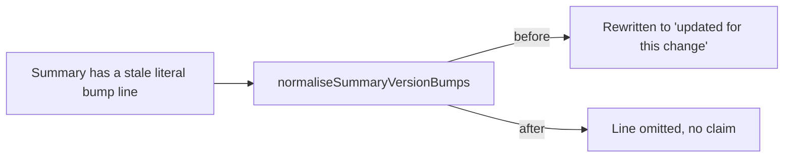

## Summary

The **Project version wording (Issue #3954)** paragraph no longer prescribes a
version-bump line. Its only ready-made text, "`VERSION` updated for this
change", was copied into PRs whose diff changed no version file. The paragraph
now says a summary needs no version-bump line, and keeps the release-evidence
and preserve rules. `normaliseSummaryVersionBumps` no longer manufactures the
same sentence: a stale literal bump line is omitted. Closes #4972.

## Spec

### Intent and Rationale

- The old example presumed every PR bumps a version and made the false claim the
  default. CI auto-increment, a base merge or a deploy-owned release policy
  settles the version after the agent's last push, so no line stays true in
  every case; omitting the line does.
- The loader generated the same sentence from a stale `1.2.3 → 1.2.4` pair, so
  fixing the prompts alone would have recreated the claim in the published PR
  body.

### Essential Design Decisions

- The matching rules of `normaliseSummaryVersionBumps` (scope, headings, code
  blocks, list items, manifest names) are unchanged. Only the action on a match
  changed, from rewrite to omit, so exactly the same lines are touched as
  before.
- A line already worded by the author (including the old durable sentence) is
  left as written: the loader only stops adding claims; it does not police
  author wording, which the issue does not ask for.
- When the omitted line sat between two blank lines, the following blank line is
  dropped so no double blank is left.

### Undiscoverable Facts

- Evidence is from the review-fleet-prs guidance ledger (42 independent PRs sent
  back for a false version-bump line since #3954 closed); the issue lists four
  of them.

## Evidence

Backend and prompt-text change; evidence is the tests below.

Docs read: the three copies of the paragraph (`CODING-STANDARDS.md`,
`prompts/issue/prompt.md`, `prompts/pr_feedback/prompt.md`) are byte-identical.
`grep -rn "updated for this change"` over `CODING-STANDARDS.md`, `prompts/`,
`README.md` and `docs/` (excluding `docs/archive/`) finds nothing at the head.
Related existing rules checked: the "Keep the PR summary true to the head" and
"Describe the final state of the branch" rules in the same files; none asks for
a version line.

## Test Plan

- `worker/deno/tests/pr_summary_loader_test.ts`:
  - Edited
    `loadPrSummary - project bump statements are omitted across later workflow bumps, author wording kept (Issue #3954, Issue #4972)`
    and
    `version normalisation preserves scope and layout across manifest and policy shapes (Issue #3954, Issue #4972)`:
    the expected value changed from the rewritten sentence to the line omitted;
    the author-worded sentence still loads unchanged, and idempotence is still
    asserted.
  - Edited
    `loadCommittedPrSummary - applies version-bump normalisation (Issue #4712)`
    to the omitted-line expectation.
  - Added
    `version normalisation omits a stale literal bump for every manifest name and keeps surrounding prose (Issue #4972)`
    (a deploy-owns-versioning summary: no `Version bump:` or
    `updated for this change`, dependency pin and release evidence preserved
    byte for byte),
    `version normalisation removes a middle-of-document bump line leaving one blank line (Issue #4972)`
    (LF and CRLF),
    `version normalisation removes a list-item bump line between two items (Issue #4972)`,
    `version normalisation removes a final bump line with no trailing newline (Issue #4972)`,
    a 50,000-space hostile-input case for the bump pattern,
    `version normalisation keeps the blank line after a bump list item that follows another item (Issue #4972)`
    and
    `version normalisation keeps the next line after a bump list item that follows a blank line (Issue #4972)`
    (these two pin the blank-line collapse condition at
    `lib/pr_summary_loader.ts:261-262`: each fails when its operand is replaced
    with `true`).
- `worker/deno/tests/pr_body_sync_test.ts`: edited
  `sync - a stale literal version bump is omitted from the body and later workflow version changes need no edit (Issue #3954, Issue #4972)`.
  Removed from `worker/deno/tests/pr_body_sync_test.ts`:
  `assertStringIncludes(body, "the merged commit records the final version")`
  - Required by: "omit the unsupported summary bump line rather than manufacture
    an assertion that the diff changes a version"
  - Replaced by: `assert(!body.includes("Version bump:"))` and
    `assert(!body.includes("updated for this change"))`
- Red check: with `lib/pr_summary_loader.ts` restored to the base version, the
  eight edited or added tests above fail (`87 passed | 8 failed` across the two
  files); with the fix, `95 passed | 0 failed`.
- The tests that keep non-bump prose, dependency pins, code blocks, changelog
  and release evidence are unchanged and still pass.
- Callers of `normaliseSummaryVersionBumps`: `loadPrSummary` and
  `loadCommittedPrSummary` (both covered above); their consumers
  (`pr_body_sync`, `pr_body_reconcile`, `closure_verdict_recovery`,
  `completion_phase`, `fleet_pr_babysitter`) only read the content.
- `./quality.sh < /dev/null`: PASSED (config integration and checkov skipped),
  run after the last code change.
