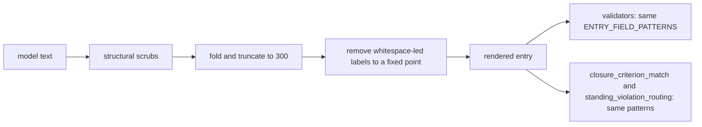

## Summary

The closure-verdict renderer and its validators now read entry fields with one
shared grammar, `worker/deno/lib/closure_entry_grammar.ts`. Cited paths such as
`src/evidence-store.ts`, `docs/reviewer-guide.md` and `lib/reason-codes.ts` now
render unchanged and validate. Text from the model can no longer create, replace
or override a worker-written `evidence:`, `reason:` or `reviewer:` field.
Consolidates #4988. Closes #4977.

## Spec

### Intent and Rationale

- The old scrub (`[A-Za-z]{0,32}(?:evidence|reason|reviewer)\s*[:\-—]+`) deleted
  `evidence-`, `reason-` and `reviewer-` from paths, and the validators' own
  unanchored patterns read the same keywords as fields. Narrowing only the scrub
  would have made the validators misread the surviving paths, so both sides
  change together.
- A label is `evidence`, `reason` or `reviewer` followed by `:`, and it is a
  field only at the entry start or directly after whitespace. A keyword glued to
  a word or path is data. A hyphen or dash is no longer a label separator.

### Essential Design Decisions

- The boundary is start-or-whitespace, a superset of the renderer's `—`
  separator that the issue suggested. `collectListItems` joins nested
  continuation lines with a single space (`- evidence: x`), and existing tests
  pin that form (`acceptance_criteria_gate_test.ts`,
  `label_tail_redos_3186_test.ts`). A strict `—` boundary broke them, and it let
  a field that begins with a dash forge a label. The sanitiser removes every
  whitespace-led label, so the wider boundary costs the renderer nothing.
- The sanitiser truncates to 300 characters first, then removes labels to a
  fixed point (replace, trim, repeat). It is the last step, so no later step can
  create a field. Removing a label can leave another one adjacent
  (`a reviewer: reviewer: met`), which is why one pass is not enough.
- An entry carrying two `reviewer:` fields with different verdicts is read as
  having no verdict, so the gate blocks. Agreeing duplicates keep the verdict.
- The evidence and reason values still run to the end of the entry. That is the
  existing behaviour and is unchanged.

### Undiscoverable Facts

- Under this grammar, model text containing a whitespace-led `reason:` (for
  example "the reason: x") loses the label word. The old scrub removed more.

## Evidence

Backend-only change; no UI files.

Callers of the changed readers: `independent_review_gate.ts`,
`acceptance_criteria_gate.ts`, `closure_criterion_match.ts` (`subjectOf`,
`gapSubject`), `standing_violation_routing.ts` (`citedLocations`) and
`degraded_delivery.ts` (`isPendingMergeCheck`, PR #5060 review) now import the
shared patterns. `reproduction_status_gate.ts` keeps its own `REASON_RE`: it
reads the agent-written reproduction block, not a worker-rendered closure entry.

## Test Plan

- `worker/deno/tests/closure_verdict_test.ts`: 14 new tests through the real
  `parseClosureVerdict`, `renderClosureBlocks` and both validators. They cover
  the three cited paths and underscore paths unchanged, forged `reviewer:`,
  `evidence:` and `reason:` labels in criterion, finding, reason and evidence
  text (worker `missing` verdict retained), nested and reconstructed labels
  including `a reviewer: reviewer: met`, `reviewer_:`, ``reviewer`:``,
  `reviewer#:` and `Xreviewer:`, tab, NBSP, newline and 300-character-cap
  boundaries, the nested continuation form, duplicate reviewer fields, and
  100k-character hostile fields.
- `worker/deno/tests/degraded_delivery_test.ts`: 2 new tests through
  `renderClosureBlocks` and `assessScopeShortfalls`: a pending-CI `partial`
  entry whose evidence cites `lib/reason-codes.ts` (and two similar paths) stays
  a pending merge check with no shortfall; the same entry with failed-CI
  evidence stays a shortfall. Red check: `degraded_delivery.ts` restored to the
  earlier commit → the first test fails (`evidence lib/reason-codes.ts`).
- `worker/deno/tests/closure_entry_grammar_4977_test.ts`: 10 new tests of the
  grammar itself, plus `subjectOf` keeping `reason-codes.ts` whole and
  `citedLocations` reading `src/reason-codes.ts:12` intact.
- Existing tests edited: none; no assertion removed. Only comments were reworded
  (see the comments bullet below), so `git diff origin/main` shows deleted
  comment lines in `closure_verdict_test.ts` and `label_tail_redos_3186_test.ts`
  but no deleted assertion.
- Red checks (a mutation applied, tests run, lib restored): old scrub restored →
  path, `subjectOf` and `citedLocations` tests red; patterns made unanchored
  with `[:\-—]` → 9 tests red; `neutraliseFieldLabels` skipped in
  `sanitiseEvidence` → 3 red, in `sanitiseField` → 8 red; single-pass scrub →
  grammar idempotence test and the adjacent-label render tests red;
  reviewer-ambiguity rule removed → read-back test red.
- `deno task test:unit` at head: `closure_verdict_test.ts` (46 tests at head),
  `closure_entry_grammar_4977_test.ts` (10 tests at head). The existing tests of
  the changed readers (gates, `closure_criterion_match`, `degraded_delivery`,
  `closure_met_check_3766`, `label_tail_redos_3186`,
  `standing_violation_routing`) pass unchanged; `degraded_delivery_test.ts`
  passes with the 2 new tests (`degraded_delivery_test.ts`, 14 tests at head).
- Comments that described the removed unanchored grammar were reworded in
  `closure_verdict_test.ts` (the `Xevidence:` test) and
  `label_tail_redos_3186_test.ts` (header).
- Completeness: the new module is claimed in
  `docs/audits/lib-sweep-coverage/top-up-4977.json`.
- Docs: `docs/workflows/issue-processing.md` (closure-verdict rendering item)
  read and updated. `docs/audits/security-sweep-2242-closure-verdict.md` line 27
  is a point-in-time audit record and still describes the old scrub.
- `./quality.sh < /dev/null` on the code head before the PR #5060 review fix:
  PASSED (config integration and checkov skipped: no config, no checkov); it was
  re-run after that fix (see the last paragraph). An earlier run failed only the
  lib sweep ledger test, fixed by the ledger file above.
  `deno task pr-summary-check`: 0 blocked, 0 not checked.

Not done or not checked: the Spec and Standards reviewer sub-agents were not
dispatched (the issue has no `Acceptance Criteria` heading); the 2242 audit
record is not rewritten. `./quality.sh < /dev/null` was re-run after the PR
#5060 review fix: PASSED (config integration and checkov skipped).
