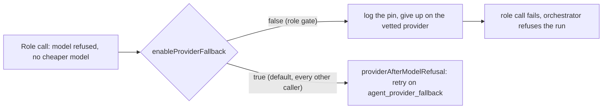

## Summary

External orchestration role calls (manager, executor, reviewer) no longer move
to `agent_provider_fallback` after a model refusal. `RunClaudeOptions` gains
`enableProviderFallback` (default `true`). The role gate's `claudeOptionsFor`
sets it to `false`. With it off, `runRetryLadder` never calls
`providerAfterModelRefusal`, so no other provider is started. It logs
`[provider-fallback] <provider> refused model "<model>" — the caller pinned the
provider, so agent_provider_fallback is not consulted (Issue #4986).` and gives
up on the role's own provider through the existing give-up path. Every other
caller keeps the Issue #4034 switch.

Closes #4986.

## Spec

### Intent and Rationale

- The role's provider is the only one that passed `assertRoleSupported`, the
  subscription/billing preflight and, for Codex, the read-only snapshot guard.
  A switch inside the ladder bypassed all three. The issue requires the switch
  to be prevented before any other provider is invoked, so the fix is in the
  ladder, not a check after the run.
- `enableModelFallback: false` already gated the cheaper-model step. A sibling
  flag in the same options object follows that existing pattern.

### Essential Design Decisions

- The flag defaults to `true`, so non-role callers and the babysitter's
  separate overflow choice (`babysitter_provider_choice.ts`, not touched) keep
  their configured fallback. The role gate is the only caller that sets it
  `false`. A future role-call builder must set it too.
- The Codex #4221 same-provider retry with no `--model` still runs before the
  pin, because it stays on the vetted provider.
- No post-run check of which provider ran was added. The ladder's one
  provider-switch site is now gated, so the call cannot reach another
  provider.

### Undiscoverable Facts

- #4981 owns the sandbox and tool-denial comment wording. This PR rewrote only
  the clause the fix made false ("does not disable the model-refusal
  fallback"). It may overlap textually with #4981's edits in the same
  paragraphs of `docs/ROLE-CONFIGURATION.md` and
  `docs/MANAGER-WORKER-CONTRACT.md`.

## Evidence

Backend only; no UI files.

- Code: `worker/deno/lib/claude_runner.ts` (the `enableProviderFallback`
  option, its read in `runRetryLadder`, the gated `providerAfterModelRefusal`
  call and the `agentProvider` doc comment) and
  `worker/deno/lib/orchestration/issue_run_gate.ts` (`claudeOptionsFor` sets
  it `false`; the module header lists the pin).
- Callers checked: `claudeOptionsFor` is the only builder of role-call options.
  Every other `runClaudeWithRetry` caller leaves the flag unset and keeps the
  switch. The new option has a production setter (`issue_run_gate.ts`) and a
  production reader (`runRetryLadder`).
- Docs updated: `docs/ROLE-CONFIGURATION.md` and
  `docs/MANAGER-WORKER-CONTRACT.md` section 7 (the "does not disable
  model-refusal fallbacks" sentence was false and now states the pin), the
  section 8 "gate never falls back" bullet and the native-split retry-ladder
  bullet (now "non-role run"), `docs/MODEL-AND-CACHING.md` (Issue #4034
  bullet), `docs/PROVIDER-PARITY.md`, `SECURITY.md` and `docs/THREAT-MODEL.md`
  (the provider-selection sentence now adds the pin). Stale `path:line`
  citations in the edited contract sentences now point at the head lines.
- Cited issues (looked up this run): #4034: Fall back to agent_provider_fallback
  when a phase run's model is refused; #4981: Codex `orchestrationRole`
  comments still claim a sandbox that role calls bypass.

## Acceptance Criteria

<!-- vibe-spec-review inputs="diff+issue-body" -->

- **met** — Prevent provider switching before any fallback provider is invoked for an orchestration role call — evidence: `worker/deno/lib/claude_runner.ts` (`runRetryLadder` skips `providerAfterModelRefusal` when `enableProviderFallback` is false), `worker/deno/lib/orchestration/issue_run_gate.ts` (`claudeOptionsFor`) — reviewer: met
- **met** — Through the orchestration gate and real retry-ladder wiring, a role model refusal with a configured fallback returns the appropriate refusal without invoking another provider. — evidence: `worker/deno/tests/orchestration_provider_pin_4986_test.ts::orchestration - a refused manager model does not switch provider (Issue #4986)` — reviewer: met
- **met** — Cover manager, reviewer and executor role calls, and prove a non-role call still follows its configured fallback policy. — evidence: `worker/deno/tests/orchestration_provider_pin_4986_test.ts` (manager, executor and reviewer tests, plus `runClaudeWithRetry - a non-role call still uses agent_provider_fallback (Issue #4986)`) — reviewer: met
- **met** — A read-only role cannot lose its existing guard through provider switching. Required quality/review checks and automatic recovery remain intact. — evidence: the manager and reviewer tests show no Codex invocation, so `call.envelope.provider` is the provider that runs; preflight, `assertRoleSupported`, the snapshot guard and same-provider retries are unchanged; `./quality.sh` passed — reviewer: met
- **met** — #4981 owns the inaccurate sandbox/tool-denial comments; coordinate terminology without duplicating that documentation task. — evidence: `docs/ROLE-CONFIGURATION.md`, `docs/MANAGER-WORKER-CONTRACT.md` (only the fallback clause changed; the sandbox wording was left alone) — reviewer: met
- **unrequested** — `docs/MODEL-AND-CACHING.md` and `docs/PROVIDER-PARITY.md` each gain a sentence naming role calls as the exception to the provider switch — reviewer: unrequested — reason: these manuals describe the Issue #4034 switch, and the coding standards require them to stay true after this change
- **unrequested** — the new `[provider-fallback] … the caller pinned the provider` warn line in `claude_runner.ts` — reviewer: unrequested — reason: it makes the pinned give-up visible to operators, and the tests use it to prove the refusal branch was reached

## Standards Review

<!-- vibe-standards-review inputs="diff+CODING-STANDARDS.md" -->

- **violation** — A Code Change Owes a Docs Change: `SECURITY.md` and `docs/THREAT-MODEL.md` kept the provider-selection sentence without the new pin — evidence: `SECURITY.md:52` — reason: fixed in this diff (both files now state the pin)
- **violation** — stale `path:line` citations in contract sentences this diff edits — evidence: `docs/MANAGER-WORKER-CONTRACT.md:486` — reason: fixed in this diff (`issue_run_gate.ts:118`/`:120`, `claude_runner.ts:3280` and `:3855-3878`)
- **clean** — outcome-based tests with a forbidden-input fixture (configured Codex fallback) and positive controls; no existing test edited; nothing exists only for a test; fail-loud give-up; no secret in the new log line; Australian English; no persisted shape, path, workflow or commit-safety surface touched. The reviewer found no "by review only" rule this diff touches. Optional notes taken: wrapped the long comment in `issue_run_gate.ts`, added the pin to its module header and to the `agentProvider` doc comment.

## Test Plan

- New: `worker/deno/tests/orchestration_provider_pin_4986_test.ts`. Each role
  test runs `runOrchestratedIssueRun` with the real `runClaudeWithRetry` and a
  path-named stub agent. The stub records its argv, refuses the role's model
  as Claude, and succeeds as Codex (`exec`). The policy is
  `fallback: ["codex"]`. Assertions: the run fails, no `exec` invocation, the
  refused model was requested, and the pin was logged. The executor and
  reviewer tests also assert that the earlier role ran first. The non-role
  control calls `runClaudeWithRetry` directly with the same policy and asserts
  that an `exec` invocation happened. It pins existing behaviour and is green
  on base by design.
- Red on base: with `claude_runner.ts` and `issue_run_gate.ts` restored from
  `origin/main`, `deno task test:unit tests/orchestration_provider_pin_4986_test.ts`
  gave `FAILED | 1 passed | 3 failed` (the three role tests; a Codex `exec`
  ran in each).
- Green on head:
  `deno task test:unit tests/orchestration_provider_pin_4986_test.ts tests/claude_runner_provider_fallback_4034_test.ts tests/orchestration_3642_gate_test.ts tests/codex_model_adaptation_test.ts`
  passed. `deno check`, `deno fmt --check` and `deno lint` of the changed
  source files were clean. `deno task check:manifests` passed.
- `./quality.sh < /dev/null` gave `Result: PASSED (with skipped checks)`. The
  gate itself skipped config integration (no `.config.json`) and checkov (no
  binary).
- Not checked: a live external-orchestration run on a host with
  `agent_provider_fallback` configured.
