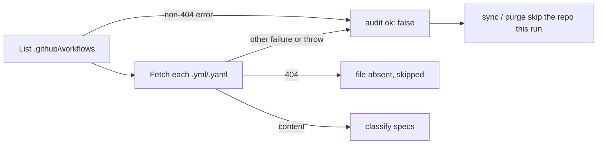

# PR Summary — Issue #5009

## Summary

`auditRepoWorkflows` used to drop a listed workflow file when its content fetch
failed. A non-success `gh api` result was ignored, and a thrown error was
swallowed, so the audit still returned `ok: true` and reported the specs matched
only in that file as missing. A transient 502 or a rate limit could therefore
make `setup workflow-sync` file a spurious "Add … workflow" issue. Now a failed
content fetch fails the audit with an error that names the file and quotes the
cause, just as a failed listing already does. Closes #5009.

- `worker/deno/lib/workflow_auditor.ts`:
  - `fetchWorkflowContent` returns `ok: false` for any failure other than a 404,
    with the error `Failed to fetch workflow <file> for <repo>: <stderr>`. A 404
    resolves to `undefined`, meaning the file is absent.
  - The `auditRepoWorkflows` loop returns that error. It also returns a thrown
    error as `Failed to fetch workflow <file> for <repo>: <message>`, where it
    used to skip it.
  - The 404 test is now one helper, `isGhNotFound`, shared by the listing read,
    the content read and the Dependabot config read.

## Spec

### Intent and Rationale

- An incomplete content map must not be classified, because a missing file reads
  as a missing spec and that becomes a filed issue. The audit now fails and every
  caller already skips the repository on `ok: false`, the same way it handles a
  failed listing (Issue #1829).

### Essential Design Decisions

- The issue suggests failing on any failed fetch, "or at least fail on any
  non-404". I chose the non-404 form. A 404 on a file the listing just named
  means the file was deleted between the two calls, so treating it as absent
  matches the listing's and the Dependabot read's 404 rule. Any other failure,
  or a throw, fails the audit.
- The 404 rule now lives in one helper, `isGhNotFound`, so the three reads
  cannot drift apart. Its regex is unchanged.

### Undiscoverable Facts

- None.

## Evidence

This is a backend/CLI-only change: no UI file is touched.

- The new auditor tests in `worker/deno/tests/workflow_auditor_test.ts` were run
  against the unfixed code first. The run ended `FAILED | 69 passed | 2 failed`:
  the 502 test and the thrown-error test both failed at their `result.ok === false`
  assertion (actual `true`). Both pass after the fix. The 404 test passed before
  the fix as well, because it pins behaviour that was already there.
- The workflow-sync test in `worker/deno/tests/setup_workflow_sync_test.ts` was
  red with the base-branch `workflow_auditor.ts` restored
  (`FAILED | 65 passed | 1 failed`) and green at the head (66 passed, 0 failed).
- The auditor fix commit was covered by these unit-test runs, all passing:
  `workflow_auditor_test.ts`, `workflow_auditor_local_path_test.ts`,
  `workflow_auditor_local_path_fallback_test.ts`,
  `workflow_alternative_groups_regression_test.ts`,
  `setup_workflow_sync_test.ts`, `purge_stale_workflow_issues_test.ts`,
  `workflow_sync_actions_test.ts` and `spawn_timeout_bounds_1228_test.ts`
  (200 passed, 0 failed).
- `./quality.sh < /dev/null` passed on the fix commit `7739545a`, including the
  full Deno test, lint, type-check and fmt stages. Two checks were skipped by the
  host: "config integration" (`deno or .config.json not available`) and
  "checkov" (no checkov binary or image; the CI checkov job stays
  authoritative). The later commit adds only the workflow-sync test. That file
  passed on its own, and `deno fmt`, `deno lint` and `deno check` were clean.

Callers of `auditRepoWorkflows` checked:

- `syncWorkflowsForRepo` (`worker/deno/setup/workflow_sync.ts`): it returns
  `ok: false` and raises no issues. This is covered by the new workflow-sync test.
- `purgeStaleWorkflowIssuesForRepo`
  (`worker/deno/lib/purge_stale_workflow_issues.ts`): it returns
  `Workflow audit failed: …` and closes nothing. This is covered by the existing
  test `purgeStaleWorkflowIssuesForRepo - surfaces audit errors via Result type`.
- `workflowSyncActionReferences` (`worker/deno/lib/workflow_sync_actions.ts`):
  it returns a fault naming the cause. This is covered by the existing test
  `workflowSyncActionReferences - a failed workflow audit is a fault naming the cause, never a throw (Issue #4448)`.

The only issue number this diff adds as provenance:

- #5009: Workflow auditor silently drops a workflow file whose content fetch
  fails, so a transient API error files a spurious 'Add … workflow' request

## Test Plan

Added to `worker/deno/tests/workflow_auditor_test.ts`:

- `workflow_auditor - returns error when a listed workflow's content fetch fails with non-404 (Issue #5009)`.
  The listing names `gitleaks.yml` and its content fetch returns
  `gh: HTTP 502: Bad Gateway`. The test asserts `ok === false` and that the error
  contains `gitleaks.yml` and the cause text `HTTP 502: Bad Gateway`. Positive
  control: the same fixture with readable content gives `ok === true`, with
  `gitleaks` in `present`.
- `workflow_auditor - returns error when a workflow content fetch throws (Issue #5009)`.
  The runner throws `connection reset` for that file only. The test asserts
  `ok === false` and that the error names both the file and the cause.
- `workflow_auditor - a listed workflow that 404s on fetch is treated as absent (Issue #5009)`.
  The test asserts `ok === true` with `gitleaks` in `missing`. It pins the 404
  rule, which was also green on the base branch.

Added to `worker/deno/tests/setup_workflow_sync_test.ts`:

- `syncWorkflowsForRepo - a transient workflow content fetch failure files no issue (Issue #5009)`.
  This is the issue's failure scenario through the production sync entry point.
  A 502 on `gitleaks.yml` gives `ok === false`, 0 issues created, and an error
  that names the file and the cause. Control: the same fixture with a 404 gives
  `ok === true` and exactly one Gitleaks issue filed.
- `buildMockRunner` gained an optional `workflowContentFailures` map. Existing
  tests do not set it, so their behaviour is unchanged.

No existing assertion was removed or edited. The existing tests' mocks answer
unlisted content fetches with a 404 or with success, so none of them now stops
at the new failure. All of them passed in the files listed under Evidence.

Docs: I grepped `README.md` and `docs/` (outside `docs/archive/`) for
`workflow_auditor`, `1829` and the content-fetch behaviour. The only hit is
`docs/SUPPLY-CHAIN-READINESS-SCAN.md`, and it describes visibility scoping,
which this change leaves true. The `workflow-sync` row in `docs/SETUP.md` does
not describe audit-failure handling. The doc comments updated are the ones on
`fetchWorkflowContent`, the `auditRepoWorkflows` `@returns` line, and the loop
comment.

Not checked: checkov and config integration were skipped by the host, as listed
under Evidence. The full gate was not re-run after the commit that only adds
the workflow-sync test.
