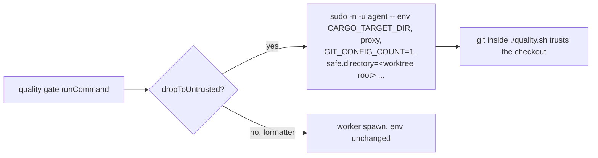

# PR Summary — Issue #5011

## Summary

The quality gate's `spawnRepositoryCommand`
(`worker/deno/lib/quality_gate_phase.ts`) drops the gate runner (`./quality.sh`)
to the `agent` account through `sudo`. It used to carry only the cargo target
and the egress proxy in argv. The `agent` account has no `~/.gitconfig`, so any
git command inside the gate refused the worker-owned checkout with
`fatal: detected dubious ownership` and exit 128. A dropped spawn now also
carries `gitSafeDirectoryEnv(options?.cwd ?? Deno.cwd())`, the same three
entries `runRepositoryCommand` in `untrusted_gate_spawn.ts` already carries
(Issue #4927). A spawn run as the worker, such as a formatter, still carries
nothing. Closes #5011.

## Spec

### Intent and Rationale

- The issue names this exact fix. Reusing `gitSafeDirectoryEnv` keeps the
  quality gate and the milestone gates on a single rule for which directory is
  trusted, which is the worktree root and never `*`.

### Essential Design Decisions

- The entry is added only when `dropToUntrusted` is true. `carryEnvThroughSudo`
  leaves an argv without `sudo` unchanged anyway, and a worker spawn already has
  the worker's git config.
- When the caller passes no `cwd`, the process cwd is used. That is the
  directory `./quality.sh` resolves against, so it is the checkout.

### Undiscoverable Facts

- This host can run `sudo -n -u agent`, so the real-sudo tests ran here rather
  than returning early.

## Evidence

This is a backend-only change.

- **Red before the fix:** the new real-sudo tests in
  `worker/deno/tests/quality_gate_git_safe_directory_5011_test.ts` failed
  against the unfixed `quality_gate_phase.ts` (1 passed, 2 failed). Both git
  tests failed with exit 128 instead of 0, and this was the output:
  `fatal: detected dubious ownership in repository at '/tmp/issue-5011-sub-…'`.
  The `id -un` control passed, which shows that the command really runs as
  `agent`.
- **Green after the fix:**
  - The new test file passes (3 passed).
  - `quality_gate_credentials_4705_test.ts`, `quality_gate_phase_test.ts` and
    `untrusted_gate_spawn_test.ts` pass together (152 passed, 0 failed).
- **Full gate:** `./quality.sh < /dev/null` passed on commit `ec7cb9f5`. Two
  checks were skipped by the host:
  - config integration: `deno or .config.json not available`.
  - checkov: no checkov binary or image on this host. The CI checkov job is
    still the authoritative check.
- **Docs:** I updated the bullet in `docs/CONTAINER.md` that covers
  safe.directory and dubious ownership. It used to say that the quality gate's
  `./quality.sh` "is not covered (Issue #5011)". It now says that the quality
  gate's spawn carries the same entries.
  - I grepped `README.md` and `docs/` (excluding `docs/archive/`) for
    `safe.directory`, `dubious` and `5011`. The only other hits are in
    `docs/CONTAINMENT.md`, and they describe the worker's own
    `GIT_CONFIG_GLOBAL`. This change leaves them true.
  - In source, the doc comments on `carryEnvThroughSudo` and
    `spawnRepositoryCommand`, and the inline comment at the call site, now name
    the git entry.

The only issue numbers this diff adds as provenance:

- #5011: Quality-gate commands dropped to the agent account carry no git
  safe.directory, so git inside ./quality.sh fails with dubious ownership

## Test Plan

Added `worker/deno/tests/quality_gate_git_safe_directory_5011_test.ts`. All
three tests use the real `createDefaultDeps({}).runCommand` and the real sudo
drop, and return early on a host that cannot drop to `agent`.

- `real sudo: the quality-gate runner runs as the agent account (Issue #5011)`:
  a positive control. `id -un` prints `UNTRUSTED_USER`, so the git tests below
  exercise the dropped path.
- `real sudo: git run by the quality-gate runner works in a worker-owned checkout (Issue #5011)`:
  `git rev-parse --git-dir` in a fresh `git init` checkout exits 0, and the
  output does not contain `dubious ownership`.
- `real sudo: git run by the quality-gate runner works from a subdirectory of the checkout (Issue #5011)`:
  `git rev-parse --show-toplevel` run from `crates/app` exits 0 and prints the
  checkout root. This proves the entry names the worktree root, not the
  subdirectory.

No existing test was edited. None asserts the exact argv of a dropped
quality-gate spawn.

Callers checked: `spawnRepositoryCommand` is reached through
`createDefaultDeps().runCommand` (dropped) and the formatter spawn (not
dropped). Only the dropped path gains the entry.

Not checked: the config integration and checkov checks were skipped by the host,
as listed under Evidence. Otherwise none.
