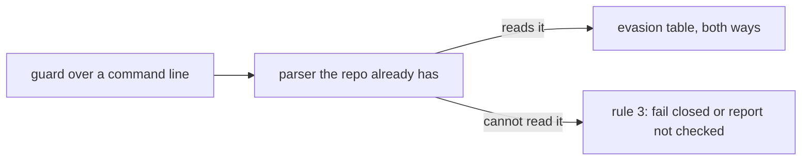

# PR Summary — Issue #5012

## Summary

Rewrote the Issue #3568 sentence in item 1 (**Evasion table**) of **Writing a
gate over text** in `CODING-STANDARDS.md`, using the passage the issue
proposes. The old sentence asked a guard over another tool's command line to
handle "every flag spelling and placement the parser accepts". For a shell
`run:` line that list has no end. The new sentence points at the parser the repo
already has: `normaliseGhArgs` in `worker/deno/lib/gh_flag_parser.ts` for `gh`,
with the rule registered in `worker/deno/tests/support/gh_guard_conformance.ts`.
It also says that a construct that parser does not read is unread input under
rule 3 (**No silent pass on unread input**). "Run the table both ways:" and
everything after it are unchanged. Closes #5012.

## Spec

### Intent and Rationale

- Three fleet PRs (#3864, #4857, #4979) were sent back repeatedly for spellings
  their own hand-written readers missed. The sentence sent authors to the
  tool's grammar instead of the repo's existing parser and rule 3.

### Essential Design Decisions

- The passage is the issue's own text. I added only `(Issue #5012)` as
  provenance on the new rule-3 sentence. It adds no gate, check or summary
  obligation.
- The `gh --verbose` / `GH_DEBUG=api` instruction is removed, as the issue asks.

### Undiscoverable Facts

- The passage now sits at lines 1178–1186, not 1121–1129 as the issue says,
  because the file has grown since the issue was written.

## Evidence

This is a documentation-only change to `CODING-STANDARDS.md`.

- I grepped `CODING-STANDARDS.md`, `prompts/*/prompt.md`, `worker/deno/lib/`,
  `.claude/` and `docs/` (excluding `docs/archive/` and `docs/audits/`) for
  `flag spelling`, `command line or request`, `GH_DEBUG` and `gh --verbose`.
  This is the only place the rule is stated. `SECURITY.md` and
  `docs/THREAT-MODEL.md` describe the `gh` guard's own normalisation and
  conformance table, and this change leaves them true.
- Related existing rules I checked:
  - Rule 3 of the same section, which the new sentence points to.
  - **Call existing code — never copy it** in `prompts/issue/prompt.md`, which
    the new sentence agrees with.
  - The issue prompt's one-line summary of **Writing a gate over text**, which
    still matches.
- I applied the new rule to this PR's own diff. The diff adds no gate or
  parser, so the rule has nothing to flag.
- The only docs test that reads this passage is
  `worker/deno/tests/text_gate_matcher_3149_test.ts`, which pins "Run the table
  both ways". The new text keeps that phrase.

Issue numbers this diff adds as provenance:

- #5012: Rewrite the #3568 command-line guard sentence: 'every flag spelling
  the parser accepts' has no end for a shell line, so fleet scanners grow
  hand-written parsers one review round at a time (VibeCoder#3864, #4857,
  #4979)

## Test Plan

No test was added or edited.

- `deno test --allow-all tests/text_gate_matcher_3149_test.ts`, run from
  `worker/deno`: 8 passed, 0 failed.
- `deno fmt --check CODING-STANDARDS.md` fails both on this branch and on the
  unmodified base copy. The file was already unformatted before this change,
  and I did not reformat it.
- `./quality.sh < /dev/null` with a 1500 s bound, run on commit `e23490db`
  with this summary already written: every stage it reported passed, including
  `markdownlint`, `mermaid`, `semgrep`, `gitleaks` and `deno tests` (1403.3 s).
  Config integration and checkov were skipped by the host. The bound stopped
  the gate after `deno tests`, so any stage after it did not run. That run
  used up the budget for a re-run.

<!-- vibe-quality-gate-skipped reason="the 1500 s bound stopped ./quality.sh after its deno tests stage passed; stages after it did not run, and the run budget could not cover a re-run" -->
