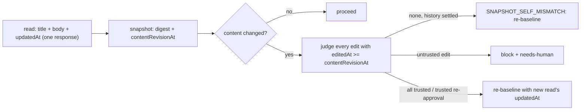

# PR Summary — Issue #5018

## Summary

The content-integrity gate used to judge edits against `capturedAt`, the
worker-clock time the snapshot was written. An edit could land between the
content read and the capture, or be hidden by a worker clock ahead of GitHub's.
Such an edit was treated as pre-snapshot, and `[SNAPSHOT_SELF_MISMATCH]`
re-baselined it without checking the editor.

Each snapshot now records `contentRevisionAt`: GitHub's `updatedAt` from the
same read that produced the hashed title and body. The gate judges every edit
stamped at or after that value. The #3963 encoding migration now keeps the
snapshot's original boundary. A snapshot with no revision judges every recorded
edit. Closes #5018.

## Spec

### Intent and Rationale

- An edit missing from the hashed bytes happened after the read that produced
  them, so GitHub stamps it at or after that read's `updatedAt`, on GitHub's own
  clock. Using that value as the boundary ties the boundary to the bytes. The
  cache age of the listing and the worker clock no longer affect it, and no skew
  margin is needed.
- `updatedAt` is already in the repository listing (`fetchAllIssues`), so the
  scan pays no extra call. The pickup read (`fetchIssueData`) and the scan's
  live fallback (`gh issue view`) now request `updatedAt` too.

### Essential Design Decisions

- The filter is `editedAt >= contentRevisionAt`. An edit stamped in the same
  second as the read is judged again, which errs towards blocking. `updatedAt`
  also moves on comments and labels. That only makes the boundary later than the
  last edit reflected in the bytes, never earlier than an edit the bytes are
  missing.
- `capturedAt` is kept, but only as the write time for the 7-day age cleanup.
  The encoding migration (`reEncodeContentSnapshot`) rewrites only the digest,
  the encoding stamp and `dependsOn`. It keeps `capturedAt`, `issueAuthor` and
  `contentRevisionAt` as they were.
- Persisted shape: `contentRevisionAt` is a new optional field, and old-shape
  snapshots are read as they are (no key bump). A snapshot without it, or one
  captured from a read with no usable `updatedAt`, has an unknown boundary. The
  gate then logs `[SECURITY] [CONTENT_REVISION_UNKNOWN]` and uses boundary 0, so
  every recorded edit is judged. Any truncated history window then stays
  unsettled and blocks. `SNAPSHOT_SELF_MISMATCH` applies only when GitHub
  records no edit at all.
- A listing row without a usable `updatedAt` is read live rather than hashed
  with no revision. A trusted re-approval must post-date the content revision
  instead of `capturedAt`, and it must still post-date the newest edit.

### Undiscoverable Facts

- `gh issue view 5018 --repo stSoftwareAU/VibeCoder --json updatedAt,title`
  returned `"updatedAt":"2026-11-15T16:49:40Z"`. That was the time of the most
  recent comment edit, so `updatedAt` moves on comment activity as well as
  content edits. The code relies only on `updatedAt` never being earlier than an
  edit the read reflects. I did not edit an issue to watch a rename or body edit
  bump `updatedAt` live, because that would change shared state. GitHub's
  GraphQL `Issue.updatedAt` is documented as the time the object was last
  updated.
- Legacy snapshots age out under the existing 7-day cleanup. Until then, a
  changed legacy snapshot is judged against its whole edit history, so an old
  untrusted edit can escalate once.

## Evidence

This is a backend change.

- `worker/deno/lib/content_approval_tracker.ts`:
  - adds `ContentSnapshot.contentRevisionAt`;
  - adds the required `contentRevisionAt` parameter to `captureContentSnapshot`;
  - adds `reEncodeContentSnapshot`;
  - the `changed` verification result now carries `contentRevisionAt` in place
    of `capturedAt`.
- `worker/deno/lib/work_on_content_integrity.ts`: `resolveContentIntegrity`
  takes a required `contentRevisionAt`. Its `changed` branch uses `boundaryAt`
  for the history-window settlement, the judged-edit filter and the re-approval
  timing. The scan reads `updatedAt` from the listing row or from the live
  `gh issue view --json title,body,updatedAt`.
- `worker/deno/lib/pickup_content_integrity.ts` (`issueUpdatedAt`),
  `worker/deno/lib/issue_data.ts` (`updatedAt` in `--json`), and both pickup
  callers, `worker/deno/commands/work_on_issue.ts` and
  `worker/deno/lib/run_core_production_deps.ts`, pass the read's `updatedAt`.
  `toUnixSeconds` in `worker/deno/lib/issue_edit_actor.ts` is now exported and
  reused rather than copied.
- Callers checked for the new required values:
  - every `resolveContentIntegrity` caller (scan
    `verifyWorkOnContentIntegrityDetailed`, pickup
    `verifyPickupContentIntegrity`);
  - every `captureBaselineOrBlock` site (no-snapshot, re-approval,
    trusted-editor, self-mismatch);
  - both `verifyPickupContentIntegrity` callers.

  The type checker names any that were missed.
- Docs: `SECURITY.md`:
  - the "Every editor counts" bullet;
  - the content-revision sub-bullet, which replaces the residual-risk text #4948
    added;
  - the "Re-approval" bullet;
  - the encoding-migration bullet.

  I grepped `SECURITY.md`, `docs/THREAT-MODEL.md` and `docs/*.md` for
  `capturedAt`, `SELF_MISMATCH` and `self-mismatch` on the final head. Only the
  updated `SECURITY.md` passages match. No other doc needed a change.
- Issue numbers this diff adds as provenance:
  - #5018: Content snapshot capturedAt is stamped at write time on the worker
    clock, so an edit made between the content read and the capture is later
    re-baselined by SNAPSHOT_SELF_MISMATCH

## Test Plan

- Added
  `worker/deno/tests/work_on_content_integrity_revision_boundary_5018_test.ts`,
  with 8 tests:
  - (a) a cached listing older than the snapshot write cannot hide a later
    untrusted edit;
  - (b) an edit between a live read and the capture is judged after a trusted
    re-baseline;
  - (c) a worker clock ahead of GitHub's does not bless an untrusted edit;
  - (d) the encoding migration keeps the original boundary, and a later
    untrusted edit is judged at pickup;
  - (e) a genuinely unchanged self-mismatch still recovers automatically;
  - (f) a legacy snapshot judges the whole history: an old untrusted edit
    blocks, no recorded edit proceeds, and a truncated window blocks;
  - (g) a trusted re-approval re-baselines to the new revision;
  - (h) a listed row without `updatedAt` and with stale bytes is read live: the
    fake `gh issue view` honours `--json` and returns only the requested fields,
    the live content differs from the cached row's, and an untrusted edit sits
    at the live revision. The baseline's revision is the live `updatedAt`, and a
    later pickup of the live content proceeds. Stale bytes paired with the live
    revision hash differently, so that pickup would judge the edit and block. I
    confirmed this by pairing the bytes wrongly in the live fallback: (h)
    failed.

  The tests assert the decisions the worker reaches and the persisted baseline.
  They do not assert the mocked `gh` call log, call count or `--json` text.
- Result: 8 passed (re-run after the (h) rewrite). Against the base production
  files, the file does not type-check (the new parameters do not exist), and
  with `--no-check` all 8 tests fail.
- Existing tests updated for the new required parameters. Each keeps its
  previous boundary:
  - the `captureContentSnapshot` calls pass `Math.floor(Date.now() / 1000)`;
  - the `setCapturedAt`-style helpers also set `contentRevisionAt`;
  - raw-seeded snapshots in the encoding, label-candidate and low-priority tests
    gain `contentRevisionAt`;
  - the pickup tests pass `issueUpdatedAt`;
  - `worker/deno/tests/work_on_content_integrity_listed_content_test.ts` gives
    its listed content an `updatedAt`.
- Removed from `worker/deno/tests/content_approval_encoding_test.ts`:
  `assertEquals(result.capturedAt, 1_760_000_000);`
  - Replaced by: `assertEquals(result.contentRevisionAt, 1_760_000_000);`
- Removed from `worker/deno/tests/work_on_content_integrity_encoding_test.ts`:
  `snapshot.capturedAt > SNAPSHOT_AT_UNIX,`
  - Required by: "Preserve the original trust boundary during an encoding-only
    migration of unchanged content."
  - Replaced by: `snapshot.capturedAt` asserted equal to `SNAPSHOT_AT_UNIX`, in
    the same test, "a v1-stamped snapshot over unchanged content proceeds and is
    re-baselined under the current encoding (Issue #3963)".
- Kept guards: the `SNAPSHOT_SELF_MISMATCH` re-baseline still runs only after
  `unsettledHistoryWindows` and the editor lookup. It now uses the revision
  boundary, and with a legacy boundary of 0 any truncated window is unsettled
  (case f). Worker record-block stripping and the `dependsOn` check are
  unchanged and covered by
  `worker/deno/tests/content_approval_deferral_edit_test.ts` and
  `worker/deno/tests/content_approval_depends_on_test.ts`.
- `./quality.sh < /dev/null` on the head before this summary: passed, with
  `config integration` and `checkov` skipped by the host. Within it,
  `deno tests` passed (863.7 s).
