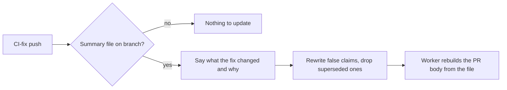

## Summary

The CI-fix prompt's **Keep the PR summary true to the head.** rule only applied
when the fix made something in the committed summary false. A purely additive CI
fix, such as a dependency replaced to clear an audit advisory or a race fixed in
an unrelated test, made nothing false, so the summary stayed silent about it and
the PR came back as `summary_incomplete`. The opening sentence now tells the
agent to update the summary on every push so it describes the head commit: say
what the fix changed and why (a test it adds or edits goes in the Test Plan),
rewrite any claim it made false, and drop what it superseded. The list of
triggers that narrowed the rule is gone. The rest of the paragraph is unchanged.
`CODING-STANDARDS.md` gains one sentence saying the same thing for CI-fix runs.

Closes #5023.

## Spec

### Intent and Rationale

- The rule's condition now matches its heading. The old condition only checked
  claims the summary already made, so nothing asked for the fix itself to be
  described.
- I reworded the existing paragraph rather than adding a check or gate, as the
  issue proposes. No change to `pr-summary-check` or auto-merge.

### Essential Design Decisions

- The two additive examples from the issue's evidence table are named in the
  rule, so a literal reader cannot read "no claim became false" as "leave the
  summary alone".
- The scope is the CI-fix prompt only. `prompts/pr_feedback/prompt.md` keeps its
  deliberate "only where this push made it false" scope (#3143), which is a
  different surface with its own drift check. The new `CODING-STANDARDS.md`
  sentence names CI-fix runs only, so it does not contradict that scope.

### Undiscoverable Facts

- The failure was seen on NEAT-AI-Explore#673 and on a private fleet PR (the
  issue's evidence table). In both cases the CI-fix reply comment explained the
  change, but the summary file the worker rebuilds the PR body from did not.

## Evidence

This is a prompt and docs change only (no UI and no runtime code).

- `prompts/ci_fix/prompt.md`: I replaced the first sentence of the "Keep the PR
  summary true to the head." paragraph in § Fixing the Failure. The sentences
  after it are byte-for-byte unchanged.
- `CODING-STANDARDS.md` § PR Summary and Evidence: I appended one sentence after
  "Any later commit on the branch … refreshes the summary in the same push when
  it changes what the summary says."
- Related rules I checked:
  - `prompts/pr_feedback/prompt.md` lines 13 and 77: kept on purpose, as above.
  - `prompts/merge_conflict/prompt.md` item 5: covers merges that supersede part
    of the change, not CI-fix runs.
  - The marker-less description paragraph that follows in `ci_fix` (#4893:
    CI-fix leaves a bot PR's title and description claiming a bump its fix
    reverted): a different surface, untouched.
  - The `CODING-STANDARDS.md` sentence I extended.

  None contradicts the new wording.
- I applied the rule to this PR's own diff: this summary says what the change
  did and why, and lists the test it adds. I found nothing to fix.
- Docs sweep: I grepped `README.md`, `docs/` (excluding `docs/archive/`),
  `prompts/`, `CODING-STANDARDS.md` and `worker/deno/lib` for "invalidates
  anything it says". The only remaining hit is the `pr_feedback` paragraph, kept
  as explained above.
- Issue numbers cited:
  - #5023: Reword the CI-fix prompt's summary rule
  - #4893: CI-fix leaves a bot PR's title and description claiming a bump its
    fix reverted
  - #3143: the earlier scope change behind the `pr_feedback` wording; cited from
    that prompt's existing text, not added as provenance here

## Test Plan

- Added `worker/deno/tests/ci_fix_summary_additive_5023_docs_test.ts`:
  - The first test is scoped to the "Keep the PR summary true to the head."
    paragraph in § Fixing the Failure of `prompts/ci_fix/prompt.md`. It requires
    "say what your fix changed and why", "rewrite any claim it made false",
    "purely additive fix" and `git diff <base>...HEAD`, and forbids "invalidates
    anything it says".
  - The second test checks that `CODING-STANDARDS.md` § PR Summary and Evidence
    has "A CI-fix run also records what its fix changed".
- Red against base: I restored the base-branch `prompts/ci_fix/prompt.md` and
  `CODING-STANDARDS.md` and kept the new test. `deno task test:unit` reported 0
  passed, 2 failed. At the head, both pass.
- Existing drift tests over the edited paragraph and section all passed:
  - `worker/deno/tests/marker_less_body_rebuild_4515_docs_test.ts`
  - `worker/deno/tests/pr_body_matches_final_diff_3015_test.ts`
  - The eight tests that read `CODING-STANDARDS.md` § PR Summary and Evidence,
    for example `worker/deno/tests/twinned_rule_3732_docs_test.ts` and
    `worker/deno/tests/pr_summary_check_prompt_3423_test.ts`

  Together with the new file: 52 passed, 0 failed.
- Edited `worker/deno/tests/pr_summary_final_state_2879_test.ts`: the
  `${type} - keeps the PR summary true to the head` loop now gives each type its
  own extra pins. `pr_feedback` still pins "known defect"; `ci_fix` no longer
  does. The three shared pins and the test names are unchanged.
- Removed from `worker/deno/tests/pr_summary_final_state_2879_test.ts`:
  `"known defect",` (for `ci_fix` only)
  - Required by: "drop the enumerated trigger list that narrows it"
- The first full `./quality.sh` run failed only on that pin
  (`ci_fix - keeps the PR summary true to the head`). After the edit, the file
  and the new test passed (5 passed, 0 failed).
- Full `./quality.sh` after that edit: PASSED with skipped checks, the deno
  tests passing in both the parallel and serial passes. The two skipped stages
  were config integration and checkov, which this host cannot run; CI still runs
  checkov.
