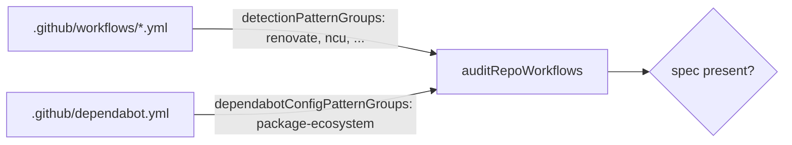

# PR Summary — Issue #5026

## Summary

The workflow-file detection groups of the three `dependabotConfig` specs
(`npm-dependency-updates`, `java-dependency-updates`,
`java-gradle-dependency-updates`) no longer contain `package-ecosystem: <eco>`
entries. Dependabot reads only `.github/dependabot.yml` / `.yaml`, so a
Dependabot config saved under `.github/workflows/` no longer makes these specs
present. Workflow sync now files the "Add … Dependency Updates" request for it,
and purge no longer closes that request as satisfied. Closes #5026.

- `worker/deno/lib/workflow_definitions.ts`: the `package-ecosystem` entries
  were removed from the three `detectionPatternGroups`. They remain in
  `dependabotConfigPatternGroups`, which the auditor checks only against the
  real config. In a workflow file the specs are now satisfied only by real
  update tooling (`renovate`, `npm-check-updates`, `ncu`,
  `versions-maven-plugin`, `gradle-versions-plugin`). The
  `dependabotConfigPatternGroups` doc comment and the comments on the specs now
  state this rule.
- `docs/EXTENDING.md`: the Dependabot paragraph now says that a
  `package-ecosystem` entry under `.github/workflows/` does not count.

## Spec

### Intent and Rationale

- A `package-ecosystem:` line in a workflow file can only be a misplaced
  Dependabot config or a comment, and Dependabot never acts on either. Counting
  it hid a missing dependency-update setup, the same gap-hiding as #4903.

### Essential Design Decisions

- I took the issue's main suggestion: drop the entries. I did not take the
  optional one, which was to have workflow sync flag a misplaced config. With
  the spec now `missing`, the filed issue already names
  `.github/dependabot.yml` as the path, so the misplaced file is reported
  without a new code path.
- A new definitions test applies the rule to every `dependabotConfig` spec, so
  a future Dependabot spec cannot add the entries back to its workflow-file
  groups.

### Undiscoverable Facts

- PR #5024 (merged) had already moved the npm spec onto
  `package-ecosystem: npm` patterns. This PR removes those patterns from the
  workflow-file group.

## Evidence

This is a backend/CLI-only change: no UI file is touched.

- I ran the tests first, against the unfixed `workflow_definitions.ts`:
  `deno task test:unit tests/workflow_auditor_test.ts tests/workflow_definitions_test.ts`
  ended `FAILED | 137 passed | 8 failed`. The failures were the 3 per-spec
  template tests, the 3 npm `package-ecosystem` workflow tests, the edited Java
  split test and the new definitions invariant test. After the fix the same
  command ended `ok | 145 passed | 0 failed`.
- Related suites `setup_workflow_sync_test.ts`,
  `purge_stale_workflow_issues_test.ts`,
  `workflow_template_audit_conformance_test.ts` and `dependabot_config_test.ts`:
  126 passed, 0 failed.
- `./quality.sh < /dev/null` passed at head `038f2ad4`. Two checks were skipped
  on this host: config integration (`deno or .config.json not available`) and
  checkov (no binary).

Issue number this diff adds as provenance:

- #5026: Dependency-update specs count a Dependabot configuration saved under
  .github/workflows/ as present, though Dependabot never reads it there

## Test Plan

Added:

- `worker/deno/tests/workflow_auditor_test.ts`: `workflow_auditor - <id>'s own
  template saved as .github/workflows/<suggestedFilename> leaves the spec
  missing (Issue #5026)`, one test for each of the three spec ids.
  - Fixture: the spec's own template served under `.github/workflows/`, with no
    `dependabot.yml`.
  - Assertions: the spec is in `missing`, and in neither `present` nor
    `partial`.
  - Controls: the template contains `package-ecosystem:`. The same template
    served as `.github/dependabot.yml` makes the spec present, with `foundIn`
    `.github/dependabot.yml`.
- `worker/deno/tests/workflow_definitions_test.ts`: `workflow_definitions - no
  dependabotConfig spec matches a workflow file on a package-ecosystem entry
  (Issue #5026)`.
  - Assertions: no pattern in any `dependabotConfig` spec's
    `detectionPatternGroups` names `package-ecosystem`, and every
    `dependabotConfigPatternGroups` pattern does.
  - Control: the filtered spec set contains the three ids.

Edited:

- `worker/deno/tests/workflow_auditor_test.ts`: the loop over `npm`, `"npm"`
  and `'npm'` is renamed to `workflow_auditor - a workflow file carrying
  package-ecosystem: ${ecosystem} leaves npm-dependency-updates missing (Issue
  #5026)`. The fixture is unchanged.
  - Removed from `worker/deno/tests/workflow_auditor_test.ts`: `assertEquals(status?.foundIn, ".github/workflows/deps.yml");`
    - Required by: "Drop the `package-ecosystem: <ecosystem>` entries from the workflow-file `detectionPatternGroups` of all three specs."
  - Removed from `worker/deno/tests/workflow_auditor_test.ts`: `assertEquals(status?.missing, false);`
    - Required by: "Update the npm tests that pin a workflow-file `package-ecosystem: npm` line as present."
  - Replacements: `assertEquals(status?.foundIn, undefined);`,
    `assertEquals(status?.missing, true);` and
    `assertEquals(status?.partial, false);`.
- `worker/deno/tests/workflow_definitions_test.ts`, `workflow_definitions -
  Java dependency update specs are split by ecosystem`: the expected Maven and
  Gradle `detectionPatternGroups` drop their `package-ecosystem` entries. New
  assertions pin the ecosystem-specific `dependabotConfigPatternGroups`, so
  "a Gradle-only dependabot.yml cannot satisfy the Maven spec" is still
  covered. The auditor tests `a maven-only dependabot.yml leaves the Gradle spec
  missing` and `an npm-only dependabot.yml leaves java-dependency-updates
  missing` also still cover it.
  - Removed from `worker/deno/tests/workflow_definitions_test.ts`: `"package-ecosystem: maven",` and `'package-ecosystem: "maven"',` from the expected `maven!.detectionPatternGroups`
    - Required by: "Keep them only in `dependabotConfigPatternGroups`."
  - Removed from `worker/deno/tests/workflow_definitions_test.ts`: `"package-ecosystem: gradle",` and `'package-ecosystem: "gradle"',` from the expected `gradle!.detectionPatternGroups`
    - Required by: "Keep them only in `dependabotConfigPatternGroups`."

Docs: I grepped `README.md`, `docs/*.md` (outside `docs/archive/`) and the
`worker/deno` sources for `package-ecosystem` and for wording about Dependabot
detection. I read the Dependabot paragraph in `docs/EXTENDING.md` and updated
it. No other sentence claimed that a workflow file's `package-ecosystem` line
satisfies these specs. The `workflow_auditor.ts` comment ("The config is matched
on its `package-ecosystem` entry only") is still true.

Not checked: checkov and config integration were skipped by the host, as listed
under Evidence. The optional misplaced-config flag was not built; see Essential
Design Decisions.
