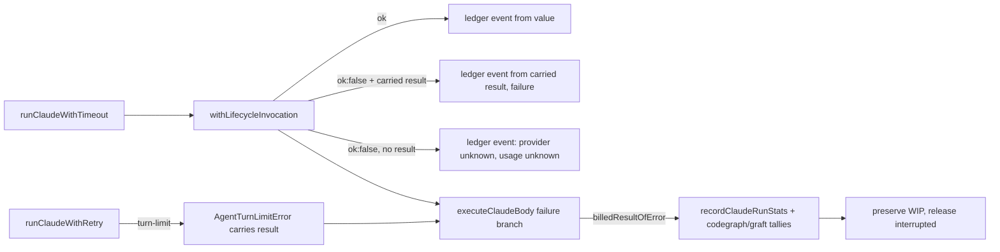

## Summary

A turn-cap stop (`AgentTurnLimitError`) and a refused split run
(`UnfinishedIssueExecutorError`) both end an invocation that already ran and was
billed, and both errors carry that invocation's result. Until now the execute
phase's failure branch released the run without recording that result, and the
lifecycle wrapper read telemetry only from an `ok` result. A refused split run
was therefore written to the ledger as provider `unknown` with no usage, and
both kinds were missing from the run's cost/model figures and its CodeGraph and
Graft tallies.

- New `billedResultOfError` (`worker/deno/lib/failed_invocation_result.ts`)
  returns the carried result for those two error types and `undefined` for
  anything else.
- `executeClaudeBody`'s `!claudeResult.ok` branch records that result through
  the existing `recordClaudeRunStats`, `codegraph.record` and `graft.record`
  path before releasing.
- `withLifecycleInvocation` takes provider, served model and tokens from it, and
  records the refused invocation as a `failure`.

Preservation, the `interrupted` release, the bounded retry and claim release are
unchanged.

Closes #5029.

## Spec

### Intent and Rationale

- One helper decides which errors carry a billed result, so the execute phase
  and the lifecycle wrapper cannot disagree about it.
- The failure branch reuses the success path's recording calls rather than
  adding a second accounting path, so stats, the callback and the tallies stay
  one code path.

### Essential Design Decisions

- Recording happens at the top of the failure branch, once per pass through
  `executeClaudeBody`. The #1550 retry re-enters the body, so a refused retry
  gets its own entry. A turn cap is not retried in-process, so it gets one.
- An error with no carried result records nothing in run totals. In the ledger
  it keeps provider `unknown` and usage `unknown`. A carried result with no
  `runStats` records an entry with no `runStats`, never zeroed tokens.
- Ledger `result` is `failure` whenever the wrapped call returned `ok: false`.
  That was already the outcome for every earlier `ok: false` case, because
  `value` was `undefined`. The refused split run would otherwise read `success`
  from its exit code 0.
- The turn cap is raised in `runClaudeWithRetry`, above the wrapper, which has
  already recorded it as an `ok` result. The helper's turn-cap arm therefore
  never adds a second ledger event.

### Undiscoverable Facts

- The issue's three defects come from the PR #5025 report and the two #5068
  review comments. They are restated in the issue body.

## Evidence

Backend only; no UI file is touched.

- Callers checked:
  - `billedResultOfError` has two callers:
    `worker/deno/lib/phases/execute_phase.ts` and
    `worker/deno/lib/lifecycle_recording.ts`.
  - `withLifecycleInvocation` has one production caller, `runClaudeWithTimeout`,
    which every phase's single spawn goes through. The ledger fix therefore
    applies to a refused split run in any phase.
  - For callers that were never refused, the ledger event is unchanged.
- Docs: `docs/INTERNALS.md` § Lifecycle ledger and issue assignment gains a
  "Refused and capped invocations (Issue #5029)" paragraph.
  - I read the "Invocation usage (Issue #3719)" paragraph and the next one in
    that section; neither needed a change.
  - `docs/CONFIGURATION.md`'s `claude_max_turns` row describes the release, not
    accounting, and is still true.
  - The doc comments above `withLifecycleInvocation` and above the success-path
    `recordClaudeRunStats` call are updated.
- `docs/audits/lib-sweep-coverage/top-up-5029.json` registers the new module, as
  `worker/deno/tests/lib_sweep_coverage_test.ts` requires.
- Issue numbers cited: #5029 (this issue).

## Test Plan

- Added `worker/deno/tests/execute_phase_billed_failure_stats_5029_test.ts`. It
  drives `workOnIssueExecuteClaude` with mock deps and asserts on
  `state.claudeRunStats` (run totals) and `state.graftContext.queries`:
  - each refused split invocation, the retry included, is recorded once, with
    its own token figures. The run is still `interrupted` and the work is still
    preserved.
  - a turn-capped run is recorded once and not retried.
  - a typed error whose result has no usage records an entry with no `runStats`.
  - a plain `Error` records nothing and stays `internal_error`.
  - a credential switch then a refusal records the exhausted invocation and the
    refused one once each.
  - a normal success records exactly one entry.
  - a refused invocation's Graft calls and its retry's each reach the tally once
    (3 + 4 = 7). The fake collector returns a fresh object per call, as
    production does.
- Added `worker/deno/tests/lifecycle_billed_failure_5029_test.ts`:
  - an unfinished split refusal through the real runner (an agent stub with a
    pending executor dispatch) records provider `claude`, the served model, the
    token buckets and `failure`.
  - a turn cap through `runClaudeWithRetry` keeps exactly one ledger entry.
  - a refusal with no usage records its provider and `usage: unknown`.
  - a plain error records provider `unknown`.
  - `billedResultOfError` returns only a carried result.
- Red against the unfixed code:
  - Execute-phase file, before the `execute_phase.ts` change: 5 failed, 2
    passed. The refusal, turn-cap, absent-usage, switch-then-refusal and graft
    tests failed; the plain-error and success controls passed.
  - Graft test again, with only `graft.record(billed.runStats)` removed: failed
    with `undefined` against the expected 7.
  - Lifecycle file, before the `lifecycle_recording.ts` change: the real-runner
    refusal test and the no-usage refusal test failed with provider `unknown`.
    The turn-cap, plain-error and helper tests passed, as expected.
- No existing test was edited.
- Targeted runs at head:
  - Both new files, plus `execute_phase_unfinished_executor_5048_test.ts`,
    `execute_phase_turn_limit_4949_test.ts`,
    `graft_context_wiring_2102_test.ts`, `execute_phase_codegraph_2159_test.ts`,
    `lifecycle_invocation_3719_test.ts` and `issue_executor_enforcement_test.ts`
    (all under `worker/deno/tests/`): passed.
- Full `./quality.sh` on the final code commit: PASSED with skipped checks. The
  skipped checks were config integration (no `.config.json`) and checkov (not
  installed on this host; CI runs it). The first run failed only because the new
  module was missing from the sweep ledger. The top-up slice fixed it.
- Resumed run: the previous attempt stopped at the worker's pre-push gate, which
  runs the full unit suite and reported `error: Test failed` without naming the
  test. On this head, the full suite (`deno task test:unit`) passed: parallel
  pass 34722 passed, 0 failed; serial pass 885 passed, 0 failed. `./quality.sh`
  passed again, with config integration and checkov skipped as before. That
  failure was not reproduced here.

Not checked: the test that failed the earlier pre-push gate could not be
identified from its truncated output, and it did not fail on this host.
