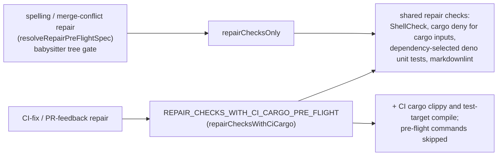

# PR Summary — Issue #5035

## Summary

The two repair pre-push gate modes had names that no longer said what they run.
This PR renames them and the path lists they filter. Behaviour is unchanged.

Closes #5035.

- `shellcheckOnly` → `repairChecksOnly`: the shared repair checks only.
- `ciCargoOnly` → `repairChecksWithCiCargo`: the shared repair checks plus the
  repo CI's cargo clippy and test-target compile.
- `CI_CARGO_ONLY_PRE_FLIGHT` → `REPAIR_CHECKS_WITH_CI_CARGO_PRE_FLIGHT`.
- In `runPrePushGate`:
  - `changed` → `formatterCandidates`, now a plain array instead of a
    `{ value }` wrapper;
  - `considered` → `formatterSelection`;
  - the local `cargoChanged` → `ciCargoPaths`, passed to the planner as
    `cargoChanged: ciCargoPaths`.

## Spec

### Intent and Rationale

- Earlier PRs dropped or skipped checks because their authors took
  `shellcheckOnly` and `ciCargoOnly` literally. The new names say what each mode
  runs, and both start with `repairChecks`, so the two modes are still told
  apart.

### Essential Design Decisions

- The two booleans stay as separate booleans. Folding them into one enum would
  change the case where both are set: today `repairChecksWithCiCargo` wins for
  `formatterCandidates` and `ciCargoPaths`, and both disable `always` for cargo
  deny. The issue says not to collapse the modes.
- The planner's own option keys (`cargoChanged`, `validationChanged`) and the
  raw lists (`touched`, `contained`, `uncontained`) keep their names. Only the
  locals that the mode filters were renamed. Every condition is unchanged, token
  for token, apart from the renamed identifiers.
- No persisted shape changes. `PreFlightGateSpec` is built and used inside one
  process. Its only reader is `gateUnpushedCommits` in
  `worker/deno/lib/git_push.ts`, and the agent hook's spec file does not carry
  these fields.

### Undiscoverable Facts

- I confirmed both dependencies were closed with `gh issue view`:
  - #4930 was closed and its continuation PR #5117 was merged;
  - #5121 (the local Gitleaks integration) was closed.

  The Gitleaks stage is untouched, and `./quality.sh` ran it and passed.

## Evidence

This is a backend rename.

- Code: `worker/deno/lib/git_push.ts` and `worker/deno/lib/pre_push_gate.ts`
  rename the identifiers and rewrite their doc comments. These callers use the
  new names:
  - `worker/deno/lib/pr_ci_processor.ts`;
  - `worker/deno/lib/pr_feedback_processor.ts`;
  - `worker/deno/lib/babysitter_tree_gate.ts`.
- One stale doc sentence in `runPrePushGate` said the ShellCheck-only mode
  "plans no changed-file check at all". It actually plans the unit tests and
  markdownlint from the pushed paths. The sentence now says that.
- Docs: `docs/CONFIGURATION.md`. I read the pre-flight section and the
  changed-file check bullets (`deno test`, CI cargo, `cargo deny`), and updated:
  - the no-`pre-flight` paragraph and the Step 1b paragraph, which now name
    `REPAIR_CHECKS_WITH_CI_CARGO_PRE_FLIGHT`;
  - the `deno test` bullet, which names both modes;
  - the CI cargo bullet;
  - the `cargo deny` bullet. It used to say only "ShellCheck-only repair checks"
    run it on changed cargo inputs, but `runCargoDenyGate`'s
    `always: !opts.repairChecksOnly && !opts.repairChecksWithCiCargo && …`
    treats both repair modes that way, so it now names both.
- Grep on the final head:
  `git grep -n -E 'shellcheckOnly|ciCargoOnly|CI_CARGO_ONLY|ShellCheck-only|cargo-only spec|cargo-only mode|cargo-only repair' -- ':!docs/archive' ':!docs/audits'`
  returns nothing.
  - The remaining "cargo-only tree" hits (milestone merge-only syncs) and the
    "shellcheck-only hole" hits (quality-gate remediation) are different
    concepts and were left alone.
  - `README.md` and the other `*/README.md` files have no hit.
- No issue number is newly cited as provenance. The diff cites only the existing
  #4626, #4630, #4631 and #4930.

## Test Plan

- No new test: the change is a rename, and the existing repair-path suites drive
  the real gate under both modes. I updated them for the new keys and kept every
  behavioural assertion. They show the same checks still run and the same
  failures still block:
  - `worker/deno/tests/pre_push_gate_test.ts` (each mode in the loop at the
    renamed `for (const mode of …)`, CI-cargo-only checks, markdownlint
    blocking, pre-flight skipping);
  - `worker/deno/tests/pre_push_gate_cargo_deny_test.ts`;
  - `worker/deno/tests/git_push_preflight_test.ts`;
  - `worker/deno/tests/shellcheck_publication_test.ts`;
  - `worker/deno/tests/pr_ci_processor_test.ts`;
  - `worker/deno/tests/pr_feedback_processor_pre_flight_4630_test.ts`;
  - `worker/deno/tests/pr_feedback_review_dismissal_3383_test.ts`;
  - `worker/deno/tests/pr_merge_conflict_processor_test.ts`;
  - `worker/deno/tests/pr_round_repo_formatters_test.ts`;
  - `worker/deno/tests/pr_side_gate_guarantee_4876_test.ts`;
  - `worker/deno/tests/pr_spelling_processor_test.ts`.
- `deno task test:unit` over those 11 files: 482 passed, 0 failed.
- `./quality.sh < /dev/null` on the code commit: passed. Every stage passed,
  including deno tests, semgrep, gitleaks and markdownlint, except
  `config integration` and `checkov`, which the host skipped.
- Every edited assertion below changes only an identifier or a message string,
  and keeps its expected value and guard:
  - Removed from `worker/deno/tests/pr_ci_processor_test.ts`:
    `assertEquals(spec?.ciCargoOnly, true);`
    - Required by: "rename the internal modes and filtered path variables to
      describe their actual purpose"
    - Replaced by: `assertEquals(spec?.repairChecksWithCiCargo, true);`
  - Removed from `worker/deno/tests/pr_ci_processor_test.ts`:
    `assertEquals(spec, CI_CARGO_ONLY_PRE_FLIGHT);`
    - Required by: "rename the internal modes and filtered path variables to
      describe their actual purpose"
    - Replaced by: `assertEquals(spec, REPAIR_CHECKS_WITH_CI_CARGO_PRE_FLIGHT);`
  - Removed from `worker/deno/tests/pr_ci_processor_test.ts`:
    `assertEquals(spec?.ciCargoOnly === true, false);`
    - Required by: "rename the internal modes and filtered path variables to
      describe their actual purpose"
    - Replaced by:
      `assertEquals(spec?.repairChecksWithCiCargo === true, false);`
  - Removed from
    `worker/deno/tests/pr_feedback_processor_pre_flight_4630_test.ts`:
    `assertEquals(spec?.ciCargoOnly, true);`
    - Required by: "rename the internal modes and filtered path variables to
      describe their actual purpose"
    - Replaced by: `assertEquals(spec?.repairChecksWithCiCargo, true);`
  - Removed from
    `worker/deno/tests/pr_feedback_processor_pre_flight_4630_test.ts`:
    `assert(spec?.ciCargoOnly !== true, "a configured repo is not cargo-only");`
    - Required by: "rename the internal modes and filtered path variables to
      describe their actual purpose"
    - Replaced by: `spec?.repairChecksWithCiCargo !== true,` (same message,
      wrapped by `deno fmt`)
  - Removed from `worker/deno/tests/pr_spelling_processor_test.ts`:
    `assertEquals(preFlights, [{ commands: [], shellcheckOnly: true }]);`
    - Required by: "rename the internal modes and filtered path variables to
      describe their actual purpose"
    - Replaced by:
      `assertEquals(preFlights, [{ commands: [], repairChecksOnly: true }]);`
  - Removed from `worker/deno/tests/pre_push_gate_test.ts`:
    `assert(!blocked.result.ok, "markdownlint must gate a ciCargoOnly push");`
    - Required by: "rename the internal modes and filtered path variables to
      describe their actual purpose"
    - Replaced by: `!blocked.result.ok,` with the message
      `"markdownlint must gate a repairChecksWithCiCargo push"`
  - Removed from `worker/deno/tests/pr_feedback_review_dismissal_3383_test.ts`:
    `[CI_CARGO_ONLY_PRE_FLIGHT, CI_CARGO_ONLY_PRE_FLIGHT],`
    - Required by: "rename the internal modes and filtered path variables to
      describe their actual purpose"
    - Replaced by: `REPAIR_CHECKS_WITH_CI_CARGO_PRE_FLIGHT,` (twice, same
      `assertEquals`)
  - Removed from `worker/deno/tests/pr_side_gate_guarantee_4876_test.ts`:
    `capturedPreFlight?.shellcheckOnly,`
    - Required by: "rename the internal modes and filtered path variables to
      describe their actual purpose"
    - Replaced by: `capturedPreFlight?.repairChecksOnly,`
  - Removed from `worker/deno/tests/pr_merge_conflict_processor_test.ts`:
    `{ commands: [], shellcheckOnly: true },`
    - Required by: "rename the internal modes and filtered path variables to
      describe their actual purpose"
    - Replaced by: `{ commands: [], repairChecksOnly: true },`
  - Removed from `worker/deno/tests/git_push_preflight_test.ts`:
    `` `deno must not run in cargo-only mode: ${calls.join(" | ")}`, ``
    - Required by: "rename the internal modes and filtered path variables to
      describe their actual purpose"
    - Replaced by:
      `` `deno must not run in repairChecksWithCiCargo mode: ${calls.join(" | ")}`, ``
- Callers checked for the renamed spec fields:
  - `gateUnpushedCommits` (the only reader of the spec fields);
  - `resolveRepairPreFlightSpec`;
  - both users of the CI-cargo constant (`pr_ci_processor.ts` and
    `pr_feedback_processor.ts`);
  - `babysitter_tree_gate.ts`.

  `deno check` over the whole tree, run by `./quality.sh`, names any missed
  caller.
