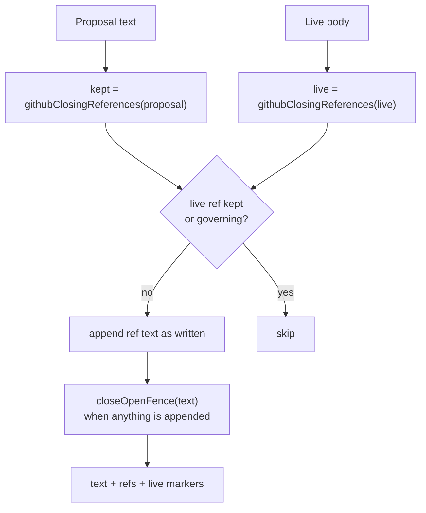

## Summary

`guardPrBodyProposal` in `worker/deno/lib/babysitter_pr_body_guard.ts` had two
defects in how it composes a repaired PR description:

- **A.** It appended restored references and live `vibe-` markers after a
  proposal that ended inside an unclosed fenced code block, so GitHub read them
  as code. A fully met issue was not closed, and the worker markers were lost.
- **B.** It read the kept and live closing references with the loose `\s+`
  pattern over a space-masked body. A hard-wrapped (`Closes\n#99`) or code-split
  (``Closes `x` #99``) close in the proposal therefore counted as keeping
  another issue's close, and the live body's valid `Closes #99` was not
  restored. Live colon and URL closes (`Fixes: #99`) were never restored.

Both sides now come from `githubClosingReferences`, a new reader in
`worker/deno/lib/pr_body.ts`. It uses the existing same-line patterns and the
code-placeholder masking behind `hasGithubClosingReference`. When anything is
appended, a body that ends in an open fence first has that fence closed, using
the opener's indent. The new `unclosedFenceOpener` in
`worker/deno/lib/markdown_code_spans.ts` finds the open fence. Trust and closure
decisions are unchanged.

Closes #5039.

## Spec

### Intent and Rationale

- The issue asks to reuse the `pr_body.ts` helpers and not to add another close
  parser. The new reader is the listing form of the existing
  `hasGithubClosingReference` / `hasGithubColonOrUrlClosingReference` reads:
  same patterns, same masking. It returns offsets, so a restored reference is
  copied exactly as written.
- Closing the fence before appending was chosen over moving the appended lines
  above the proposal, because it keeps the established body layout (proposal,
  references, markers) unchanged whenever no fence is open.

### Essential Design Decisions

- The loose `closingRefs` read is kept only for the `assertWithheld` backstop.
  It is the conservative side: a line-wrapped close of a withheld issue still
  throws.
- A close in the live body is restored only if GitHub honours it. A
  line-wrapped or code-split close there is no longer copied, because the issue
  says "without accepting code-split or line-wrapped impostors".
- The closer repeats the opener's indent, so a fence opened under a list item is
  closed inside that item. A backtick opener whose info string contains a
  backtick is not a fence on GitHub, so it gets no closer. Appending one there
  would open a new fence.
- `unclosedFenceOpener` tracks fences in the same order as `splitMarkdownCode`
  (opener by `parseFenceLine`, closer by `isClosingFence`). The tests' oracle,
  `maskCodeWithPlaceholder`, is built on `splitMarkdownCode`, so the guard tests
  fail if the two disagree.

### Undiscoverable Facts

- #5040 is superseded by this issue's combined scope, as the issue body
  records.

## Evidence

Backend only. No UI file is touched.



- Callers checked: `guardPrBodyProposal` has one production caller,
  `worker/deno/commands/fleet_pr_babysitter.ts`, which is unchanged.
  `githubClosingReferences` and `unclosedFenceOpener` are new, and each has a
  production caller in the guard. `closingRefs` is now used only by
  `assertWithheld`. Existing tests in
  `worker/deno/tests/babysitter_pr_body_guard_test.ts` pin the composed body
  byte for byte (for example "Moved to babysitter_pr_body_guard: a proposed PR
  description keeps the closing references it dropped") and still pass
  unchanged.
- Docs: in `docs/workflows/fleet-pr-babysitter.md` § "fleet-pr-babysitter"
  repair publication, I read steps 3 and 4 through. Step 3 now says an open
  fence is closed first. Step 4's last sentence now says which closing
  references are restored. The module doc and the `guardPrBodyProposal`,
  `ClosingRef`, `closingRefs` and `maskCodeWithPlaceholder` doc comments are
  updated to match.
- Issue numbers this diff adds: #5039 (Preserve effective issue-closing
  references and markers in babysitter PR descriptions).

## Acceptance Criteria

<!-- vibe-spec-review inputs="diff+issue-body" -->

- **met** — A fully met summary plus an unclosed trailing fence produces an effective governing close and readable live markers. — evidence: `worker/deno/tests/babysitter_pr_body_guard_5039_test.ts::a proposal ending in an unclosed fence has it closed before the appended close and marker (Issue #5039)` — reviewer: met
- **met** — Hard-wrapped/code-split proposals cannot suppress restoration of another issue's effective live close. — evidence: `worker/deno/tests/babysitter_pr_body_guard_5039_test.ts::a line-wrapped or code-split close in the proposal does not keep the live close (Issue #5039)` — reviewer: met
- **met** — Valid supported reference forms remain valid without duplicate additions. — evidence: `worker/deno/tests/babysitter_pr_body_guard_5039_test.ts::a valid colon, URL or qualified close in the proposal is not duplicated (Issue #5039)` — reviewer: met
- **met** — Partial/missing governing work remains non-closing; code contents cannot forge references or worker markers. — evidence: `worker/deno/tests/babysitter_pr_body_guard_5039_test.ts::partial governing work with an unclosed fence stays non-closing (Issue #5039)` and `::code in an unclosed fence cannot forge a marker or keep a close (Issue #5039)` — reviewer: met
- **met** — Focused deterministic tests call the production guard and the existing effective-reference reader. — evidence: `worker/deno/tests/babysitter_pr_body_guard_5039_test.ts` drives `guardPrBodyProposal` and checks with `hasGithubClosingReference`, `hasGithubColonOrUrlClosingReference` and `maskCodeWithPlaceholder` — reviewer: met
- **unrequested** — a backtick opener with a backtick in its info string gets no closer — reviewer: unrequested — reason: the Spec reviewer flagged that the shared `parseFenceLine` accepts such an opener, which GitHub does not treat as a fence, so an appended closer would hide the appended lines. Fixed in this diff and tested, as part of requirement A.

## Standards Review

<!-- vibe-standards-review inputs="diff+CODING-STANDARDS.md" -->

- **violation** — A Code Change Owes a Docs Change: the `guardPrBodyProposal` doc comment still described the old restore rule and left out the fence closer — evidence: `worker/deno/lib/babysitter_pr_body_guard.ts:204` — reason: fixed in this diff (rewritten in commit 34d44563)
- **clean** — Check where you insert; dummy and "how" test rules; negative tests carry the forbidden input; nothing exists only for a test to read; masked offsets equal original offsets; no swallowed errors; Australian English; no `/tmp` use in tests; no workflow, persisted-shape or cross-repo change. Optional notes not acted on: `unclosedFenceOpener` is another loop over the shared `parseFenceLine` / `isClosingFence`, and the two existing `hasGithub*` readers could be rewritten on top of `githubClosingReferences`. I left that refactor out, under Change Scope.

## Test Plan

- Added `worker/deno/tests/babysitter_pr_body_guard_5039_test.ts` (11 tests). It
  covers:
  - unclosed top-level and list-item fences;
  - line-wrapped and code-split proposal closes;
  - colon, URL and qualified closes not duplicated;
  - a live colon close restored;
  - a live line-wrapped impostor not restored;
  - partial work with an unclosed fence staying `Part of`;
  - a forged marker and close inside a fence;
  - a backtick info-string opener getting no closer;
  - direct tests of `githubClosingReferences` and `unclosedFenceOpener`.
- Red against the unfixed code: all eight guard-behaviour tests failed with
  `AssertionError`. The two direct reader tests could not import the new
  functions. The backtick info-string test failed before its `closeOpenFence`
  check (the body included the appended closer) and passed after it.
- No existing test was edited or removed.
- `deno task test:unit` on `worker/deno/tests/babysitter_pr_body_guard_5039_test.ts`,
  `worker/deno/tests/babysitter_pr_body_guard_test.ts`,
  `worker/deno/tests/markdown_code_spans_test.ts` and
  `worker/deno/tests/pr_body_test.ts` after the last commit: 83 passed, 0
  failed.
- Full `./quality.sh` on commit 0e5590d0 passed with skipped checks: config
  integration (no `.config.json`) and checkov (not installed here). The later
  commit changes only a doc comment, one guard line and one test. It was
  re-checked with `deno fmt`, `deno lint`, `deno check` and the targeted tests
  above.
- Not covered: a fence opened inside a block quote. `parseFenceLine` does not
  read `> ```` as a fence, and the blank line before the appended block ends
  the quote on GitHub, so nothing is appended inside it.

🤖 Generated with [Claude Code](https://claude.com/claude-code)
