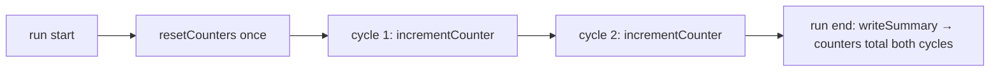

# PR Summary — Issue #5043

## Summary

`runCoreLoop` cleared the named fault-tolerance counters at the start of every
cycle, but it writes `fault_tolerance_summary.json` only once, at run end. The
file therefore described the final cycle only. The counters are now reset once
per run, just before the main loop, so they accumulate across the run's cycles
and the run-end summary counts all of them. Closes #5043.

## Spec

### Intent and Rationale

- Of the issue's two suggested fixes, this takes the "accumulate run totals"
  one in its simplest form. Nothing reads the named counters during the run:
  `getCounters()` has one production caller, `writeSummary`, which
  `writeFaultToleranceSummary` calls at run end. So a separate run-total
  store, or a write on every cycle, would add moving parts for no reader.

### Essential Design Decisions

- The reset stays once per run instead of being removed. The counters are
  module state, and a process (a test suite, for example) can call
  `runCoreLoop` more than once. Resetting at run start keeps one run's counts
  out of the next run's summary.
- The fault-event counters (`recordFaultEvent` / `formatCounterSummary`) are
  unchanged. `runCoreLoop` never reset them, so they already covered the whole
  run.

### Undiscoverable Facts

None.

## Evidence

Backend-only change, covered by tests.

- The new test was observed **red** on the unfixed placement, with
  `resetCounters()` back as the first statement of the loop body: the summary
  held `retryAttempts: 1` where 2 was expected. It is green with the fix.
- Issue numbers this diff cites: #5043: fault_tolerance_summary.json keeps
  only the final cycle's named counters: they are reset every cycle but
  written once at run end.
- Docs swept: I grepped `README.md`, `docs/` (excluding archive and audits),
  the standards files and `worker/` for `resetCounters`, `named counter`,
  `fault_tolerance_summary` and "reset each worker cycle". The only stale
  sentences were the doc comments in `worker/deno/lib/fault_tolerance_counters.ts`
  (module doc and `resetCounters`) and `worker/deno/lib/repair_base_merge_4943.ts`
  ("per-cycle" is now "per-run"); both are fixed. `docs/MERGE.md:1393` and
  the `docs/INTERNALS.md` index row stay true.

## Test Plan

- Added `worker/deno/tests/run_core_test.ts::run_core - fault tolerance summary counts named counters from every cycle of the run (Issue #5043)`.
  It runs `runCoreLoop` for two cycles, and each cycle's PR-feedback handler
  calls `incrementCounter("retryAttempts")`. The real `writeSummary` writes to
  a temp directory. The test asserts that the handler ran twice (a positive
  control) and that `counters` equals `{ retryAttempts: 2 }`. A
  `staleFromEarlierRun` counter seeded before the run must not appear in the
  file, which covers the run-start reset.
- No existing assertion was removed or edited.
- `deno task test:unit` on `worker/deno/tests/run_core_test.ts`,
  `worker/deno/tests/fault_tolerance_counters_test.ts`,
  `worker/deno/tests/fault_tolerance_counters_write_summary_test.ts` and
  `worker/deno/tests/repair_base_merge_4943_test.ts`: 138 passed, 0 failed.
- `deno task test:unit` (the full unit suite) on this head: 34,724 passed in
  the parallel pass and 885 passed in the serial pass, 0 failed. An earlier
  attempt's pre-push gate stopped with `error: Test failed` on a wide test
  list, and its output was cut off before it named the failing test. The full
  suite does not reproduce that failure on this head.
- `./quality.sh < /dev/null` on this head: PASSED, including deno tests, lint,
  type check and fmt. Config integration and checkov were skipped by the host.

Not done or not checked: I could not identify the test that failed the earlier
pre-push gate, because its output was truncated and the full suite now passes.
The fault-event log header still reads "Cycle summary". The run loop never
resets those counters, so that text predates this change and covers the whole
run; it is out of scope here. Remaining risk: that earlier failure was not
reproduced, so it may have been intermittent.
