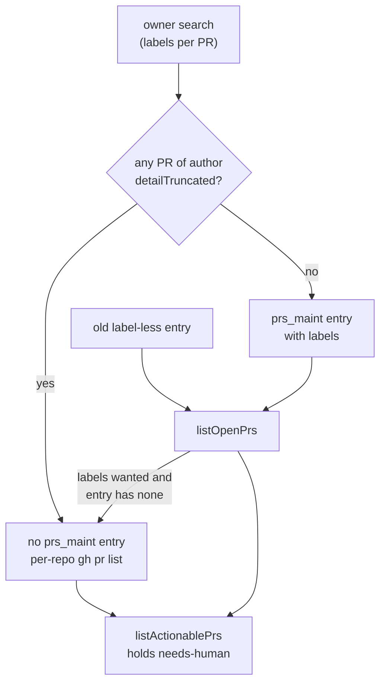

## Summary

`toMaintenanceEntry` in `worker/deno/lib/fleet_pr_prefetch.ts` built the
`prs_maint_<author>` cache entries without `labels`. `listActionablePrs` holds a
PR only when its labels include `needs-human`, so a fleet PR listed from the
prefetch was never held, and the maintenance lanes kept working it.

- `toMaintenanceEntry` now carries `labels` the way `toInvitationEntry` did.
  `toInvitationEntry` gets them through its spread.
- When any PR of an author has `detailTruncated` set (its labels, comments or
  reviews overflowed one page), that author's `prs_maint_<author>` entry for the
  repo is not written. The per-repo `gh pr list` serves it instead.
- `listOpenPrs` in `worker/deno/lib/pr_maintenance.ts` treats a cached listing
  as a miss, and re-lists live, when the caller asks for `labels` and an entry
  has none. That is the shape the old prefetch wrote.

Closes #5047.

## Spec

### Intent and Rationale

- The fix follows the issue's suggested fix: carry labels in
  `toMaintenanceEntry`, and leave a `detailTruncated` repo/author listing to the
  per-repo path.
- The prefetched entries live in the file-backed `IssueCache` (600 s TTL), so
  label-less entries written before deployment would still be served for one
  window. Under **Changing the Shape of Persisted Data**, this reads the old
  shape: such an entry is a miss for a caller that needs labels. The key is not
  bumped, because the per-repo listing and the CI-nudge scan share the key.

### Essential Design Decisions

- `detailTruncated` also covers comment and review truncation, so a PR with a
  long conversation sends its author's maintenance listing to the per-repo path
  too. That costs one `gh pr list` per repo, author and cache window. The search
  has no labels-only flag, and adding one would change the persisted
  last-good-result shape.
- The old-shape miss applies only when `fields` includes `labels`. Callers that
  do not ask for labels, such as `pr_body_reconcile`
  (`number,headRefName,
  headRefOid,body,author`), are still served the cached
  entry unchanged. `listActionablePrs` always adds `labels`, and
  `pr_merge_conflict_scan`'s `PR_FIELDS` includes it, so both re-list an
  old-shape entry once.
- An entry re-listed live is recorded as a live read in
  `lifecycleListingObservedAt`. It is no longer treated as a cached read.

### Undiscoverable Facts

- Observed on the real tool:
  `gh pr list --repo stSoftwareAU/VibeCoder --state
  open --limit 3 --json number,labels`
  returned `[{"labels":[],"number":5183},…]`. So a live listing always carries a
  `labels` array, even an empty one, and is never mistaken for the old shape.

## Evidence

Backend only. No UI file is touched.

- Fakes relied on: `fakeGithubPrSearch`
  (`worker/deno/tests/support/github_graphql_fake.ts`) stands in for the GraphQL
  search behind `searchOpenFleetPrs`. It returns `labels(first: N)` with
  `totalCount`, and so does the production query in
  `worker/deno/lib/fleet_pr_search.ts`. The per-repo `gh pr list` fakes return
  `labels` as an array of `{ name }`, matching the observed output above.
- Callers of `listOpenPrs` checked: `listActionablePrs` (asks for labels;
  re-lists an old-shape entry), `pr_merge_conflict_scan` (its `PR_FIELDS`
  includes labels; same), and `pr_body_reconcile` (no labels; unchanged, covered
  by `worker/deno/tests/pr_body_reconcile_test.ts`, which seeds a label-less
  entry and still passes). `auto_merge_sweep` and `pr_ci_nudge_scan` use their
  own `listOpenPrs` functions and are untouched.
- Docs: `docs/GH-API-OPTIMISATION.md`, section "Cross-repo prefetch — one search
  per owner (Issue #1486)". The truncation bullet now names both listings and
  the needs-human hold. A new bullet covers the old-shape re-list. The
  `conversationSize` doc comment in `fleet_pr_prefetch.ts` now says the
  maintenance and invitation listings.
- Issue numbers this diff adds: #5047 (Prefetched prs_maint listings omit
  labels, so the needs-human hold never holds a fleet PR served from the
  prefetch).

## Test Plan

- Added `worker/deno/tests/fleet_pr_prefetch_needs_human_5047_test.ts` (6
  tests):
  - "listActionablePrs - a needs-human fleet PR served from the prefetch is
    held": runs the real prefetch and asserts that only the unlabelled PR is
    returned, with no `gh pr list` call.
  - "prefetch - the prs_maint entry carries the labels the search reported".
  - "prefetch - a PR whose labels overflowed one page is left to the per-repo
    listing": the `prs_maint` entry for author A is not written, author B's
    entry is, and the per-repo listing holds A's needs-human PR.
  - "listActionablePrs - a label-less entry left by the old prefetch is
    re-listed live": an old-shape seed, with persisted-data rule coverage.
  - "listActionablePrs - control: an entry that carries labels is served from
    the cache".
  - "listOpenPrs - a caller that does not ask for labels is still served the
    label-less entry".
- Red against base `lib/fleet_pr_prefetch.ts` and `lib/pr_maintenance.ts`: 4 of
  the 6 tests failed. In the first, needs-human PR #7 was returned. In the
  second, `labels` was `undefined`. In the third, `prs_maint_A` was written. In
  the fourth, there was no live re-list. The control and the
  caller-without-labels test pass on base, as expected.
- Fixture changes needed by the new old-shape precondition. No assertion was
  removed:
  - `worker/deno/tests/lifecycle_pr_observation_test.ts` ("CI maintenance never
    revives a closed PR from a cached OPEN listing"): the seeded `prs_maint_bot`
    entry gains `labels: []`. Without it, the scan would re-list live, and the
    fake's `[]` answer would let the test pass without reaching the cached
    listing.
  - `worker/deno/tests/fleet_pr_prefetch_budget_2662_test.ts`: the fake per-repo
    `gh pr list` now returns `labels`, as the real listing does. Without it,
    every fallback listing looked old-shape and re-listed, which broke the "at
    most once per repo per window" count.
- `deno task test:unit` on the new file plus
  `worker/deno/tests/fleet_pr_prefetch_test.ts`,
  `worker/deno/tests/fleet_pr_prefetch_draft_ci_scan_4951_test.ts`,
  `worker/deno/tests/fleet_pr_prefetch_wiring_test.ts`,
  `worker/deno/tests/fleet_pr_prefetch_budget_2662_test.ts`,
  `worker/deno/tests/lifecycle_pr_observation_test.ts`,
  `worker/deno/tests/pr_body_reconcile_test.ts`,
  `worker/deno/tests/pr_maintenance_bot_prs_test.ts`,
  `worker/deno/tests/pr_invitation_lookup_test.ts` and the `pr_merge_conflict_*`
  tests: 341 passed, 0 failed.
- Full `./quality.sh` on the code commit and again on bbe123ea, which adds the
  docs change and this summary: passed with skipped checks both times. Config
  integration was skipped (no `.config.json`) and checkov is not installed here.
- Not covered: a live end-to-end cycle through `runFleetPrPrefetch` in
  `run_core_production_deps.ts`. The tests drive `prefetchFleetOpenPrs` and
  `listActionablePrs` directly, with the same cache.

🤖 Generated with [Claude Code](https://claude.com/claude-code)
