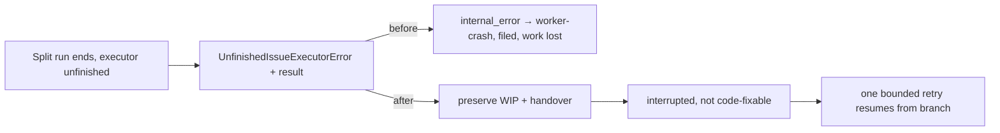

## Summary

A split issue run that ended with an executor sub-agent unfinished was refused
(correctly) by `runClaudeWithTimeout` with a plain `Error`. The execute phase
turned every such error into `internal_error` ("Claude execution failed: …"), so
the run was classified `worker-crash` (code-fixable) and auto-filed as a worker
fault, and the agent's uncommitted work was never preserved on the issue branch.
The refusal is now a typed `UnfinishedIssueExecutorError` carrying the
invocation's result. The execute phase preserves the working tree on the issue
branch with a handover note, releases the run as `interrupted` (not
code-fixable, never auto-filed), and the existing bounded in-process
infrastructure retry resumes from the preserved branch. The unfinished-work
guard, and its refusal of completion and PR creation, are unchanged. The sibling
`execute_claude_phase.ts` path (the `execute-claude-phase` command) classifies
the refusal as a distinct `executor_unfinished` failure type instead of a
generic `execution_error`, as it already does for `turn_limit`. Closes #5048.

## Spec

### Intent and Rationale

- The failure is not a recurrence of #4949. #4949 (PR #5025, merged
  2026-11-11T05:41:23Z) fixed `AgentTurnLimitError` only; this run (host
  `vibe-coder-37935`, released 05:47 UTC on #4952, phase `execute`, 1535 s)
  failed on the executor refusal, which `execute_phase.ts` did not handle at
  all. Both share the `worker-crash` bucket because both fell through to
  `internal_error`.
- The turn-limit branch is the precedent: preserve the work, return
  `interrupted`. Its body is factored into one local helper used by both causes,
  so turn-limit output is unchanged (`execute_phase_turn_limit_4949_test.ts`
  passes unmodified).

### Essential Design Decisions

- The discriminator is the error class, not the message text: a plain `Error`
  with the same wording stays `internal_error`.
- The new reason prefix is deliberately not added to the no-retry check beside
  `TURN_LIMIT_REASON_PREFIX`. An `interrupted` result keeps the one bounded
  infrastructure retry, which re-enters the phase on the branch holding the
  preserved work. That is the "resume automatically" contract; a second failure
  is released as `interrupted` with the work preserved.
- `execute_claude_phase.ts` (a production wiring site of `issueExecutorSplit`)
  maps `!claudeResult.ok` itself, so it gets the same discriminator:
  `UnfinishedIssueExecutorError` → `failureType: "executor_unfinished"`, beside
  `AgentTurnLimitError` → `turn_limit`. Like `turn_limit` there, that path does
  not preserve or release the work itself; it only stops reporting the refusal
  as an execution error. Nothing in `lib/` consumes `failureType`, so no other
  mapping changes.
- The posted reason carries no issue number (it lands in the target repo's
  comments, Issue #3499 rule), unlike the log line.

### Undiscoverable Facts

- The source issue's release comment (#4952) records the death as
  `infrastructure-error` in phase `execute` after 1535 s, with the message
  quoted in #5048. Whether the in-process retry ran on that incident is not
  recorded there.

## Evidence

Backend only; no UI file is touched. `deno.lock` is unchanged.

- `./quality.sh < /dev/null` on the final head: PASSED (with skipped checks:
  `config integration`, `checkov`); deno tests, lint, type check and fmt all
  passed.
- Issue numbers cited as provenance: #4599: executor split foreground pinning
  and unfinished-executor refusal; #4949: turn-cap run recorded as worker crash
  (PR #5025); #4952: source issue of this failure.

## Reproduction

- **symptom** — a split run whose advisor ended with an executor unfinished was
  recorded
  `Claude execution failed: Split issue run has unfinished executor
  work; refusing completion and PR creation (Issue #4599).`,
  classified `worker-crash` and auto-filed, with the work not preserved.
- **status** — `verified` — the new phase tests go red when the new branch is
  disabled (the unfixed behaviour: the typed error falls through to
  `internal_error`): 3 failed, 2 passed (the two that assert unchanged
  behaviour). They also cannot compile against the base branch, which has no
  `UnfinishedIssueExecutorError`. They pass with the fix.
- **regression test** —
  `worker/deno/tests/execute_phase_unfinished_executor_5048_test.ts::execute_phase #5048 - an unfinished executor with a dirty tree is preserved and released as interrupted`

## Test Plan

- New `worker/deno/tests/execute_phase_unfinished_executor_5048_test.ts` (5
  tests): preserved-and-interrupted with handover note and `not_code_fixable`
  classification; the bounded retry runs the invocation twice; a plain `Error`
  with the same message stays `internal_error`; the reason quotes the refused
  invocation's own output, not stale state; the commit subject. Not covered: a
  first attempt failing and a second succeeding (the harness has no full success
  path).
- `worker/deno/tests/issue_executor_enforcement_test.ts` (production runner with
  a fake CLI): additionally asserts the refusal is an
  `UnfinishedIssueExecutorError` whose `executionResult.output` is `done`. No
  assertion removed.
- `worker/deno/tests/execute_claude_phase_test.ts`: new
  `runExecuteClaudePhase - an unfinished executor is not an execution error and
  an open PR never turns it into a success (Issue #5048)`
  asserts `failureType` is `executor_unfinished` and the failure message quotes
  the refusal even though `findExistingPrForBranch` returns an open PR. The
  existing turn-limit test now uses the same open-PR fake and no longer asserts
  on a mock flag. Red check: making the failure path self-heal and succeed on a
  found PR turns both tests red. Two other tests in that file
  (`a repo provider pin reaches the runner…`,
  `an explicit provider stays
  absolute…`) fail identically on the head without
  this change.
- Cause lists extended with `executor-unfinished` in
  `worker/deno/tests/wip_checkpoint_test.ts`,
  `worker/deno/tests/handover_note_test.ts`,
  `worker/deno/tests/wip_commit_marker_test.ts`. No assertion removed.
- Red checks: disabling the `instanceof UnfinishedIssueExecutorError` branch → 3
  of the new tests red. Not red-checked: the runner-side typing, covered by the
  added `instanceof` assertion in `issue_executor_enforcement_test.ts`.
- Twinned rules: the `WipPreservationCause` list is mirrored by the three test
  lists above; `TURN_LIMIT_REASON_PREFIX` has no twin for the new prefix by
  design (see decisions).
- Docs: `docs/MANAGER-WORKER-CONTRACT.md` ("The existing failure path retains
  the work for retry" was false) now describes the typed error, preservation and
  release as `interrupted`.
- Targeted run on the final head: `deno task test:unit` of the new test, the
  4949 test, the enforcement test and the three cause-list tests plus
  `execute_phase_killed_test.ts`: 88 passed, 0 failed.

## Not done

- No change to turn-cap accounting (#5029) or the quoted-usage-heading retry
  (#5037), per the issue.
- The originating worker revision of the 05:47 run was not established from
  within this checkout; the path comparison above rests on the source, not on
  the deployed revision.
