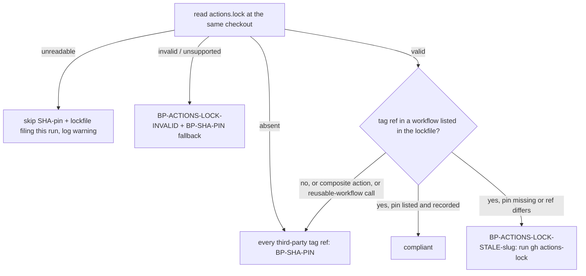

# PR Summary — Issue #5051

## Summary

The native SHA-pin pre-filer and the GitHub Actions audit prompt now accept
GitHub workflow lockfiles (`.github/workflows/actions.lock`, written by
`gh actions-lock`). A tag ref in a workflow onboarded to a valid lockfile is
compliant when that workflow's lockfile entry lists its `owner/repo@ref` pin and
the lockfile has a dependency record for that pin. If the entry or the record is
missing, the pre-filer files one `BP-ACTIONS-LOCK-STALE-<slug>` finding per
workflow, telling the repository to re-run `gh actions-lock`. An invalid or
unsupported lockfile is filed as `BP-ACTIONS-LOCK-INVALID`, and its tag refs
fall back to the SHA rule. Reusable-workflow calls, composite-action files and
workflows the lockfile does not list keep the SHA rule (`BP-SHA-PIN-…`). The
prompt's checks #1 and #13 now draw the same line, and the new advisory check 1b
(`BP-ACTIONS-LOCK-ADOPT`, low) recommends adopting a lockfile. Closes #5051.

## Spec

### Intent and Rationale

- GitHub's secure-use page now ranks lockfiles first and calls them a
  replacement for SHA pinning in repositories that adopt them. Before this
  change, an adopting repository got a high-severity "pin to a SHA" finding for
  every action, and the fix rewrote its tags. That fix works against the
  lockfile and against Dependabot regenerating it.
- The parser follows the official schema rather than accepting any YAML. I read
  `github/gh-actions-lock` (its README and its own `actions.lock`) and the
  `github/actions-lockfile` Go parser (`go/pkg/lockfile`: `lockfile.go`,
  `compat.go`, `pin.go`). The rules it checks are the top-level keys, the
  supported versions, `owner/repo@ref` pins, the required `ref`, `commit`,
  `owner_id` and `repo_id`, `sha1-`/`sha256-` digests, positive IDs, transitive
  `uses` that resolve to a record, and a full-SHA key that must match its
  commit.

### Essential Design Decisions

- Only versions v0.0.2 and v0.0.3 are accepted. The official parser also reads
  v0.0.1, but that version uses a legacy key shape. This parser does not
  canonicalise it, so v0.0.1 and any future version are reported as unsupported
  rather than trusted.
- A lockfile that is present but cannot be read (anything other than not-found)
  skips the SHA-pin and lockfile filing for that run, with a logged warning.
  Later pre-filers still run. A read failure is an unknown result (issue: "a
  source-fetch outage remains an unknown/retryable audit result"), so it is
  never filed as missing protection. An invalid lockfile does file a finding,
  and its tag refs keep the SHA rule, because evidence that cannot be verified
  is not a lock.
- The PR-time `action-pins` check in `worker/deno/lib/workflow_file_checks.ts`
  stays SHA-only (it passes `{ kind: "absent" }`, with a comment explaining
  why). It holds the worker's own workflow edits to the fleet rule "Pin GitHub
  Actions to commit SHAs", which a lockfile repository also accepts.
- The two optional items are not done. Item 3, a report on the "Require
  lockfile" policy, needs a settings API that was not inspected. Item 4, a
  mention in `prompts/workflow_setup/prompt.md`, would let generated workflows
  rely on tag refs, which the SHA-only PR-time check above would then refuse.

### Undiscoverable Facts

- The lockfile format is documented only in the upstream repositories,
  `github/gh-actions-lock` and `github/actions-lockfile`. The fixtures follow
  `github/gh-actions-lock`'s own `.github/workflows/actions.lock`. Its README
  section "Limitations" says reusable workflows called at `jobs.<id>.uses` are
  not locked, and local `./` actions are never followed.

## Evidence

Backend and prompt change, with no UI. The tests below cover it.

- Command run for the upstream format:
  `gh api repos/github/gh-actions-lock/contents/.github/workflows/actions.lock`.
  The code relies on this output: `version: 'v0.0.3'`, a `workflows:` map of
  `'.github/workflows/<file>.yml'` to `'owner/repo@ref'` lists, and
  `dependencies:` records with `ref`, `commit: 'sha1-<40 hex>'`, `owner_id`,
  `repo_id` and optional `uses`.
- Files: new `worker/deno/lib/actions_lockfile.ts`, which parses and validates
  the lockfile and decides each tag ref's coverage.
  `worker/deno/lib/action_pin_scanner.ts` now requires a `lockfile` input in
  `scanActionPins` and gains `scanActionLockfile`.
  `worker/deno/lib/idle_task_templates/github_actions_audit_template.ts` (step
  5b) reads the lockfile and files the new findings.
  `worker/deno/lib/workflow_file_checks.ts` is also changed.
  `docs/audits/lib-sweep-coverage/top-up-5051.json` claims the new module in a
  sweep slice.
- Docs: `prompts/github_actions_audit/prompt.md` (the SHA-pinning rule, checks
  1, 1b and 13, the low band list and the specific-prefix ID list).
  `docs/GITHUB-ACTIONS-AUDIT-SCAN.md` (§ "Native SHA-pin pre-filer" and the
  pre-filed ID list). `docs/REFERENCES.md` (the secure-use row, plus new rows
  for `github/gh-actions-lock` and GitHub's lockfile page).
  `DESIGN-PRINCIPLES.md` (the SHA-pin sentence in the pre-filer paragraph). I
  swept the rest of `docs/` (excluding archive and audits), `README.md`,
  `SECURITY.md` and `docs/THREAT-MODEL.md` for claims that the pre-filer flags
  every tag ref. `SECURITY.md` describes the PR-time check, which is unchanged,
  so it stays true.
- Issue numbers this diff cites: #5051: Action-pin pre-filer and audit prompt
  ignore GitHub workflow lockfiles (actions.lock). #5009 is cited only as the
  issue's own wording on read failures.
- The history includes
  `5a1e5530 WIP checkpoint: periodic agent progress
  snapshot`, made by the
  worker's periodic snapshot rather than by hand. I kept it rather than rewrite
  pushed history.

## Test Plan

- `worker/deno/tests/actions_lockfile_test.ts` (new, 34 tests). It parses the
  real upstream example. Each invalid rule is tested by changing one value from
  that valid fixture, and the test asserts the reason names the rule. The
  invalid rules are malformed YAML, v0.0.1, a future version, an unknown
  top-level key, a missing `commit`, a bad digest, `owner_id` 0, `uses` naming a
  missing record, and a full-SHA key that does not match its commit. Other tests
  cover `readActionsLockfile` for absent, unreadable (an injected
  `PermissionDenied` error whose cause text appears in the reason) and valid
  files, plus the `lockCoverage` cases.
- `worker/deno/tests/action_pin_scanner_test.ts`: the existing calls now pass
  `{ lockfile: { kind: "absent" } }`, and no assertion changed. New cases:
  - Valid per-workflow adoption: no findings.
  - Partial adoption: the unlisted workflow keeps `BP-SHA-PIN`.
  - A newly added unlocked action, a ref mismatch (@v5 against a locked @v4),
    and a workflow pin with no dependency record each produce
    `BP-ACTIONS-LOCK-STALE-…` and no `BP-SHA-PIN`.
  - An invalid lockfile produces `BP-ACTIONS-LOCK-INVALID` plus the SHA fallback
    findings.
  - A reusable-workflow call is `BP-SHA-PIN` even when the lockfile lists its
    pin.
  - A composite-action file is `BP-SHA-PIN`.
  - A sub-action path is covered by its repo-scoped pin.
- `worker/deno/tests/github_actions_audit_template_test.ts`: two tests through
  `runTask`. An unreadable lockfile files no SHA-pin or lockfile issue, but a
  later pre-filer still files. A stale lockfile files `BP-ACTIONS-LOCK-STALE`
  and no `BP-SHA-PIN` for that call-site.
- `worker/deno/tests/action_sha_pinning_policy_test.ts`: two section-scoped
  tests. Check 13 says a caller's lockfile never covers a reusable-workflow
  call. Check 1b names `BP-ACTIONS-LOCK-ADOPT` and `gh actions-lock --verify`.
- `worker/deno/tests/run_mode_ci_coverage_test.ts`: one call gains the required
  `lockfile` option, and its assertions are unchanged.
- No existing assertion was removed.
- `./quality.sh < /dev/null` on the head: PASSED. The parallel unit pass passed
  in 8m31s and the serial pass in 3m49s. Lint, type check, fmt, markdownlint,
  semgrep, gitleaks and the completeness checks all passed. Config integration
  and checkov were skipped by the host. The first gate run failed only on
  `lib_sweep_coverage_test.ts`, because the new module was not claimed by a
  sweep slice. `top-up-5051.json` fixed it.

Not done or not checked:

- The two optional items (3 and 4) are not done. The reasons are under Essential
  Design Decisions.
- Lockfile versions v0.0.1 and newer than v0.0.3 are refused rather than
  migrated.
- No real fleet repository with a lockfile was scanned end to end. The fixtures
  come from upstream's real file.
- No independent reviewers were dispatched, because the issue has no
  acceptance-criteria heading.
- Pre-existing and left alone: the "Ten further prefixes" count in
  `docs/GITHUB-ACTIONS-AUDIT-SCAN.md` already disagreed with its list before
  this change.

## Review repair

Validate symbolic key/body refs, canonical GitHub/GHE hostnames and acyclic
uses graphs before granting lock coverage. The first-party exemption now
belongs only to the SHA scanner; lockfile staleness checks all remote owners.
Composite and mixed call-site findings offer SHA-only remediation. The prompt
and operator documentation describe these boundaries. The documentation test
imports ACTIONS_LOCKFILE_PATH from production.

Three scanner regressions failed before the repair. All 142 lockfile, scanner,
policy and audit-template tests pass afterwards. Tests used Deno 2.9.6 with a
temporary local import map because direct JSR downloads fail here; repository
dependency files are unchanged. Full hosted CI and fresh review remain required.
