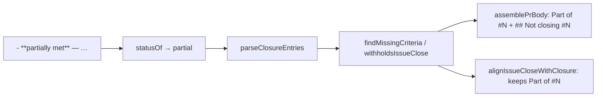

## Summary

The closure parser now reads a `## Acceptance Criteria` entry spelled
`**partially met**` (or `partially`, `partially-met`, `**partially** met`) as
`partial`, and `**not met**` as `missing`. Before, `statusOf` matched only the
exact words, so such an entry disappeared. The close guard, `assemblePrBody` and
`alignIssueCloseWithClosure` then kept or restored `Closes #N` for an issue the
summary said was unfinished (VibeCoder#5034). The draft-continuation body and
its module doc now say the close is withheld when an entry is `partial` or
`missing`, not only `missing`. Closes #5053.

## Spec

### Intent and Rationale

- Fix the shared parser rather than add a gate. Every reader of the block
  (`parseClosureEntries`, `findMissingCriteria` / `withholdsIssueClose`,
  `assemblePrBody`, `alignIssueCloseWithClosure` and the closure gate) gets the
  fix at once, as the issue asks.

### Essential Design Decisions

- The match stays anchored at the start of the entry, after the
  `[\s*_`]*` emphasis prefix. A status word in criterion prose ("The criterion
  is partially met") is still not an assessment.
- `LEADING_STATUS_RE` in `closure_criterion_match.ts` is the twin of `statusOf`.
  It strips the same status to get the entry's subject, so it takes the same
  status words and now ends at the same `\b`. Without that, `partially met`
  would leave `ly met**` in the subject, and the entry would no longer match its
  criterion by words.
- Both patterns stay hardcoded literals rather than a regex built from a shared
  string (Semgrep's ReDoS rule). A test pins their agreement through
  `subjectOf` on the parsed entry.
- Bare `**not**` and `**nothing met**` are still not statuses. Only `not met`
  maps to `missing`.

### Undiscoverable Facts

- `independent_review_gate.ts` has its own leading-token parser
  (`LEADING_TOKEN_RE`). The issue does not name it, and it still does not see a
  `partially met` entry. That affects only the `reviewer:` field rules, not the
  close decision, so it is left unchanged.

## Evidence

Backend only: no UI file is touched. A rewritten status flows through this path:

Issue numbers this diff cites: #5053: Worker reads a `**partially met**`
closure entry as no entry, so the PR body keeps `Closes #N` for an issue its
summary says is unfinished (VibeCoder#5034).

Docs sweep: I read the closure-block section of
`docs/workflows/issue-processing.md` ("Each assessment starts with its status
word …") and updated it. I grepped for `unless an entry is` across
`worker/deno/lib`, `prompts` and `docs` (archive excluded). The only stale copy
was in `draft_continuation_pr.ts`. Line 1185 of `issue-processing.md` already
said `partial` or `missing`.
`worker/deno/tests/draft_pr_self_heal_4952_test.ts` keeps the old sentence on
purpose, because its legacy fixture reproduces a body written before the fix.

## Test Plan

- Added `worker/deno/tests/closure_status_spelling_5053_test.ts`. It covers:
  - each `partially` and `not met` spelling, with the exact statuses parsed;
  - canonical controls;
  - look-alikes (`**partiality**`, `**metadata**`, `**not**`, `**notable**`,
    `**nothing met**`, non-leading prose) that parse to no entry;
  - `subjectOf` stripping the whole status;
  - `withholdsIssueClose`;
  - `assemblePrBody` returning `Part of #4930` and `## Not closing #4930` with
    no closing keyword;
  - `alignIssueCloseWithClosure` keeping and rewriting to `Part of`;
  - hostile 50,000-character whitespace and marker runs, one per pattern,
    asserting their results.
- Red before the fix: run against the unfixed `statusOf` and
  `LEADING_STATUS_RE`, 7 of the 9 tests failed. The first failure was
  `**partially met**` parsing to `[]`, not `["partial"]`. `assemblePrBody` still
  carried `Closes #4930.` with no `Part of #4930`. The canonical-control and
  look-alike tests passed, as expected. After the fix, all 9 pass.
- Edited `worker/deno/tests/draft_continuation_4146_test.ts`:
  - Removed from `worker/deno/tests/draft_continuation_4146_test.ts`:
    ``assert(body.includes("unless an entry is `missing`"), body);``
    - Required by: "Generated instructions must say that both partial and missing product criteria withhold closure"
    - Replaced by: ``assert(body.includes("unless an entry is `partial` or `missing`"), body);``
- Re-ran these after the fix, all passing:
  - `worker/deno/tests/acceptance_criteria_gate_test.ts`
  - `worker/deno/tests/closure_entry_grammar_4977_test.ts`
  - `worker/deno/tests/closure_criterion_match_test.ts`
  - `worker/deno/tests/missing_criterion_close_guard_3177_test.ts`
  - `worker/deno/tests/label_tail_redos_3186_test.ts`
  - `worker/deno/tests/pr_body_sync_test.ts`
  - `worker/deno/tests/unmet_criteria_gate_test.ts`
  - `worker/deno/tests/draft_pr_self_heal_4952_test.ts`
- `./quality.sh < /dev/null` on the head passed, with checks skipped as
  configured. The first run hit my own 600s bound during the test stage. The
  re-run with a longer bound passed every stage.
- Corpus run: I ran `parseClosureEntries` at head over all 1,437
  `docs/archive/pr-summaries/*.md` files and got 5,036 entries. Exactly one
  entry opens with a new spelling: `pr-summary-2896.md`, `**partially met** —
  NEAT-AI-Snapshot …`, which now parses as `partial`. The base drops it. That is
  1 new true positive, 0 false positives and 0 false negatives among entries
  that open with `partially` or `not met`.

Not done or not checked: `independent_review_gate.ts` still reads only the exact
status words, as explained above. I did not repeat the corpus run over this
PR's own test file; its look-alike cases cover that.

🤖 Generated with [Claude Code](https://claude.com/claude-code)
