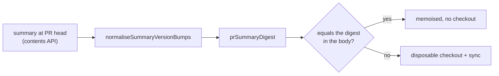

## Summary

`headSummaryDigest` in `worker/deno/lib/pr_body_reconcile.ts` hashed the summary
file exactly as committed. The digest a worker PR body records comes from the
loaders' content (`loadPrSummary` / `loadCommittedPrSummary` in
`worker/deno/lib/pr_summary_loader.ts`), which runs
`normaliseSummaryVersionBumps` first. For a summary holding a literal line such
as ``Version bump: `VERSION` 1.2.3 → 1.2.4`` the two digests never matched, so
every reconcile pass logged "digest differs", made a disposable checkout, and
the sync then skipped as "summary unchanged".

- `headSummaryDigest` now hashes `normaliseSummaryVersionBumps(summary)`, the
  same content completion and the sync hash.
- A reconcile test with a literal bump line asserts that neither of two passes
  makes a checkout.

Closes #5057.

## Spec

### Intent and Rationale

- Hash the same content on all three paths. Completion
  (`worker/deno/lib/phases/completion_phase.ts`,
  `summaryDigest:
  prSummaryDigest(rawSummaryContent)`, where
  `rawSummaryContent` is the loader's content) and `buildSyncedPrBodyCandidate`
  in `worker/deno/lib/pr_body_sync.ts` already hash normalised content, so only
  the reconcile read needed changing.

### Essential Design Decisions

- The issue's suggested `summaryDigestOf(raw)` helper was not added. The other
  two paths receive content the loader has already normalised, so routing them
  through the helper would normalise twice and change nothing. The reconcile
  calls the loader's own exported `normaliseSummaryVersionBumps`, so the rule is
  not copied.
- The digest format and the body marker are unchanged, so no recorded digest
  goes stale.

### Undiscoverable Facts

None.

## Evidence

Backend only. No UI file is touched.

- Docs: `docs/workflows/pr-feedback.md`, section "Priority 1.64 — Reconcile PR
  Body Digests". It now says the digest is taken after the loaders'
  normalisation. The `headSummaryDigest` doc comment says the same. The
  post-push sync sentence in the same file ("the digest is of the summary alone,
  Issue #4234") was re-read. It describes the sync, which already hashes loader
  content, so it stays true.
- Callers of `headSummaryDigest` checked: `reconcilePr` in
  `worker/deno/lib/pr_body_reconcile.ts` (the reconcile pass) and the
  `headSummaryDigest` tests in `worker/deno/tests/pr_body_reconcile_test.ts`.
  Their summaries carry no bump line, so normalisation leaves them unchanged and
  they still pass.
- Issue numbers this diff adds: #5057 (PR body reconcile hashes the raw summary
  but the body records the normalised digest, so a summary with a literal
  version-bump line is checked out again on every pass).

## Test Plan

- Added to `worker/deno/tests/pr_body_reconcile_test.ts`: "reconcile - a summary
  with a literal version-bump line matches its recorded digest: no checkout on
  either pass (Issue #5057)".
  - The recorded digest comes from the real `loadPrSummary` on a temporary
    directory, the content completion hashes.
  - Positive control: normalisation changes this summary, and the raw and
    normalised digests differ.
  - The test then asserts two passes with no checkout, no log lines, one
    contents read, and the memo set on the first pass.
- Red against the base `worker/deno/lib/pr_body_reconcile.ts`: the new test
  failed (35 passed, 1 failed). The second pass re-checked the PR (`checked: 1`,
  expected `0`) because the first pass never memoised it.
- Green after the fix:
  `deno task test:unit tests/pr_body_reconcile_test.ts
  tests/pr_summary_loader_test.ts tests/pr_body_sync_test.ts`,
  133 passed and 0 failed. `deno fmt --check`, `deno lint` and `deno check` on
  the two changed TypeScript files are clean.
- No existing test was edited, and no assertion was removed.
- Full `./quality.sh` on 41b5cc84 (the code, test and docs commit): passed with
  skipped checks. Config integration was skipped (no `.config.json`), and
  checkov is not installed here.
