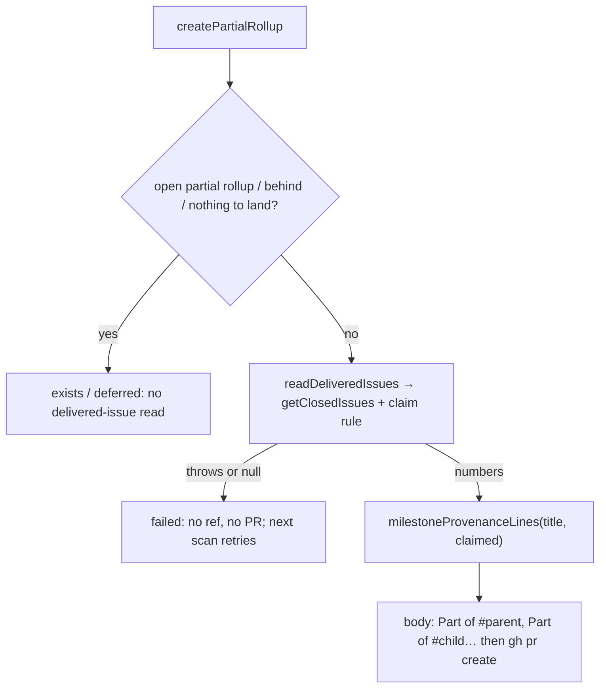

# PR Summary — Issue #5058

## Summary

A partial milestone rollup PR now links the issues it serves. It carries the
same anchored `Part of #N` lines as the full rollup: one line for the
milestone's parent (the leading `#N` of its title) and one for each claimed
child the milestone delivered, ascending and capped at
`MILESTONE_PROVENANCE_MAX_CHILDREN`. It never carries a closing keyword. Both
bodies render these lines through a new shared helper,
`milestoneProvenanceLines`, so the two cannot drift apart. Before this change
the partial rollup body had no `Part of` line, and its `partial-rollup/…` head
does not match the reviewer's `issue-<N>-…` pattern. `resolveGoverningIssues`
therefore found no governing issue, and every meaningful test change carried by
a partial rollup was sent back. Closes #5058.

## Spec

### Intent and Rationale

- The partial rollup is the only review that child test changes get, because PRs
  into a milestone branch are not reviewed. Its body is written by the worker,
  so only the worker can give the reviewer the issues to read.
- Moving the #4967 logic into one helper, rather than copying it into the
  partial rollup, keeps one rule for which numbers are linked.

### Essential Design Decisions

- **Same claim rule as the full rollup.** The delivered children come from
  `getClosedIssues` in `milestone_completion.ts`, which excludes trackers and
  classifies claims. Only issues with no `claimProblem` are linked.
- **The read is injected.** `milestone_deadlock_rollup.ts` must not import
  `milestone_completion.ts` (that would be an import cycle), so
  `DeadlockRollupOptions` and `PartialRollupOptions` take a required
  `readDeliveredIssues` callback.
- **The read is lazy and fails loud.** `createPartialRollup` calls the callback
  only after the idempotency, behind and nothing-to-roll-up checks. A deferred
  or existing outcome therefore never pays for the classification. A failed read
  (including `getClosedIssues` returning `null`) returns `failed` with the
  cause, and creates no ref and no PR. The partial rollup body is never
  refreshed after creation, so a body without its children could not be fixed
  later. The next scan retries the read instead.
- **No tracking issue is excluded for a partial rollup.** A deadlocked milestone
  never completes, so it has no tracker, and `getClosedIssues` already drops
  trackers. With no leading `#N` in the title and no delivered issues, the body
  is byte-identical to the body before this change.

### Undiscoverable Facts

- The `Part of` numbers are the target repository's own issues: the milestone
  title's `#N` and its closed children. So they respect the #3674 rule that the
  body cites no VibeCoder issue number.

## Evidence

Backend change, with no UI.

- Files:
  - `worker/deno/lib/milestone_provenance.ts` (new): `milestoneProvenanceLines`.
  - `worker/deno/lib/milestone_completion.ts`: `buildMilestoneSummaryBody` calls
    the helper, with byte-identical output. The `raiseDeadlockPartialRollups`
    call passes `readDeliveredIssues`.
  - `worker/deno/lib/milestone_partial_rollup.ts`: `buildPartialRollupBody`
    gains `deliveredIssues`, and `createPartialRollup` gains the lazy read.
  - `worker/deno/lib/milestone_deadlock_rollup.ts`: passes the read through for
    each deadlocked milestone.
  - `docs/audits/lib-sweep-coverage/top-up-5058.json`: claims the new module in
    a sweep slice.
- The reviewer's anchored-line rule that this relies on is `PART_OF_SAME`
  (`^[ \t]*Part of #(\d+)…$`) in
  `.claude/skills/review-fleet-prs/scripts/test_change_policy.ts`, scanned over
  the first 200 body lines. The new lines sit in the body's first paragraphs.
- Docs: no operator manual documents the partial rollup body. A grep of `docs/`
  (excluding archive and audits), `README.md` and `DESIGN-PRINCIPLES.md` for
  "partial roll" found nothing. The full-rollup paragraph in
  `docs/workflows/milestones.md` (Final PR) stays true. The module doc, its
  flowchart and the `buildPartialRollupBody` doc comment in
  `milestone_partial_rollup.ts` were updated.
- Issue numbers this diff cites:
  - #5058: Partial milestone rollup PR links no governing issue, so the
    reviewer's test-change policy sends back any partial rollup that changes a
    test.
  - #4967: Milestone roll-up PR links only its unlabelled tracking issue, so the
    reviewer's test-change policy sends back every roll-up that changes a test.
  - #3674: Partial-rollup PR body and base-integrity PR comments still cite
    VibeCoder issue numbers in target repos.
  - #3662: Milestone completion reads closed sub-issues from a 500-issue
    repo-wide batch, so an older milestone's rollup is skipped as empty.

## Test Plan

- `worker/deno/tests/milestone_provenance_test.ts` (new, 9 tests). It covers
  parent-then-children ordering, deduplication, the child cap, exclusion of the
  tracking issue and the parent, and refusal of zero, negative and unsafe
  numbers. Each test uses literal expected values.
- `worker/deno/tests/milestone_partial_rollup_test.ts`. The fake gains a
  `readDeliveredIssues` field defaulting to `[]`, so the existing tests keep
  their assertions, and the "cites no bare #N (Issue #3674)" test is unchanged.
  New tests:
  - A `#42` title with delivered `[81, 77, 77, 42]` gives exactly `Part of #42`,
    `#77` and `#81`, with no closing keyword.
  - A read that throws `HTTP 502` gives `failed` with that cause, and creates no
    ref and no PR.
  - The read is not called on a deferred or existing outcome.
- `worker/deno/tests/milestone_completion_test.ts`:
  - Reviewer test: a partial rollup body for `#42 Retry policy` with delivered
    `[77]`, under a `partial-rollup/…` head, is run through
    `resolveGoverningIssues` and `assessTestChanges`. It links
    `[[42,"part-of"],[77,"part-of"]]` and finds the quote held only in child
    #77, with no findings. Its control, with no title `#N` and no children,
    reports "no usable governing issue".
  - Production wiring through `checkAndHandleMilestoneCompletions`:
    - A claimed closed child (#1456, with a merged `(#1456)` PR scripted) puts a
      `Part of #1456` line in the `pr create` body.
    - The default, unclaimed scenario adds no such line.
    - A failed closed-issue read raises no PR and logs a warning naming
      `'Web src'`.
  - `rvReply` and `assessRollupBody` take a `headRefName` (default
    `milestone/v1-0`), so the existing #4967 callers are unchanged.
- `worker/deno/tests/regex_backtrack_followup_3206_test.ts`: the `rollup` helper
  passes the new required option, and its assertions are unchanged.
- No assertion was removed from any existing test.
- Red before the fix: the new partial rollup, reviewer and wiring tests failed
  against the unfixed production code (run with `--no-check`, since the new
  options do not type-check there). Before the fix, the body had no `Part of`
  lines, a failing read still returned `created`, and the read was never called.
  The unclaimed-child test and the reviewer control pass on the base code by
  design.
- Callers checked for the new required option:
  - `raiseDeadlockPartialRollups` is the only production caller of
    `createPartialRollup`.
  - `processRepoMilestones` is the only production caller of
    `raiseDeadlockPartialRollups`.
  - The only callers of `buildPartialRollupBody` are `createPartialRollup` and
    the tests.
- `./quality.sh < /dev/null` on the head: PASSED. The parallel unit pass took
  8m25s and the serial pass 3m51s. Lint, type check, fmt, markdownlint, mermaid,
  semgrep, gitleaks and the completeness checks passed. The host skipped config
  integration and checkov.

Not done or not checked:

- No real deadlocked milestone was rolled up end to end. The `gh` responses are
  scripted fakes in the existing deadlock fixture's shape.
- No independent reviewers were dispatched, because the issue has no
  acceptance-criteria heading.
