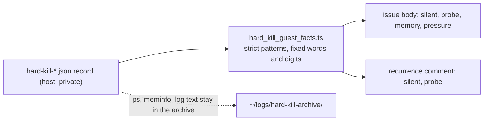

## Summary

The hard-kill issue the worker files now carries four figures derived from the
evidence record, so a recurrence can be classified without reading the host's
archive: the silence before capture, the state of the guest exec probe, guest
memory and guest pressure. They are in the issue body and in the one-line
follow-up comment on a recurrence (silence and probe state). The cause of the
#5062 wedge on `GRQ-25` is not established; its evidence is in that host's
`~/logs/hard-kill-archive/`, which this host cannot read. Part of #5062.

## Spec

### Intent and Rationale

- The report said only "agent turn" and a last-log time. It could not tell a
  frozen guest VM (the exec probe does not answer, the log stops dead) from an
  agent hung in a live VM. For #5062 the capture came 48m 51s after the last log
  line, and the run id `vibe-mwc7uss5` decodes to a start of
  2026-11-11T14:30:33Z, 3h 11m before the capture: consistent with the launcher
  watchdog's default `11400s` (3h 10m) deadline expiring on a run whose log had
  already gone quiet. The next recurrence needs the distinction in the public
  issue, because the archive stays private.
- The same gap held up #4815, which was deferred because its evidence was on
  another host. This does not diagnose #5062; it makes the next one diagnosable.

### Essential Design Decisions

- The public issue stays free of evidence text. Each figure is a fixed word or
  digits captured by a strict, bounded pattern (`hard_kill_guest_facts.ts`); no
  `ps`, meminfo or log text is returned. The figures are not part of the dedup
  signature `hard-kill-<handler>-<phase>`.
- The probe state is read with the same cause constants the capture writes
  (`GUEST_EXEC_NO_ANSWER_CAUSE`, `NOT_COLLECTED_CAUSE` in
  `hard_kill_evidence.ts`), so the two cannot drift. A `Z`-less or later-than-
  capture timestamp gives `unknown` rather than a guessed time.

### Undiscoverable Facts

- `/proc/pressure/*` does not exist in the worker container, so the pressure
  fixtures use the kernel's documented `some|full avg10=… total=…` shape; the
  meminfo fixture is real `cat /proc/meminfo` output.
- The deno test
  `createFallbackFlagFiler - routes the label creation through the
  caller's gh (Issue #2310)`
  in `tests/merge_fallback_issue_test.ts` fails on this host on the base commit
  `4462521e` too (checked in a detached worktree), so the full gate's parallel
  pass reports it. It is unrelated to this change.

## Evidence

Backend-only change; no UI files.

Real tool observed: `cat /proc/meminfo` in the worker container gave the
`MemTotal:` / `MemAvailable:` line shapes the meminfo fixture copies.

Issue-number provenance: #4815: "Hard kill: container wedged in completion
(watchdog)" (the same gap, deferred); #4253 and #4254 are cited by the existing
doc text the change edits.

## Reproduction

- **symptom** — a hard-kill issue names only "agent turn" and a log time, so a
  frozen guest and a hung agent look the same
- **status** — `partial` — the missing distinction is reproduced; the wedge on
  `GRQ-25` itself is not
- **reason** — the evidence of run `vibe-mwc7uss5-1071e3` is in the archive of
  `GRQ-25`, unreadable here; the tests drive the real `captureHardKillEvidence`
  with a failing exec to produce the records, not a real frozen VM
- **regression test** —
  `worker/deno/tests/hard_kill_report_test.ts::the body carries the four guest figures under the last log time (Issue #5062)`

## Acceptance Criteria

- **missing** — Hard kill: container wedged in execute (watchdog) — the cause of
  the wedge in run `vibe-mwc7uss5-1071e3` — reason: its evidence is on `GRQ-25`;
  this change adds the figures that classify the next recurrence, and a later
  run acts on the first recurrence that carries them

## Test Plan

- `worker/deno/tests/hard_kill_guest_facts_test.ts` (new, 27 tests): silent time
  (the incident's `48m 51s`, hours, mtime note, no `Z`, `unknown`,
  after-capture, unparseable), the four probe states driven by the real
  `captureHardKillEvidence`, memory, pressure (partial, `some`/`full`,
  malformed), privacy (a private title and a token in `ps`/meminfo never
  appear), and 64 KiB hostile fields.
- `worker/deno/tests/hard_kill_report_test.ts`: 4 new tests: the body's four
  lines for the incident's values, an answered guest's numbers, guest free text
  never reaching the body, and the recurrence follow-up line. No existing
  assertion changed.
- `worker/deno/tests/run_failure_issue_test.ts`: the fixture of
  `runFailureNamesReadableSource - a hard-kill body stays schedulable (Issue #4462)`
  gains `evidence.guest` (all empty strings) because `formatHardKillBody` now
  reads it; no assertion changed or removed.
- Red checks (mutation applied, tests run, restored): `hardKillGuestProbe`
  always `answered` → 8 tests red (the four producer-driven probe tests,
  privacy, 64 KiB ps, and the body and follow-up tests); `Z` requirement dropped
  → the no-`Z` test red; the four lines removed from `formatHardKillBody` → 3
  red; the follow-up suffix removed → the follow-up test red.
- Other callers of the changed function: `hardKillTerminalRun` and
  `reportPendingHardKills` do not read the new figures; the only other builder
  of a truncated evidence object was the `run_failure_issue_test.ts` fixture
  above.
- Docs read and updated: `docs/workflows/resilience-and-concurrency.md`
  (hard-kill evidence paragraphs), `docs/TROUBLESHOOTING.md` (exit 87 section),
  `docs/CALLBACKS.md` (the Filing bullet); the header and `formatHardKillBody`
  doc comments in `hard_kill_report.ts`. The new module is claimed in
  `docs/audits/lib-sweep-coverage/top-up-5062.json`.
- `deno task test:unit` on `hard_kill_guest_facts_test.ts`,
  `hard_kill_report_test.ts`, `hard_kill_evidence_test.ts`,
  `run_failure_issue_test.ts`: passed (124 and 118 tests across the two runs).
- `./quality.sh < /dev/null` (first run, before the fixture fix): every stage
  passed except `deno tests`, whose parallel pass reported 2 failures: the
  `run_failure_issue_test.ts` fixture (fixed in the second commit; the file
  passes now) and the pre-existing `merge_fallback_issue_test.ts` failure above.
  The serial pass did not run because the parallel pass failed. The gate was not
  re-run after the fixture fix: it takes about 9 minutes here and would stop on
  the same pre-existing failure.

Not done or not checked: the wedge on `GRQ-25` is undiagnosed; no real frozen VM
was available; the full gate's serial pass has not run on this head.
