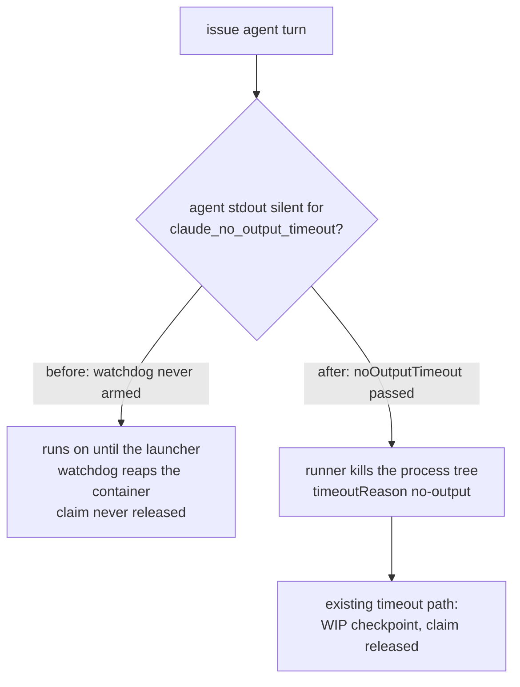

## Summary

The issue-work agent turn never armed the no-output (silence) watchdog.
`docs/CONFIGURATION.md` documents `claude_no_output_timeout` (600 s by default)
as the stuck-process detector that "still kills a silent run however many
extensions were granted" on issue work. Neither issue-run call site passed it to
the runner, though: `invokeAgent` in `worker/deno/lib/phases/execute_phase.ts`
(the main loop) and `runExecuteClaudePhase` in
`worker/deno/lib/execute_claude_phase.ts` (the `execute-claude-phase` command,
where the value was used only for diagnostics). The runner's silence watchdog is
off when `noOutputTimeout` is absent. A silent agent turn therefore ran on until
the launcher watchdog reaped the container. Both incidents on this issue have
that shape: last step `agent turn`, with the worker log silent for about 49
minutes (16:53:16Z to 17:42:07Z) and for 54m 20s. Both call sites now pass
`claude_no_output_timeout` to the runner. The host's incident archive could not
be correlated from here, so the issue stays open. Part of #5062.

## Spec

### Intent and Rationale

- The fix uses the control already documented for issue work, so it guesses no
  new timeout and loosens no containment. A silent turn is killed inside the
  container after `claude_no_output_timeout`. The ordinary timeout path then
  checkpoints the work and releases the claim, so the container is not wedged
  until the launcher reaps it.

### Essential Design Decisions

- The configured value is passed through unchanged, so `0` still switches the
  watchdog off, as it does in every other phase.
- Trade-off: the agent's stream is silent while one tool call runs. So a single
  foreground command running longer than `claude_no_output_timeout` is now
  killed on issue work, as it already was on CI-fix and PR-feedback runs.
  `docs/CONFIGURATION.md` tells operators to raise the key on a host whose gate
  is that slow.

### Undiscoverable Facts

- `~/logs/hard-kill-archive/` does not exist on this host (`vibe-coder-57749`),
  and `~/logs` holds no line for run `vibe-mwemw9zw-65c352` or
  `vibe-mwc7uss5-1071e3`. The archive lives on `GRQ-25`, which earlier runs
  found does not resolve from the executor.

## Evidence

Purely backend changes, with no UI files.

- `worker/deno/lib/phases/execute_phase.ts`: `invokeAgent` passes
  `noOutputTimeout: config.claudeNoOutputTimeout`. This covers the subscription
  switch's second call and the external-orchestration route, because both take
  the same options.
- `worker/deno/lib/execute_claude_phase.ts`: `claudeRunOptions` passes
  `noOutputTimeout: claudeNoOutputTimeout`. The doc comment on that option no
  longer says the value is only for diagnostics.
- `worker/deno/commands/execute_claude_phase.ts`: the
  `--claude-no-output-timeout` usage text now says it arms the watchdog.
- `docs/CONFIGURATION.md`: a paragraph in "Timeout behaviour" says issue work
  arms the watchdog and sets out the long-silent-tool-call trade-off.
- Docs read: `docs/CONFIGURATION.md` lines 2000, 2051, 2705-2770 and 3055-3066.
  They already described the armed watchdog on issue work, which is true now.
  `lib/agent_progress.ts` already says a silent agent is the no-output
  watchdog's territory.
- Callers checked: these are the only two issue-run spawns of
  `runClaudeWithRetry` with `phase: "issue"`. The other phases (CI fix, PR
  feedback, spelling, merge conflict, grill-me and custom label) already pass
  `noOutputTimeout`.
- Issues cited: #5062 is this issue. #1825 is the silence watchdog the runner
  already implements.

## Reproduction

- **symptom** — a container wedged in `execute` after the `agent turn` step: the
  worker log was silent for about 49 minutes in the first incident and 54m 20s
  in the second, until the launcher watchdog reaped it. The claim was never
  released.
- **status** — `partial` — reason: the regression tests reproduce the wiring
  defect against the unfixed base code (the issue run reaches the runner with
  `noOutputTimeout` undefined, so the silence watchdog is off). They were not
  run against the incident itself, because its archive on `GRQ-25` could not be
  reached, so what the agent was doing during the silence was not observed.
- **regression test** —
  `worker/deno/tests/execute_phase_routing_test.ts::execute_phase - the issue run arms the configured no-output watchdog (Issue #5062)`

## Acceptance Criteria

- **missing** — "Correlate the worker's last operation, agent activity and
  guest/host health through the existing authorised diagnostic path, or a
  bounded replay" — reason: the incident archive is on `GRQ-25`, which does not
  resolve from this executor, and this host's `~/logs` holds nothing for either
  run. The guest probe's `did not answer` in the 13 November run is not
  explained by this fix.

## Test Plan

- `worker/deno/tests/execute_phase_routing_test.ts` adds two tests:
  - "execute_phase - the issue run arms the configured no-output watchdog (Issue
    #5062)": with `claudeNoOutputTimeout` 437, every runner call receives
    `noOutputTimeout` 437.
  - "execute_phase - claude_no_output_timeout 0 leaves the silence watchdog off
    (Issue #5062)": with 0, every runner call receives 0.
- `worker/deno/tests/execute_claude_phase_test.ts` adds "runExecuteClaudePhase -
  arms the configured no-output watchdog on the coding run (Issue #5062)" (437
  reaches the runner).
- Red before the fix: against the unmodified `execute_phase.ts`, both routing
  tests failed (`Actual undefined, Expected 437` and
  `Actual undefined,
  Expected 0`). Against the unmodified
  `execute_claude_phase.ts`, the command path test failed
  (`Actual undefined, Expected 437`).
- These tests check that the value reaches the runner. That the runner then
  kills a silent process is covered by existing tests:
  `worker/deno/tests/claude_runner_test.ts::runClaudeWithTimeout - kills silent process via no-output watchdog (Issue #1825)`
  and
  `worker/deno/tests/claude_runner_progress_extension_4296_test.ts::runClaudeWithTimeout - the silence watchdog still kills an extended run (Issues #1825, #4296)`.
- Green on the final head:
  `deno task test:unit tests/execute_claude_phase_test.ts tests/execute_phase_routing_test.ts`
  gave 70 passed, 0 failed.
- Full `./quality.sh` on head `00acb574` PASSED with skipped checks. Config
  integration was skipped (no `.config.json`), and so was checkov (not
  installed).
- No existing assertion was removed or edited.

## Not checked

- The incident archive (worker log, agent transcript, boot logs, guest probes)
  for either run was not read. If the guest itself froze, an in-guest watchdog
  cannot fire either, and the launcher watchdog stays the backstop.
- No live issue run was observed being killed by the newly armed watchdog.
