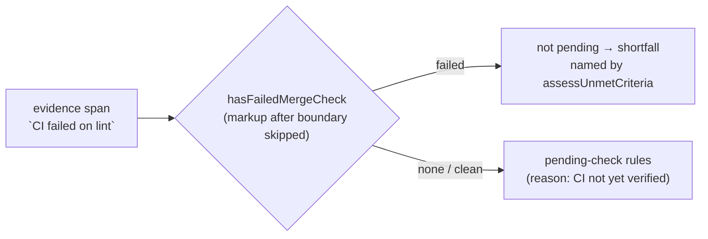

## Summary

`hasFailedMergeCheck` in `worker/deno/lib/degraded_delivery.ts` matched a check
declaration (`CI failed`, `quality gate failed`, ...) only at the very start of
the evidence or straight after `;`, `.` or `—`. `renderClosureBlocks` wraps
evidence in a code span, so the evidence span always began with a backtick, and
a failed check at its start was missed. An entry such as
``evidence: `CI failed on lint` — reason: CI not yet verified`` was then read
as a pending merge check, not a shortfall. `assessUnmetCriteria` therefore did
not name it, and the run got no recovery round to fix the failed check.

- The declaration prefix is now `(?:^|[;.—])[\s`*_]*`: whitespace, backticks
  and `*` / `_` emphasis between the boundary and the declaration are skipped.
  The rest of the pattern is unchanged.
- Two tests drive `renderClosureBlocks` → `assessScopeShortfalls`: one where a
  failed check is a shortfall, and an allowed control.

Closes #5063.

## Spec

### Intent and Rationale

- Widen the accepted prefix rather than strip backticks from the evidence. This
  also covers a declaration after `;` that opens another code span
  (`` `lib/x.ts`; `CI failed` ``) and hand-written `**`CI failed`**` emphasis,
  and it leaves the evidence text the other checks read untouched.

### Essential Design Decisions

- Markup is skipped only directly after a boundary (start, `;`, `.`, `—`). A
  word in the middle of a phrase, such as `tests/foo_test.ts passed`, still
  does not count as a declaration.
- A later clean result still supersedes an earlier failure for the same check
  (`CI failed; CI passed` stays pending), as before.

### Undiscoverable Facts

None.

## Evidence

Backend only. No UI file is touched.

- Corpus run of `isPendingMergeCheck` over every closure entry in
  `docs/archive/pr-summaries/` (1436 files, 5035 entries), base against head:
  no entry changed classification, so the change added no false positives or
  false negatives on the archive. One entry is pending on both.
- Docs: `docs/workflows/issue-processing.md` names `isPendingMergeCheck` only
  for its shared field grammar, which is unchanged, so it needed no edit. The
  doc comment above `hasFailedMergeCheck` now says that markup is skipped.
- Callers: `isPendingMergeCheck` is used by `assessScopeShortfalls`
  (`degraded_delivery.ts`) and `assessUnmetCriteria`
  (`worker/deno/lib/unmet_criteria_gate.ts`). The suite for each passes at the
  head.
- Issue numbers this diff adds: #5063 (Pending-merge-check classifier misses a
  failed check at the start of rendered evidence, so a failed-CI criterion is
  treated as pending, not unmet).

## Test Plan

- Added to `worker/deno/tests/degraded_delivery_test.ts`:
  - "assessScopeShortfalls - a failed check at the start of rendered evidence
    is a shortfall, not pending (Issue #5063)". It renders the evidence
    `CI failed on lint`, `CI failed`, `quality gate failed` and `tests failing`
    with reason `CI not yet verified`, and also uses two hand-written bodies
    (`**`CI failed`**`, and `` `lib/x.ts`; `CI failed` ``). Each must give a
    `partial` shortfall.
  - "assessScopeShortfalls - a passed check at the start of rendered evidence
    stays pending (Issue #5063)" is the allowed control: `CI passed on lint`,
    `quality gate passed` and `CI failed; CI passed` give no shortfall.
- Red against the base `degraded_delivery.ts`: the failed-check test failed on
  `CI failed on lint` (expected one `partial` shortfall, got `[]`). The control
  passed on the base.
- Green after the fix: `deno task test:unit tests/degraded_delivery_test.ts
  tests/unmet_criteria_gate_test.ts tests/closure_verdict_test.ts
  tests/acceptance_criteria_gate_test.ts` passed with 0 failed.
- No existing test was edited, and no assertion was removed.
- Full `./quality.sh` on ed862d95 passed with skipped checks. Config
  integration was skipped (no `.config.json`), and checkov is not installed
  here.
