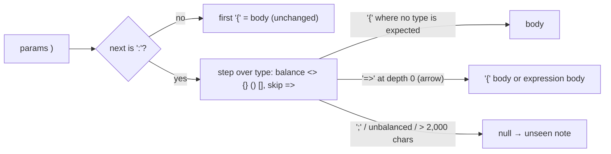

## Summary

The dummy-test scan no longer takes a helper's return type for its body.
`definitionsIn` in `worker/deno/lib/dummy_test_scan.ts` took the first `{`
after a helper's parameter list as the body. For a helper declared
`): Promise<{ publishedBase: boolean; lines: string[] }> {` (VibeCoder#5059),
that `{` opens the return type. The scan therefore found no assertion, and a
test that asserts through the helper was refused as `no-assertion`. A new
`afterReturnType` step now moves past a TS `:` return-type annotation, using
bracket balancing for `<>`, `{}`, `()` and `[]`, and the body search starts
after it. Closes #5065.

## Spec

### Intent and Rationale

- This fixes the existing check, as the issue proposes. No gate or rule is
  added. A helper that really asserts nothing is still refused.

### Essential Design Decisions

- After the `:`, a `{` at angle depth 0 is part of the type when a type is
  expected: at the start, or after `|`, `&`, `,`, `:`, `?`, `<` or `=>`.
  Otherwise it is the body. Brackets are skipped with the existing
  `closingBracket`. A `=>` inside the type is stepped over, so its `>` is never
  counted as a closing angle bracket.
- For an arrow, the first `=>` at depth 0 ends the annotation. A return type
  that is itself a bare function type (`(): () => void => {`) is therefore
  still misread. This is rare and left as it is.
- An annotation that does not end in view stores `null`, the existing value
  for "body runs past its hunk". A test calling that helper becomes an `unseen`
  note rather than a finding. Ends that count as "not in view": a `;` (an
  overload signature), a lone `=`, an unbalanced bracket, or more than 2,000
  characters (`MAX_RETURN_TYPE_CHARS`, marked `SIMPLE-ON-PURPOSE`). The cap
  keeps many definitions from making the scan quadratic.
- Rust definitions behave as before. The arrow expression-body test drops its
  optional `(?::[^=]{0,120})?` type part, because the annotation has already
  been stepped over.

### Undiscoverable Facts

- None.

## Evidence

Backend only: no UI file is touched.

- **Corpus run.** I ran `scanDummyTests` over all 2,359
  `worker/deno/tests/*.ts` files, each fed in as a new-file diff, using the
  base and head copies of the module. Base gave 145 findings and head gave 143.
  Notes were identical. The two that went away were both `success-only`:
  `worker/deno/tests/content_approval_tracker_test.ts:386` and
  `worker/deno/tests/setup_repo_default_branch_cache_test.ts:264`. Each test
  calls a helper with an object return type (`createMemoryFs(): { … } {` and
  `buildClone(): Promise<{ … }> {`). The scan now reads the real body of each
  helper. That body holds a `throw` (`createMemoryFs`) or `assertEquals` calls
  (`buildClone`), which the existing delegation rule counts as strong
  assertions. A helper with no annotation gets the same result. Counts: 0 new
  findings, and 2 results changed, both by the fix's intended path. No other
  result changed.
- Docs sweep: `CODING-STANDARDS.md` ("a test with no visible assertion that
  calls a helper defined in view is judged by the helper's assertions"),
  `docs/review-checklists.md`, `.claude/skills/review-fleet-prs/SKILL.md` and
  `prompts/pr_review_brief/prompt.md` describe the scan's delegation rule. The
  fix makes that rule hold for annotated helpers too, so none of them needed
  changing. `definitionsIn` has no twin: a repo-wide search for it and for
  "helper defined in view" found only this module and that standards
  paragraph.
- Issue numbers this diff cites: #5065: Dummy-test scan reads a helper's
  object-literal return type as its body, so a test that asserts through that
  helper is refused as asserting nothing (VibeCoder#5059).

## Test Plan

- Added to `worker/deno/tests/dummy_test_scan_5016_test.ts`:
  - "a helper whose return type holds an object type literal is judged by its
    body (Issue #5065)". Each fixture's only test calls a helper that asserts
    in its body, and each must give no finding. The shapes:
    - an async function returning `Promise<{ ok: boolean }>`;
    - an async arrow returning the same type;
    - a function with a bare `: { ok: boolean }` return type;
    - the VibeCoder#5059 head, re-wrapped across lines;
    - a nested generic and union (`Promise<Array<{ … }>> | { ok: false }`);
    - a function type inside the generic (`Promise<(x: number) => { … }>`);
    - an arrow with an expression body as a control.
  - "a helper with an object return type that asserts nothing is still refused
    (Issue #5065)". It uses the first four shapes, each with no assertion in
    its body. Each gives exactly `no-assertion` on the `Deno.test` line.
  - "an unterminated return type is a note, not a hang or a finding (Issue
    #5065)". A 50,000-character run of `<` after `):` gives no finding and one
    `unseen` note on line 2. An arrow with 50,000 spaces between `=>` and its
    `{` body is judged by that body and gives no finding. No timing
    assertions.
- Red before the fix: with the base `lib/dummy_test_scan.ts` restored and the
  new tests kept, 2 of the 3 new tests failed (`24 passed | 2 failed`).
  - The first failed on its first shape. The scan returned
    `[["no-assertion", 7]]` instead of `[]`, the issue's symptom. That test
    stops at its first failing shape, so the other shapes were not each
    observed red on base.
  - The hostile test failed because the base takes the `Deno.test` body's `{`
    as the helper's body and refuses the test.
  - The refusal test passes on base, as a guard that it should. After the fix,
    all pass.
- No existing test was edited. `worker/deno/tests/dummy_test_scan_wiring_5016_test.ts`
  also passes.
- `./quality.sh < /dev/null` on the head passed, with checks skipped as
  configured.

Not done or not checked: a return type that is itself a bare function type on
an arrow (`(): () => void => {`) is still misread, as described above.

🤖 Generated with [Claude Code](https://claude.com/claude-code)
