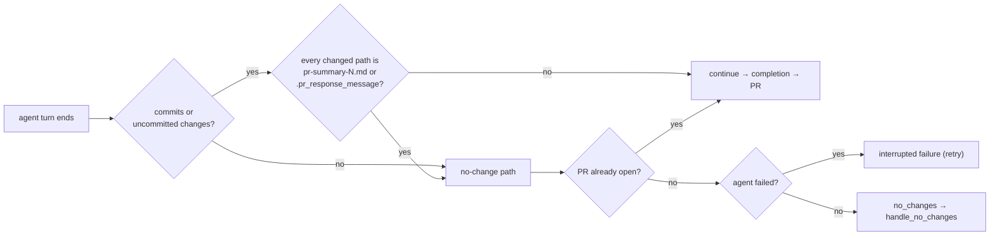

## Summary

Issue-run change detection in `worker/deno/lib/phases/execute_phase.ts` decided
there was work to publish from the commit count alone. A run that committed only
its own PR summary therefore raised a PR with no deliverable (VibeCoder#5069).
It also skipped the documented no-PR retry.

- New `worker/deno/lib/run_record_only.ts`:
  - `readBranchChangedPaths` lists every path the branch changes:
    `git diff --name-only -z <base>...HEAD`, tracked uncommitted changes
    (`git diff --name-only -z HEAD`) and untracked files that are not ignored.
    Any git failure is an error that names the command, never an empty list.
  - `changesOnlyRunRecords` is true only when that list is non-empty and every
    path is this issue's `docs/archive/pr-summaries/pr-summary-<N>.md` or the
    top-level `.pr_response_message`.
- Change detection runs that check whenever the branch has commits or
  uncommitted changes. A record-only branch now goes down the existing no-change
  path, and returns `early_exit` / `no_changes`, so `issue_worker.ts` routes it
  to `handle_no_changes`. The run's output carries forward as on any no-change
  run.
- The `## Retry: make the code change` nudge now says "committed no change to
  them" instead of "committed nothing", which is false for a record-only run.
  `docs/workflows/issue-processing.md` documents the new case.

Closes #5070.

## Spec

### Intent and Rationale

- The check sits in change detection rather than in the completion phase. A
  record-only run then reuses the whole no-change route (declared hand-offs, the
  analysis-only close, the not-finished retry), and no second copy of it is
  needed before PR creation.

### Essential Design Decisions

- Only this run's own record files count. Another issue's summary, a nested
  `foo/.pr_response_message`, or an untracked real file left for completion to
  commit is still a real change, and the PR is raised as before.
- The guards on the no-change path are kept for the new case:
  - The existing-PR backstop still applies, so a PR already open for the issue
    carries the run on to completion.
  - The failed-agent guard still gives an `interrupted` failure. Its reason
    gains `beyond its own run record`.
- Excluded: the remote-commits self-heal (Issue #585). The local branch already
  holds the commits, and a record commit the agent pushed would otherwise read
  as remote work and raise the PR anyway.
- If reading the changed paths fails, the worker logs a warning and keeps the
  previous behaviour (the PR is raised). The check is never treated as passed.

### Undiscoverable Facts

- VibeCoder#5069 is the observed case. The agent rewrote only
  `pr-summary-5062.md`, and merging it would have replaced the summary that the
  merged PR #5067 archived.

## Evidence

Backend only. No UI file is touched.

- The tests run the real `git` against a temporary repository with a bare
  `origin`, not a fake. `--end-of-options` before `<base>...HEAD` was checked to
  work with the installed `git diff`.
- Callers: `readBranchChangedPaths` and `changesOnlyRunRecords` are used only by
  `executeClaudeBody` in `execute_phase.ts`. `prSummaryFilePath` and
  `PR_RESPONSE_MESSAGE_FILE` are reused unchanged.
- Docs: in `docs/workflows/issue-processing.md`, the "Analysis-only / no-PR
  issues" bullet gains the record-only case and the "committed no change to
  them" wording. The `## 🧭 Analysis-only / no-PR issues` section was read, and
  says only "no code changes", which stays true.
- `docs/audits/lib-sweep-coverage/top-up-5070.json` claims the new module for
  the lib sweep ledger (Issue #1609).
- Issue numbers this diff adds: #5070 (A run whose only commit is the PR summary
  raises a PR instead of taking the no-changes retry path).

## Test Plan

- Added `worker/deno/tests/execute_phase_record_only_5070_test.ts`, which drives
  `workOnIssueExecuteClaude` with the real `runGitCommand`:
  - a: the only commit edits the run's own summary → `no_changes`.
  - b: the same commit also pushed to `origin/<branch>` → still `no_changes`
    (remote self-heal skipped).
  - c: own summary plus an untracked `.pr_response_message` → `no_changes`.
  - d: summary plus `lib/real.ts` in the commit → `continue` (PR raised).
  - e: own summary plus an untracked real file → `continue`.
  - f: only another issue's summary → `continue`.
  - g: record-only with an existing PR → `continue` (backstop kept).
  - h: record-only with an agent that exited 1 → `interrupted` failure whose
    reason contains `beyond its own run record`.
  - i: `changesOnlyRunRecords` unit cases (empty, both records, nested
    lookalike, another issue's summary).
  - j: `readBranchChangedPaths` with an unknown base ref → error naming the git
    command.
- Red on the base logic: with the new condition disabled, a, b, c and h failed
  (each gave `continue` or lacked the new reason text). d, e, f, g, i and j
  passed.
- Green: `deno task test:unit` over every `tests/execute_phase_*_test.ts`,
  `tests/handle_no_changes_phase_test.ts` and
  `tests/completion_wip_only_gate_test.ts`: 195 passed, 0 failed.
  `tests/lib_sweep_coverage_test.ts` passed, and `deno task check:manifests`
  passed.
- No existing test was edited, and no assertion was removed.
- Full `./quality.sh` on 65a4c253 failed only on the missing sweep-slice claim
  for `run_record_only.ts` (completeness checks, and
  `tests/lib_sweep_coverage_test.ts` in the deno tests). de290574 fixes that.
  The re-run on 480d4e31 passed with skipped checks: config integration (no
  `.config.json`) and checkov (not installed here).
- Not changed: the standalone `execute-claude-phase` command
  (`worker/deno/lib/execute_claude_phase.ts`, `runExecuteClaudePhase`) keeps its
  own commit-count change detection. The issue names the fleet's issue-run
  phase, and this PR changes only that phase.
