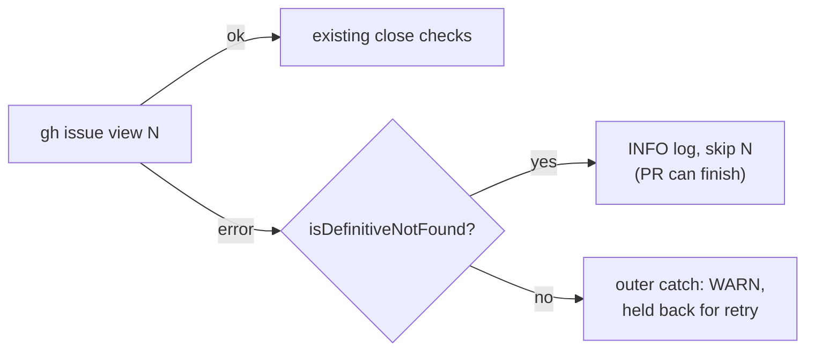

## Summary

The merged-PR close sweep (`closeIssuesForMergedPrs` in
`worker/deno/lib/pr_issue_linking.ts`) now treats an issue number that GitHub
says does not exist as terminal. Before, the per-issue catch held back every
error. Merged PR #5020's body says `Closes #5394`, an issue that does not exist
in this repository, so the PR was never marked processed and this warning
repeated every cycle:

```text
WARNING: [close-merged-pr] stSoftwareAU/VibeCoder#5394 (PR #5020): view/close failed; held back for retry: gh command failed (exit 1): GraphQL: Could not resolve to an issue or pull request with the number of 5394.
```

Only the `gh issue view` call is now wrapped. If the existing shared
`isDefinitiveNotFound` (`worker/deno/lib/github_not_found.ts`) recognises the
answer as a not-found, the sweep logs one INFO line, skips that number and does
not hold the PR back. Any other error is rethrown to the existing catch, which
still logs the warning and holds the PR back for retry. Closes #5075.

## Spec

### Intent and Rationale

- A number GitHub says does not exist can never be closed, so retrying it
  cannot succeed. Holding it back kept the whole PR out of the processed set,
  and the PR was re-examined and warned about every cycle.
- The fix reuses `isDefinitiveNotFound` rather than adding a new matcher. That
  helper is the repository's one "does this issue exist?" test, and the label
  strip and `escape_hatch_verify.ts` already use it.

### Essential Design Decisions

- The not-found check covers only the `issue view` step. A not-found from the
  landing check, the roll-back thread read or `issue close` still falls through
  to the existing held-back catch, because a 404 there does not mean the issue
  number is invalid.
- The INFO line goes through `logFn` with level `"info"`. In production
  (`run_core_production_deps.ts`) the sweep runs with `watermarkPath`, so the
  finished PR is recorded as processed and the line is logged once. The
  `pr_manager.ts` CLI path passes no `watermarkPath` and no `logFn`. There the
  number is skipped silently on each invocation, as an already-closed issue is.
- Other issues the same PR names are still handled. In the test, `#77` in the
  title is closed while `#5394` from the body is skipped.

### Undiscoverable Facts

- Observed with the real tool:
  `gh issue view 5394 --repo stSoftwareAU/VibeCoder --json state,labels,createdAt`
  exits 1 with
  `GraphQL: Could not resolve to an issue or pull request with the number of 5394. (repository.issue)`.
  The test fixture uses that text.

## Evidence

Backend only: no UI file is touched.



- `worker/deno/tests/pr_issue_linking_test.ts::pr_issue_linking - a merged PR naming an issue that does not exist is finished, not retried for ever (Issue #5075)`
- `worker/deno/tests/pr_issue_linking_test.ts::pr_issue_linking - a transient failure on an issue view is still held back (Issue #5075)`
- Docs sweep:
  - `docs/workflows/issue-processing.md` (the "At merge" passage on
    `closeIssuesForMergedPrs`) and `docs/GH-API-OPTIMISATION.md` describe no
    retry or hold-back behaviour for this sweep, so they needed no change.
  - Updated two doc comments: the module doc in
    `worker/deno/lib/github_not_found.ts`, which lists the helper's users, and
    the comment above `finished` in `closeIssuesForMergedPrs`, which lists what
    is held back.
- Issue numbers this diff cites: #5075: close-merged-pr retries an issue number
  that does not exist every cycle, forever.

## Test Plan

- Added
  `worker/deno/tests/pr_issue_linking_test.ts::pr_issue_linking - a merged PR naming an issue that does not exist is finished, not retried for ever (Issue #5075)`.
  - Fixture: merged PR 5020, titled `(#77)` with body `Closes #5394`. Viewing
    #5394 is answered with the observed GraphQL not-found text.
  - Cycle 1 asserts:
    - `#77` is closed, a positive control that the sweep got past the
      not-found;
    - the processed set is `[5020]`;
    - no warning is logged;
    - exactly one `info` log is written, naming `#5394`, `PR #5020` and
      `Could not resolve to an issue or pull request`.
  - Cycle 2 asserts no `issue view` call and no further log or warning.
- Added
  `worker/deno/tests/pr_issue_linking_test.ts::pr_issue_linking - a transient failure on an issue view is still held back (Issue #5075)`.
  - The same fixture runs with a 502, a rate limit and a DNS timeout.
  - Each run asserts: the processed set stays `[]`, `#77` is still closed, one
    warning is logged containing `held back for retry` and the error's cause
    text, and no `info` skip line is logged.
- Red before the fix:
  - I restored the base `worker/deno/lib/pr_issue_linking.ts`, kept the new
    tests and ran `deno test --allow-all tests/pr_issue_linking_test.ts --filter 5075`.
    The not-found test failed: the processed set was `[]`, not `[5020]`.
  - The transient test passed on base, as a guard should.
  - Both pass on the head.
- No existing test was edited. `tests/pr_issue_linking_test.ts` passes as a
  whole: 69 passed, 0 failed. These also pass:
  `tests/close_merged_pr_ordering_482_test.ts`,
  `tests/close_merged_pr_any_author_2537_test.ts` and
  `tests/merged_pr_close_rollback_1770_test.ts`.
- `isDefinitiveNotFound` is unchanged, so its existing callers
  (`reserved_label_strip.ts`, `escape_hatch_verify.ts`) are unaffected.
- `./quality.sh < /dev/null` passed on the head commit, with checks skipped as
  configured. It covers deno tests, lint, type check, fmt, markdownlint and
  semgrep.

Not done or not checked: none.

🤖 Generated with [Claude Code](https://claude.com/claude-code)
