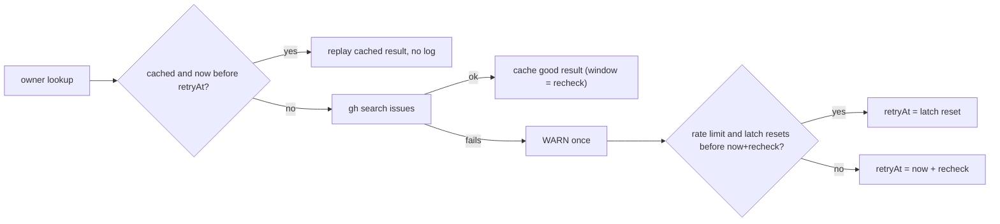

## Summary

Four log lines were at ERROR even though the worker carries on with a documented
fallback. They now log at WARNING (degraded but continuing), and the fleet
lookup no longer replays its cached failure.

- `lookupFleetDiagnosticBackOffs`
  (`worker/deno/lib/repo_fast_failure_tracker.ts`):
  - A failed owner lookup warns once, when it happens.
  - Replaying the cached failure inside its back-off window logs nothing.
    Before, it re-logged "last attempt failed (…)" at ERROR on every scan, with
    a stale "(in 27s)" countdown.
  - A new `retryAt` on the cache entry ends the window at the GitHub rate-limit
    latch's reset when the failure was a rate limit that lifts sooner than the
    600 s recheck. The first lookup after the reset retries instead of replaying
    the old message.
  - The unused `error` sink is removed from `FleetDiagnosticLookupOptions` and
    from the production wiring.
- `run_core.ts`: "Claim-evidence lookup failed … claiming on the plain runway
  floor alone" and "slot run(s) still finishing after the …s grace" now log
  through `warnOf(deps)`.
- `lifecycle_pr_observation.ts`: one helper, `logObservationFailure`, is shared
  by the per-PR and closed-PR observations. Latch skips stay INFO, a raw
  rate-limit refusal or a `gh` timeout (`TIMEOUT: … timed out after 60s`) is
  WARNING, and every other fault stays ERROR.

Closes #5076.

## Spec

### Intent and Rationale

- The log-level rule is: WARNING means degraded but continuing, and ERROR means
  cannot continue. Each changed line logs a fallback the run continues past,
  such as this host's own back-offs, the plain runway floor, the exit cleanup,
  or the next sweep.
- The owner's 13 November example shows the fleet lookup replaying a cached
  quota failure at ERROR after the quota had reset. A replay is not a new
  failure, so it is silent, and recovery follows the latch's reset instead of
  the fixed 600 s window.

### Essential Design Decisions

- The retry deadline reads the process-wide latch (`primaryQuotaLatchedUntil`)
  only when the failure message is a rate limit (`isPrimaryRateLimitMessage`).
  The deadline is never later than `now + recheck`, so a non-quota failure or a
  long latch keeps the 600 s recheck.
- A retry that fails again (for example, under a new latch) is a new back-off
  state and warns once more.
- In lifecycle observation, the timeout is matched with two plain `includes`
  checks against the shape `ghTimedOut` produces in `gh_spawn.ts`, not a regex.
  A genuine fault, such as an invalid snapshot, stays ERROR, and that is the
  fatal-failure control.

### Undiscoverable Facts

- The issue's counts come from the 2026-11-10 to 2026-11-12 logs. The stale
  countdown case is the owner's laptop host log from 2026-11-13, 04:13 to
  04:18Z. #5077 (disk-park outcomes) and #5118 (scheduled deadline releases) are
  untouched, as the issue asks.

## Evidence

Backend only. No UI file is touched.

- The fleet tests use the real latch (`latchPrimaryQuota`,
  `primaryQuotaSkipMessage`) with an injected clock. The production `gh`
  chokepoint raises that skip message while latched.
- Production wiring: `run_core_production_deps.ts` passes `logWarn` into
  `RunCoreDeps`, so `warnOf(deps)` reaches the real logger.
- Docs: `docs/CONFIGURATION.md` ("Fleet-wide back-off (Issue #2955)") no longer
  says the no-good-result case logs an ERROR, and now describes warn-once and
  the retry after the quota resets. `docs/GH-API-OPTIMISATION.md` (the lifecycle
  observation sentence) names the WARNING case. Doc comments on
  `deferClaimForAdaptiveFloor`, both observation functions, the cache entry and
  the lookup are updated. Greps for "last attempt failed", "Claim-evidence",
  "still finishing after" and "logged as an error" turn up no other stale
  wording.
- Issue numbers this diff adds: #5076 (Mislevelled ERRORs: GitHub
  rate-limit/timeout fallbacks the worker continues past are logged as ERROR).

## Test Plan

- Added `worker/deno/tests/repo_fast_failure_fleet_backoff_5076_test.ts`, using
  an injected clock and the real latch:
  - The first quota failure warns once, with no ERROR. Scans inside the back-off
    do not call `gh` and do not log. The scan just after the reset calls `gh`
    and recovers, with the repo backed off and `failedOwners` empty.
  - A retry refused by a new latch warns exactly once more, with the new
    countdown.
  - A non-quota failure is not retried before the 600 s window ends, and is
    retried at +600 s.
  - A latch longer than the window still retries at +600 s.
- Added to `worker/deno/tests/lifecycle_pr_observation_test.ts`: one test for
  each of the per-PR and closed-PR observations.
  - A raw rate-limit refusal gives one `warn:` line that names the cause.
  - A `gh` timeout gives one `warn:` line containing "timed out after 60s".
  - A genuine fault still gives one `error:` line (the control).
- Added to `worker/deno/tests/run_core_slot_pool_test.ts`: a slot whose tail
  outlives the run-ending grace is reported through `logWarn`, not `logError`.
- Edited expectations, all required by "Log the documented
  degraded-but-continuing fallbacks at WARNING":
  - `worker/deno/tests/run_core_adaptive_claim_test.ts`, "a failed evidence
    lookup is logged and the claim proceeds": the line is now asserted in
    `warnings`, and absent from `errors`. `claimed[0] === 222` is kept.
  - `worker/deno/tests/repo_fast_failure_tracker_test.ts`, the "no cached set"
    and "unparsable output" tests: the `errors` checks moved to `warnings`, with
    the same count and cause text. The `error: logs.error` sinks are removed,
    here and in `repo_fast_failure_issue_test.ts`, because the option no longer
    exists.
- Red on base: before the fix, the new fleet, lifecycle, adaptive-claim and
  slot-pool tests each failed, because the line arrived at ERROR or no warning
  was emitted. After the fix, the touched files pass: 123 passed in the fleet,
  tracker, issue, lifecycle and adaptive-claim files, and 54 passed in the
  slot-pool file.
- Full `./quality.sh` on 77e6643e: PASSED with skipped checks. Config
  integration was skipped (no `.config.json`) and checkov was skipped (not
  installed here).
- Not checked: no reviewer sub-agents ran, because the issue has no
  acceptance-criteria list.

## Babysitting review repair

Replaced mock invocation counters with observable cache/recovery assertions. The fake service becomes available before each expiry; cached failures remain until retryAt and the recovered diagnostic appears at expiry. Renewed-latch warnings and reasons remain covered. All four focused tests pass.

Local validation used Deno 2.9.6 and a temporary import map to cached published
standard-library dependencies because direct JSR downloads fail here. Repository
dependency files are unchanged. Full hosted CI and fresh review remain required.
