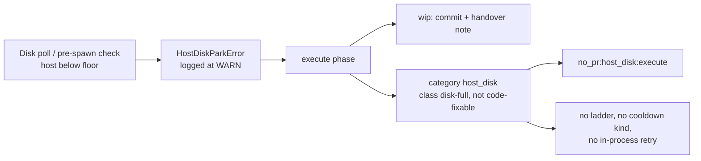

# PR Summary — Issue #5077

## Summary

A host-disk park that stops the issue run's agent in the execute phase is now
released as host infrastructure instead of a worker error. The runner returns a
typed `HostDiskParkError` and logs the park at WARNING. The execute phase keeps
the work on the issue branch (a `wip:` commit plus a handover note) and releases
the run under a new failure category, `host_disk` (display `host-disk`). The
claim release therefore logs `no_pr:host_disk:execute`, not
`no_pr:internal_error:execute`, and the "failed at phase" line is a WARNING for
this category. The attempt is not charged. Closes #5077.

## Spec

### Intent and Rationale

- The runner already knew it had parked the agent, but it returned a plain
  `Error`, so the execute phase could only treat it as an unknown crash
  (`Claude execution failed: …`, `internal_error`, no WIP kept). A typed error
  lets the phase recognise the park without matching text that could also come
  from agent output.
- The release reuses the execute phase's existing interrupted-run path (turn
  limit #4949, unfinished executor #5048), so preservation and the handover note
  work the same way.

### Essential Design Decisions

- New category `host_disk`, modelled on `clone_corrupt`: `detectHostFault` maps
  it to `disk-full`, `classifyRunFailure` gives `disk-full` /
  `not_code_fixable`, and `isInfrastructureFailure` is `false`, so the run is
  not retried in-process (a retry would meet the same floor). The `disk-full`
  class is transient, so `planCodingFailure` applies no ladder and no cooldown
  kind.
- `HostDiskParkError.agentStarted` is `true` for the mid-run poll and `false`
  for the pre-spawn park. The working tree is inspected and preserved when the
  agent had started, or when the run already holds output from an earlier
  invocation.
- Scope: only the issue run's execute phase changes. Other steps that park (the
  quality gate, security-fix discrimination, merge fast checks) still report
  `internal_error` with the park note, as before. `lib/execute_claude_phase.ts`
  still maps the error to `execution_error`.

### Undiscoverable Facts

- The ERROR line quoted in the issue is the runner's own `logger?.error(reason)`
  in the mid-run disk poll (`claude_runner.ts`), and the "failed at phase
  'execute'" line is `run_core_production_deps.ts`. Both are now WARNING for
  this park.

## Evidence

Backend-only change, no UI files.

- `worker/deno/lib/heavy_build_gate.ts`: `HostDiskParkError`.
- `worker/deno/lib/claude_runner.ts`: both park returns use the typed error; the
  mid-run park line is `warn`.
- `worker/deno/lib/phases/execute_phase.ts`: `releaseInterrupted` takes the
  category and cause; new `HostDiskParkError` branch.
- `worker/deno/lib/issue_run_failure_log.ts` (new): `logIssueRunFailure`,
  extracted from `run_core_production_deps.ts` so the log level is testable.
- `worker/deno/lib/failure_diagnosis.ts`, `host_fault.ts`,
  `run_outcome_classifier.ts`, `label_failure.ts`, `wip_checkpoint.ts`: the
  `host_disk` category and `host-disk-park` WIP cause.
- `docs/audits/lib-sweep-coverage/top-up-5077.json`: claims the new module for
  the lib sweep ledger, so `lib_sweep_coverage_test.ts` passes.
- Docs: `docs/CONTAINER.md` ("In-flight builds stop at the same floor") and
  `docs/TROUBLESHOOTING.md` (the `Parked as infrastructure` paragraph).
- Issue numbers this diff cites: #5077 (A host-disk park mid-execute is still
  logged as ERROR and released as internal_error).

## Test Plan

- New `worker/deno/tests/execute_phase_host_disk_park_5077_test.ts`:
  - Composition test "a host-disk park mid-execute is preserved, released as
    host_disk, and logged as a warning". The phase runs the real
    `runClaudeWithTimeout` with an agent stub that writes a real file, the real
    heavy-build gate, real git and a disk probe that drops below the floor once
    the agent has started. The fixture is a bare remote plus a clone on the
    issue branch. It asserts category `host_disk`, class `disk-full` /
    `not_code_fixable`, that the remote issue branch holds the agent's file and
    the handover note naming the host disk floor, that nothing is left only in
    the local clone, that the released preservation reference
    (`state.preservedWip`) names that branch and handover file, that the agent
    started once and never ran past its gate (observed through marker files the
    stub writes, not a mock call count), `no_pr:host_disk:execute`,
    `applyLadder: false` with no cooldown kind, and no ERROR line from the
    runner, the phase or `logIssueRunFailure`.
  - `logIssueRunFailure` logs a non-disk failure at ERROR (allowed control) and
    a `host_disk` failure at WARN.
  - `classifyRunFailure("host_disk", …)` and `detectHostFault(…, "host_disk")`.
- Edited `worker/deno/tests/claude_runner_host_disk_4390_test.ts` (crossFloor
  case): it now asserts no ERROR line, one WARN naming the host disk, and a
  `HostDiskParkError` with `agentStarted: true`.
  - Removed from `worker/deno/tests/claude_runner_host_disk_4390_test.ts`:
    `assertEquals(errors.length, 1);`
    - Required by: "Composition test: a heavy-build-gate park thrown inside
      execute gives the disk outcome and no ERROR line."
  - Removed from `worker/deno/tests/claude_runner_host_disk_4390_test.ts`:
    `assertStringIncludes(errors[0]!, "host disk below its floor");`
    - Required by: "A host-disk park raised during execute is released as an
      infrastructure park at WARNING"
    - Replaced by: `assertEquals(hostDiskWarns.length, 1);`
- `worker/deno/tests/failure_comment_no_vibecoder_numbers_4585_test.ts`: adds
  `host_disk: true` to its `Record<FailureCategory, true>` table.
- Red before the change: the edited 4390 assertion failed against the unchanged
  runner (`errors` held the
  `host disk below its floor … Parked as
  infrastructure (Issue #4360).` ERROR
  line). The new composition test does not compile against the base branch (it
  imports `HostDiskParkError` and `logIssueRunFailure`), so no base-branch red
  was observed for it.
- `./quality.sh < /dev/null` on the head: PASSED. This host skipped config
  integration and checkov. The first run failed only because the new module was
  in no lib sweep slice; `top-up-5077.json` fixed that.

Not done or not checked: no independent reviewers were dispatched, because the
issue has no acceptance-criteria heading. `lib/execute_claude_phase.ts` and the
other park sites were deliberately left unchanged (see Essential Design
Decisions).
