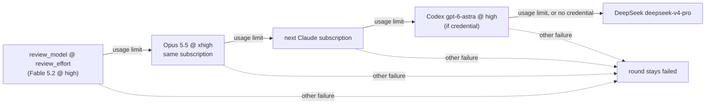

# Review bot: configurable model and effort, and a Codex link before DeepSeek (Issue #5083)

## Summary

The review-fleet-prs round now takes its model and effort from `.config.json`
(`review_model`, `review_effort`), with defaults of `claude-fable-5-2` at
`high`. The reviewer agent inherits them. After the Opus step-down and the
Claude pool rotation, a round still stopped by a usage limit runs once on Codex
`gpt-6-astra` before DeepSeek is tried. Codex gets the same prompt and the same
`post.ts` JSON contract. Its attempt is recorded in `review-run.json` as
provider `codex`, and its cost is priced from Codex's own usage events. Each
provider or model switch logs one `INFO:` line. Codex runs in a round only on
an API key or on a login in a mount the round shares; the documented
subscription setup (its `CODEX_HOME` on the agent-state volume) is skipped, and
reaching it is tracked as #5127, a follow-up to #5083, so this PR is `Part of #5083`, not `Closes`.

## Spec

### Intent and Rationale

- Fable 5.2 and the Opus step-down were already on main from #5081/#5082. This
  PR adds what was still missing: config-driven model and effort, the Codex
  runner, the logging, and the tests.
- Codex runs only when the Claude side is spent and a usable Codex login or key
  reaches the round (not the documented agent-state subscription home).
  DeepSeek runs only when Codex also hit its usage limit or has no credential. Codex failing for any other reason ends the round there and
  does not fall back to DeepSeek.

### Essential Design Decisions

- **Read-only sandbox, enforced in code.** Codex's own CLI sandbox cannot start
  in the worker container (it needs bubblewrap, #4356), so `buildCodexArgs`
  still passes `--dangerously-bypass-approvals-and-sandbox`. Two other things
  hold the Codex attempt instead. The checkout is mounted read-only
  (`worker/deno/lib/container_launch.ts:1296`). A `PreToolUse` hook
  (`worker/deno/lib/review_round_guard.ts`) applies the round's own limits:
  `reviewRoundToolPolicy` reads them off the round's Claude args (the
  `Bash(...)` rules, `Edit(<round dir>/**)` and `--add-dir`). The hook refuses
  any shell command not on that list, command substitution, any redirect,
  `mkdir`, `apply_patch` or `Edit`/`Write` outside `/tmp` and the round
  directory, and web fetches. `post.ts` (`deno run ...`) still runs. The shell
  parser fails closed on syntax it does not model: command and process
  substitution, `$'...'` and `$"..."` quoting, a here-document with an unquoted
  end marker, a redirect with no target and an unterminated quote are all
  refused. `>&file`, `&>file`, `>|file` and `<>file` count as writes (`>&` with
  a digit or `-` is a descriptor). A redirect or `mkdir` target with `$`, `~`,
  braces or a glob is refused, because the guard checks the literal path.
  `cd` (and `pushd`, `popd`) is on the round's command list and the guard does
  not follow it, so on a line that has one, a relative redirect or `mkdir`
  target is refused and only an absolute target is checked. Comments are dropped, and an input-redirect target is read by the same
  quote-aware word reader. A patch inside a shell line is accepted only as a
  bare `apply_patch` call with a quoted here-document. Any other shell text
  around a patch goes through the shell check, and a `patch` or `input` field
  never stands in for the command beside it. The guard holds Codex to the same
  command list as a Claude round, no tighter: `gh` and `deno run` on that list
  can still do whatever those tools do.
- **Codex child env.** `runCodexCli` spawns with `clearEnv: true`. The child
  gets only the env `exportCodexCredential` builds, so the Claude, DeepSeek and
  metered OpenAI variables Codex's env builder strips are not inherited from the
  process.
- **Codex only when it can log in.** `exportCodexCredential` returns null (and
  logs `... skipping the codex fallback`) in three cases: Codex's state
  initialiser throws, the child env has no API key and no `CODEX_HOME`, or the
  selected `CODEX_HOME` has no `auth.json`. In each case DeepSeek is still
  tried. This is the documented subscription setup: its `CODEX_HOME` is on
  the agent-state volume, which the round's container does not mount, and the
  one-time `auth.json` seed sits beside it. **Known limit:** so a ChatGPT
  subscription login is never used by a round, and with quota left the round
  still goes to DeepSeek. Only an API key in `provider.env` (metered) or a
  `CODEX_HOME` on a mount the round shares, already holding a login, runs Codex.
  Making the subscription reachable (a persistent Codex home on a shared mount,
  with its own login, never a copy of the worker's seed) is tracked as #5127, a
  follow-up to #5083. The limit is stated in `running-unattended.md`, `CONFIGURATION.md`
  and `SKILL.md`. The state initialiser sees only the
  process environment, not the `CODEX_HOME` that `provider.env` exports, so the
  round never seeds a login into a throwaway home (a stale seed would fail
  authentication, and a refreshed one could invalidate the worker's durable
  login). The exported home is checked for an existing login and skipped when
  it has none.
- **Same prompt.** Codex has no skills and no Agent tool. The round prompt is
  sent unchanged on stdin, behind `CODEX_ROUND_NOTE`, which tells Codex to read
  `SKILL.md` itself, do each `fleet-pr-reviewer` review itself, and give
  `post.ts` the same JSON.
- **The reviewer agent inherits.** `.claude/agents/fleet-pr-reviewer.md` is now
  `model: inherit` with no `effort` line. The configured values, and the Opus
  step-down, therefore reach the reviewer sub-agents, not only the main session.
  This assumes, without testing it here, that Claude Code gives a sub-agent with
  no `effort` the session's effort.
- **Validation.** `run.sh` accepts `review_model` only as an id of
  `[A-Za-z0-9._-]` up to 100 characters. `review_effort` must be one of `low`,
  `medium`, `high`, `xhigh` or `max`. Any other value is logged and the default
  used. The Codex link's model (`gpt-6-astra`) and effort (`high`, Codex's top
  level) are constants, because the issue makes only the primary configurable.

### Undiscoverable Facts

- `gpt-6-astra` has no pricing row in `token_usage.ts`, so a Codex review's
  footer keeps saying `cost unknown` until one is added. It is priced through
  the same path that prices `gpt-5`, which the tests check.
- `codex` is not installed in this run's environment, so the Codex fixtures copy
  the event shapes from `worker/deno/tests/codex_output_adapter_1695_test.ts`
  rather than from a live recording.

## Evidence

Backend and runner only; no UI file is touched.

Issue numbers this diff cites as provenance:

- #5083: PR reviewer bot: Fable 5.2 @ high, falling back Opus 5.5 -> Codex
  gpt-6-astra -> DeepSeek
- #5081: Model policy 2026-11-12: Fable 5.2 reviews and plans, Opus manages,
  Sonnet executes; subscription-first fallbacks everywhere
- #4356: Orchestrated Codex roles have no shell: --sandbox needs bubblewrap,
  which the image lacks, so every manager/executor/reviewer run makes no change
- #3632: review-fleet-prs round: fall back to DeepSeek when every Claude
  subscription has no budget
- #2976: review-fleet-prs: review PRs with Opus 5.5 at xhigh effort instead of
  Fable

Docs updated: `docs/CONFIGURATION.md` (new "Reviewer model and effort" section,
and a parallel-rounds sentence; its chain says Codex runs when a credential
"reaches the round", not merely when one is provisioned),
`.claude/skills/review-fleet-prs/references/running-unattended.md` (the round's
chain, whose Codex step now points at "Which Codex credentials reach a round"
instead of saying a provisioned `codex/provider.env` is enough, and "What each
review cost", both read through),
`.claude/skills/review-fleet-prs/SKILL.md` (the review step and the footer),
`DESIGN-PRINCIPLES.md` (reviewer-round overflow), `docs/MODEL-AND-CACHING.md`
(the PR reviewer bot paragraph, and the 2026-10-16 decision sentence that still
said the reviewer stays on Opus), and `docs/audits/release-contract.txt`,
regenerated to add the two config keys.

CI config updated: `.github/gitleaks.toml` gains allowlist patterns for the two
synthetic credential-named env fixture lines in `review_round_wiring_test.ts`,
plus one pattern for the earlier commit that quoted them in this summary.
gitleaks scans each commit in the PR range, and its `generic-api-key` rule
flagged those placeholder values (they are not credentials). Each pattern
matches only those fixture strings, so every other value stays scanned.
This summary no longer repeats the values.

## Test Plan

- `worker/deno/tests/review_round_test.ts`, new tests:
  - `runReviewRound runs the chain Fable, Opus, rotation, then Codex, and stops before DeepSeek (Issue #5083)`:
    the round runs at `--effort max`, and the Codex args carry
    `--model gpt-6-astra` and `model_reasoning_effort="high"` with no `max`.
    Stdin carries the round prompt, and the Codex env has no Claude token.
    Passing the round's `--effort` to `buildCodexArgs` makes this test fail.
  - Each link is taken only after the previous one is spent:
    `does not step a Fable round down unless it was usage-limited`,
    `does not reach Codex when the rotated retry failed for another reason`,
    `does not reach DeepSeek when the Codex attempt failed for another reason`,
    `runs DeepSeek when the Codex attempt is itself usage-limited`, and
    `skips Codex with a plain log line and runs DeepSeek when there is no Codex credential`.
  - `logs exactly one INFO line per provider or model switch, and no ERROR`.
  - `records the Codex attempt as codex, gpt-6-astra at high effort`, which is
    what the review's model line reads.
  - `renderCodexStreamLine shows the agent's message or its errors, and leaves out other events`.
  - `runCodexCli reports a usage-limit refusal as usageLimited and sends the prompt on stdin`
    and
    `runCodexCli returns a successful run with its message and no usage limit`.
    Both run a stub binary.
  - `runCodexCli gives the child only the curated env, not this process's credentials`:
    a child Deno process holding `CLAUDE_CODE_OAUTH_TOKEN`, `ANTHROPIC_API_KEY`,
    `DEEPSEEK_API_KEY` and `OPENAI_API_KEY` runs `runCodexCli`, and the stub
    Codex it starts sees none of them. The test never changes its own
    `Deno.env`, so it stays in the parallel pass.
  - The chain test also checks that the Codex args carry the guard's
    `hooks.PreToolUse` and `--dangerously-bypass-hook-trust`.
- `worker/deno/tests/review_round_guard_test.ts`:
  `the guard fails closed on shell syntax it does not model (Issue #5083)`
  refuses `cat x >&/state/guidance.md`, `gh $'\'' ; rm -rf /state #'`,
  `gh <x' '; rm -rf /state; echo '`, a quote inside a comment followed by `rm`
  on the next line, `mkdir /tmp/{a,../../state/b}`,
  `cat x > /tmp/${X:-../state/y}`, `$HOME` and `~` targets, `<>`, `&>`, `>|`
  outside the round, an unquoted here-document, and a command after a quoted
  one. It allows `2>&1 >&2`, a quoted here-document into the round directory, a
  quoted input file, a here-string and `&>> /tmp/z`.
  `the guard checks a shell line that carries a patch as shell (Issue #5083)`
  refuses `rm -rf /state # *** Begin Patch`, a here-document patch outside the
  round, a body line equal to the marker followed by `rm`, `bash -lc` running
  `rm`, and a Bash call whose `input` field is a patch. It allows a quoted
  here-document `apply_patch` and an `["apply_patch", patch]` argv into the
  round. Both tests fail against the previous guard (5 passed, 2 failed) and
  pass now. The bypass forms were also run in real bash first, which ran the
  command after them.
- `worker/deno/tests/review_round_guard_test.ts` (new): the policy read off
  run.sh-shaped args; `post.ts`, `gh ... --jq '.a | .b' | head`, a redirect into
  the round dir and `mkdir -p /tmp/...` are allowed; `rm`, a chained `curl`,
  `git push`, a redirect or `mkdir` outside the round, `$(...)`, an
  `apply_patch` or `Write` outside the round, and `WebFetch` are refused. The
  `the guard refuses a relative write or mkdir target on a line that changes directory`
  refuses `cd <dir> && cat /tmp/a > ../tmp/y`, `cd <dir> && mkdir -p ../tmp/q`,
  a subshell `(cd <dir>; cat /tmp/a >> tmp/y)` and `2> y`, and allows an
  absolute `/tmp` target after `cd` and a relative target with no `cd` on the
  line; it fails against the previous guard (7 pass, 1 fail). The
  hook command is also run as a real process: `rm -rf /state` exits 2 with a
  `deny` decision, and `deno run ... post.ts` exits 0 with no output.
- `worker/deno/tests/review_round_wiring_test.ts`:
  `a provisioned Codex credential exports a Codex-only child env`,
  `an ambient Codex credential keeps the Codex fallback`,
  `no Codex credential means no Codex fallback`,
  `a CODEX_HOME provider.env whose login is present offers Codex`,
  `a CODEX_HOME the round cannot reach skips Codex with a log line, so DeepSeek is still tried`
  and
  `a CODEX_HOME whose auth.json is not a login skips Codex at the login check`
  (an `auth.json` of `{}` gets past the state initialiser, so only the login
  check can stop it, and the test asserts that check's `no Codex login at ...`
  line),
  `no Codex API key and no usable CODEX_HOME in the round skips Codex` (a blank
  `CODEX_HOME` reaches the `no Codex API key and no CODEX_HOME` line) and
  `a one-time login seed beside an unreachable CODEX_HOME is not copied into the round`
  (`provider.env` names a missing home, a 0600 ChatGPT seed sits beside it, and
  the test asserts null, the skip line, and that the home was not created).
  Against the previous `review_round.ts`, the seed test fails (9 of 10 pass).
  With the `codexChildLoginMissing` call removed, 4 of the 10 fail (6 pass):
  the three login-check tests above and the seed test. They use an injected `env` option rather than changing `Deno.env`.
- `worker/deno/tests/review_fleet_prs_run_cost_test.ts`: three `attemptCost`
  Codex tests (an unpriced `gpt-6-astra` stays unknown, `gpt-5` is priced from
  `turn.completed` usage against a hand-computed $0.0369375, and no usage means
  cost unknown) and
  `amendRound leaves a Codex attempt on an unpriced model at cost unknown under the codex footer`.
  The fixture is `worker/deno/tests/fixtures/review_round/codex-round.jsonl`.
- `worker/deno/tests/review_fleet_prs_runner_test.ts`:
  - `run.sh runs the round on review_model and review_effort from .config.json, Fable 5.2 at high by default`
    checks that the configured model and effort reach the CLI args.
  - `run.sh refuses an unsafe review_model or review_effort, and falls back to the defaults`.
  - `run.sh keeps effort high when only review_model is set (independent defaults)`.
- Red runs before the code: the new round tests failed at import, the
  Codex-pricing tests failed with 2 failures, the runner tests with 3, and the
  ambient-credential wiring test with 1. All passed after the code.
- Existing tests: no assertion was removed. Only the `fakeDeps` and
  `recordingDeps` helper signatures changed, to add the Codex seams. Their Codex
  default is no credential, so the existing DeepSeek tests still reach DeepSeek.
  Callers of `createReviewRoundDeps` checked: the command's default deps
  (`worker/deno/commands/review_round.ts`) and the wiring tests. The command
  uses the same `exportCodexCredential` and `runCodexCli` the wiring and
  `clearEnv` tests exercise, so on a host whose `CODEX_HOME` the round cannot
  reach it skips Codex and still reaches DeepSeek. Twinned copies searched for:
  none found.
- The guard's hook entry point installs console redaction, and
  `docs/audits/lib-sweep-coverage/top-up-5083.json` claims
  `worker/deno/lib/review_round_guard.ts` for the security-sweep ledger.
- `./quality.sh < /dev/null` on the head passed with skipped checks: config
  integration (no `.config.json`) and checkov (not installed).

Not done: the `clearEnv` fix was not red-checked against the old code. The
guard's fail-closed and `cd` tests, the login-check and seed wiring tests, and
the Codex effort test were. Codex was not run for real (the CLI is not installed here), so
the Codex round's behaviour against a live PR is not observed. It is also not
checked whether a sub-agent with no `effort` takes the session's effort. Codex's
`input_tokens` may already include its cached tokens. The adapter counts both,
so a priced Codex model could be overstated; the adapter is unchanged.
