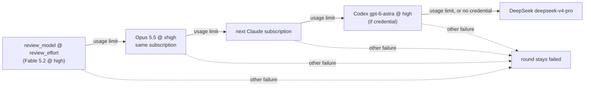

# Review bot: configurable model and effort, and a Codex link before DeepSeek (Issue #5083)

## Summary

The review-fleet-prs round now takes its model and effort from `.config.json`
(`review_model`, `review_effort`), with defaults of `claude-fable-5-2` at
`high`. The reviewer agent inherits them. After the Opus step-down and the
Claude pool rotation, a round still stopped by a usage limit runs once on Codex
`gpt-6-astra` before DeepSeek is tried. Codex gets the same prompt and the same
`post.ts` JSON contract. Its attempt is recorded in `review-run.json` as
provider `codex`, and its cost is priced from Codex's own usage events. Each
provider or model switch logs one `INFO:` line. Closes #5083.

## Spec

### Intent and Rationale

- Fable 5.2 and the Opus step-down were already on main from #5081/#5082. This
  PR adds what was still missing: config-driven model and effort, the Codex
  runner, the logging, and the tests.
- Codex runs only when the Claude side is spent and a Codex credential exists.
  DeepSeek runs only when Codex also hit its usage limit or has no credential.
  Codex failing for any other reason ends the round there and does not fall back
  to DeepSeek.

### Essential Design Decisions

- **Read-only sandbox.** The round container mounts the checkout read-only
  (`worker/deno/lib/container_launch.ts:1296`). That mount, as for Claude
  rounds, is the Codex round's read-only sandbox. Codex's own CLI sandbox is not
  used: it needs bubblewrap and cannot start in the worker container (#4356,
  `worker/deno/lib/orchestration/read_only_guard.ts`), and a `read-only` sandbox
  would also block `post.ts` from writing the round's files and posting.
  `buildCodexArgs` still passes `--dangerously-bypass-approvals-and-sandbox`, as
  it does for every worker Codex role.
- **Same prompt.** Codex has no skills and no Agent tool. The round prompt is
  sent unchanged on stdin, behind `CODEX_ROUND_NOTE`, which tells Codex to read
  `SKILL.md` itself, do each `fleet-pr-reviewer` review itself, and give
  `post.ts` the same JSON.
- **The reviewer agent inherits.** `.claude/agents/fleet-pr-reviewer.md` is now
  `model: inherit` with no `effort` line. The configured values, and the Opus
  step-down, therefore reach the reviewer sub-agents, not only the main session.
  This assumes, without testing it here, that Claude Code gives a sub-agent with
  no `effort` the session's effort.
- **Validation.** `run.sh` accepts `review_model` only as an id of
  `[A-Za-z0-9._-]` up to 100 characters. `review_effort` must be one of `low`,
  `medium`, `high`, `xhigh` or `max`. Any other value is logged and the default
  used. The Codex link's model (`gpt-6-astra`) and effort (`high`, Codex's top
  level) are constants, because the issue makes only the primary configurable.

### Undiscoverable Facts

- `gpt-6-astra` has no pricing row in `token_usage.ts`, so a Codex review's
  footer keeps saying `cost unknown` until one is added. It is priced through
  the same path that prices `gpt-5`, which the tests check.
- `codex` is not installed in this run's environment, so the Codex fixtures copy
  the event shapes from `worker/deno/tests/codex_output_adapter_1695_test.ts`
  rather than from a live recording.

## Evidence

Backend and runner only; no UI file is touched.

Issue numbers this diff cites as provenance:

- #5083: PR reviewer bot: Fable 5.2 @ high, falling back Opus 5.5 -> Codex
  gpt-6-astra -> DeepSeek
- #5081: Model policy 2026-11-12: Fable 5.2 reviews and plans, Opus manages,
  Sonnet executes; subscription-first fallbacks everywhere
- #4356: Orchestrated Codex roles have no shell: --sandbox needs bubblewrap,
  which the image lacks, so every manager/executor/reviewer run makes no change
- #3632: review-fleet-prs round: fall back to DeepSeek when every Claude
  subscription has no budget
- #2976: review-fleet-prs: review PRs with Opus 5.5 at xhigh effort instead of
  Fable

Docs updated: `docs/CONFIGURATION.md` (new "Reviewer model and effort" section,
and a parallel-rounds sentence),
`.claude/skills/review-fleet-prs/references/running-unattended.md` (the round's
chain and "What each review cost", both read through),
`.claude/skills/review-fleet-prs/SKILL.md` (the review step and the footer),
`DESIGN-PRINCIPLES.md` (reviewer-round overflow), `docs/MODEL-AND-CACHING.md`
(the PR reviewer bot paragraph, and the 2026-10-16 decision sentence that still
said the reviewer stays on Opus), and `docs/audits/release-contract.txt`,
regenerated to add the two config keys.

## Test Plan

- `worker/deno/tests/review_round_test.ts`, new tests:
  - `runReviewRound runs the chain Fable, Opus, rotation, then Codex, and stops before DeepSeek (Issue #5083)`:
    the Codex args carry `--model gpt-6-astra` and
    `model_reasoning_effort="high"`, stdin carries the round prompt, and the
    Codex env has no Claude token.
  - Each link is taken only after the previous one is spent:
    `does not step a Fable round down unless it was usage-limited`,
    `does not reach Codex when the rotated retry failed for another reason`,
    `does not reach DeepSeek when the Codex attempt failed for another reason`,
    `runs DeepSeek when the Codex attempt is itself usage-limited`, and
    `skips Codex with a plain log line and runs DeepSeek when there is no Codex credential`.
  - `logs exactly one INFO line per provider or model switch, and no ERROR`.
  - `records the Codex attempt as codex, gpt-6-astra at high effort`, which is
    what the review's model line reads.
  - `renderCodexStreamLine shows the agent's message or its errors, and leaves out other events`.
  - `runCodexCli reports a usage-limit refusal as usageLimited and sends the prompt on stdin`
    and
    `runCodexCli returns a successful run with its message and no usage limit`.
    Both run a stub binary.
- `worker/deno/tests/review_round_wiring_test.ts`:
  `a provisioned Codex credential exports a Codex-only child env`,
  `an ambient Codex credential keeps the Codex fallback`, and
  `no Codex credential means no Codex fallback`. They use an injected `env`
  option rather than changing `Deno.env`.
- `worker/deno/tests/review_fleet_prs_run_cost_test.ts`: three `attemptCost`
  Codex tests (an unpriced `gpt-6-astra` stays unknown, `gpt-5` is priced from
  `turn.completed` usage against a hand-computed $0.0369375, and no usage means
  cost unknown) and
  `amendRound leaves a Codex attempt on an unpriced model at cost unknown under the codex footer`.
  The fixture is `worker/deno/tests/fixtures/review_round/codex-round.jsonl`.
- `worker/deno/tests/review_fleet_prs_runner_test.ts`:
  - `run.sh runs the round on review_model and review_effort from .config.json, Fable 5.2 at high by default`
    checks that the configured model and effort reach the CLI args.
  - `run.sh refuses an unsafe review_model or review_effort, and falls back to the defaults`.
  - `run.sh keeps effort high when only review_model is set (independent defaults)`.
- Red runs before the code: the new round tests failed at import, the
  Codex-pricing tests failed with 2 failures, the runner tests with 3, and the
  ambient-credential wiring test with 1. All passed after the code.
- Existing tests: no assertion was removed. Only the `fakeDeps` and
  `recordingDeps` helper signatures changed, to add the Codex seams. Their Codex
  default is no credential, so the existing DeepSeek tests still reach DeepSeek.
  Callers of `createReviewRoundDeps` checked: the command's default deps
  (`worker/deno/commands/review_round.ts`) and the wiring tests. Twinned copies
  searched for: none found.
- `./quality.sh < /dev/null` on the head passed with skipped checks: config
  integration (no `.config.json`) and checkov (not installed). The first run
  failed parallel safety, a stale release contract, and the completeness check
  that wraps them. All three were fixed before the passing run.

Not done: Codex was not run for real (the CLI is not installed here), so the
Codex round's behaviour against a live PR is not observed. It is also not
checked whether a sub-agent with no `effort` takes the session's effort. Codex's
`input_tokens` may already include its cached tokens. The adapter counts both,
so a priced Codex model could be overstated; the adapter is unchanged.
