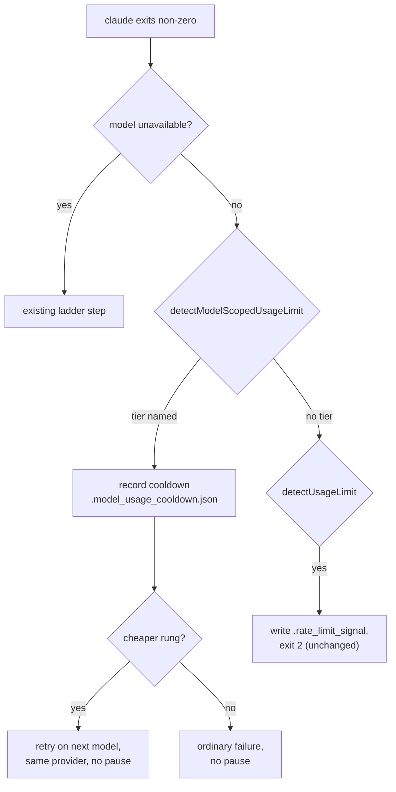

## Summary

A Claude usage limit that names a model tier is now handled as a model-scoped
limit, not an account-wide one. `runClaudeWithRetry`
(`worker/deno/lib/claude_runner.ts`) checks for it with the new
`detectModelScopedUsageLimit` (`worker/deno/lib/claude_executor.ts`) before the
account-wide usage-limit branch. On a match it:

- retries the phase at once on the next model down on the same provider (`fable`
  → `opus` → `sonnet` → `haiku`, the existing ladder);
- records a model-scoped cooldown in `WORK_DIR/.model_usage_cooldown.json` (new
  `worker/deno/lib/model_usage_cooldown.ts`);
- writes no `.rate_limit_signal` and returns no `usageLimit`, so Claude-routed
  work is not paused and no provider switch follows.

While a cooldown is active, a later invocation that would run that tier starts
on the next rung down and logs one `[model-cooldown]` INFO line. Account-wide
limits keep today's terminal pause and provider fallback. Closes #5086.

## Spec

### Intent and Rationale

- On the base branch, the observed Fable cap
  (`You've reached your Fable limit. Switch to another model to continue.`)
  matched no detector, so it was an ordinary exit-1 failure. A `weekly`-worded
  Fable cap matched `weekly limit` in `USAGE_LIMIT_RE`, so it wrote a Claude
  usage pause while Opus and Sonnet still had quota.
- Stepping down reuses `attemptModelFallback` and the existing tier ladder, as
  the model-unavailable branch already does, rather than adding a new ladder.

### Essential Design Decisions

- The model-scoped branch runs after the model-unavailable branch and before the
  account-wide one. That order is what keeps a tier-named weekly cap away from
  the account-wide pause, and a later change must keep it.
- The matcher is anchored per line (`^\W*`, with an optional `Error:` or
  `API Error:` prefix). A CLI refusal line matches, but agent prose that quotes
  one ("I see you've reached your Fable limit") does not. Only Claude tier names
  are matched, so a Codex `usage limit for <model>` line is unaffected.
- The cooldown lasts until the parsed reset, capped at an hour, or an hour when
  the message gives no time (`USAGE_LIMIT_DEFAULT_WAIT_SECONDS` /
  `USAGE_LIMIT_MAX_WAIT_SECONDS`, as Issue #333 set for the account-wide wait).
  Entries clear by expiry. A cooled tier is not run during its window, so expiry
  is its recovery path. The store is read through `readTextFileNoFollow`
  (`worker/deno/lib/file_utils.ts`) with a 64 KiB size bound and a 1 second open
  timeout, so a symlink or an oversized file is refused before it is decoded. An
  unreadable, symlinked, oversized or malformed store is logged as a warning and
  the requested model runs; a write replaces a corrupt store.
- With no cheaper rung (already on `haiku`, or model fallback disabled), the
  call returns the CLI's exit code as an ordinary failure. It still writes no
  provider pause. New persisted file, `version: 1`, so there is no old shape to
  read.

### Undiscoverable Facts

- I could not trigger a real Fable cap from this container. The observed refusal
  text is the one this repository already records from a fleet subscription
  (`worker/deno/lib/review_round.ts:412`,
  `.claude/skills/review-fleet-prs/references/running-unattended.md:170`). The
  stream-json shape is the captured line in
  `worker/deno/tests/lifecycle_invocation_3719_test.ts:37`. The
  `You've hit your Fable weekly limit · resets …` form is modelled on the CLI's
  account-wide weekly wording; it was not captured.

## Evidence

Backend only: no UI file is touched.

- Base-branch behaviour, checked by running the detectors on the base code: the
  observed Fable line gives `detectUsageLimit` false, `detectRateLimit` false
  and `detectModelUnavailable` false. The weekly Fable line gives
  `detectUsageLimit` true.
- Docs updated:
  - `docs/TROUBLESHOOTING.md`, the "Rate limits and subscription usage limits"
    section: a new model-scoped bullet, and the usage-limit bullet's "does not
    fall back" claim now names this exception.
  - `docs/MODEL-AND-CACHING.md`, "Model Fallback on Rate Limit": a new bullet.
    "Fable-unavailable auto-fallback + self-heal" now has one sentence telling
    it apart from the cooldown.
  - `docs/PROVIDER-PARITY.md`: an account-wide limit writes
    `provider: "claude"`, and a model-scoped one writes no signal.
- The new module is claimed in
  `docs/audits/lib-sweep-coverage/top-up-5086.json`, written by
  `sweep-drift --record-top-up`.
- Issue numbers this diff cites: #5086: A Fable-specific usage limit must step
  down to Opus, not mark Claude exhausted.

## Test Plan

- Added `worker/deno/tests/claude_runner_model_scoped_limit_5086_test.ts`. The
  stub agent logs every `--model` it is given and refuses only the named tiers.
  - `runClaudeWithRetry - a Fable-scoped limit (observed form) steps down to opus with no provider pause (Issue #5086)`
    and the `(weekly form)` variant assert, on the first call:
    - models `["fable", "opus"]` and exit 0;
    - `usageLimit` is undefined;
    - no `.rate_limit_signal` is written;
    - a `claude/fable` cooldown entry exists.

    A second call on the same `WORK_DIR` runs only `["opus"]`.
  - `… a stream-json synthetic Fable limit on stdout steps down to opus (Issue #5086)`:
    the same assertions for the captured stream-json line.
  - `… an account-wide session limit still pauses the provider and records no model cooldown (Issue #5086)`:
    a control. The result is exit 2, models `["fable"]`, the signal is written,
    and there is no cooldown file.
  - `… a model-scoped limit on the cheapest rung writes no provider pause (Issue #5086)`:
    exit is not 2, `usageLimit` is undefined and no signal is written.
  - `… a corrupt cooldown file warns loudly and the requested model still runs (Issue #5086)`.
- Added `worker/deno/tests/model_scoped_usage_limit_5086_test.ts`:
  - accepted and rejected message lists, including the account-wide forms,
    Codex's `usage limit for gpt-5.2-codex-sonic`, and agent prose;
  - tail-only reading;
  - a hostile line over 100k characters with an exact result;
  - the store's active, expired, other-key, missing, malformed and
    unknown-version cases;
  - `cooldown store refuses an escaping symlink and oversized content`: a
    symlink to a valid file outside `WORK_DIR` is refused with an error naming
    the symlink, a 1 MiB padded file is refused with an error naming the size
    bound, and a regular valid file still reads back `{ untilEpochMs: 5000 }`;
  - `firstModelNotCooling` stepping over one rung, over two rungs, and stopping
    at the cheapest rung.
- Red before the fix: I ran the new runner tests against the unmodified
  `claude_runner.ts`.
  - The observed form returned exit 1 instead of 0.
  - The weekly form returned exit 2 instead of 0: it was taken as an
    account-wide pause.
  - The account-wide control and the cheapest-rung test passed on base, as
    guards of unchanged behaviour should.
- On the head, these pass with no failures:
  - the two new files;
  - `worker/deno/tests/claude_runner_usage_limit_test.ts`;
  - `worker/deno/tests/claude_runner_model_unavailable_fallback_test.ts`;
  - `worker/deno/tests/model_fallback_test.ts`;
  - `worker/deno/tests/lib_sweep_coverage_test.ts`.
- No existing test was edited.
- After merging `origin/main` (before the bounded-read change), the full unit
  suite exited 0 with no failures. That is `deno task test:unit` run from
  `worker/deno`, the pre-push pre-flight command that blocked the previous
  attempt. It was not re-run on the final head: only the listed test files were.
- Callers checked: `detectUsageLimit` and `USAGE_LIMIT_RE` are unchanged, so
  their callers keep their behaviour: `classifyClaudeFailure`,
  `review_round.ts`, `handle_no_changes_phase.ts` and
  `claude_health_message.ts`.
- `./quality.sh` was not re-run for the final head by this repair. An earlier
  run on commit `6b6d088d` passed ("Result: PASSED (with skipped checks)"); it
  predates the bounded-read and symlink change in
  `worker/deno/lib/model_usage_cooldown.ts`, so it does not cover that change.
  The same earlier run failed `completeness checks` once, because the new module
  was not claimed by any lib-sweep slice; `top-up-5086.json` fixed that.

Not done or not checked: the weekly-worded Fable fixture is modelled, not
captured, as noted under Undiscoverable Facts. Nothing else.

🤖 Generated with [Claude Code](https://claude.com/claude-code)
