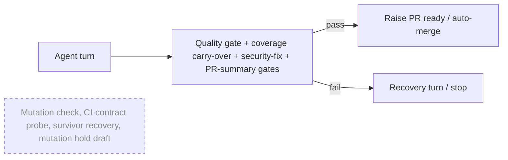

# PR Summary — Issue #5095

## Summary

Completion and review-fix no longer run the diff-scoped mutation check. This
PR removes its invocation and everything that only it used: the
CI-contract probe, the budgets, the recovery turns, the survivor comments and
the mutation-hold draft logic. The two `repo_config` keys are retired with a
warning, `cargo-mutants` is dropped from the container image, and the docs
now describe what ships. Shared helpers stay and keep their tests:
`collectRunOwnBaseline`, coverage carry-over, the runner process teardown and
the workflow-text helpers used by `ci_cargo_checks.ts`. The ENOTEMPTY fault
recorded on #5078 could still hit the security-fix discrimination cleanup, so
that cleanup is fixed test-first: a failed temp-dir removal is now logged and
no longer fails a check that has already completed. Closes #5095.

## Spec

### Intent and Rationale

- On 12 November 2026 the owner rejected automatic mutation, fuzzing and test-discovery campaigns. Completion and review-fix still spent mutation setup, runs and recovery turns on every PR, and the removal targets that cost.
- The fix is removal, not a default-off knob. The issue forbids a new default-on knob, and a dead switch would leave all the mutation-only code paths in place.

### Essential Design Decisions

- Retired keys (`skipMutationCheck` / `skip_mutation_check`, `mutationCheckBudgetSeconds` / `mutation_check_budget_seconds`) are **tolerated and dropped with a warning**, not refused. A deployed `.config.json` that still sets them keeps loading (`RETIRED_REPO_CONFIG_KEYS`, `detectRetiredRepoConfigKeys`).
- The `draft` field on deferred-PR records and on `pr_create_rest` is **kept**. A record persisted before this change still opens as a draft, and nothing new sets the field. This follows "Changing the Shape of Persisted Data": the old shape is still read.
- `collectRunOwnBaseline` moved verbatim to `lib/run_own_baseline.ts` and is called from `pr_feedback_drift_check.ts`, not re-implemented. Its six cases moved with it.
- Shared helpers keep their module names (`mutation_runner.ts`, `mutation_gate.ts`, `ci_mutation_contract.ts`) so their callers need no churn. The hard-kill `mutation check` step label stays, to classify logs written before the retirement.

### Undiscoverable Facts

- stSoftwareAU/GRQ-AutoTrader#5385 removed AutoTrader's CI mutation job. Nothing here touches any repository's CI. A repository that still runs a mutation job in CI keeps it as its own required check.
- #5078 is closed. Its ENOTEMPTY evidence is kept in `docs/mutation-check.md`.
- The first full gate run on this branch failed 5 `pr_maintenance_command_test.ts` cases, a file this PR does not touch. The same file passed 28/28 in isolation and passed in the next full gate, so the failure was load-dependent.

## Evidence

Backend/CLI only; no UI file changed.

- The completion workflow test gives CI a blocking PR-triggered `mutants` job. It shows that the PR is raised ready with auto-merge, no recovery turn runs and nothing about mutation is logged. The same fixture still stops PR creation when the security-fix gate fails.
- The review-fix workflow test shows a push completes and posts nothing about mutation. No `mutants.out` is written, and no `rules/branches` required-checks lookup is made. A genuine drift failure still runs its recovery turn and reaches the PR reply.
- Issue numbers this diff adds as provenance:
  - #5095: Retire automatic mutation testing from completion and review-fix workflows
  - #5078: Mutation check fails to run when its temp dir cleanup hits ENOTEMPTY
- Docs updated:
  - `docs/mutation-check.md`, rewritten as a retirement page
  - `README.md`
  - `docs/CONFIGURATION.md`, `docs/CALLBACKS.md`, `docs/TROUBLESHOOTING.md`, `docs/MERGE.md`, `docs/INTERNALS.md`, `docs/CONTAINER.md`
  - `docs/coverage-carryover-check.md`, `docs/security-fix-gate-feedback.md`
  - `docs/workflows/issue-processing.md`, `docs/workflows/pr-feedback.md`
  - `docs/security/vulnhunter-methodology-evaluation.md`
  - `docs/audits/dependency-inventory.md`, regenerated
  - the lib-sweep ledgers

## Acceptance Criteria

<!-- vibe-spec-review inputs="diff+issue-body" -->

- **met** — Normal completion and review-fix execute existing regression/quality checks without launching mutation tools or paying mutation-specific setup/recovery costs, including repositories whose workflows previously advertised mutation. — evidence: `worker/deno/tests/completion_phase_no_mutation_5095_test.ts::completion - a PR-triggered blocking mutants job in CI neither drafts the PR nor spends a recovery turn (Issue #5095)`, `worker/deno/tests/pr_feedback_processor_no_mutation_5095_test.ts::processPrFeedback - a push with a blocking cargo mutants job completes, posts nothing about mutation, and writes no mutants output (Issue #5095)` — reviewer: met
- **met** — Meaningful workflow tests demonstrate successful normal PR progression with no mutation execution, and preserve failure handling for genuine regression/quality failures. — evidence: `worker/deno/tests/completion_phase_no_mutation_5095_test.ts::completion - the same mutants fixture still stops PR creation when a security-fix gate fails (Issue #5095)`, `worker/deno/tests/pr_feedback_processor_no_mutation_5095_test.ts::processPrFeedback - a genuine drift failure still runs the recovery turn and reaches the PR reply (Issue #5095)` — reviewer: met
- **met** — No automatic fuzzing or replacement discovery campaign is introduced. — evidence: the diff adds no gate, runner or config knob; the only new production functions are `detectRetiredRepoConfigKeys` and the moved `collectRunOwnBaseline` — reviewer: met
- **met** — Shared baseline/drift/coverage behaviour retains its regression protection. — evidence: `worker/deno/tests/run_own_baseline_test.ts` (6 cases), `worker/deno/tests/ci_mutation_contract_helpers_test.ts` (12 cases for `triggersOn` / `isNonFailing` / `logicalLines`), `worker/deno/tests/coverage_carryover_runner_test.ts` — reviewer: met
- **met** — Documentation, config and tests agree; obsolete mutation-only tests are removed or replaced with an explanation of the remaining protection. — evidence: `docs/mutation-check.md`, `worker/deno/tests/config_test.ts::config - loadConfig tolerates retired mutation-check repo_config keys (Issue #5095)`, the Test Plan removal entries below — reviewer: partial — reason: the reviewer's residue was fixed in commit `c4650290`: stale "mutation hold" comments in `deferred_pr_store.ts`, `pr_create_rest.ts`, `deno_test_config.ts`, `draft_pr_self_heal.ts` and `hard_kill_report.ts`; the renamed `deferred_pr_drain_test.ts` case; and the unused `mutation_tree_guard.ts`, now deleted. The `draft` plumbing is kept on purpose for persisted records, as Essential Design Decisions explains.
- **unrequested** — `worker/deno/lib/heavy_build_gate.ts` header claimed extra `parkInFlightBuild` callers — reviewer: unrequested — reason: reverted in `c4650290` to the base wording minus the mutation mention, so the diff now only drops "mutation".
- **unrequested** — `worker/deno/lib/summary_rule_gate_retry.ts`: `STEP_TWO_MUTATION_RULE` became `STEP_TWO_TEST_RULE`, with coverage carry-over wording — reviewer: unrequested — reason: the old rule described mutation survivors and became false. Coverage carry-over is the only remaining test-change item, so the wording had to change with it.
- **unrequested** — `docs/audits/lib-sweep-coverage/top-up-3750.json` / `top-up-4617.json` `sweptAt` re-stamped, and `top-up-4905.json` deleted — reviewer: unrequested — reason: the repository's ledger recorder re-stamps a slice when its paths change. The `top-up-4905` slice only covered the deleted `mutation_tree_guard.ts`.
- **unrequested** — `worker/deno/lib/merge_fallback_issue.ts`: `createFallbackFlagFiler` takes an optional `labelCacheDir`, defaulting to `defaultLabelCacheDir()` — reviewer: unrequested — reason: the pre-push gate blocked this branch on `merge_fallback_issue_test.ts` "routes the label creation through the caller's gh". That test read the host's live per-account label cache, which already listed the merge-fallback label, so no `POST` reached the fake `gh`. It failed the same way on `origin/main` on this host. The test now uses its own temp directory; production behaviour is unchanged.

## Standards Review

<!-- vibe-standards-review inputs="diff+CODING-STANDARDS.md" -->

- **violation** — Deleting the contract test lost the only tests for the retained `triggersOn` / `isNonFailing` / `logicalLines` helpers (no-op tails, the comment-marker negative case, continuation lines, the linear-growth guard) — evidence: `worker/deno/tests/ci_mutation_contract_test.ts` — reason: fixed in this diff. The cases are restored in `worker/deno/tests/ci_mutation_contract_helpers_test.ts`, with the linear-growth guard now checked by output instead of wall-clock time.
- **violation** — The new review-fix test would also pass on base because the mock never wired the mutation runner — evidence: `worker/deno/tests/pr_feedback_processor_no_mutation_5095_test.ts:268` — reason: fixed in this diff. The test now records every `gh` call and asserts that no `rules/branches` required-checks lookup, which base always made, is issued.
- **violation** — Two negative assertions could not fail on any input (a tool-argument scan and a workflow-file read the fixture never stages) — evidence: `worker/deno/tests/completion_phase_no_mutation_5095_test.ts:302` — reason: fixed in this diff. Both are removed, and the discriminating mutation-log assertion is kept.
- **violation** — An empty `catch {}` hid a failed temp-dir cleanup — evidence: `worker/deno/lib/security_fix_discrimination.ts:541` — reason: fixed in this diff. It now logs `console.warn` with the temp dir and the cause, and the #5078 test asserts the warning contains `ENOTEMPTY`.
- **clean** — Checked and found compliant:
  - no named-but-absent test, no stub for another repository's binary, no workflow change
  - no review-only rule breached in a changed line; the whole-file `includes` drift-test rule was checked
  - twinned rule: `pr_summary_check.ts` has no mutation gate to mirror
  - retired config keys still load with a warning; persisted `draft` records are still read
  - doc claims match the head code; container manifest, image-hash inputs and inventory agree
  - new tests use `Deno.makeTempDir`; Australian spelling; no secrets or hidden files staged
- **clean** — Edited expectations still go red without their code: `config_test.ts`, `summary_rule_gate_retry_test.ts`, `draft_pr_self_heal_4952_test.ts`, `hard_kill_report_test.ts` and `pr_feedback_drift_check_3750_test.ts`.

## Test Plan

- Added `worker/deno/tests/completion_phase_no_mutation_5095_test.ts` (2 tests)
- Added `worker/deno/tests/pr_feedback_processor_no_mutation_5095_test.ts` (2 tests)
- Added `worker/deno/tests/run_own_baseline_test.ts` (6 tests)
- Added `worker/deno/tests/draft_continuation_unmet_body_test.ts` (1 test)
- Added `worker/deno/tests/ci_mutation_contract_helpers_test.ts` (12 tests)
- Added a retired-key test to `worker/deno/tests/config_unknown_keys_test.ts` and replaced the mapping test in `worker/deno/tests/config_test.ts`
- Added to `worker/deno/tests/security_fix_discrimination_test.ts`: "discrimination: a cleanup that throws ENOTEMPTY once keeps a completed check checked (Issue #5078)". It was observed red before the fix (`not_checked: discrimination runner failed: ENOTEMPTY`) and passes after it. It now also asserts the cleanup warning names `ENOTEMPTY`.
- Copies of a twinned rule: none found. `pr_summary_check.ts` never ran the mutation gate.
- Callers checked for the removed `runMutationCheck` quality dependency:
  - `completion_phase.ts` and `pr_feedback_processor.ts`, where it was removed
  - `issue_worker_wiring.ts`, where the seam was removed
  - no other caller of `invokeMutationCheck` existed
- Results on the final code head:
  - The full `./quality.sh < /dev/null` gate passed at `a79856b2`.
  - At `c4650290` every stage passed except `deno type check`, which failed on one TS2345 in the new helper test; that run's `deno tests` stage passed.
  - That error was fixed in `5e075710`. After the fix, `deno check .` from `worker/deno` exited 0 and `deno task test:unit tests/ci_mutation_contract_helpers_test.ts` passed 12/12.
  - The targeted runs for every edited test file passed.
  - At `c7aac8cd`, `deno task test:unit` ran over the 724 test files that import a changed module or are in the diff. The serial pass (6 parallel-unsafe files) passed. The parallel pass had one red file: `worker/deno/tests/pr_maintenance_command_test.ts` (5 Issue #4424/#4613 cases). That file fails the same way in a clean `origin/main` worktree on this host and passed in this branch's previous run of the same list, so it is host-state dependent and was not caused by this diff.
  - `worker/deno/tests/merge_fallback_issue_test.ts` was red on this host before `c7aac8cd` (`the label creation did not go through the given gh`) and passes 29/29 after it.

Removed assertions (each test below was removed along with the production code it exercised):

- Removed from `worker/deno/tests/mutation_runner_test.ts`: every `runMutationCheck`, `detectMutationLanguage` and `confinement` / `confinement rust` assertion (241 `assert*` lines)
  - Removed functionality: `runMutationCheck` and `detectMutationLanguage` are deleted, and `git grep runMutationCheck -- worker/deno/lib` finds no caller. `confinePath`, `importsModule`, `listTestFiles`, `makeMutationTempDir` and the `runProcess` SIGTERM/SIGKILL teardown keep their tests in the same file.
- Removed from `worker/deno/tests/mutation_gate_test.ts`: every `parseAddedLines`, `generateDenoMutants*`, `wiring mutants`, `evaluateMutationGate`, `mutationErrorNextAction` and `buildMutationGateComment` assertion (224 `assert*` lines)
  - Removed functionality: those functions are deleted from `lib/mutation_gate.ts`; only `isDenoTestFile`, `parseMutationExemptions` and `mdSafe` remain. `parseMutationExemptions` keeps its tests in the same file.
- Removed from `worker/deno/tests/pr_feedback_drift_check_3750_test.ts`: the survivor, recovery-turn, exemption, CI-job, budget, error and not-applicable assertions of `runPrFeedbackDriftCheck`, and the `formatDriftResidual` / `buildDriftRecoveryPrompt` survivor-wording assertions (78 lines)
  - Removed functionality: the drift check's mutation step, `runMutationCheck` dependency and `mutationSurvivors` / `mutationNote` residual fields are deleted.
  - Still covered by: `worker/deno/tests/pr_feedback_drift_check_3750_test.ts`, whose kept test checks the documentation-only "Change no code" closing step.
- Removed from `worker/deno/tests/pr_feedback_drift_check_3143_test.ts`: `formatDriftResidual - the mutation check section carries no issue number (Issue #4585)`
  - Removed functionality: the residual has no mutation section any more.
- Removed from `worker/deno/tests/host_disk_inflight_4360_test.ts`: `assertEquals(ran, false)` and `assertEquals(result.kind, "error")` in "Issue #4360 - mutation check does not start the runner when the host is below the floor"
  - Removed functionality: the mutation runner no longer starts at all. `parkInFlightBuild` keeps its other callers' tests in the same file.
- Removed from `worker/deno/tests/config_test.ts`: `assertEquals(repoConf?.skipMutationCheck, true);` and `assertEquals(repoConf?.mutationCheckBudgetSeconds, 120);`
  - Required by: "Remove or deprecate obsolete mutation configuration/install instructions as appropriate."
  - Replaced by: `config - loadConfig tolerates retired mutation-check repo_config keys (Issue #5095)`, which asserts the keys are dropped and warned about by name.
- Removed from `worker/deno/tests/container_manifest_test.ts`: `assert(REQUIRED_REPO_TOOLCHAIN_COMMANDS.includes("cargo-mutants"));`
  - Required by: "Remove or deprecate obsolete mutation configuration/install instructions as appropriate."
- Removed from `worker/deno/tests/summary_rule_gate_retry_test.ts`: the mutation-check-item expectations in "a mutation-check item allows test changes" and "a standing violation and a mutation-check item both allow code and tests"
  - Obsolete: mutation-check items no longer exist.
  - Still covered by: `worker/deno/tests/summary_rule_gate_retry_test.ts`, whose same two cases now assert the coverage carry-over wording.
- Removed from `worker/deno/tests/completion_phase_no_mutation_5095_test.ts`: the tool-argument scan and the workflow-file read scan
  - Obsolete: neither could fail on any input (Standards Review). The `MUTATION_TEXT` log assertion, the ready-PR assertion and the auto-merge assertion remain.
- Deleted whole files, with their production modules:
  - `worker/deno/tests/ci_mutation_lookup_test.ts`
  - `worker/deno/tests/ci_mutation_contract_remote_test.ts`
  - `worker/deno/tests/completion_phase_mutation_gate_test.ts`
  - `worker/deno/tests/draft_continuation_mutation_hold_test.ts`
  - `worker/deno/tests/pr_feedback_mutation_check_3750_test.ts`, whose `collectRunOwnBaseline` cases moved to `worker/deno/tests/run_own_baseline_test.ts`
  - `worker/deno/tests/pr_feedback_processor_mutation_check_3750_test.ts`
  - `worker/deno/tests/mutation_tree_guard_test.ts`
  - `worker/deno/tests/ci_mutation_contract_test.ts`, whose cases for the retained helpers moved to `worker/deno/tests/ci_mutation_contract_helpers_test.ts`

Not checked / remaining risk:

- `isDenoTestFile` and `mdSafe` have no test that names them; their callers' tests cover them indirectly.
- The `rules/branches` assertion in the review-fix test was not run against the base branch, so its red on base is reasoned from the base code, not observed.
- The cause of the host-dependent `pr_maintenance_command_test.ts` failure was not diagnosed. The fake `gh` sees only the default-branch read, which points to a shared PR-list cache.
- The full `./quality.sh` was not re-run after `c7aac8cd`; the worker re-runs it before the PR is raised.
  <!-- vibe-quality-gate-skipped reason="run budget: about 30 minutes were left after the unit-test runs, under the gate's cost plus push time" -->

- `docs/pre-pr-ci-audit.md` and the archived PR summaries still mention the mutation check as history and were left as they are.
