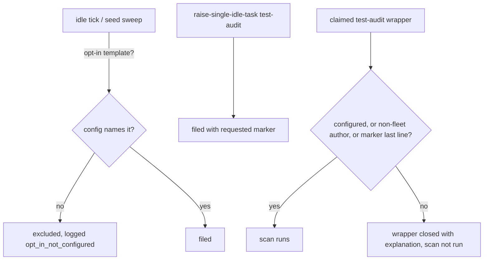

# PR Summary — Issue #5096

## Summary

`test-audit`, the whole-repository test-maintainability and coverage-gap
discovery scan, is now an **opt-in** idle-task template. It stays registered as
a capability, but automatic idle work leaves it out unless the owner asked for
it. The new module `worker/deno/lib/idle_task_opt_in.ts` holds the opt-in set
(`OPT_IN_IDLE_TASK_TEMPLATES`, only `test-audit`). Every automatic entry path
honours it:

- **Idle tick filer.** The weighted random pick and the cadence bias in
  `maybe_file_idle_task.ts` exclude it.
- **Bulk seed sweep.** `createAllIdleTaskWrappers`, behind `add-repo:`,
  `seed-idle-tasks:`, `create-all-idle-task-wrappers` and
  `raise-all-idle-tasks`, leaves it out.
- **Claim dispatch.** The main loop's idle-task route closes a fleet-filed
  `test-audit` wrapper with an explanatory comment instead of running it.

Owner configuration that already names `test-audit` still enables it: a positive
`idle_task_template_weights` entry, or an `idle_task_cadence.templates` entry.
An explicit request still runs it. The idle-task and test-audit manuals explain
the difference between a registered template and enabled automatic work. Closes
#5096.

## Spec

### Intent and Rationale

- The owner wants missing-test discovery in unchanged features to happen only
  when it is requested. Closing every automatic path, not just the picker, is
  what stops it coming back by another route. Seed sweeps and label-backfilled
  wrappers are both such routes.
- Reusing the two config keys that already name a template (weights and cadence)
  honours existing owner configuration without adding a new key or an approval
  queue.

### Essential Design Decisions

- **Claim gate inputs.** The gate trusts the issue author. A wrapper filed by
  anyone outside the fleet identity set (this host's login, `fleet_pr_authors`,
  `service_accounts`) is an explicit request. That includes an `allowed_authors`
  owner. The set comes from `resolveSuppressionExcludedLogins` through
  `idleRouteOptInInput`. The claim lock's broader `fleetAuthors` set includes
  `allowed_authors`, so the gate does not use it. An unknown (empty) author is
  not treated as a request.
- **Explicit requests from the CLI.** `raise-single-idle-task` naming
  `test-audit` is an operator request. The sweep stamps
  `<!-- vibe-idle-task-requested -->` as the body's final line and reserves
  clamp room so truncation cannot drop it. The gate reads that marker only as
  the last non-blank line. `work-on-issue` (an operator naming one issue) is not
  gated.
- **Refused wrappers are closed.** A refused wrapper is closed through
  `finaliseIdleTaskWrapper` (`ok: true`) and returns
  `{ routed: true, success: true }`. It never reaches the standard PR pipeline
  and is not retried forever.
- **Callers that omit the authorised set.** `authorisedOptInTemplates` is
  optional on `createAllIdleTaskWrappers` and `raiseAllIdleTasks`, and omitting
  it keeps `test-audit` out, the safe direction. Every caller with a config
  passes it: `process_add_repo.ts`, `process_seed_idle_tasks.ts`,
  `commands/create_all_idle_task_wrappers.ts` and
  `commands/raise_all_idle_tasks.ts`. Two callers omit it on purpose:
  `raise_single_idle_task.ts`, whose explicit `templateNames` is the request,
  and `boy_scout_idle_tasks.ts`, whose fixed four-name allowlist holds no opt-in
  template.

### Undiscoverable Facts

- The spec reviewer found that the route's `fleetAuthors` includes
  `allowed_authors` (`lib/fleet_authors.ts`, `resolveFleetAuthors`). The first
  version of the gate would therefore have refused owner-filed wrappers. The
  branch fixes this, and a regression test covers it.

## Evidence

Backend and CLI change, no UI files.

- Issue numbers this diff cites: #5096 (Require explicit scope for idle
  coverage-gap discovery audits).
- `idleRouteOptInInput` stands in for the production wiring at
  `lib/run_core_production_deps.ts`. That call site spreads the helper, so the
  route tests that build their input with it exercise the real composition.

## Acceptance Criteria

<!-- vibe-spec-review inputs="diff+issue-body" -->

- **met** — With ordinary/default worker configuration, idle cycles do not file
  or run a coverage-gap discovery scan of unchanged features. — evidence:
  `worker/deno/tests/idle_task_opt_in_filing_5096_test.ts::maybe-file-idle-task - default config never offers test-audit to the random picker (Issue #5096)`,
  `worker/deno/tests/idle_task_opt_in_5096_test.ts::route gate - a fleet-filed test-audit wrapper with nothing authorised is closed, not run (Issue #5096)`
  — reviewer: met
- **met** — A separately authorised test audit can still run under its requested
  scope and budget. — evidence:
  `worker/deno/tests/idle_task_opt_in_5096_test.ts::route gate - a test-audit wrapper filed by an allowed_authors owner runs the scan (Issue #5096)`,
  `route gate - a fleet-filed test-audit wrapper runs when the owner config authorises it`,
  `route gate - a fleet-filed test-audit wrapper with the marker as its final line runs the scan`
  — reviewer: partial — reason: the reviewer's gap, owner logins in
  `allowed_authors` being treated as fleet, is fixed in commit 5395d6f7, and the
  new owner regression test covers it
- **met** — Existing or repaired fleet-created wrappers cannot bypass that
  distinction. — evidence:
  `worker/deno/tests/idle_task_opt_in_5096_test.ts::route gate - a test-audit wrapper filed by this host's own login is closed, not run (Issue #5096)`
  — reviewer: partial — reason: the reviewer marked this partial only because
  the gate over-blocked owners, which 5395d6f7 fixes. Wrappers raised by
  `raise-single-idle-task` before this change carry no marker and are closed,
  which is the intended cost
- **met** — Deterministic workflow tests cover both default and explicitly
  authorised paths, plus unaffected security scan scheduling. — evidence:
  `worker/deno/tests/idle_task_opt_in_filing_5096_test.ts::maybe-file-idle-task - an overdue security-scan pair is still biased and filed (Issue #5096)`,
  `worker/deno/tests/idle_task_opt_in_filing_5096_test.ts::createAllIdleTaskWrappers - templateNames naming test-audit seeds it with the requested marker last (Issue #5096)`,
  `worker/deno/tests/raise_all_idle_tasks_command_test.ts`,
  `worker/deno/tests/process_add_repo_test.ts`,
  `worker/deno/tests/process_seed_idle_tasks_test.ts` — reviewer: partial —
  reason: the reviewer's gaps are closed. The owner case is tested, and add-repo
  and seed-idle-tasks have default-versus-configured tests.
  `raise-single-idle-task` reaches the sweep through `templateNames`, which the
  marker test covers
- **met** — No new routine feature, PR or CI test-discovery obligation is
  introduced. — evidence: the diff touches no completion, PR-review or CI path,
  only idle-task filing and claim code — reviewer: met
- **unrequested** — `docs/audits/lib-sweep-coverage/top-up-5096.json` registers
  the new module — reviewer: unrequested — reason:
  `tests/lib_sweep_coverage_test.ts` requires every new `lib/` module to be
  claimed by a sweep slice
- **unrequested** — the `<!-- vibe-idle-task-requested -->` final-line marker —
  reviewer: unrequested — reason: it keeps the issue's "explicit owner
  invocation of a named audit is allowed" true for `raise-single-idle-task`,
  whose wrapper is fleet-authored
- **unrequested** — the `opt_in_not_configured` log lines — reviewer:
  unrequested — reason: they make each exclusion visible, so nothing is skipped
  silently

## Standards Review

<!-- vibe-standards-review inputs="diff+CODING-STANDARDS.md" -->

- **violation** — Every changed call site needs a test that goes red without it
  (the add-repo and seed-idle-tasks default sweep wiring) — evidence:
  `worker/deno/commands/process_add_repo.ts`,
  `worker/deno/commands/process_seed_idle_tasks.ts` — reason: fixed in this
  diff, with a test per command that drives the real default sweep under a
  default and a configured config
- **violation** — Every changed call site needs a test that goes red without it
  (the main loop's claim-gate wiring) — evidence:
  `worker/deno/lib/run_core_production_deps.ts` — reason: fixed in this diff.
  The wiring is now a spread of `idleRouteOptInInput`, which the route tests use
  to build their inputs
- **clean** — Australian English, behaviour tests with no source greps, the
  marker read only at the anchored final line with look-alike and long-input
  cases, refusal tests that assert neither the clone nor the scan ran, no
  wall-clock assertions, every edited existing test keeping its assertions (only
  fixtures changed), and the docs matching the head code. The reviewer also
  raised the optional `authorisedOptInTemplates` parameter under "A new argument
  reaches every caller". It is kept optional because omitting it keeps
  `test-audit` out, which is the issue's required default. Every caller with a
  config passes it, and the two that omit it are explained under Essential
  Design Decisions.

## Test Plan

- New `worker/deno/tests/idle_task_opt_in_5096_test.ts`: config authorisation,
  auto-enable, anchored marker reading (including hostile long inputs, decided
  by output only), every `decideOptInClaim` basis and refusal,
  `idleRouteOptInInput` composition, and the route gate. The route cases cover a
  fleet wrapper (closed), an owner-filed or `allowed_authors` wrapper (runs), a
  configured wrapper (runs), a marker wrapper (runs) and `security-scan`
  (unaffected).
- New `worker/deno/tests/idle_task_opt_in_filing_5096_test.ts`: the filer's
  random pick and cadence bias, the sweep's default, authorised, `templateNames`
  and Boy Scout allowlist cases, and the create-all command under default and
  configured config.
- `worker/deno/tests/raise_all_idle_tasks_command_test.ts`: new test showing
  `test-audit` is filed only when the config authorises it.
- `worker/deno/tests/process_add_repo_test.ts`,
  `worker/deno/tests/process_seed_idle_tasks_test.ts`: new tests that drive each
  command's real default sweep under a default and a configured config. Both
  commands gained an optional `ensureLabelFn` dependency, which defaults to the
  production `ensureIdleTaskLabel`, so the label step can be stubbed instead of
  calling live `gh`.
- Edited existing tests: `create_all_idle_task_wrappers_test.ts`,
  `create_all_idle_task_wrappers_command_test.ts`,
  `raise_all_idle_tasks_test.ts` and `raise_all_idle_tasks_command_test.ts` now
  authorise `test-audit` in their fixtures, so they still exercise the full
  canonical set. `idle_task_process_issue_route_test.ts` and
  `idle_task_cross_host_claim_1139_test.ts` gained only the new required input
  fields; their templates are not opt-in. No assertion was removed or changed.
- Regression for the owner defect: the route test "a test-audit wrapper filed by
  an allowed_authors owner runs the scan" puts the owner in the claim set
  `fleetAuthors`. The pre-fix gate matched against that set, so by construction
  it would have refused this wrapper. That red run was reasoned, not executed.
- `./quality.sh < /dev/null` on head 7a1b2170: PASSED, with config integration
  and checkov SKIPPED on this host.
- `deno task pr-summary-check`: 0 gates blocked, 0 not checked.

Not done or not checked: the owner-defect regression test was not run against
the pre-fix code. `raise_single_idle_task.ts` has no test of its own for the
marker; the sweep test covers the same `templateNames` path.
