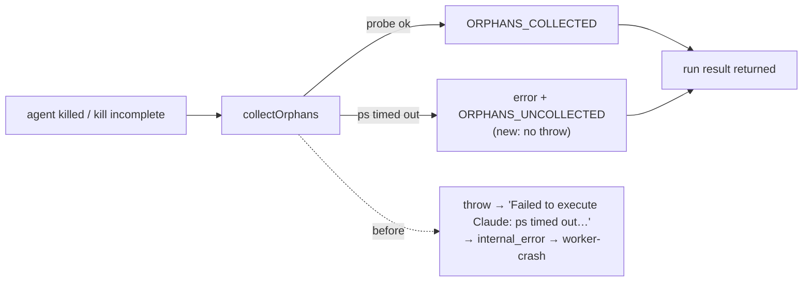

# PR Summary — Issue #5099

## Summary

The source run was released with no PR, and its reason read "Claude execution
failed: Failed to execute Claude: ps timed out after 10000ms". After an external
or incomplete kill, `runClaudeWithTimeout` (`worker/deno/lib/claude_runner.ts`)
awaits `DescendantTracker.collectOrphans` without a catch. That method's doc
says it never throws, but the probes it calls rethrow a command timeout on
purpose (PR #4289). On a loaded host one `ps` took longer than 10 s. The timeout
escaped the runner's main `try`, and the outer catch replaced the agent's whole
result with that error. The result was recorded as `internal_error`, classified
`worker-crash` and auto-filed.

`collectOrphans` now keeps its contract. A probe or signal that fails stops the
sweep. The method then logs one error line and an `ORPHANS_UNCOLLECTED` security
line, each naming the cause and the pids already signalled, and returns what was
collected so far. The runner's result therefore reaches the execute phase's
existing handling for a killed or timed-out run. Closes #5099.

## Spec

### Intent and Rationale

- The issue body withholds its source. The cause came from the release comment
  on the source issue in a private fleet repository: host `vibe-coder-46458`,
  started 11:47 UTC, released 12:52:48 UTC on 2026-11-12, phase `execute`, with
  the message quoted above.
- The defect is in the collector, not the runner. Its only caller already relies
  on "Never throws", so making that true fixes every path that reaches it
  without a second catch in the runner.
- An orphan sweep is cleanup after the agent has already exited. It failing is
  no reason to throw away the agent's output, exit status and kill evidence.

### Essential Design Decisions

- The probes still rethrow a timeout, so a timed-out `ps` is never read as
  "process gone" or "no parent". The PR #4289 intent stands: a timeout stops the
  sweep and nothing more is signalled. It does not let the sweep go on with
  guessed data.
- Fail loud without failing the run. The cause appears in a `logger.error` line
  and in the `ORPHANS_UNCOLLECTED` security event
  (`after=<reason> cause=<message> signalled=<pids|none>`), and the error line
  says that any survivor is left running.
- `collected` is filled as each TERM is sent, so a sweep that fails in its wait
  loop reports the pids it already signalled. On the success path, `collected`,
  `skipped` and the `ORPHANS_COLLECTED` lines are unchanged.

### Undiscoverable Facts

- The release comment does not record which kill (an external kill or an
  incomplete watchdog kill) led to the sweep. The fix covers both, because both
  reach the same `collectOrphans` call.

## Evidence

Backend-only change. No UI file is touched.

- The real producer's timeout message was observed through `readParentPid`. With
  a 0 ms budget, `commandOutputWithTimeout` throws `ps timed out after 0ms`, the
  same `${executable} timed out after ${ms}ms` form as the incident's
  `ps timed out after 10000ms`. The collector test uses that real function.
- Docs: grep of `README.md`, `docs/` (excluding `docs/archive/`), `SECURITY.md`
  and `docs/THREAT-MODEL.md` for `collectOrphans`, `ORPHANS_COLLECTED` and
  "orphan collect" found no manual describing the sweep. The only doc surface is
  the `collectOrphans` doc comment, and this diff updates it.
- Issue numbers in the diff: #5099 (fix(worker): worker-crash — runs releasing
  with no PR). PR #4289 (Give every subprocess an explicit timeout) is cited
  only in this summary and in the commit message.

## Reproduction

- **symptom** — a killed agent run on a loaded host ended as
  `Failed to execute Claude: ps timed out after 10000ms`. Its result was
  discarded, and the run was released with no PR and filed as `worker-crash`
- **status** — `verified` — the regression test was observed failing against the
  unfixed code
  (`expected ok result, got Error: Failed to execute Claude: ps timed out after 10000ms`)
  and passing after the fix
- **regression test** —
  `worker/deno/tests/claude_runner_killed_test.ts::runClaudeWithRetry - a SIGKILLed agent whose orphan sweep's ps times out still returns its result (Issue #5099)`

## Test Plan

- Added to `worker/deno/tests/claude_runner_killed_test.ts`: "runClaudeWithRetry
  - a SIGKILLed agent whose orphan sweep's ps times out still returns its result
    (Issue #5099)". A real agent stub SIGKILLs itself, and fake collector deps
    answer `getParentPid` with the incident's timeout. The test asserts `ok`,
    `killed`, the agent's output and an error line carrying the cause, and that
    no signal was sent. It drives the runner, the production caller. Red on the
    unfixed code, green after the fix.
- Added to `worker/deno/tests/orphan_collector_test.ts`: "orphan collector - a
  ps probe that times out stops the collection without throwing and names the
  cause (Issue #5099)". It uses the real `readParentPid(pid, 0)`. It asserts the
  sweep resolves, that nothing is collected or signalled, that the error and
  `ORPHANS_UNCOLLECTED` lines name `ps timed out after 0ms` and `AGENT_KILLED`,
  and that no `ORPHANS_COLLECTED` line is written. Red on the unfixed code (the
  timeout escaped as a rejection).
- Added to `worker/deno/tests/orphan_collector_test.ts`: "orphan collector - a
  probe that times out after TERM was sent reports the pids already signalled
  (Issue #5099)". It asserts `collected` is `[102, 101]` and that both lines
  name those pids and the cause. Red on the unfixed code.
- Added to `worker/deno/tests/orphan_collector_test.ts`: "orphan collector - the
  logged cause is the error's message, or the thrown value itself when it is not
  an Error (Issue #5099)". A `sendSignal` that rejects with an `Error` and then
  with a bare string must give the exact line
  `[ORPHANS_UNCOLLECTED] after=AGENT_KILLED cause=<message> signalled=none` and
  a matching error line. This pins the `error instanceof Error` ternary at
  `orphan_collector.ts:221`. With that condition negated the test fails (the
  cause becomes `Error: …` or `undefined`); on the head it passes.
- Edited only the `capturingLogger()` helper in both test files, which now also
  records `error` lines. No assertion was removed. The existing collector tests,
  including the success-path `ORPHANS_COLLECTED` test, run unchanged.
- `deno test -A tests/orphan_collector_test.ts tests/claude_runner_killed_test.ts`
  from `worker/deno` on the head: 23 passed, 0 failed.
- `./quality.sh < /dev/null` on `3003ef32` (the head before this summary edit):
  passed in 793 s. Config integration and checkov were skipped by the gate
  itself. Deno tests, lint, type check, fmt, markdownlint, mermaid and semgrep
  passed.
- The pre-push gate's own `deno task test:unit` list for this diff (1,912 files:
  every test that imports `orphan_collector.ts` directly or transitively,
  rebuilt with `loadReferencedUnitTests`) on `3003ef32`: exit 0, parallel pass
  1,864 files passed in 8m05s, serial pass 829 passed and 0 failed. An earlier
  attempt was blocked by this gate. Its output was cut off before the failing
  test, and that failure did not recur on the same commit.
- Branch outcomes of the new catch: a throw before any signal (first collector
  test) and a throw after TERM (second collector test). The no-throw path is
  covered by the existing collector tests.
