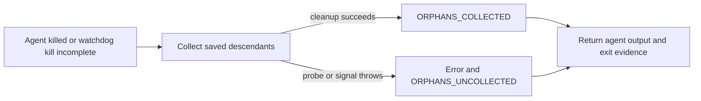

## Summary

Keep orphan-cleanup exceptions from discarding a completed agent invocation's
output and kill evidence. A throwing probe or signal stops the sweep, records
its cause and partial progress, and returns the PIDs already signalled. Failed
subtree discovery also stops cleanup instead of falling back to the root alone.
Closes #5099.

## Spec

### Intent and Rationale

- `collectOrphans` promised never to throw, but a process-probe timeout escaped
  into the runner's outer catch and replaced its result with an execution error.
- Handle cleanup failures in the collector so its existing runner caller can
  return output, exit status and watchdog evidence without a second catch.

### Essential Design Decisions

- Stop on a thrown probe or signal; do not continue signalling with incomplete
  process-table data. Log an error and `ORPHANS_UNCOLLECTED`, including the
  cause and PIDs whose TERM call completed. Survivors can remain running.
- Retain snapshot liveness, parentage and PID-age checks, bottom-up TERM/KILL
  handling, and the successful `ORPHANS_COLLECTED` event.
- Keep the real timeout producer's zero-budget fixture: it rejects before
  spawning, so its result depends on neither host load nor a timer race.

### Undiscoverable Facts

- The private source-run archive identifies run `vibe-mwdgtb02-e62970`, host
  `vibe-coder-46458`, started 2026-11-12 11:46:43 UTC, finished 12:52:57 UTC:
  `no_pr`, phase `execute`, category `internal_error`, class `worker-crash`.
  This independently corroborates the incident's host, window and
  classification.
- That metadata does not contain the exception reason. The archived agent
  transcript contains no timeout line, and the live source issue no longer
  retains the release comment quoted by the checkpoint summary. The original
  `ps timed out after 10000ms` diagnosis is therefore not independently
  confirmed from source-run logs in this run.
- The later #5099 attempts stopped at the pre-push gate or the host disk floor
  (42.9 GB free, 46.0 GB floor). Those are separate recorded failures; this
  change does not alter their gates.

## Evidence

Backend-only change; no visual surface changed.

- On current unfixed main (`da7d20c1a`), the runner regression returned
  `Failed to execute Claude: ps timed out after 10000ms`. With the fix, it
  retains the agent's output, exit 137 and `timedOut: false`.
- `readParentPid(pid, 0)` exercises the real `commandOutputWithTimeout` producer
  and throws `ps timed out after 0ms`. Its immediate rejection is explicit in
  `worker/deno/lib/subprocess_timeout.ts`; it does not probe or signal the
  fixture's invented PIDs.
- The load-bearing fake implements `OrphanCollectorDeps`: its injected timeout
  matches the producer's error format. `worker/deno/lib/pid_guard.ts` rethrows
  command timeouts from liveness, age and descendant probes. The runner test
  drives `runClaudeWithRetry` with a gated agent stub that SIGKILLs itself.
- Read `docs/INTERNALS.md`'s PID guard section and updated it, the collector
  method comment and the caller's memory-reclamation comment for partial
  cleanup. Searches of README files, non-archived docs and source callers found
  no other manual describing `collectOrphans` or its security events.
- Provenance checked: #5099: fix(worker): worker-crash — runs releasing with no
  PR.

## Reproduction

- **symptom** — an orphan probe timeout replaces the killed agent's result with
  `Failed to execute Claude: ps timed out after 10000ms`, losing output and kill
  evidence
- **status** — `partial` — reason: the runner failure was observed against
  unfixed main using an injected timeout, then passed with the fix; an actual
  ten-second OS probe stall and the complete historical incident were not
  recreated
- **regression test** —
  `worker/deno/tests/claude_runner_killed_test.ts::runClaudeWithRetry - a SIGKILLed agent whose orphan sweep's ps times out still returns its result (Issue #5099)`

## Test Plan

- [x] Preserve checkpoint commits and merge current main without rewriting
      history.
- [x] Review source-run records, collector guards, caller and documentation.
- [x] Observe regressions against unfixed main and passing targeted tests.
- [x] Run the full quality gate on the final head (every stage before Semgrep
      passed; see below).
- [x] Run the summary validator and preserve the implementation on the issue
      branch.

- `worker/deno/tests/orphan_collector_test.ts`: added cases for a real
  zero-budget parent probe, timeout after TERM, Error and non-Error signal
  failures, and failed subtree discovery. They assert specific causes, partial
  progress, surviving processes and absence of success events/signals where
  cleanup stopped. Existing successful cleanup, PID reuse, empty snapshot and
  TERM/KILL escalation tests remain unchanged.
- `worker/deno/tests/claude_runner_killed_test.ts`: added the runner regression
  above, asserting output, killed status, raw and reported exit 137,
  `timedOut: false`, no cleanup signals and the logged cause.
- No existing assertion was removed. Both capturing loggers now retain error
  lines. No new production API or dependency was added.
- Against main's collector with these tests retained:
  `deno task test:unit tests/orphan_collector_test.ts tests/claude_runner_killed_test.ts`
  failed with 19 passed and 5 failed. The runner exposed the execution error;
  parent/wait/signal errors escaped; subtree failure incorrectly collected root
  101. The subtree regression also failed against the checkpointed fix.
- With the final production and test changes, that same task passed: 24 passed,
  0 failed. Targeted `deno fmt --check`, `deno lint` and
  `deno check --frozen --lock=deno.lock` passed for both production and both
  test files.
- Caller checked: `runClaudeWithTimeoutBody` in
  `worker/deno/lib/claude_runner.ts`, reached through `runClaudeWithRetry`. It
  uses the same collector for external kills and incomplete watchdog kills; the
  subtree test exercises the latter reason. Existing empty/no-root returns still
  bypass signalling; PID ownership and signalling order are unchanged.
- No twinned collector rule was found. No persisted data, credential handling,
  external command construction or path guard changed.

- `deno task check:manifests`: passed, 870 passed, 0 failed, 1 ignored (earlier
  attempt; manifests unchanged since).
- After merging current `origin/main`,
  `deno task test:unit
  tests/orphan_collector_test.ts tests/claude_runner_killed_test.ts`
  passed: 24 passed, 0 failed.
- Full `./quality.sh < /dev/null` on the final head (load average about 10):
  every stage before Semgrep passed. That includes completeness checks (unit
  suite, lint, type check and formatting, 467s), Mermaid, Markdown lint, the
  chokepoint audits and workflow hygiene. The
  `tests/parallel_safety_cap_test.ts` timing failure from the earlier attempt
  did not recur. Config integration was skipped because no runtime config was
  available.
- The Semgrep stage did not complete. Its version probe failed with
  `Error: semgrep timed out after 10000ms` (`probe` in
  `worker/deno/lib/semgrep_check.ts`). By hand, `semgrep --version` took 37.8s
  and then 30.6s on this host, so a 10s probe cannot pass under this load.
  Checkov, the only stage after Semgrep, is skipped on this host because neither
  the binary nor a container runtime is present.
- Instead, `semgrep scan --config p/default --metrics=off --error --quiet --`
  over the four changed `.ts` files exited 0 with no findings. The worker runs
  the full gate again before the PR is raised.
- `deno task pr-summary-check --base main --issue-body-file <issue body> --labels bug,top-priority,failed-once`
  on this summary: 0 gates blocked, 0 not checked.

## Merge verification

CI and independent code review are pending. The local full gate's Semgrep stage
timed out on this host and was replaced by the direct scan above.

## Limitations and remaining risk

The original host's complete worker log and ten-second OS stall were not
reproduced. Cleanup failures can leave descendants running; the error and
security event report that condition. The full-gate Semgrep stage did not
complete on this host; only the direct scan of the changed files ran.
