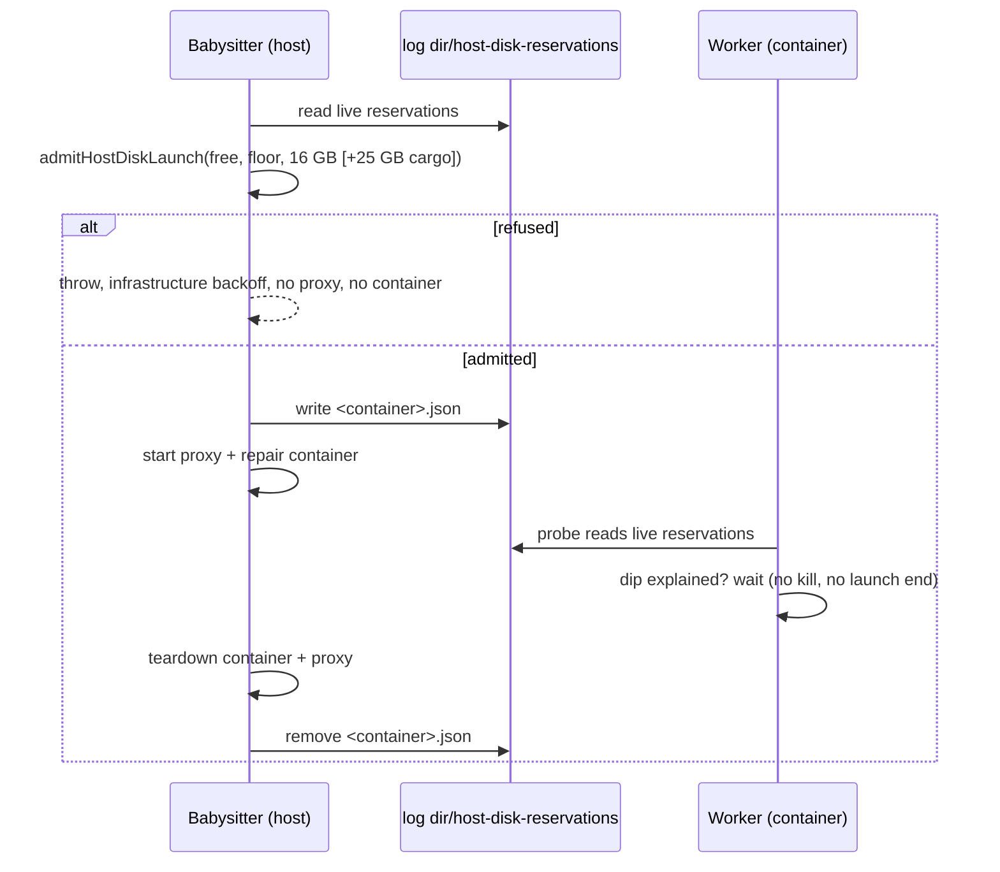

# PR Summary — Issue #5105

## Summary

PR #5116 made agent-owned cargo targets releasable and measured the ephemeral
root. This PR delivers the three asks it left open, all from the babysitter
comment on the issue:

- **One host-disk admission.** The fleet PR babysitter and the worker now admit
  against the same floor and one shared reservation ledger.
- **No second babysitter egress proxy.** The babysitter runs one repair
  container, so one egress proxy, at a time.
- **A wait, not a kill.** The worker no longer kills its runs for a dip below
  the floor that the babysitter's live repairs account for.

Closes #5105.

- `worker/deno/lib/host_disk_reservations.ts` (new) is the ledger. While a
  repair container runs, the babysitter keeps one JSON file per container in
  `<log dir>/host-disk-reservations/`. That is the mounted log directory that
  already carries `host-disk.json`; inside the worker it is
  `${HOME}/logs/host-disk-reservations`. `admitHostDiskLaunch` admits new work
  when `free − outstanding reservations − request ≥ floor`.
  `babysitterDipCreditBytes` tells whether a dip below the floor is fully
  explained by what live reservations have consumed, after the worker's own
  measured growth over the same span is taken off the drop. No credit applies
  below half the floor (`HOST_DISK_HARD_MINIMUM_FLOOR_FRACTION`), and unknown
  worker growth credits nothing. `ReservationSightings` records the worker's own
  footprint when it first sees each reservation.
- **Babysitter admission** (`fleet_babysitter_container.ts`).
  `runBabysitterRepairContainer` calls `babysitterHostDiskAdmission` before any
  egress starts.
  - It measures the host the way `run.sh` does and uses the configured floor.
  - It asks for 16 GB: the container rootfs plus its proxy's. A clone with a
    cargo project adds the worker's 25 GB cargo headroom.
  - A refusal throws before any proxy or container starts. The reservation is
    removed after the container and its proxy are torn down.
- **One repair at a time** (`fleet_pr_babysitter.ts`). The production queue
  passes `BABYSITTER_REPAIR_CONTAINER_LIMIT = 1` instead of `2`.
- **Worker** (`heavy_build_gate.ts`, `run_core_production_deps.ts`,
  `host_disk.ts`). The host disk probe and the `checkRootFilesystem` stop check
  now also read the live reservations and the worker's own growth since each was
  first seen. `HostDiskMonitor.workerFootprintGrowthBytes` is the work volume's
  growth, summed across launcher re-bases, plus the ephemeral cargo root's
  highest measured size. It only rises. It is undefined on a native `df`.
  - `parkRunningBuild` and `hostDiskLaunchStopReason` return null for a dip the
    reservations explain.
  - `parkInFlightBuild` waits out such a dip only when the caller opts in. The
    default is no wait. Only the agent step in `claude_runner.ts` opts in,
    polling every 60 s for at most 20 minutes, and never past its finish
    deadline less the minimum session (`babysitterDipWaitWithin`).
  - `heavyBuildAdmission`, `cargoClaimDeferral` and
    `shouldSkipEphemeralCargoBuild` subtract the reserved bytes not yet consumed
    from the free space they test.

## Spec

### Intent and Rationale

- On the reporter's laptop, each babysitter repair took about 15–16 GB (its
  container plus its own egress proxy). Two repairs at once, plus a cargo build,
  pushed the host below the worker's floor, and the worker killed issue runs
  that had nothing to do with it. The worker could not see the babysitter's
  usage, and the two sides used separate checks.
- A file ledger in the log directory is the one host path both sides already
  share, and the worker already reads the launcher's `host-disk.json` from it.
  So no new mount or IPC is needed.

### Essential Design Decisions

- **Consumption estimate.** What a reservation has consumed is estimated as the
  drop in free space since the earliest live reservation was admitted, capped at
  the reserved bytes. Admission subtracts only the unconsumed rest, so space is
  not counted twice.
- **Dip credit.** The credit is the drop less the worker's own growth since it
  first saw the earliest reservation, capped at the reserved bytes. The worker's
  growth only rises, so it is never understated. A reservation first seen more
  than 10 minutes after its admission (`RESERVATION_SIGHTING_GRACE_MS`) gets no
  credit, because the worker's earlier growth is unknown. Below half the floor
  nothing is credited, so a running build always stops and the launch ends.
- **Proxy decision.** "No second babysitter egress proxy" is met by running one
  repair container at a time, not by sharing one proxy between containers. Proxy
  names, networks and Apple ownership journals are per container, so sharing
  would need a new proxy lifecycle. The trade-off: queued repairs wait for the
  running one (up to 90 minutes each).
- **Bounds.** A reservation expires at admission plus the repair timeout plus 10
  minutes. That bounds a crashed babysitter's stale file, since the worker in
  its container cannot check host PIDs. A new agent step waits at most 20
  minutes, after which the existing park applies. Callers with their own budget
  do not wait.
- **Unknown readings.** An unmeasurable host admits the repair without a
  reservation, the same rule as the worker's "unknown never defers". An
  unreadable ledger is logged by the worker and read as no reservations, which
  keeps the existing park and stop behaviour.

### Undiscoverable Facts

- The 16 GB footprint and the "two proxies at once" observation come from the
  owner's measurements in the issue comments (2026-11-13): worker rootfs 7.7 GB,
  egress proxy rootfs 7.4–7.6 GB, and drops of about 40 GB per babysitter run.
- Before this change the babysitter had no disk check at all: there are no floor
  or disk references in `fleet_babysitter_container.ts` on the base branch.
- The issue body's own items (agent-owned target release, ephemeral-root
  telemetry, composition test) landed in #5116, which merged on 2026-11-13 and
  left this issue open.

## Evidence

Backend and CLI only, with no UI files.

## Reproduction

- **symptom** — mid-run, a babysitter repair (container plus egress proxy, and a
  cargo build) pushed the host below the 46 GB floor, and the worker's issue run
  was killed (`no_pr:internal_error:execute`). The babysitter launched with no
  disk check.
- **status** — `partial` — reason: the new tests drive each decision with fake
  disk readings and a real ledger in a temp directory. The real
  host-plus-container incident was not reproduced. The new tests call API this
  PR adds, so they cannot run against the base branch. The base behaviour they
  replace is shown by each test's control case, which is the same low reading
  without a reservation and still parks or stops.
- **regression test** —
  `worker/deno/tests/host_disk_babysitter_dip_5105_test.ts::Issue #5105 - parkRunningBuild does not kill a dip the reservations explain`

## Test Plan

- `worker/deno/tests/host_disk_reservations_5105_test.ts` (new, 13 tests): the
  parser rejects each malformed field; write and read round-trip; expired,
  malformed and mismatched-name files are not read as live; a missing directory
  reads as empty; consumption accounting, including the cap; admission admits
  and refuses where the inputs differ only by the reservation; dip credit for an
  explained dip, an unexplained dip, no dip and no reservations. The dip credit
  takes the worker's own growth off the drop, credits nothing for unknown
  growth, and never applies below half the floor. `ReservationSightings`
  measures growth from first sight and credits nothing past the grace.
  Red-check: with the worker-growth term removed, 2 of these tests fail.
- `worker/deno/tests/host_disk_babysitter_dip_5105_test.ts` (new, 10 tests):
  - `parkRunningBuild` and `hostDiskLaunchStopReason` do not park or stop for an
    explained dip; the same reading without a reservation does (control).
  - A dip the reservation cannot explain still parks and stops.
  - `parkInFlightBuild` waits out a dip that recovers (two polls), and parks
    once the wait bound passes.
  - Cargo admission becomes `merge-only` when an unconsumed reservation leaves
    too little headroom.
  - The probe helper reads a live reservation, and logs and survives an
    unreadable directory.
  - A dip the worker's own growth caused still parks and still ends the launch,
    and so does unknown growth; zero growth is the control.
  - A 41 GB reservation with 1 GB free still parks and ends the launch; at 30 GB
    free the same reservation is credited (control).
  - `parkInFlightBuild` does not wait by default.
- `worker/deno/tests/heavy_build_gate_reservations_5105_test.ts` (new, 4 tests):
  `cargoClaimDeferral` defers, and `shouldSkipEphemeralCargoBuild` skips, for a
  reading that clears the floor and headroom only when the outstanding
  reservation is ignored; the same reading without the reservation is the
  control. Red-check: with the subtraction at either site changed back to
  `hostFreeBytes: free`, both reservation cases fail and both controls pass.
- `worker/deno/tests/host_disk_reservations_wiring_5105_test.ts` (new, 2 tests):
  `createProductionRunCoreDeps` with a temp `HOME` holding
  `logs/host-disk-reservations/<id>.json`. `parkRunningBuild()` returns null
  with the file and a park reason without it. `checkRootFilesystem` does not
  stop for host disk with the file, and stops without it. Red-check: with the
  reservations dropped from the wiring, both fail.
- `worker/deno/tests/security_fix_discrimination_test.ts` (one new test):
  `runSecurityFixDiscrimination` with the default park and an explained dip
  returns the host-disk park reason at once, not a budget exhaustion. Not
  red-checked: with the old 20-minute default the test would hang, not fail.
- `worker/deno/tests/babysitter_host_disk_admission_5105_test.ts` (new, 12
  tests):
  - A refused admission starts no sidecar, Apple helper or spawn.
  - The release runs once, after the sidecar stops, including when the spawn
    fails, and a failing release does not mask the repair's error.
  - Reservation sizes, with the production cargo check (no `holdsCargo` seam):
    footprint only for a clone with only `deno.json`, plus the headroom for a
    clone with a Cargo.toml. Red-check: with `defaultHoldsCargo` returning
    false, the test fails.
  - With the real `babysitterHostDiskAdmission` (temp ledger, fake host), the
    reservation file is live when the sidecar stops and gone afterwards, both
    when the spawn succeeds and when it fails. Red-check: moving the release
    before teardown, or removing it, fails 5 tests.
  - With only the ledger directory injected, the production measure, floor and
    cargo check run. The outcome is pinned for a refusal, an unmeasurable host
    and an admission. This host admitted, and the release removed the file.
  - A refusal from an outstanding reservation, with a control that admits.
  - An unmeasurable host admits and writes no file.
  - With `BABYSITTER_REPAIR_CONTAINER_LIMIT`, `runRepairs` never overlaps two
    repairs.
- Existing tests: `fleet_babysitter_container_4738_test.ts`,
  `fleet_babysitter_container_egress_4738_test.ts` and
  `tests/fixtures/babysitter_container_fakes_4770.ts` inject an admitting fake
  `hostDiskAdmission`, so they do not measure the real host or write to the real
  log directory. No assertions were removed.
- `worker/deno/tests/claude_runner_host_disk_4390_test.ts` (unchanged) pins one
  probe read per new agent process. The in-flight park now reads the probe once
  outside a babysitter dip, and that test passes.
- The full gate was not re-run on this head; the worker re-runs it. The related
  suites passed, 515 tests with 0 failures: the claude_runner, discrimination,
  merge fast checks, heavy build gate, cargo claim, milestone gate, host disk
  and ephemeral root suites, plus every new #5105 file.
- Callers checked: `parkInFlightBuild` has four production callers.
  - `claude_runner.ts` (agent step): opts in to the wait, bounded by the finish
    deadline less the minimum session. The spawn clamp re-reads the clock after
    it.
  - `phases/quality_gate_remediation_phase.ts`: default, no wait. A park returns
    at once, as before.
  - `merge_fast_checks.ts` (`opts.park ?? parkInFlightBuild`): default, no wait,
    so the merge lock is not held through a dip.
  - `security_fix_discrimination.ts` (`park = parkInFlightBuild`, and
    `issue_worker_wiring.ts` passes none): default, no wait, so the 600 s budget
    is not spent. `runBabysitterRepairContainer` is called by
    `startBabysitterAgent`, which uses the production admission. The production
    probe and the `checkRootFilesystem` stop check both pass the reservations.
- Docs updated:
  - `docs/workflows/fleet-pr-babysitter.md`: the concurrency sentence, the
    per-repair scope line, and a new "Host-disk admission" paragraph.
  - `docs/CONTAINER.md`: the "In-flight builds stop at the same floor" section.
  - `docs/INTERNALS.md`: the launch-end sentence.
  - `docs/audits/lib-sweep-coverage/top-up-5105.json` now lists the new module.

## Not checked

- No real babysitter-plus-worker run on an Apple or docker host. Every check is
  a unit test with fakes or a temp ledger.
- Whether the worker's per-handler watchdogs tolerate a 20-minute wait at the
  start of an agent step was not measured.
- The comment's other candidate levers were not done: pruning the builder near
  the floor, sharing the worker's own proxy, and counting container rootfs
  images in telemetry.
