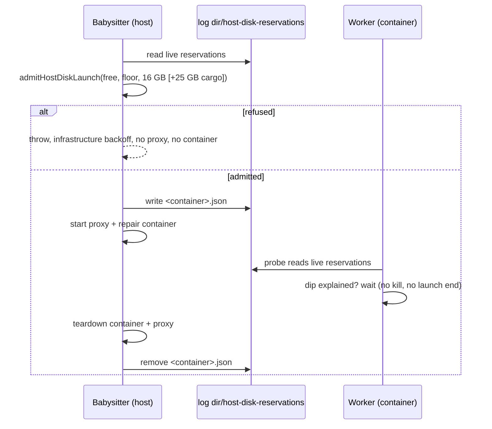

# PR Summary — Issue #5105

## Summary

PR #5116 made agent-owned cargo targets releasable and measured the ephemeral
root. This PR delivers the three asks it left open, all from the babysitter
comment on the issue:

- **One host-disk admission.** The fleet PR babysitter and the worker now admit
  against the same floor and one shared reservation ledger.
- **No second babysitter egress proxy.** The babysitter runs one repair
  container, so one egress proxy, at a time.
- **A wait, not a kill.** The worker no longer kills its runs for a dip below
  the floor that the babysitter's live repairs account for.

Closes #5105.

- `worker/deno/lib/host_disk_reservations.ts` (new) is the ledger. While a
  repair container runs, the babysitter keeps one JSON file per container in
  `<log dir>/host-disk-reservations/`. That is the mounted log directory that
  already carries `host-disk.json`; inside the worker it is
  `${HOME}/logs/host-disk-reservations`. `admitHostDiskLaunch` admits new work
  when `free − outstanding reservations − request ≥ floor`.
  `babysitterDipCreditBytes` tells whether a dip below the floor is fully
  explained by what live reservations have consumed.
- **Babysitter admission** (`fleet_babysitter_container.ts`).
  `runBabysitterRepairContainer` calls `babysitterHostDiskAdmission` before
  any egress starts.
  - It measures the host the way `run.sh` does and uses the configured floor.
  - It asks for 16 GB: the container rootfs plus its proxy's. A clone with a
    cargo project adds the worker's 25 GB cargo headroom.
  - A refusal throws before any proxy or container starts. The reservation is
    removed after the container and its proxy are torn down.
- **One repair at a time** (`fleet_pr_babysitter.ts`). The production queue
  passes `BABYSITTER_REPAIR_CONTAINER_LIMIT = 1` instead of `2`.
- **Worker** (`heavy_build_gate.ts`, `run_core_production_deps.ts`). The host
  disk probe now also reads the live reservations.
  - `parkRunningBuild` and `hostDiskLaunchStopReason` return null for a dip the
    reservations explain.
  - `parkInFlightBuild` first waits out such a dip, polling every 60 s for up
    to 20 minutes.
  - `heavyBuildAdmission`, `cargoClaimDeferral` and
    `shouldSkipEphemeralCargoBuild` subtract the reserved bytes not yet
    consumed from the free space they test.

## Spec

### Intent and Rationale

- On the reporter's laptop, each babysitter repair took about 15–16 GB (its
  container plus its own egress proxy). Two repairs at once, plus a cargo
  build, pushed the host below the worker's floor, and the worker killed issue
  runs that had nothing to do with it. The worker could not see the
  babysitter's usage, and the two sides used separate checks.
- A file ledger in the log directory is the one host path both sides already
  share, and the worker already reads the launcher's `host-disk.json` from it.
  So no new mount or IPC is needed.

### Essential Design Decisions

- **Consumption estimate.** What a reservation has consumed is estimated as the
  drop in free space since the earliest live reservation was admitted, capped
  at the reserved bytes. Admission subtracts only the unconsumed rest, so space
  is not counted twice. The dip credit can never exceed the reservation, so a
  dip with another cause still parks or ends the launch.
- **Proxy decision.** "No second babysitter egress proxy" is met by running
  one repair container at a time, not by sharing one proxy between containers.
  Proxy names, networks and Apple ownership journals are per container, so
  sharing would need a new proxy lifecycle. The trade-off: queued repairs wait
  for the running one (up to 90 minutes each).
- **Bounds.** A reservation expires at admission plus the repair timeout plus
  10 minutes. That bounds a crashed babysitter's stale file, since the worker
  in its container cannot check host PIDs. A new build step waits at most 20
  minutes, after which the existing park applies.
- **Unknown readings.** An unmeasurable host admits the repair without a
  reservation, the same rule as the worker's "unknown never defers". An
  unreadable ledger is logged by the worker and read as no reservations, which
  keeps the existing park and stop behaviour.

### Undiscoverable Facts

- The 16 GB footprint and the "two proxies at once" observation come from the
  owner's measurements in the issue comments (2026-11-13): worker rootfs
  7.7 GB, egress proxy rootfs 7.4–7.6 GB, and drops of about 40 GB per
  babysitter run.
- Before this change the babysitter had no disk check at all: there are no
  floor or disk references in `fleet_babysitter_container.ts` on the base
  branch.
- The issue body's own items (agent-owned target release, ephemeral-root
  telemetry, composition test) landed in #5116, which merged on 2026-11-13 and
  left this issue open.

## Evidence

Backend and CLI only, with no UI files.

## Reproduction

- **symptom** — mid-run, a babysitter repair (container plus egress proxy, and
  a cargo build) pushed the host below the 46 GB floor, and the worker's issue
  run was killed (`no_pr:internal_error:execute`). The babysitter launched with
  no disk check.
- **status** — `partial` — reason: the new tests drive each decision with
  fake disk readings and a real ledger in a temp directory. The real
  host-plus-container incident was not reproduced. The new tests call API this
  PR adds, so they cannot run against the base branch. The base behaviour they
  replace is shown by each test's control case, which is the same low reading
  without a reservation and still parks or stops.
- **regression test** —
  `worker/deno/tests/host_disk_babysitter_dip_5105_test.ts::Issue #5105 - parkRunningBuild does not kill a dip the reservations explain`

## Test Plan

- `worker/deno/tests/host_disk_reservations_5105_test.ts` (new, 9 tests): the
  parser rejects each malformed field; write and read round-trip; expired,
  malformed and mismatched-name files are not read as live; a missing directory
  reads as empty; consumption accounting, including the cap; admission admits
  and refuses where the inputs differ only by the reservation; dip credit for
  an explained dip, an unexplained dip, no dip and no reservations.
- `worker/deno/tests/host_disk_babysitter_dip_5105_test.ts` (new, 7 tests):
  - `parkRunningBuild` and `hostDiskLaunchStopReason` do not park or stop for
    an explained dip; the same reading without a reservation does (control).
  - A dip the reservation cannot explain still parks and stops.
  - `parkInFlightBuild` waits out a dip that recovers (two polls), and parks
    once the wait bound passes.
  - Cargo admission becomes `merge-only` when an unconsumed reservation leaves
    too little headroom.
  - The probe helper reads a live reservation, and logs and survives an
    unreadable directory.
- `worker/deno/tests/babysitter_host_disk_admission_5105_test.ts` (new, 9
  tests):
  - A refused admission starts no sidecar, Apple helper or spawn.
  - The release runs once, after the sidecar stops, including when the spawn
    fails, and a failing release does not mask the repair's error.
  - Reservation sizes: footprint only for a non-cargo clone, plus the headroom
    for a clone with a Cargo.toml.
  - A refusal from an outstanding reservation, with a control that admits.
  - An unmeasurable host admits and writes no file.
  - With `BABYSITTER_REPAIR_CONTAINER_LIMIT`, `runRepairs` never overlaps two
    repairs.
- Existing tests: `fleet_babysitter_container_4738_test.ts`,
  `fleet_babysitter_container_egress_4738_test.ts` and
  `tests/fixtures/babysitter_container_fakes_4770.ts` inject an admitting fake
  `hostDiskAdmission`, so they do not measure the real host or write to the
  real log directory. No assertions were removed.
- `worker/deno/tests/claude_runner_host_disk_4390_test.ts` (unchanged) pins
  one probe read per new agent process. The in-flight park now reads the probe
  once outside a babysitter dip, and that test passes.
- Full gate: `./quality.sh < /dev/null` passed on head `23a96dd6` (deno tests,
  lint, type check, fmt, markdownlint and semgrep all passed). It skipped two
  checks: config integration (this host has no `.config.json`) and checkov (not
  installed).
- Callers checked: `parkInFlightBuild` is called from `claude_runner.ts:1350`
  and `quality_gate_remediation_phase.ts:494`, both with the default wait.
  `runBabysitterRepairContainer` is called by `startBabysitterAgent`, which
  uses the production admission. The production probe and the
  `checkRootFilesystem` stop check both pass the reservations.
- Docs updated:
  - `docs/workflows/fleet-pr-babysitter.md`: the concurrency sentence, the
    per-repair scope line, and a new "Host-disk admission" paragraph.
  - `docs/CONTAINER.md`: the "In-flight builds stop at the same floor" section.
  - `docs/INTERNALS.md`: the launch-end sentence.
  - `docs/audits/lib-sweep-coverage/top-up-5105.json` now lists the new module.

## Not checked

- No real babysitter-plus-worker run on an Apple or docker host. Every check is
  a unit test with fakes or a temp ledger.
- Whether the worker's per-handler watchdogs tolerate a 20-minute wait at the
  start of an agent step was not measured.
- The worker's own growth during a babysitter repair also counts as the
  babysitter's consumption, so the dip credit can over-credit by up to the
  reservation's bytes.
- The comment's other candidate levers were not done: pruning the builder near
  the floor, sharing the worker's own proxy, and counting container rootfs
  images in telemetry.
