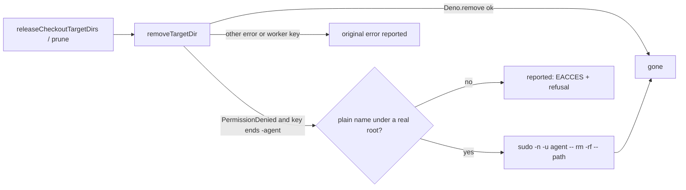

# PR Summary — Issue #5105

## Summary

The worker runs as `vibe`. It could not remove an ephemeral cargo target dir
that a dropped build wrote as `agent`
(`/var/tmp/vibe-cargo-target/<repo>-<key>-agent`). So every release after a pass
logged `Permission denied (os error 13)`, and the space stayed held until the
relaunch. This PR fixes the issue body's three Fix items:

- **Release as `agent`.** A removal refused with `PermissionDenied`, on a
  directory keyed to the `agent` account, is retried as
  `sudo -n -u agent -- rm -rf -- <path>`: the same drop the build used
  (`removeTargetDir` and `targetDirRemovalAsAccount` in
  `worker/deno/lib/heavy_build_gate.ts`). The fallback runs only when every
  check passes: the account is `agent`, the path is one plain name directly
  under the root, and the root is a real directory, not a symlink.
  `productionEphemeralRootDeps.removeDir` uses it, so the maintenance-pass
  release, the pre-PR verifier's release and the budget's pruning all gain it.
- **Measure the ephemeral root.** On a trim-refused runtime, the `Work volume:`
  line now ends with the ephemeral cargo root's size and its largest target
  dirs. The host-disk monitor is given the same figure, and its launch-baseline
  detail names it (`worker/deno/lib/ephemeral_root_telemetry.ts`, and
  `HostDiskMonitor.recordEphemeralCargoRootBytes` in
  `worker/deno/lib/host_disk.ts`).
- **Composition test.** A pass whose build ran as `agent` leaves no target dir
  behind and reports no error. One test uses a fake standing in for `sudo`, and
  one uses the real `agent` account.

The trusted comments on the issue add three items that this PR does not deliver,
so they are recorded as `missing` below. Part of #5105.

## Spec

### Intent and Rationale

- Of the two options the issue offers, this PR releases the directory as the
  `agent` account, not group-writable dirs. Group-writable dirs (setgid,
  umask 002) would need every cargo invocation the agent runs to honour the
  umask, which the worker does not control. Dropping to `agent` uses the sudo
  rule the image already carries (`container/Containerfile:462`).
- The ephemeral root lives on the container's own layer, not on the volume. Its
  figure is therefore appended to the `Work volume:` line and is never added to
  that line's total or buckets.

### Essential Design Decisions

- The host-disk estimate's arithmetic and level are unchanged; only the detail
  text names the ephemeral root. An adopted launcher reading already includes
  the rootfs as it stood when the launcher measured it, so subtracting the whole
  root would count those bytes twice. The detail therefore says that the growth
  since the launcher's reading is not in the estimate.
- A failed measurement (anything other than a missing root, including a `du`
  timeout) reads `unknown` on the line and records `null` to the monitor. It is
  never reported as a clean `0.0 GB`.
- The fallback runs only on `PermissionDenied`. Any other error, or a directory
  keyed to the worker's own account, is rethrown unchanged. A failed fallback
  keeps the original EACCES text and adds the sudo cause.
- `productionTargetDirRemoval.removeAsAccount` builds its remover when it is
  called, not when the module loads, because the import graph is cyclic through
  `untrusted_command_env.ts`.

### Undiscoverable Facts

- Observed in this container (uid `vibe`, in group `vibework`): on a directory
  that `agent` created (`drwxr-xr-x agent vibework`),
  `Deno.remove(path,
  {recursive: true})` throws `Deno.errors.PermissionDenied`
  with `Permission denied (os error 13): remove '<path>'`, and
  `sudo -n -u agent -- rm -rf -- <path>` exits 0 and removes it.
- The trusted comments (2026-11-13) point to babysitter launches as the main
  driver of the 40 GB swings. Each launch has its own container and egress
  proxy. This PR does not touch that path.

## Evidence

This is a backend-only change; it touches no UI file.

- **Real-tool reproduction.** I ran `releaseCheckoutTargetDirs` with
  `unmeasuredEphemeralRootDeps` on a dir that `agent` built (via
  `sudo -n -u agent -- mkdir`).
  - **Base `c2b806d1`:** returned
    `errors: ["…-agent: Permission denied (os error 13): remove '…-agent'"]`,
    and the dir stayed. This is the issue's logged line.
  - **Head, under the real root `/var/tmp/vibe-cargo-target`:** returned
    `{"bytes":0,"errors":[]}`, and the dir was gone. Another lane's worker-owned
    dir under the same root was left untouched.
  - **Head, with a temp root:** the production remover refuses with
    `its parent is not exactly /var/tmp/vibe-cargo-target`. That is the
    confinement working as intended.
- `./quality.sh < /dev/null` passed on head `0ac2620e`. "config integration" was
  skipped because `.config.json` was not available, and "checkov" because no
  checkov binary was available. The first gate run failed only on the
  completeness check, because the new module had no sweep slice.
  `docs/audits/lib-sweep-coverage/top-up-5105.json` fixes that.
- Issue numbers this diff adds as provenance:
  - #5105: Agent-owned ephemeral cargo target dirs cannot be released mid-cycle
    (EACCES), and container-rootfs growth is unmeasured, so a Rust-heavy cycle
    hits the host disk floor

## Reproduction

- **symptom** —
  `WARNING: Could not release an ephemeral target dir of <repo>:
  /var/tmp/vibe-cargo-target/<repo>-<key>-agent: Permission denied (os error
  13) (Issue #3178)`,
  and the space was held until the relaunch
- **status** — `partial` — reason: the same release call was observed failing on
  base with the issue's exact EACCES text and succeeding on head, using the real
  `agent` account. The committed regression tests import the new remover, so
  they cannot run against base unchanged.
- **regression test** —
  `worker/deno/tests/heavy_build_gate_agent_release_5105_test.ts::a pass whose build ran as agent leaves no target dir behind`

## Acceptance Criteria

- **missing** — "the babysitter's container and builds admitted against the same
  host budget as the worker's, with one admission for both, not two independent
  checks" — reason: the babysitter launches in its own container through the
  launcher (`fleet-pr-babysitter/`, `run.sh`). A shared host-wide admission is a
  separate change to the launcher and babysitter, and this PR does not make it.
- **missing** — "no second babysitter egress proxy (reuse one per host, or the
  worker's)" — reason: the egress proxy lifecycle lives in the launcher, and
  this PR does not change it.
- **missing** — "the worker's floor check treating a babysitter-driven dip as a
  wait, not a kill (#5077)" — reason: this is the open issue #5077 ("A host-disk
  park mid-execute is still logged as ERROR and released as internal_error"),
  and this PR does not change the park.

## Test Plan

- Added `worker/deno/tests/heavy_build_gate_agent_release_5105_test.ts`:
  - `a pass whose build ran as agent leaves no target dir behind`. EACCES is
    staged with a `0555` subdir, and a positive control proves the plain remove
    is refused. A fake stands in for `sudo`; it records the argv and removes the
    tree. The test asserts `errors` is `[]`, the `-agent` dir is gone, the argv
    is exact, the worker-account sibling went without sudo, and an unrelated
    checkout's dir survives. It is ignored as root, where EACCES cannot be
    staged.
  - `the real agent account's target dir is released through sudo`: real
    `sudo -n -u agent`. It ran here, and it is ignored where no `agent` account
    exists, as in CI.
  - `a failed fallback is reported with both causes and keeps the dir`: the
    reported error holds `Permission denied`, the sudo stderr line, and
    `(Issue #5105)` exactly once.
  - `targetDirRemovalAsAccount refuses anything but a plain agent dir under a
    real root`:
    an account other than `agent`, `<root>/..`, `<root>/missing/../x`, a
    different parent and a symlinked root are each refused before `run` is
    called, with an allowed control that does run.
  - `targetDirAccount names only an agent-keyed directory`, including a long
    hostile input.
  - `removeTargetDir only falls back for a refused agent directory`: `NotFound`,
    and a refused worker-key dir, are both rethrown without the fallback.
- Added `worker/deno/tests/ephemeral_root_telemetry_5105_test.ts`:
  - measurement: sums and ordering; a missing root is zero; any other failure is
    `unknown`; a real `du` run against a temp root;
  - formatting: literal strings for 0, 1 and 4 dirs;
  - the report: the line is unchanged and nothing is measured when the trim is
    honoured; the segment is appended and the bytes recorded when it is refused;
    `null` is recorded on a measurement error;
  - `the host-disk estimate names the root without changing the estimate`:
    `availableBytes` and `level` are equal with and without the record.
- The production wiring in `worker/deno/lib/run_core_production_deps.ts` has no
  unit test of its own. `deno check` covers it, and the tests above cover the
  functions it calls.
- No existing test or assertion was edited or removed.
  `heavy_build_gate_3178_test.ts`, `heavy_build_gate_in_flight_4413_test.ts`,
  `heavy_build_gate_in_flight_4423_test.ts`, `host_disk_test.ts`,
  `host_disk_live_reading_test.ts` and
  `host_disk_recreate_declined_4498_test.ts` pass unchanged.
- Callers of the changed removal: `releaseCheckoutTargetDirs` (milestone sync
  release in `run_core_production_deps.ts`, and the pre-PR verifier in
  `pre_pr_verifier.ts` via `unmeasuredEphemeralRootDeps`) and the pruning in
  `enforceEphemeralCargoBudget`. All of them reach `removeDir`. A worker-owned
  dir behaves as before.
- Docs: updated `docs/CONTAINER.md` ("One directory per account" bullet and the
  `Work volume:` section) and the `docs/CONTAINMENT.md` table row. I read "A
  pass releases what it built", and it is still true.
- Result: `./quality.sh < /dev/null` passed on head `0ac2620e`, with the two
  host skips listed under Evidence.

Not checked: the babysitter and egress-proxy items above. The fallback was not
observed on Apple `container`; it was observed in this Linux container, which
uses the same image and sudo rule.
