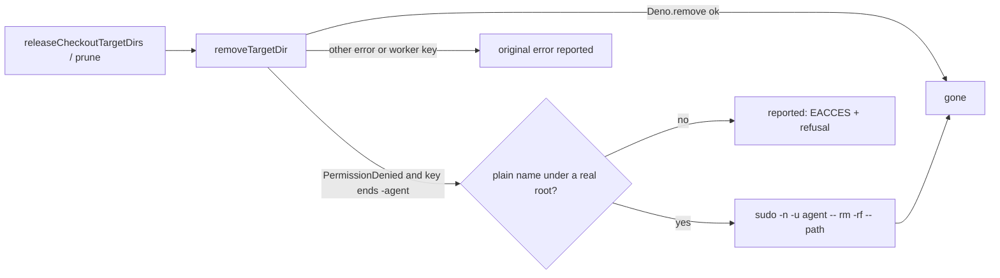

# PR Summary — Issue #5105

## Summary

The worker runs as `vibe`. It could not remove an ephemeral cargo target dir
that a dropped build wrote as `agent`
(`/var/tmp/vibe-cargo-target/<repo>-<key>-agent`). So every release after a pass
logged `Permission denied (os error 13)`, and the space stayed held until the
relaunch. This PR fixes the issue body's three Fix items:

- **Release as `agent`.** A removal refused with `PermissionDenied`, on a
  directory keyed to the `agent` account, is retried as
  `sudo -n -u agent -- rm -rf -- <path>`: the same drop the build used
  (`removeTargetDir` and `targetDirRemovalAsAccount` in
  `worker/deno/lib/heavy_build_gate.ts`). The fallback runs only when every
  check passes: the account is `agent`, the path is one plain name directly
  under the root, and the root is a real directory, not a symlink.
  `productionEphemeralRootDeps.removeDir` uses it, so the maintenance-pass
  release, the pre-PR verifier's release and the budget's pruning all gain it.
- **Measure the ephemeral root.** On a trim-refused runtime, the `Work volume:`
  line now ends with the ephemeral cargo root's size and its largest target
  dirs. The host-disk monitor is given the same figure, and its launch-baseline
  detail names it (`worker/deno/lib/ephemeral_root_telemetry.ts`, and
  `HostDiskMonitor.recordEphemeralCargoRootBytes` in
  `worker/deno/lib/host_disk.ts`). Whenever a host-disk check reads below `ok`,
  the monitor measures the root again through its new
  `measureEphemeralCargoRoot` option. So a floor trip mid-cycle names the root
  as it stands then, not the near-zero cycle-start figure.
- **Composition test.** A pass whose build ran as `agent` leaves no target dir
  behind and reports no error. One test uses a fake standing in for `sudo`, and
  one uses the real `agent` account.

The trusted comments on the issue add three items that this PR does not deliver,
so they are recorded as `missing` below. Part of #5105.

## Spec

### Intent and Rationale

- Of the two options the issue offers, this PR releases the directory as the
  `agent` account, not group-writable dirs. Group-writable dirs (setgid,
  umask 002) would need every cargo invocation the agent runs to honour the
  umask, which the worker does not control. Dropping to `agent` uses the sudo
  rule the image already carries (`container/Containerfile:462`).
- The ephemeral root lives on the container's own layer, not on the volume. Its
  figure is therefore appended to the `Work volume:` line and is never added to
  that line's total or buckets.

### Essential Design Decisions

- The host-disk estimate's arithmetic and level are unchanged; only the detail
  text names the ephemeral root. An adopted launcher reading already includes
  the rootfs as it stood when the launcher measured it, so subtracting the whole
  root would count those bytes twice. The detail therefore says that the growth
  since the launcher's reading is not in the estimate.
- A failed measurement (anything other than a missing root) reads `unknown` on
  the line and records `null` to the monitor. It is never reported as a clean
  `0.0 GB`. The telemetry measures through `strictlyMeasuredTargetDirs`, whose
  `measureDirectoryBytesStrictly` throws when `du` times out, exits non-zero (a
  subtree it could not read) or prints no size. The budget's own listing
  (`productionEphemeralRootDeps`) keeps the lenient `measureDirectoryBytes`, so
  pruning behaves as before.
- The monitor's mid-cycle refresh runs only from a check that actually probes,
  so at most once per sample interval (60 s), and only while the level is not
  `ok`. On a runtime that honours the trim it measures nothing
  (`measureEphemeralCargoRootBytesIfTrimRefused`). A failed refresh drops the
  stale figure, logs the cause, and the detail reads
  `ephemeral cargo root unknown on the container's own layer: <cause>`.
- The strict and lenient measurements share one `du -sk` run (`runDuSk`) and one
  parse (`parseDuKilobytes`). The lenient one still returns `du`'s figure on a
  non-zero exit, as before.
- The fallback runs only on `PermissionDenied`. Any other error, or a directory
  keyed to the worker's own account, is rethrown unchanged. A failed fallback
  keeps the original EACCES text and adds the sudo cause.
- `productionTargetDirRemoval.removeAsAccount` builds its remover when it is
  called, not when the module loads, because the import graph is cyclic through
  `untrusted_command_env.ts`.

### Undiscoverable Facts

- Observed in this container (uid `vibe`, in group `vibework`): on a directory
  that `agent` created (`drwxr-xr-x agent vibework`),
  `Deno.remove(path,
  {recursive: true})` throws `Deno.errors.PermissionDenied`
  with `Permission denied (os error 13): remove '<path>'`, and
  `sudo -n -u agent -- rm -rf -- <path>` exits 0 and removes it.
- The trusted comments (2026-11-13) point to babysitter launches as the main
  driver of the 40 GB swings. Each launch has its own container and egress
  proxy. This PR does not touch that path.

## Evidence

This is a backend-only change; it touches no UI file.

- **Real-tool reproduction.** I ran `releaseCheckoutTargetDirs` with
  `unmeasuredEphemeralRootDeps` on a dir that `agent` built (via
  `sudo -n -u agent -- mkdir`).
  - **Base `c2b806d1`:** returned
    `errors: ["…-agent: Permission denied (os error 13): remove '…-agent'"]`,
    and the dir stayed. This is the issue's logged line.
  - **Head, under the real root `/var/tmp/vibe-cargo-target`:** returned
    `{"bytes":0,"errors":[]}`, and the dir was gone. Another lane's worker-owned
    dir under the same root was left untouched.
  - **Head, with a temp root:** the production remover refuses with
    `its parent is not exactly /var/tmp/vibe-cargo-target`. That is the
    confinement working as intended.
- **Unreadable subtree.** An `agent`-keyed dir with a `chmod 000` subdir holding
  a 1 MB file: `du` exits 1, and `measureEphemeralCargoRoot` returns
  `error: "du -sk … exited 1: …"` with `null` recorded. With the base's lenient
  listing the same test fails (red-checked: the default listing was swapped back
  to `productionEphemeralRootDeps.listTargetDirs`, and the test failed).
- **Production binding.** With `productionEphemeralRootDeps.removeDir` reverted
  to `Deno.remove(path, { recursive: true })`, the three new binding tests fail;
  with the head they pass.
- **Mid-cycle refresh.** With the refresh in `HostDiskMonitor.check` disabled,
  `a mid-cycle floor trip names the root as it stands now` fails; with it, the
  `low` detail names `ephemeral cargo root 38.5 GB`.
- `./quality.sh < /dev/null` passed on the earlier head `0ac2620e`. "config
  integration" was skipped because `.config.json` was not available, and
  "checkov" because no checkov binary was available. The worker re-runs the gate
  on this head. The 167 tests in `tests/heavy_build_gate*_test.ts`,
  `tests/host_disk*_test.ts`, `tests/ephemeral*_test.ts`, the #4743 tests and
  `tests/claude_runner_host_disk_4390_test.ts` pass, and `deno check`,
  `deno lint`, `deno fmt` and `markdownlint-cli2` are clean on the changed
  files.
- Issue numbers this diff adds as provenance:
  - #5105: Agent-owned ephemeral cargo target dirs cannot be released mid-cycle
    (EACCES), and container-rootfs growth is unmeasured, so a Rust-heavy cycle
    hits the host disk floor

## Reproduction

- **symptom** —
  `WARNING: Could not release an ephemeral target dir of <repo>:
  /var/tmp/vibe-cargo-target/<repo>-<key>-agent: Permission denied (os error
  13) (Issue #3178)`,
  and the space was held until the relaunch
- **status** — `partial` — reason: the same release call was observed failing on
  base with the issue's exact EACCES text and succeeding on head, using the real
  `agent` account. The committed regression tests import the new remover, so
  they cannot run against base unchanged.
- **regression test** —
  `worker/deno/tests/heavy_build_gate_agent_release_5105_test.ts::a pass whose build ran as agent leaves no target dir behind`

## Acceptance Criteria

<!-- vibe-spec-review inputs="diff+issue-body" -->

- **met** — Release an agent-owned target dir as the agent account (the same
  drop the build used), so the worker can remove it — evidence:
  `worker/deno/tests/heavy_build_gate_agent_release_5105_test.ts::productionEphemeralRootDeps releases a real agent dir under the real root`
  — reviewer: met
- **met** — Measure the ephemeral root in the host-disk and work-volume
  telemetry, so this growth is no longer "other / unmeasured" — evidence:
  `worker/deno/tests/ephemeral_root_telemetry_5105_test.ts::Issue #5105 - a mid-cycle floor trip names the root as it stands now`
  — reviewer: met
- **met** — Composition test: a pass whose build ran as `agent` leaves no target
  dir behind, with no EACCES warning — evidence:
  `worker/deno/tests/heavy_build_gate_agent_release_5105_test.ts::a pass whose build ran as agent leaves no target dir behind`
  — reviewer: met
- **missing** — the babysitter's container and builds admitted against the same
  host budget as the worker's, with one admission for both, not two independent
  checks — reviewer: missing — reason: the babysitter launches its own container
  through the launcher (`fleet-pr-babysitter/`, `run.sh`), and this PR makes no
  change there.
- **missing** — no second babysitter egress proxy (reuse one per host, or the
  worker's) — reviewer: missing — reason: the egress proxy's lifecycle lives in
  the launcher, and this PR does not change it.
- **missing** — the worker's floor check treating a babysitter-driven dip as a
  wait, not a kill (#5077) — reviewer: missing — reason: the park and kill logic
  is unchanged; it is the open issue #5077.

## Standards Review

<!-- vibe-standards-review inputs="diff+CODING-STANDARDS.md" -->

- **violation** — Never Fail Silently: a failed host-disk refresh of the root
  was swallowed and read as no root — evidence: `worker/deno/lib/host_disk.ts`
  (`check`, `ephemeralCargoRootDetail`) — reason: fixed in this diff (logged,
  and the detail reads `unknown` with the cause)
- **violation** — Never Fail Silently:
  `measureEphemeralCargoRootBytesIfTrimRefused` turned a measurement error into
  `null` — evidence: `worker/deno/lib/ephemeral_root_telemetry.ts` — reason:
  fixed in this diff (it rejects with the cause)
- **violation** — DRY: the strict `du -sk` call and parse repeated the lenient
  one — evidence: `worker/deno/lib/heavy_build_gate.ts` (`runDuSk`,
  `parseDuKilobytes`) — reason: fixed in this diff
- **violation** — DRY: an `isRoot` probe copied into both new test files —
  evidence: `worker/deno/tests/*_5105_test.ts` — reason: fixed in this diff
  (both use `canEnforceUnwritableDir` from
  `tests/support/environment_capability.ts`)
- **violation** — TDD: the strict "printed no size" refusal had no test —
  evidence: `worker/deno/lib/heavy_build_gate.ts` (`parseDuKilobytes`) — reason:
  fixed in this diff
  (`ephemeral_root_telemetry_5105_test.ts::Issue #5105 - du output with no leading size has no figure`)
- **violation** — Doc accuracy: `docs/CONTAINER.md` said the root is re-measured
  on any check below `ok`, and did not say a failed re-measure reads `unknown` —
  evidence: `docs/CONTAINER.md` (`Work volume:` section) — reason: fixed in this
  diff
- **clean** — Australian English spelling across the diff; no existing assertion
  weakened or removed; strict TypeScript and `@std/assert` use; the failure
  reason quotes the first non-empty stderr line; the `ephemeral_build_cache.ts`
  comment and the `docs/CONTAINMENT.md` row match the code; the new monitor
  option and the trim-refused gating each have a test.

## Test Plan

- Added `worker/deno/tests/heavy_build_gate_agent_release_5105_test.ts`:
  - `a pass whose build ran as agent leaves no target dir behind`. EACCES is
    staged with a `0555` subdir, and a positive control proves the plain remove
    is refused. A fake stands in for `sudo`; it records the argv and removes the
    tree. The test asserts `errors` is `[]`, the `-agent` dir is gone, the argv
    is exact, the worker-account sibling went without sudo, and an unrelated
    checkout's dir survives. It is ignored as root, where EACCES cannot be
    staged.
  - `the real agent account's target dir is released through sudo`: real
    `sudo -n -u agent`. It ran here, and it is ignored where no `agent` account
    exists, as in CI.
  - `a failed fallback is reported with both causes and keeps the dir`: the
    reported error holds `Permission denied`, the sudo stderr line, and
    `(Issue #5105)` exactly once.
  - `targetDirRemovalAsAccount refuses anything but a plain agent dir under a
    real root`:
    an account other than `agent`, `<root>/..`, `<root>/missing/../x`, a
    different parent and a symlinked root are each refused before `run` is
    called, with an allowed control that does run.
  - `targetDirAccount names only an agent-keyed directory`, including a long
    hostile input.
  - `removeTargetDir only falls back for a refused agent directory`: `NotFound`,
    and a refused worker-key dir, are both rethrown without the fallback.
  - `productionEphemeralRootDeps.removeDir drops to the agent fallback on a
    refused agent dir`,
    and the same for `unmeasuredEphemeralRootDeps`: the production deps,
    unmodified, under a temp root. The error carries `Permission denied` and the
    production remover's
    `its parent is not exactly /var/tmp/vibe-cargo-target (Issue #5105)`, which
    appears only when the fallback is wired.
  - `productionEphemeralRootDeps releases a real agent dir under the real
    root`:
    real `agent`, real root, with a positive control that the worker's plain
    remove is refused. It ran here, and it is ignored where no `agent` account
    or root exists.
- Added `worker/deno/tests/ephemeral_root_telemetry_5105_test.ts`:
  - measurement: sums and ordering; a missing root is zero; any other failure is
    `unknown`; a real `du` run against a temp root; a real `du` refused by an
    unreadable subtree reads `unknown` and records `null` (ignored where
    `canEnforceUnwritableDir()` is false);
  - formatting: literal strings for 0, 1 and 4 dirs;
  - the report: the line is unchanged and nothing is measured when the trim is
    honoured; the segment is appended and the bytes recorded when it is refused;
    `null` is recorded on a measurement error;
  - `the host-disk estimate names the root without changing the estimate`:
    `availableBytes` and `level` are equal with and without the record.
  - `a mid-cycle floor trip names the root as it stands now`: an `ok` check does
    not measure; after growth, the `low` check measures once and its detail
    names the grown size; a failed refresh drops the figure and reads `unknown`
    with its cause.
  - `du output with no leading size has no figure` (`parseDuKilobytes`).
  - `the monitor's refresh measures only on a trim-refused runtime`.
- The two closures in `worker/deno/lib/run_core_production_deps.ts` that pass
  `workVolumeTrimRefusedForLaunch` and `measureEphemeralCargoRoot` into the
  monitor and the report are covered by `deno check`. The tests above cover each
  function they call.
- No existing test or assertion was edited or removed.
  `heavy_build_gate_3178_test.ts`, `heavy_build_gate_in_flight_4413_test.ts`,
  `heavy_build_gate_in_flight_4423_test.ts`, `host_disk_test.ts`,
  `host_disk_live_reading_test.ts` and
  `host_disk_recreate_declined_4498_test.ts` pass unchanged.
- Callers of the changed removal: `releaseCheckoutTargetDirs` (milestone sync
  release in `run_core_production_deps.ts`, and the pre-PR verifier in
  `pre_pr_verifier.ts` via `unmeasuredEphemeralRootDeps`) and the pruning in
  `enforceEphemeralCargoBudget`. All of them reach `removeDir`. A worker-owned
  dir behaves as before.
- `HostDiskMonitor` is built once, in `run_core_production_deps.ts`, so that is
  the only monitor with the new option. Every caller of its `check` is unchanged
  while the level is `ok`. Below `ok`, a probing check also waits for one strict
  `du` walk of the ephemeral root.
- Docs: updated `docs/CONTAINER.md` ("One directory per account" bullet and the
  `Work volume:` section, which now names the `du` failure classes and the
  mid-cycle refresh) and the `docs/CONTAINMENT.md` table row. I read "A pass
  releases what it built", and it is still true.
- Result: `./quality.sh < /dev/null` passed on head `0ac2620e`, with the two
  host skips listed under Evidence. The worker re-runs it on this head.

Not checked: the babysitter and egress-proxy items above. The fallback was not
observed on Apple `container`; it was observed in this Linux container, which
uses the same image and sudo rule.
