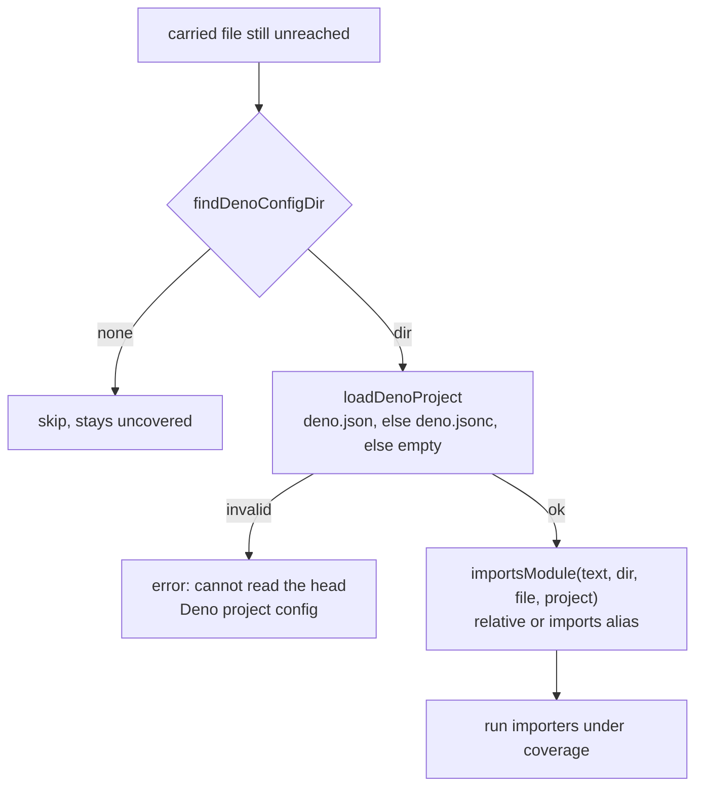

## Summary

Coverage carry-over now passes the carried file's Deno project to
`importsModule`. A head test that imports a carried module through its
project's `deno.json` or `deno.jsonc` `imports` alias (for example
`@lib/m.ts`) now counts as one of that module's importers, so its coverage
can clear a carried line. This is option 1 from the issue.

- `worker/deno/lib/mutation_runner.ts`:
  - New exported `loadDenoProject(repoPath, configDir, seams)`. It reads
    `deno.json`, else `deno.jsonc`, confined to the repository. A lock-only
    project gets the empty config. An invalid file throws.
  - `importsModule`'s `project` parameter is now required, so its alias
    branch (`QUOTED_SPECIFIER` and `resolveImportSpecifier`) runs on the
    production path.
- `worker/deno/lib/coverage_carryover_runner.ts`: loads the project for each
  carried file's Deno directory and passes it to `importsModule`.

Closes #5107.

## Spec

### Intent and Rationale

- After #5106, only tests reached the alias branch: the one production caller
  passed three arguments. Option 1 makes the branch live and fixes a real
  miss, since carry-over ignored tests that import through an alias. Option 2
  would have deleted working support and changed which configs
  `listDenoTestFiles` refuses.
- `loadDenoProject` restores the config reader that the deleted mutation
  runner had (`loadProjectConfig` before b96500d5). It is not a new parser:
  it calls `parseDenoProjectConfig`.

### Essential Design Decisions

- When a carried file's head `deno.json` or `deno.jsonc` cannot be read or
  parsed, the check returns `kind: "error"` with the reason
  `cannot read the head Deno project config: <file>: <cause>`. It does not
  fall back to relative imports only. Per the docs' Outcomes table an error
  fails closed. The issue left this open. I chose fail-loud because a fallback
  would quietly skip alias importers and report their lines uncovered, and
  `deno test` in that project would fail on the broken config anyway.
- `project` is required, not optional. A behaviour-carrying parameter with a
  default that turns the behaviour off is what caused this issue.
- `listDenoTestFiles` keeps its own fallback: a broken config in a project
  nobody asked about uses the suffix rule. It is unchanged.

### Undiscoverable Facts

None.

## Evidence

Backend only: no UI file is touched.

- Docs updated: `docs/coverage-carryover-check.md`, in "Steps" (step 5), the
  "Outcomes" Error row and "Known limits". The module docs of
  `coverage_carryover_runner.ts`, `coverage_carryover_gate.ts` and
  `mutation_runner.ts` are updated too. A grep of `README.md` and `docs/`
  (excluding `docs/archive/`) for `importsModule` and "import … directly"
  found no other hit.
- Issue numbers this diff cites:
  - #5107: importsModule keeps an import-map alias branch only tests reach
    after the mutation check retirement (#5106).
  - #4533: Mutation check ignores deno.json test.include and import-map
    aliases (already cited at the base).

## Test Plan

- Added to `worker/deno/tests/coverage_carryover_runner_test.ts`:
  - `runCoverageCarryOverCheck - a head test importing the carried module through a deno.json imports alias covers the carried line (Issue #5107)`.
    It asserts the result is `completed` with `uncovered: []`, and that the
    head run lists only `tests/alias_test.ts`. An unrelated test in the same
    project is not selected.
  - `… through a deno.jsonc imports alias covers the carried line (Issue #5107)`,
    with a commented `deno.jsonc` and no `deno.json`.
  - `… a malformed head deno.json is an error naming the file (Issue #5107)`.
    It asserts the exact reason
    `cannot read the head Deno project config: deno.json: imports must be an object`,
    and that no head `deno test` ran.
  - A lock-only project test. A relative importer is still selected and covers
    the line, so a project with no config file is not an error.
- Red before the fix: run against the unmodified runner, the `deno.json`
  alias test and the `deno.jsonc` alias test each reported `lib/m.ts` lines
  3, 4 and 6 uncovered, because no alias importer was selected. The malformed
  test got no error. The lock-only test passed on base, as a guard of
  unchanged behaviour should.
- Edited `worker/deno/tests/mutation_runner_test.ts`, only because the
  signature now requires a project:
  - Removed from `worker/deno/tests/mutation_runner_test.ts`: `assertEquals(importsModule(text, "test", "src/NEAT/Neat.ts"), false);`
    - Obsolete: calling `importsModule` without a project is no longer possible.
    - Still covered by: `worker/deno/tests/mutation_runner_test.ts::importsModule - a bare alias counts only with the project's imports map`
    - Replaced by: `assertEquals(importsModule(text, "test", "src/NEAT/Neat.ts", empty), false);`.
      An alias with no `imports` entry is still false.
  - Removed from `worker/deno/tests/mutation_runner_test.ts`: `assertEquals(importsModule(rel, "tests", "lib/m.ts"), true);`
    - Obsolete: calling `importsModule` without a project is no longer possible.
    - Still covered by: `worker/deno/tests/mutation_runner_test.ts::importsModule - a bare alias counts only with the project's imports map`
    - Replaced by: `assertEquals(importsModule(rel, "tests", "lib/m.ts", empty), true);`
  - Removed from `worker/deno/tests/mutation_runner_test.ts`: `(text) => importsModule(text, "tests", "lib/m.ts"),`
    and `importsModule("import '../lib/m.ts'", "tests", "lib/m.ts"),` in the
    hostile-input test.
    - Obsolete: calling `importsModule` without a project is no longer possible.
    - Still covered by: `worker/deno/tests/mutation_runner_test.ts::importsModule - hostile unclosed-specifier text scans in linear time`
    - Replaced by: the same calls with `{ dir: "", config: EMPTY_PROJECT_CONFIG }`
      as the fourth argument. The same `found === false` and relative `true`
      assertions are kept. With the project, the hostile text now also goes
      through the `QUOTED_SPECIFIER` scan, so that test covers that scan too.
- Callers checked: `importsModule` has one production caller,
  `coverage_carryover_runner.ts`, which now passes the project. Its other
  callers are the tests in `worker/deno/tests/mutation_runner_test.ts`.
  `loadDenoProject` has one production caller, the same runner.
- New precondition: the project load runs before the importer scan. Every
  existing carry-over fixture has a valid `deno.json` (`{}`), and the
  no-project test (`a carried file with no Deno project at head is reported
  uncovered, with no head run`) exits at `dir === null` first. None needed a
  fixture change.
- `deno task test:unit` over `worker/deno/tests/coverage_carryover_runner_test.ts`,
  `worker/deno/tests/mutation_runner_test.ts`,
  `worker/deno/tests/deno_test_config_test.ts`,
  `worker/deno/tests/coverage_carryover_gate_test.ts` and
  `worker/deno/tests/completion_phase_coverage_carryover_gate_test.ts`:
  passed, 0 failed.
- `./quality.sh < /dev/null` on commit `6b84fc04`: "Result: PASSED (with
  skipped checks)". Config integration and checkov were skipped, both for the
  environment: no `.config.json`, and no checkov binary or image.

Not done or not checked: alias resolution still ignores `importMap` files
and `scopes`, as it did before this change. Nothing else.

🤖 Generated with [Claude Code](https://claude.com/claude-code)
