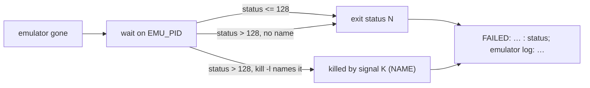

## Summary

Follow-up to PR #5214, which baked the AWS Emulator 1.0.385, AWS CLI 2.40.3 and
the `aws-emulator-run` helper into the worker image. This PR fixes the two
defects the last run recorded against that delivery:

- **JVM test on an image with no JDK.** `aws-emulator-run: JVM options cannot
  override or leak the generated identity` failed with `java: command not
  found` when run as `agent` on the worker image, which has no `java`.
  - Off CI, it is now skipped only when no `java` is on `/usr/bin:/bin`.
  - On GitHub Actions (`GITHUB_ACTIONS=true`) a missing JDK still fails it
    loudly.
  - A new JVM-free test checks the same scrub on every image:
    `JAVA_TOOL_OPTIONS`, `_JAVA_OPTIONS` and `JDK_JAVA_OPTIONS` are replaced
    before COMMAND runs.
- **Failure reason named the wrong cause.** When the emulator was killed from
  outside, the `FAILED:` line quoted only log lines (the telemetry notice).
  `container/aws-emulator-run.sh` now reaps the dead emulator and puts its exit
  status first: `exit status N`, or `killed by signal K (NAME)`. The log lines
  follow after `emulator log:`. This applies to an early exit and to a stop
  while COMMAND runs; exit codes are unchanged (5).
- `docs/CONTAINER-IMAGE.md` documents the new failure-line shape.

Full-image evidence is still short of the criteria (see Acceptance Criteria).
Part of #5109.

## Spec

### Intent and Rationale

- The last run left one red lifecycle test and a misleading failure reason;
  both are fixed here rather than redoing the delivered runtime.
- A JDK-dependent test cannot be the only check of the `JAVA_*` scrub on an
  image without a JDK, so the scrub gets a JVM-free test; the real-JVM test
  stays loud wherever a JDK is expected (CI).

### Essential Design Decisions

- The exit status comes from `wait` on the helper's own child, called in the
  parent shell (not in `$(...)`), which then clears `EMU_PID` so the cleanup
  trap never signals a reused pid.
- A status above 128 is reported as a signal only when `kill -l` names it;
  otherwise it is reported as a plain exit status, so an emulator exiting 200
  is not called "killed by signal 72".
- A readiness timeout names no status, because the emulator is still running.

### Undiscoverable Facts

- This host (aarch64, the full worker image) reports `aws-emulator --version`
  → `Version: 1.0.385` and `aws --version` → `aws-cli/2.40.3 … aarch64`.
- The last run (worker comment on #5109, host GRQ-23, arm64 under Apple
  Containers, as `agent`) observed: the CLI smoke and an SDK write-read-delete
  passing, two concurrent runs passing, a mid-run kill giving exit 5 within 2 s,
  `vibe` refused with 3, no Docker socket or container runtime, and `agent`
  unable to read `/home/vibe`. Its commits were never pushed.
- PR #5214's `container-build / container` job (run 43961750300, amd64) passed;
  it runs the build-time `runuser -u agent -- aws-emulator-run --smoke`.

## Evidence

Backend/container only; no UI file touched.

Issue numbers this diff cites: #5109 (Container: add the official AWS Emulator
with an isolated test runner).

## Acceptance Criteria

<!-- vibe-spec-review inputs="diff+issue-body" -->

- **partial** — Built amd64 and arm64 images report the pinned version and
  complete an SDK/CLI write-read-delete smoke test through the HTTPS endpoint as
  `agent`. — evidence: `container/Containerfile` build-time
  `runuser -u agent -- aws-emulator-run --smoke`; this host's arm64 full image
  reports `Version: 1.0.385` — reviewer: partial — reason: the helper this PR
  changes has not yet run in a full-image build; Container Build re-runs the
  build-time smoke on this PR (amd64), and no CI path builds the full arm64 image
- **met** — The smoke test uses generated emulator credentials and verified TLS,
  with telemetry disabled and no real AWS credentials. — evidence:
  `container/aws-emulator-run.sh` (`env -i … -t off -a on`, `apply_test_env`);
  `worker/deno/tests/aws_emulator_run_5109_test.ts::aws-emulator-run: inherited
  JVM option variables are replaced before COMMAND runs` — reviewer: met
- **met** — Two runs are isolated; failure/termination releases processes and
  temporary state. A stopped/unready emulator returns a nonzero result within
  the deadline. — evidence: `worker/deno/tests/aws_emulator_run_5109_test.ts`
  (`an emulator killed while COMMAND runs names the signal`, `an emulator that
  stops while COMMAND runs exits 5`, concurrent and SIGTERM cases) — reviewer:
  met
- **partial** — The normal Apple Containers launch contract needs no nested
  runtime, host socket, extra privilege or access to the worker's credentials. —
  evidence: no launch flag, mount or privilege changed — reviewer: partial —
  reason: no Apple Containers run is recorded in this diff; the last run's
  GRQ-23 observation (Undiscoverable Facts) is the only record
- **met** — Existing Floci users continue to work while dependent migration work
  lands. — evidence: `container/toolchains/floci.sh` and the `floci` manifest
  entry untouched — reviewer: met
- **partial** — Relevant manifest/self-check and lifecycle tests pass; record
  real image/runtime evidence rather than claiming that a mocked installer
  proves availability. Use existing unattended verification paths for any
  architecture unavailable on the implementing host. — evidence:
  `worker/deno/tests/aws_emulator_run_5109_test.ts` (21 passed in a scratch run
  with the `vibe` refusal lifted) — reviewer: partial — reason: the lifecycle
  tests run against a fake emulator; no real-emulator run of the changed helper
  as `agent` was possible here (no `sudo` to `agent`), and `./quality.sh` failed
  on one unrelated network-dependent test
- **unrequested** — the `FAILED:` line now names the emulator's exit status or
  signal — reviewer: unrequested — reason: the last run recorded that a killed
  emulator's failure line quoted the telemetry notice instead of the cause;
  the guidelines require a failure reason to name the cause

## Standards Review

<!-- vibe-standards-review inputs="diff+CODING-STANDARDS.md" -->

- **violation** — changed early-exit call site not reached by a status
  assertion — evidence: `container/aws-emulator-run.sh:308` — reason: fixed in
  this diff (shared `fail_emulator_gone`; early-exit test asserts
  `emulator exited early: exit status 1;`)
- **violation** — `exit status 1` assertion also matched `1x`/`127` — evidence:
  `worker/deno/tests/aws_emulator_run_5109_test.ts:787` — reason: fixed in this
  diff (terminator pinned)
- **violation** — signal branch's named and fallback outcomes not asserted —
  evidence: `container/aws-emulator-run.sh:216` — reason: fixed in this diff
  (assert `killed by signal 9 (KILL)`; the unnamed case now reports
  `exit status N`, covered by the exit-200 test)
- **violation** — real-JVM test silently skipped where a JDK is expected —
  evidence: `worker/deno/tests/aws_emulator_run_5109_test.ts:867` — reason:
  fixed in this diff (skipped only off GitHub Actions; on CI a missing JDK
  fails)
- **clean** — fail-loud cause naming and redaction, cleanup after reap, macOS
  bash 3.2 portability, no shared `/tmp` paths, no dummy or "how" tests, skip
  carries a reason, docs match the code, Australian English; review-enforced
  rules checked: documentation-drift tests (not applicable), check where you
  insert (compliant)

## Test Plan

- `worker/deno/tests/aws_emulator_run_5109_test.ts`:
  - Added `aws-emulator-run: inherited JVM option variables are replaced before
    COMMAND runs` (green on base by design: the scrub is unchanged; it fails if
    the unset loop is removed).
  - Added `aws-emulator-run: an emulator killed while COMMAND runs names the
    signal` and `aws-emulator-run: an emulator exit code above 128 with no
    signal name is reported as an exit status` (both red on base, which printed
    no status).
  - Edited `aws-emulator-run: an emulator that stops while COMMAND runs exits 5`
    and the early-exit crash test: added status assertions only; no assertion
    removed. The die-after-ready fake can now exit with a code read from
    `rec/exit-code` (default 1, as before).
  - `aws-emulator-run: JVM options cannot override or leak the generated
    identity`: body unchanged; ignored only when no `java` is on `/usr/bin:/bin`
    and `GITHUB_ACTIONS` is not `true`.
- As `vibe` (the real task): `ok | 2 passed | 0 failed | 21 ignored` — the helper
  refuses `vibe` by design. Scratch copy with that refusal lifted (deleted
  afterwards): `ok | 21 passed | 0 failed | 2 ignored` (the vibe-refusal case
  and the JVM case, no JDK here).
- `bash -n` and `shellcheck` on `container/aws-emulator-run.sh`: clean.
- `./quality.sh < /dev/null` on the final code: every stage passed except
  `deno tests`, with 35119 passed and 1 failed:
  `tests/pr_summary_ci_workflow_3768_test.ts` (`dns error: failed to lookup
  address information` fetching `registry.npmjs.org/minimist`). That test does
  not touch this diff; this container has no DNS for the npm registry.
- The post-result call site (`command-result` written, then the emulator found
  dead) shares `fail_emulator_gone` with the tested sites but has no test of its
  own: staging it needs the emulator to die in the window between COMMAND
  writing its result and the 0.1 s poll, which is a race.

Not done or not checked:

- No real-emulator run of the changed helper as `agent`, and no full-image
  amd64/arm64 build of this head yet.
- The `REQUIRE_JAVA` path runs only on CI.
