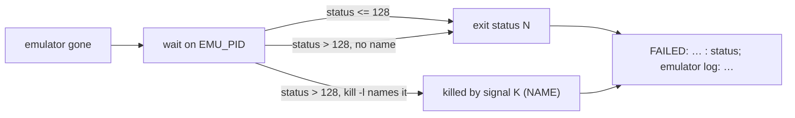

## Summary

Follow-up to PR #5214, which baked the AWS Emulator 1.0.385, AWS CLI 2.40.3 and
the `aws-emulator-run` helper into the worker image. This PR fixes the two
defects the last run recorded against that delivery:

- **JVM test on an image with no JDK.** `aws-emulator-run: JVM options cannot
  override or leak the generated identity` failed with `java: command not
  found` when run as `agent` on the worker image, which has no `java`.
  - Off CI, it is now skipped only when no `java` is on `/usr/bin:/bin`.
  - On GitHub Actions (`GITHUB_ACTIONS=true`) a missing JDK still fails it
    loudly.
  - A new JVM-free test checks the same scrub on every image:
    `JAVA_TOOL_OPTIONS`, `_JAVA_OPTIONS` and `JDK_JAVA_OPTIONS` are replaced
    before COMMAND runs.
- **Failure reason named the wrong cause.** When the emulator was killed from
  outside, the `FAILED:` line quoted only log lines (the telemetry notice).
  `container/aws-emulator-run.sh` now reaps the dead emulator and puts its exit
  status first: `exit status N`, or `killed by signal K (NAME)`. The log lines
  follow after `emulator log:`. This applies to an early exit and to a stop
  while COMMAND runs; exit codes are unchanged (5).
- `docs/CONTAINER-IMAGE.md` documents the new failure-line shape.

Full-image evidence is still short of the criteria (see Acceptance Criteria).
Part of #5109.

## Spec

### Intent and Rationale

- The last run left one red lifecycle test and a misleading failure reason;
  both are fixed here rather than redoing the delivered runtime.
- A JDK-dependent test cannot be the only check of the `JAVA_*` scrub on an
  image without a JDK, so the scrub gets a JVM-free test; the real-JVM test
  stays loud wherever a JDK is expected (CI).

### Essential Design Decisions

- The exit status comes from `wait` on the helper's own child, called in the
  parent shell (not in `$(...)`), which then clears `EMU_PID` so the cleanup
  trap never signals a reused pid.
- A status above 128 is reported as a signal only when `kill -l` names it;
  otherwise it is reported as a plain exit status, so an emulator exiting 200
  is not called "killed by signal 72".
- A readiness timeout names no status, because the emulator is still running.

### Undiscoverable Facts

- This host (aarch64, the full worker image) reports `aws-emulator --version`
  → `Version: 1.0.385` and `aws --version` → `aws-cli/2.40.3 … aarch64`.
- The last run (worker comment on #5109, host GRQ-23, arm64 under Apple
  Containers, as `agent`) observed: the CLI smoke and an SDK write-read-delete
  passing, two concurrent runs passing, a mid-run kill giving exit 5 within 2 s,
  `vibe` refused with 3, no Docker socket or container runtime, and `agent`
  unable to read `/home/vibe`. Its commits were never pushed.
- PR #5214's `container-build / container` job (run 43961750300, amd64) passed;
  it runs the build-time `runuser -u agent -- aws-emulator-run --smoke`.

## Evidence

Backend/container only; no UI file touched.

Issue numbers this diff cites: #5109 (Container: add the official AWS Emulator
with an isolated test runner).

## Acceptance Criteria

<!-- vibe-spec-review inputs="diff+issue-body" -->

ACCEPTANCE_BLOCK

## Standards Review

<!-- vibe-standards-review inputs="diff+CODING-STANDARDS.md" -->

STANDARDS_BLOCK

## Test Plan

TEST_PLAN_BLOCK
