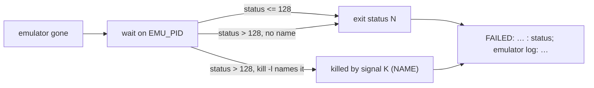

## Summary

Follow-up to PR #5214, which baked the AWS Emulator 1.0.385, AWS CLI 2.40.3 and
the `aws-emulator-run` helper into the worker image. This PR fixes the two
defects the last run recorded against that delivery:

- **JVM test on an image with no JDK.**
  `aws-emulator-run: JVM options cannot
  override or leak the generated identity`
  failed with `java: command not
  found` when run as `agent` on the worker
  image, which has no `java`.
  - The test is not skipped anywhere. Its first step now asserts that a `java`
    is on `/usr/bin:/bin` and, when none is, fails with a message naming the
    missing JDK instead of the shell's `java: command not found`.
  - A new JVM-free test checks the same scrub on every image:
    `JAVA_TOOL_OPTIONS`, `_JAVA_OPTIONS` and `JDK_JAVA_OPTIONS` are replaced
    before COMMAND runs.
- **Failure reason named the wrong cause.** When the emulator was killed from
  outside, the `FAILED:` line quoted only log lines (the telemetry notice).
  `container/aws-emulator-run.sh` now reaps the dead emulator and puts its exit
  status first: `exit status N`, or `killed by signal K (NAME)`. The log lines
  follow after `emulator log:`. This applies to an early exit and to a stop
  while COMMAND runs; exit codes are unchanged (5).
- `docs/CONTAINER-IMAGE.md` documents the new failure-line shape.

This head's helper was run as `agent` against the real emulator on arm64 under
Apple Containers (see Test Plan). An amd64 run of this head is left to the PR's
Container Build job.

Part of #5109.

## Spec

### Intent and Rationale

- The last run left one red lifecycle test and a misleading failure reason; both
  are fixed here rather than redoing the delivered runtime.
- A JDK-dependent test cannot be the only check of the `JAVA_*` scrub on an
  image without a JDK, so the scrub gets a JVM-free test; the real-JVM test is
  never skipped: where no JDK is provisioned it fails loudly, naming the JDK.

### Essential Design Decisions

- The exit status comes from `wait` on the helper's own child, called in the
  parent shell (not in `$(...)`), which then clears `EMU_PID` so the cleanup
  trap never signals a reused pid.
- A status above 128 is reported as a signal only when `kill -l` names it;
  otherwise it is reported as a plain exit status, so an emulator exiting 200 is
  not called "killed by signal 72".
- A readiness timeout names no status, because the emulator is still running.

### Undiscoverable Facts

- This host (aarch64, the full worker image) reports `aws-emulator --version` →
  `Version: 1.0.385` and `aws --version` → `aws-cli/2.40.3 … aarch64`.
- The last run (worker comment on #5109, host GRQ-23, arm64 under Apple
  Containers, as `agent`) observed: the CLI smoke and an SDK write-read-delete
  passing, two concurrent runs passing, a mid-run kill giving exit 5 within 2 s,
  `vibe` refused with 3, no Docker socket or container runtime, and `agent`
  unable to read `/home/vibe`. Its commits were never pushed.
- This run (host GRQ-25, aarch64, Apple Containers: kernel cmdline
  `init=/sbin/vminitd`, `console=hvc0`) could reach `agent` through
  `sudo -n -u agent`. As `agent` it had `CapEff: 0000000000000000`, no Docker,
  containerd or Podman socket, no `docker`/`podman`/`nerdctl`/`ctr`/`container`/
  `runc` binary, no `AWS_*`/`GH_*`/`GITHUB_TOKEN` in its environment, and
  `ls /home/vibe` → `Permission denied`.
- The full image installed on this host carries the pre-change helper, so the
  real-emulator runs below used this head's `container/aws-emulator-run.sh`,
  copied to a scratch dir that `agent` can read, together with the image's
  `aws-emulator` 1.0.385 and `aws` 2.40.3.
- PR #5214's `container-build / container` job (run 43961750300, amd64) passed;
  it runs the build-time `runuser -u agent -- aws-emulator-run --smoke`.

## Evidence

Backend/container only; no UI file touched.

Issue numbers this diff cites: #5109 (Container: add the official AWS Emulator
with an isolated test runner).

## Acceptance Criteria

<!-- vibe-spec-review inputs="diff+issue-body" -->

- **partial** — Built amd64 and arm64 images report the pinned version and
  complete an SDK/CLI write-read-delete smoke test through the HTTPS endpoint as
  `agent`. — evidence: arm64: `sudo -n -u agent -H <this head's helper> --smoke`
  with the full image's emulator 1.0.385 and CLI 2.40.3 →
  `smoke passed: Version: 1.0.385`, exit 0 (STS identity, create-bucket, put,
  get + `cmp`, delete over the run's HTTPS endpoint); amd64:
  `container/Containerfile` build-time
  `runuser -u agent -- aws-emulator-run
  --smoke`, run by Container Build —
  reviewer: partial — reason: no image is built from this head on either
  architecture yet, and this head's amd64 Container Build has not run (the last
  amd64 pass was PR #5214's head)
- **met** — The smoke test uses generated emulator credentials and verified TLS,
  with telemetry disabled and no real AWS credentials. — evidence:
  `container/aws-emulator-run.sh` (`env -i … -t off -a on`, `apply_test_env`,
  `--smoke` checks STS account `000000000000`);
  `worker/deno/tests/aws_emulator_run_5109_test.ts::aws-emulator-run: happy
  path scrubs the environment and verifies health`,
  `…: health not verified
  against this run's CA exits 5`,
  `…: inherited JVM option variables are
  replaced before COMMAND runs` —
  reviewer: met
- **met** — Two runs are isolated; failure/termination releases processes and
  temporary state. A stopped/unready emulator returns a nonzero result within
  the deadline. — evidence: `worker/deno/tests/aws_emulator_run_5109_test.ts`
  (`an emulator killed while COMMAND runs names the signal`,
  `an emulator that
  stops while COMMAND runs exits 5`, concurrent and SIGTERM
  cases) — reviewer: met
- **met** — The normal Apple Containers launch contract needs no nested runtime,
  host socket, extra privilege or access to the worker's credentials. —
  evidence: run as `agent` under Apple Containers on GRQ-25 (Undiscoverable
  Facts): no runtime socket or binary, `CapEff` 0, no credential variables,
  `/home/vibe` unreadable, and the real smoke passed; no launch flag, mount or
  privilege changed in this diff — reviewer: met
- **met** — Existing Floci users continue to work while dependent migration work
  lands. — evidence: `container/toolchains/floci.sh` and the `floci` manifest
  entry untouched — reviewer: met
- **partial** — Relevant manifest/self-check and lifecycle tests pass; record
  real image/runtime evidence rather than claiming that a mocked installer
  proves availability. Use existing unattended verification paths for any
  architecture unavailable on the implementing host. — evidence:
  `worker/deno/tests/aws_emulator_run_5109_test.ts` as `agent` on this JDK-less
  host: `FAILED | 21 passed | 1 failed | 1 ignored`, the one failure being the
  real-JVM test failing loudly on the missing JDK (Test Plan); real-emulator
  runs as `agent` on arm64 (Test Plan); amd64 left to Container Build —
  reviewer: partial — reason: the unattended amd64 path (Container Build) has
  not run on this head, and the real-JVM test cannot pass on this host (it
  passes only where a JDK is provisioned, such as the CI integration tests job)
- **unrequested** — the `FAILED:` line now names the emulator's exit status or
  signal — reviewer: unrequested — reason: the last run recorded that a killed
  emulator's failure line quoted the telemetry notice instead of the cause; the
  guidelines require a failure reason to name the cause

## Standards Review

<!-- vibe-standards-review inputs="diff+CODING-STANDARDS.md" -->

- **violation** — changed early-exit call site not reached by a status assertion
  — evidence: `container/aws-emulator-run.sh:317` — reason: fixed in this diff
  (shared `fail_emulator_gone`; early-exit test asserts
  `emulator exited early: exit status 1;`)
- **violation** — `exit status 1` assertion also matched `1x`/`127` — evidence:
  `worker/deno/tests/aws_emulator_run_5109_test.ts:791` — reason: fixed in this
  diff (terminator pinned)
- **violation** — signal branch's named and fallback outcomes not asserted —
  evidence: `container/aws-emulator-run.sh:212` — reason: fixed in this diff
  (assert `killed by signal 9 (KILL)`; the unnamed case now reports
  `exit status N`, covered by the exit-200 test)
- **violation** — real-JVM test skipped on a host without a JDK — evidence:
  `worker/deno/tests/aws_emulator_run_5109_test.ts:898` — reason: fixed in this
  diff (the skip is removed; a missing JDK now fails the test with a message
  naming the prerequisite)
- **clean** — fail-loud cause naming and redaction, cleanup after reap, macOS
  bash 3.2 portability, no shared `/tmp` paths, no dummy or "how" tests, skip
  carries a reason, docs match the code, Australian English; review-enforced
  rules checked: documentation-drift tests (not applicable), check where you
  insert (compliant)

## Test Plan

- `worker/deno/tests/aws_emulator_run_5109_test.ts`:
  - Added
    `aws-emulator-run: inherited JVM option variables are replaced before
    COMMAND runs`
    (green on base by design: the scrub is unchanged; it fails if the unset loop
    is removed).
  - Added
    `aws-emulator-run: an emulator killed while COMMAND runs names the
    signal`
    and
    `aws-emulator-run: an emulator exit code above 128 with no
    signal name is reported as an exit status`
    (both red on base, which printed no status).
  - Edited `aws-emulator-run: an emulator that stops while COMMAND runs exits 5`
    and the early-exit crash test: added status assertions only; no assertion
    removed. The die-after-ready fake can now exit with a code read from
    `rec/exit-code` (default 1, as before).
  - `aws-emulator-run: JVM options cannot override or leak the generated
    identity`:
    never skipped (no `ignore` condition added). It gains one leading assertion
    that `java` is on `/usr/bin:/bin`, with a message naming the missing JDK;
    the rest of the body is unchanged, so nothing is weakened.
- As `vibe` (the real task): `ok | 2 passed | 0 failed | 21 ignored` — the
  helper refuses `vibe` by design.
- As `agent` (`sudo -n -u agent -H`), with this head's helper and the test file
  unmodified, copied to a scratch dir (no network, so the Deno cache was copied
  too): `FAILED | 21 passed | 1 failed | 1 ignored`. The ignored case is the
  `vibe`-refusal case (not running as `vibe`). The failure is the real-JVM case,
  which fails with the JDK-naming assertion because this host has no `java`; on
  the base it failed here with `java: command not found`.
- Real emulator, as `agent`, arm64 full image, this head's helper:
  - `--smoke` → `emulator ready on https://127.0.0.1:<port>`,
    `smoke passed: Version: 1.0.385`, exit 0, in about 5 s.
  - Two concurrent `--smoke` runs → both exit 0, on different ports and state
    dirs.
  - COMMAND kills the real emulator (`pkill -KILL`) mid-run → exit 5 after 1759
    ms, with
    `FAILED: emulator stopped while COMMAND ran: killed by signal
    9 (KILL); emulator log: …`.
    No `/tmp/aws-emulator-run.*` dir or emulator process was left.
  - As `vibe` → `FAILED: refusing to run as account 'vibe'`, exit 3.
- `bash -n` and `shellcheck` on `container/aws-emulator-run.sh`: clean.
- `./quality.sh < /dev/null` on the final code: every stage passed except
  `deno tests`, with 35119 passed and 1 failed:
  `tests/pr_summary_ci_workflow_3768_test.ts`
  (`dns error: failed to lookup
  address information` fetching
  `registry.npmjs.org/minimist`). That test does not touch this diff; this
  container has no DNS for the npm registry.
- The post-result call site (`command-result` written, then the emulator found
  dead) shares `fail_emulator_gone` with the tested sites but has no test of its
  own: staging it needs the emulator to die in the window between COMMAND
  writing its result and the 0.1 s poll, which is a race.

Not done or not checked:

- No amd64 run of this head yet. The PR's Container Build job is the unattended
  path for it; it runs the build-time smoke as `agent`.
- No full image was rebuilt from this head. The arm64 runs used the installed
  image's emulator and CLI with this head's helper.
- Coverage carry-over: the edited test only drives `bash` subprocesses, so
  `deno coverage` finds no covered TypeScript file and fails with
  `No covered
  files included in the report`. No carried TypeScript line
  exists. The gate's skip setting lives in the operator's `.config.json`, which
  is outside this repo.
- The real-JVM test
  (`JVM options cannot override or leak the generated
  identity`) was not run
  green here: this host has no JDK. It runs in the PR's `integration tests` CI
  job, where a JDK is present.
