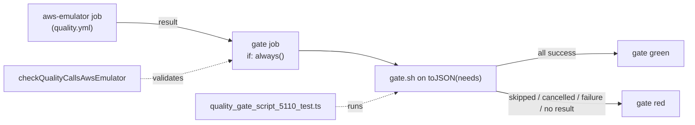

# PR Summary — Issue #5110

## Summary

Earlier merged PRs (#5276, #5288, #5297) moved VibeCoder's CloudFormation tests
to the official AWS Emulator. They also made the required `container` check run
the reference command as `agent` and held `container-build.yml` to that
contract. #5297 left one criterion `partial`: "missing required execution cannot
become a green check". The `aws-emulator` job reaches a red check only through
the required `gate` job in `quality.yml`, and that link was barely checked.
`checkQualityCallsAwsEmulator` checked only that `gate` needs `aws-emulator`,
and no test ran `.github/scripts/gate.sh`.

This PR closes that link:

- `checkQualityCallsAwsEmulator`
  (`worker/deno/lib/aws_emulator_workflow_check.ts`) now also requires the
  `gate` job to:
  - have `if: always()` (`[gate-always]`);
  - have no soft `continue-on-error` (`[gate-soft]`);
  - have one step that runs `.github/scripts/gate.sh` by its exact path as its
    only command, with `NEEDS_JSON: ${{ toJSON(needs) }}`, no `if:` or soft
    `continue-on-error`, and a shell that runs the body (`[gate-script]`);
  - have no other step but `actions/checkout`.
- `worker/deno/tests/quality_gate_script_5110_test.ts` runs the real `gate.sh`.
  It shows that a skipped, cancelled, failed or result-less `aws-emulator` job
  closes the gate, and that an unset, empty, `{}` or non-JSON `NEEDS_JSON`
  closes it too. The test is listed in `IN_GATE_SCRIPT_SUITES`, so the local
  quality gate runs it.

Closes #5110.

## Spec

### Intent and Rationale

- GitHub reports a skipped required check as passing. If `gate` lost
  `if: always()`, a skipped `aws-emulator` job would also skip `gate`, and the
  pull request would go green. The same happens if the gate step stopped feeding
  `gate.sh` the real `needs` context. The existing validator caught neither.
- `gate.sh` already treats anything but `success` as a closed gate. Nothing
  tested that, so the new test pins the script's current behaviour rather than
  fixing it.

### Essential Design Decisions

- The gate step is matched by its exact command: `.github/scripts/gate.sh`,
  `./.github/scripts/gate.sh`, or `bash` or `sh` followed by one of those paths.
  The shared `segmentInvokes` match accepts any path that ends in the script
  name, so the Standards review found that `./evil.github/scripts/gate.sh`
  passed. The shared helper is unchanged, because the `aws-emulator.yml` checks
  use it.
- Every other `gate` step must be a plain `actions/checkout`, so no earlier step
  can rewrite or replace `gate.sh`. This is the same rule the `changes` job
  already follows.
- `if:` accepts only `always()` and `${{ always() }}`. An equivalent condition
  such as `!cancelled()` is refused, which fails safe.
- The `gate.sh` tests are ignored, with a stated reason, on a host with no `jq`.
  `gate.sh` itself exits 1 without `jq`, so CI cannot pass because of this.

### Undiscoverable Facts

- Both reviewer agents defined for this run (`spec-reviewer`,
  `standards-reviewer`) failed with `You've reached your Fable limit` (HTTP
  429). The same briefs were then run as general-purpose sub-agents. Each one
  got only the diff, plus the issue body or `CODING-STANDARDS.md`.

## Evidence

Backend and CI validator only. No UI file and no workflow file is touched.

- Validator: `gateJudgesNeeds` and `stepRunsGateScript` in
  `worker/deno/lib/aws_emulator_workflow_check.ts`.
- Docs: `docs/EC2-LINUX-VERIFICATION.md`, section "Testing the template against
  AWS Emulator (Issue #5110)". The paragraph on the `aws-emulator` job now names
  the `gate` wiring that the validator checks, and the test that runs `gate.sh`.
- Issue numbers cited:
  - #5110: CI: migrate VibeCoder's AWS tests to AWS Emulator and record real
    coverage gaps.
  - #5276, #5288 and #5297: the earlier merged PRs for this issue, with the same
    title.

## Acceptance Criteria

<!-- vibe-spec-review inputs="diff+issue-body" -->

- **met** — A fresh worker container runs the reference command as `agent`, and
  CI runs the same applicable integration checks. — evidence:
  `.github/workflows/container-build.yml` agent-run step (PR #5288);
  `.github/workflows/aws-emulator.yml` through `quality.yml` — reviewer: met
- **met** — Evidence includes the pinned release, actual test commands,
  successful data assertions, a supported negative API result and cleanup. —
  evidence: `docs/EC2-LINUX-VERIFICATION.md`;
  `infra/cloudformation/test-aws-emulator.sh` — reviewer: met
- **met** — Focused tests prove startup/test failures propagate and missing
  required execution cannot become a green check. — evidence:
  `worker/deno/tests/aws_emulator_cloudformation_5110_test.ts` (startup and test
  failures exit non-zero);
  `worker/deno/tests/issue_5110_aws_emulator_workflow_test.ts`
  (`[container-agent-run]`, `[gate-always]`, `[gate-soft]` and `[gate-script]`
  refusals); `worker/deno/tests/quality_gate_script_5110_test.ts` (a skipped,
  cancelled, failed or result-less `aws-emulator` closes `gate.sh`) — reviewer:
  met
- **met** — Every existing template is accounted for as exercised or as a
  specific unsupported case with alternative validation; no unsupported/stubbed
  resource is reported as proven. — evidence:
  `infra/cloudformation/test-aws-emulator.sh` `KNOWN_GAPS`;
  `worker/deno/tests/aws_emulator_cloudformation_5110_test.ts` — reviewer: met
- **met** — Any retained Floci test names the exact gap and removal/recheck
  condition. — evidence: no Floci test of VibeCoder's templates remains (removed
  in PR #5276) — reviewer: met
- **met** — Existing branch/PR coverage, least-privilege permissions and
  required checks remain intact. CI actually runs the new command rather than
  merely installing the emulator. — evidence:
  `.github/workflows/aws-emulator.yml` runs
  `./infra/cloudformation/test-aws-emulator.sh`; this diff changes no workflow —
  reviewer: met
- **partial** — Required local/CI checks pass; no automatic mutation or fuzzing
  campaign is added. — evidence: `./quality.sh` passed on c1f548851; no campaign
  added — reviewer: met — reason: CI not yet verified — remaining:
  merge-verification-only

## Standards Review

<!-- vibe-standards-review inputs="diff+CODING-STANDARDS.md" -->

- **violation** — Writing a gate over text (equality on normalised forms;
  evasion table): the `[gate-script]` step match accepted any command ending in
  `.github/scripts/gate.sh` (`./evil.github/scripts/gate.sh`,
  `/tmp/x/.github/scripts/gate.sh`), and an earlier step that overwrote the
  script passed — evidence: `worker/deno/lib/aws_emulator_workflow_check.ts` —
  reason: fixed in this diff (`stepRunsGateScript` matches the exact path; any
  other `gate` step must be a plain `actions/checkout`; three refusal tests
  added)
- **clean** — Australian English; reuses `stepsOf`, `segmentsOf`,
  `effectiveShell`, `setsSoftContinueOnError` and `stepIsPlainCheckout`, with no
  copied helpers; malformed input yields findings, not a throw. Every new branch
  outcome has a test. Each refusal test asserts one finding, its prefix and its
  own message against an otherwise valid real `quality.yml`. No dummy, "how" or
  source-grep tests (review-enforced). Every ignore carries a reason
  (review-enforced). `runGate` clears the environment and uses no `/tmp` paths.
  `gate.sh` has no GNU-only forms. Docs were updated with the code. No twinned
  rule; no secrets or hidden files. The optional doc wording on "soft
  `continue-on-error`" was aligned in this diff.

## Test Plan

- **Added to `worker/deno/tests/issue_5110_aws_emulator_workflow_test.ts`:**
  - Refusals, each asserting one finding with its prefix and its own message:
    - `[gate-always]` refuses a removed `if:`, `success()`, and
      `${{ always() && false }}`.
    - `[gate-soft]` refuses `continue-on-error: true` on the job.
    - `[gate-script]` refuses `|| true`, `echo`, `true`, and the
      `./evil.github/…` and `/tmp/x/.github/…` paths.
    - `[gate-script]` refuses a constant `NEEDS_JSON`, no `env:`, a soft step,
      `if: false` on the step, and `shell: bash -n {0}`.
    - A trailing `set -euo pipefail` under `bash {0}` is refused so a failed
      gate remains the final exit status. A leading preamble is accepted.
    - `[gate-script]` refuses an extra step that overwrites `gate.sh`.
  - Controls that return `[]`: `${{ always() }}`,
    `bash .github/scripts/gate.sh`, a `set -euo pipefail` block, and
    `./.github/scripts/gate.sh`.
- **Added `worker/deno/tests/quality_gate_script_5110_test.ts`, 10 tests:**
  - The fixture's `gate.needs` includes `aws-emulator`.
  - All success exits 0 with the PASSED line.
  - `skipped`, `cancelled` and `failure` each exit 1, with
    `aws-emulator=<result>` and `QUALITY GATE CLOSED: 1 job(s)`.
  - A missing result gives `NO_RESULT`.
  - An unset, empty, `{}` or non-JSON `NEEDS_JSON` exits 1 with its own message.
  - These pin current behaviour, so they are green on the base too.
- **Red runs, observed:**
  - The 12 first refusals, run against the base validator
    (`git show
    HEAD:…`), gave `172 passed | 12 failed`. Each returned `[]`
    where one finding was expected.
  - The 3 evasion refusals, run against 2695c88bf, gave `185 passed | 3 failed`.
- **Existing tests:** none edited and no assertion removed. "real quality.yml
  calls aws-emulator.yml and gate needs it" still expects `[]`, so it now also
  covers the new rules.
- **Focused run:** from `worker/deno`,
  `deno task test:unit tests/issue_5110_aws_emulator_workflow_test.ts tests/quality_gate_script_5110_test.ts < /dev/null`
  gave 198 passed, 0 failed. `tests/integration_test_manifest_test.ts` passed
  once the new test was listed in `IN_GATE_SCRIPT_SUITES`.
- **Full gate:** `./quality.sh < /dev/null` on c1f548851 gave
  `Result: PASSED (with skipped checks)`.
  - The gate itself skipped `config integration` (no `.config.json`) and
    `checkov` (no checkov on PATH).
  - The run before it, on 40e1d8496, failed only on the manifest test above.
- **Docs:** read the `aws-emulator` paragraph of
  `docs/EC2-LINUX-VERIFICATION.md` and updated it. Grepped `README.md`, `docs/`
  (not `docs/archive/`) and `*/README.md` for `checkQualityCallsAwsEmulator` and
  `gate-needs`. The only hit is that paragraph.
- **Twinned-rule search:** no other checker validates the `gate` job's
  `if:`/`gate.sh` wiring. `draft_ci_by_design.ts` reads `gate` only as a check
  name.

## Merge verification

- CI on this head: pending.

## Not done or not checked

- The validator is a text check. It cannot see a runner-side change to `gate.sh`
  made outside the `gate` job, or a change to `gate.sh` itself. The new test
  covers the script's own behaviour.
- On a host with no `jq`, the `gate.sh` tests are reported as ignored, not
  failed.
