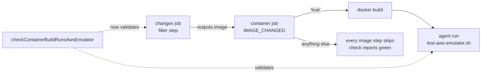

# PR Summary — Issue #5110

## Summary

PRs #5276 and #5288 (both merged) moved VibeCoder's CloudFormation tests to the
official AWS Emulator. They also added a step to the required `container` check
that runs the reference command as `agent` in a fresh worker container. #5288's
own CI has now run that step (see Evidence). The evidence the earlier summary
said was still missing now exists.

This PR closes the last gap the earlier summary named in the step's validator.
`checkContainerBuildRunsAwsEmulator`
(`worker/deno/lib/aws_emulator_workflow_check.ts`) did not look at the `changes`
job that sets `IMAGE_CHANGED`. Removing `needs: changes`, making `changes`
skippable, or making its `image` output constant would skip every image step,
including the agent run, and still report the required check green. The
validator now also requires:

- job `container` to need `changes`;
- job `changes` to exist, with no `if:` or soft `continue-on-error`, and
  `outputs.image` exactly `${{ steps.filter.outputs.image }}`;
- the `filter` step to have no `if:` or soft `continue-on-error`, a shell that
  runs the body, and `BASE_SHA`/`HEAD_SHA` taken from the pull request event;
- the `filter` step's code (comments, blank lines and `\` continuations aside)
  to be exactly the `FILTER_CODE` allowlist, ending in
  `.github/scripts/detect-image-changes.sh "$BASE_SHA" "$HEAD_SHA"`, and its env
  to set nothing but `EVENT_NAME`, `BASE_SHA` and `HEAD_SHA`;
- job `changes` to have no step but `actions/checkout` and the `filter` step,
  and no `env:`; the workflow `env:` to set none of `BASH_ENV`, `ENV`,
  `SHELLOPTS`, `BASHOPTS` or `GITHUB_OUTPUT`.

Part of #5110.

## Spec

### Intent and Rationale

- The issue's third acceptance criterion says missing required execution must
  not become a green check. In GitHub, a skipped step or job counts as passing,
  so any edit that stops `IMAGE_CHANGED` being `true` turns the agent run into a
  silent pass. The `changes` job is where that can happen.
- The `filter` step is held to an exact line allowlist rather than parsed: a
  parse of the last reachable command accepted runtime `||`/`if` guards, empty
  loops, a trailing `&` and a `GITHUB_OUTPUT` reassignment, each of which exits
  0 with no `image` output.

### Essential Design Decisions

- The check stays a text check. Edits made on the runner (rewriting the
  checked-out script, replacing docker, an indirect `GITHUB_ENV` write) are
  still outside what it can see. `docs/EC2-LINUX-VERIFICATION.md` lists them.
- The fresh-container run is still gated on `IMAGE_CHANGED`. A PR that changes
  only `infra/cloudformation/**` runs the same script on the runner through
  `aws-emulator.yml`, which the required `gate` job needs. It does not get a
  fresh-container run, because that would rebuild the 11-minute image on every
  template change.

### Undiscoverable Facts

- PR #5288's CI, job 136121503571 (`container-build / container`, step "Run the
  AWS Emulator reference command as agent in a fresh container"), ran
  `docker run --rm --user agent … test-aws-emulator.sh "${IMAGE}"` and passed:
  - aws-emulator 1.0.385 was installed from the sha256-checked package;
  - `PASS: SSM round trip value = round-trip-ee67b7b250ad`;
  - `PASS: SSM get-parameter after delete: ParameterNotFound (as expected)`;
  - 10 resources had their properties checked;
  - cleanup was asserted (`ValidationError`, `NoSuchEntity`,
    `InvalidVpcID.NotFound`);
  - `all 22 assertions passed`;
  - one named gap was reported as `UNSUPPORTED (not proven)`
    (`AWS::EC2::Instance` `MetadataOptions`), with its alternative validation
    and recheck condition;
  - `[aws-emulator-run] stopped; exit 0`.
- All 23 of PR #5288's checks succeeded (2 skipped).

## Evidence

Backend and CI validator only; no UI file and no workflow file is touched.

- Tests: `worker/deno/tests/issue_5110_aws_emulator_workflow_test.ts` (see Test
  Plan).
- Issue numbers cited: #5110 (CI: migrate VibeCoder's AWS tests to AWS Emulator
  and record real coverage gaps); #5276 and #5288 (the earlier merged PRs for
  this issue, same title).

## Acceptance Criteria

<!-- vibe-spec-review inputs="diff+issue-body" -->

- **met** — A fresh worker container runs the reference command as `agent`, and
  CI runs the same applicable integration checks. — evidence:
  `.github/workflows/container-build.yml` agent-run step (PR #5288), which ran
  and passed in job 136121503571; `.github/workflows/aws-emulator.yml` on every
  PR through `gate` — reviewer: met
- **met** — Evidence includes the pinned release, actual test commands,
  successful data assertions, a supported negative API result and cleanup. —
  evidence: job 136121503571 log (quoted under Undiscoverable Facts);
  `docs/EC2-LINUX-VERIFICATION.md` — reviewer: met
- **partial** — Focused tests prove startup/test failures propagate and missing
  required execution cannot become a green check. — evidence:
  `worker/deno/tests/aws_emulator_cloudformation_5110_test.ts` (startup and test
  failures exit non-zero);
  `worker/deno/tests/issue_5110_aws_emulator_workflow_test.ts` (the
  `[container-agent-run]` refusal tables, including the new `changes`-gate
  cases) — reviewer: partial — reason: the reviewer found a prior step in job
  `changes` could rewrite the detect script; that is now refused by a test, but
  the reviewer has not re-run on the fix
- **met** — Every existing template is accounted for as exercised or as a
  specific unsupported case with alternative validation; no unsupported/stubbed
  resource is reported as proven. — evidence:
  `infra/cloudformation/test-aws-emulator.sh` `KNOWN_GAPS`;
  `worker/deno/tests/aws_emulator_cloudformation_5110_test.ts::aws-emulator-cloudformation 5110: the expected named-gap run exits 0 and reports the gap as UNSUPPORTED, never a pass`
  — reviewer: met
- **met** — Any retained Floci test names the exact gap and removal/recheck
  condition. — evidence: no Floci test of VibeCoder's AWS templates remains
  (removed in PR #5276) — reviewer: met
- **met** — Existing branch/PR coverage, least-privilege permissions and
  required checks remain intact. CI actually runs the new command rather than
  merely installing the emulator. — evidence:
  `.github/workflows/aws-emulator.yml` runs
  `./infra/cloudformation/test-aws-emulator.sh`; this diff changes no workflow —
  reviewer: met
- **partial** — Required local/CI checks pass; no automatic mutation or fuzzing
  campaign is added. — evidence: `./quality.sh` passed on this branch; no
  campaign added — reviewer: partial — reason: CI not yet verified — remaining:
  merge-verification-only

## Standards Review

<!-- vibe-standards-review inputs="diff+CODING-STANDARDS.md" -->

- **violation** — Writing a gate over text (evasion table): the first version of
  the `filter`-step check read only the step's last line, so `true || \` above
  the call, a `GITHUB_OUTPUT=` prefix, swapped SHA arguments and a `bash -n {0}`
  shell all passed, and the `image=` regex accepted `image=true-x` and fired on
  `--image=foo` — evidence: `worker/deno/lib/aws_emulator_workflow_check.ts:554`
  — reason: `filterCodeIsCanonical` compares the joined command lines with
  `FILTER_CODE`. The validator checks `FILTER_ENV_KEYS`, `WORKFLOW_SHELL_ENV`,
  the effective shell and each sibling step (`stepIsPlainCheckout`).
- **violation** — Writing a gate over text (no silent pass on unread input):
  lines above the last were never read — evidence:
  `worker/deno/lib/aws_emulator_workflow_check.ts:554` — reason: fixed in this
  diff (the filter code is an exact allowlist, so any other command before or
  around the call, including a guarded `exit 0`, an `||`/`if` guard, a loop, a
  trailing `&` or a `GITHUB_OUTPUT` assignment, `export` or `unset`, is refused)
- **violation** — Check where you insert: after the new doc sentences, "It" and
  "those files" pointed at the wrong things — evidence:
  `docs/EC2-LINUX-VERIFICATION.md:62` — reason: fixed in this diff ("The
  validator is a text check", "`GITHUB_ENV` or `GITHUB_PATH`")
- **violation** — Prose about the PR's own change: the code comments said
  "checked end to end" and "not skippable, soft-failing or constant" — evidence:
  `worker/deno/lib/aws_emulator_workflow_check.ts:52` — reason: fixed in this
  diff (replaced by the list of what is checked)
- **violation** — Summary must match the head: the old summary listed the
  constant `outputs.image` and missing `needs: changes` cases as accepted —
  evidence: `docs/archive/pr-summaries/pr-summary-5110.md:141` — reason: fixed
  in this diff (summary rewritten)
- **clean** — These rules were checked and comply:
  - Australian English;
  - no source-grep tests;
  - no test-only members;
  - the code hunks follow "Check where you insert";
  - `outputs.image` is compared exactly;
  - YAML is read as structure, and `needs` is tested in both scalar and list
    form;
  - each refusal test asserts one finding and its own message;
  - each anchor is used exactly once;
  - no `/tmp`, environment, clock or history use in the tests;
  - the regex is linear.

  A second standards review on the allowlist version found stale comments, a
  dead `isObject` branch and a three-name env denylist; all were fixed after it
  (job `changes` env is now refused outright). The first reviewer saw the first
  version of the diff. The fixes above were made after it, in 503fe65f1.

## Test Plan

- Added to `worker/deno/tests/issue_5110_aws_emulator_workflow_test.ts`:
  - **`(container-agent-run) refuses …` table, 46 cases, each asserting one
    finding with that rule's own message:**
    - a missing or wrong `needs`;
    - a constant `outputs.image`;
    - `if:` or `continue-on-error` on job `changes` or on the `filter` step;
    - a renamed `filter` id;
    - an `image=false` write, in place of the call or before it;
    - an `image=$x`, `image=true-x` or `image=true$X` write;
    - an `image<<` output, both quoted on an `echo` line and in a here-document
      body;
    - `true ||` before the call;
    - an unconditional `exit 0`;
    - a `GITHUB_OUTPUT=` prefix;
    - `"$HEAD_SHA"` passed twice;
    - `BASE_SHA` or `HEAD_SHA` taken from the wrong event field;
    - `bash -n {0}` on the step, or on job `changes`;
    - the call behind a runtime `[[ ]] ||` or `&&`, inside an `if` on the event
      name, an empty `for` or a non-matching `case`, or run with `&`;
    - a comment inside the continued output write or detect command;
    - a guarded `exit 0`; `GITHUB_OUTPUT` assigned, exported or unset on its own
      line; an `echo "--image=foo"` line;
    - `GITHUB_OUTPUT` in the step env; any env on job `changes`;
      `GITHUB_OUTPUT` in the workflow env; a workflow env expression;
    - a step in job `changes` that rewrites the detect script, writes
      `GITHUB_ENV`, or uses a local action.
  - **`refuses job changes removed entirely with one finding`:** asserts "job
    changes must exist".
  - **Controls that return `[]`:** `needs: [changes]`, an extra comment line, an
    extra blank line, and the call split by a `\` continuation.
- **Red runs, observed:**
  - With the first refusal cases written and the validator not yet changed, 12
    failed.
  - Before the review fixes, 13 failed: 11 new refusals and the 2 look-alike
    controls, which the old regex fired on.
  - The here-document case was added after the fix, so it was never observed
    red.
  - After the pre-PR verifier's review, the 14 new filter-code and env cases all
    failed against the previous validator (`endsWithDetectCall`). The 5 later
    cases (other `changes` steps, job and expression env) were written with the
    fix and not observed red.
  - The two comment-inside-a-continuation cases added after review both failed
    against 0ac992ab2 with `[]` where one finding was expected.
  - The comment-backslash cases for `exit 0` and `true ||` both failed against
    aa8c2e6dc with `[]` where one finding was expected.
- **Existing tests:** none edited, and the diff removes no line from the test
  file. The real `container-build.yml` positive test still returns `[]`. The new
  check runs after the existing early return, so the malformed-input cases still
  give one finding.
- **Focused run:**
  `cd worker/deno && deno task test:unit tests/issue_5110_aws_emulator_workflow_test.ts tests/aws_emulator_in_ci_check_test.ts tests/aws_emulator_cloudformation_5110_test.ts < /dev/null`
  gave 312 passed, 0 failed before the last 5 cases; the 5110 workflow test file
  alone now gives 159 passed, 0 failed.
- **Corpus:** `checkContainerBuildRunsAwsEmulator` over every
  `.github/workflows/*.yml` returns `[]` only for `container-build.yml`. Every
  other workflow gets findings. False positives 0; false negatives 0 against the
  refusal table.
- **Full gate:** `./quality.sh < /dev/null` on 503fe65f1 gave
  `Result: PASSED (with skipped checks)`. The gate itself skipped
  `config integration` and `checkov`.
  - The earlier run on cabce9170 failed one test,
    `worker/deno/tests/pr_summary_ci_workflow_3768_test.ts`, on this host's
    missing DNS ("Failed caching npm package 'entities@3.0.1'").
  - That test clears the environment, so it uses `~/.cache/deno`. It passed once
    I copied the four npm packages into that cache from the worker cache. This
    was not a repository change.
- **Docs:** I read `docs/EC2-LINUX-VERIFICATION.md`, section "Testing the
  template against AWS Emulator (Issue #5110)", the paragraph on the required
  `container` check, and updated it. I grepped `README.md`, `docs/` (not
  `docs/archive/`) and `*/README.md` for `checkContainerBuildRunsAwsEmulator`
  and `container-agent-run`. The only hit was that paragraph.
- **Twinned-rule search:** `worker/deno/lib/aws_emulator_in_ci_check.ts` (the
  fleet detector) judges whether a workflow runs the emulator. It has no rule on
  a `changes` job or `needs`, so this check has no twin.

## Merge verification

- CI on this head: pending.

## Not done or not checked

- The validator cannot see runner-side edits in job `container`: a step there
  that rewrites the checked-out script, replaces docker or its context, or
  writes `GITHUB_ENV` indirectly, and a retag it does not recognise. In job
  `changes` no such step can exist (only `actions/checkout` is allowed). An edit
  to `.github/scripts/detect-image-changes.sh` itself is covered by that
  script's own tests, not by this validator. `docs/EC2-LINUX-VERIFICATION.md`
  lists them.
- A PR that changes only `infra/cloudformation/**` gets the runner path, not a
  fresh-container run (see Essential Design Decisions).
