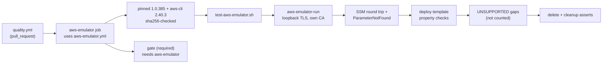

# PR Summary — Issue #5110

## Summary

VibeCoder's CloudFormation CI now runs on the official AWS Emulator, through
#5109's `aws-emulator-run`, in place of Floci. The run is now part of the one
required check.

- **Reference command:** `infra/cloudformation/test-aws-emulator.sh`. It makes
  real AWS CLI calls:
  - an SSM write, read and delete round trip;
  - a supported negative case (`ParameterNotFound`);
  - a deploy of every template, checking the material properties of each created
    resource. It reports emulator gaps as `UNSUPPORTED (not proven)`, apart from
    the pass count. It then deletes the stack and asserts the cleanup.
- **CI:** `.github/workflows/aws-emulator.yml` replaces `floci.yml`. It is now a
  reusable workflow that `quality.yml` calls as the `aws-emulator` job, and
  `gate` needs that job. There is no path filter, so every pull request to
  `Develop`, `main` or `milestone/*` runs it. A failed, cancelled, skipped or
  missing run turns `gate` red.
  - It installs the pinned 1.0.385 package and the pinned aws-cli 2.40.3, which
    replaces the runner's own CLI, through the sha256-checked toolchain
    fragments.
- **Validator:** `worker/deno/lib/aws_emulator_workflow_check.ts` replaces the
  Floci validator. It checks:
  - `workflow_call` is a trigger, and there is no `pull_request` trigger and no
    concurrency group;
  - the test step is only `set -euo pipefail` and the script, so an `if false`
    wrapper or an earlier `exit 0` is refused, and a `!`, `if`, `while` or
    `until` in front of the call is refused too (`! ./script` turns a failure
    into success and is exempt from `set -e`);
  - the pinned installs run first;
  - there is no Docker socket, no service container and no Floci;
  - least-privilege permissions;
  - `quality.yml` calls the workflow, and `gate` needs that job.
- **Removed:** the Floci workflow, `test-floci.sh`, `floci_workflow_check.ts`
  and the two `issue_3369_floci_*` test files. The pre-push gate's Floci planner
  stays for repositories that still track `test-floci.sh`. VibeCoder no longer
  does, so it never fires here.
- **Template defect fixed:** the emulator caught a real defect in
  `linux-verification-host.yaml`. Three security-group egress descriptions
  contained an em dash, which EC2 rejects. Floci had stubbed past it.
- **Fleet detector:** `BP-AWS-EMULATOR-MISSING` also accepts a workflow that
  runs a test through `aws-emulator-run [options] -- COMMAND`, directly or
  through a repository script. Without this, VibeCoder would flag itself once
  `floci.yml` is gone. The invocation must be able to run: a job or step with a
  statically false `if:`, and a command after an unconditional `exit`, behind
  `false &&` or `true ||`, in a false `if`/`elif`/`else` branch or
  `while`/`until` body, in a function body or in a here-document, earns no
  credit, in the workflow and in the repository script alike. The shell helpers
  live in `worker/deno/lib/shell_command_words.ts`.

Two criteria stay partial until CI has run on this branch and a freshly started
container runs the command, so this is Part of #5110.

## Spec

### Intent and Rationale

- **Floci treated stubs as success.** It stubbed unsupported resources and
  counted the deploy as passed. The emulator applies EC2 validation, which found
  the em-dash defect a real deployment would have hit. So Floci gives no
  meaningful coverage worth keeping for the one resource the emulator lacks.
- **The real template, unedited.** Deploying with `--on-failure DO_NOTHING`
  keeps every supported resource alive for property checks even though one
  resource is unsupported, so no trimmed copy of the template is needed.
- **Gated like `checkov.yml`.** A path-filtered standalone workflow could sit
  red, or not run at all, beside a green required check. Calling it from
  `quality.yml` makes `.github/scripts/gate.sh` judge its result.

### Essential Design Decisions

- **Named gaps are pinned.** `KNOWN_GAPS` in the script holds each gap's
  expected failure reason. A gap that stops reproducing, or fails another way,
  fails the run with `gap changed: update KNOWN_GAPS`. A template with no
  property-check function fails before any AWS call, so stack status alone never
  passes a template.
- **No path filter, no push trigger.** A called workflow cannot use a `paths`
  filter without leaving `gate` waiting on a skipped job, so it runs on every
  pull request. The fleet's `workflow-triggers` rule forbids test workflows on
  push to the default branch. Every change reaches `Develop` and `main` through
  a pull request that now always runs this check.
- **The pre-push gate does not run the emulator test.** The gate runs as `vibe`,
  which `aws-emulator-run` always refuses (#5109), so CI is the enforcing gate.
  Locally the command runs as `agent`, or as any other non-root account that is
  not `vibe`.
- **The reference command stays in shell.** The issue asks for a command that
  other repositories can adopt, and those repositories have no
  `worker/deno/commands/`. The script drives the AWS CLI. Its small text
  handling (template resource ids, SSM parameter names, gap matching) is kept
  next to the calls it feeds.

### Undiscoverable Facts

- **`AWS::EC2::Instance` is unsupported on aws-emulator 1.0.385.** The emulator
  rejects its `MetadataOptions` property with "this emulator does not apply the
  MetadataOptions property of AWS::EC2::Instance". This was observed at run time
  and is a named gap.
- **The public AMI parameter cannot be seeded.** The emulator refuses
  `put-parameter` under `/aws/...` (`ParameterPatternMismatchException`). The
  script seeds a user-owned parameter and passes its name instead, then deletes
  it and asserts the deletion.
- **Floci stays installed in the image,** but no VibeCoder test uses it.
- **The pre-push gate's unit-test run cannot reach npm in this worker.** The
  failure is `Failed caching npm package 'mdurl@1.0.1'`, with a DNS error. In
  the worker's own account the cleared-environment test
  `worker/deno/tests/pr_summary_ci_workflow_3768_test.ts` was fixed by warming
  the default Deno cache, and it now passes. The gate's run still fails, so this
  run's push was refused. The gate was not bypassed.

## Evidence

**Run as `agent` on the head script.** `infra/cloudformation/` was copied to a
world-readable scratch directory, then run with:

```text
sudo -n -u agent env -i HOME=/tmp PATH=/usr/local/bin:/usr/bin:/bin ./cloudformation/test-aws-emulator.sh
```

This used the installed `/usr/local/bin/aws-emulator-run` and exited 0. Excerpt:

```text
agent
aws-cli/2.40.3 Python/3.14.8 Linux/6.18.15 exe/aarch64.debian.13
[aws-emulator-run] emulator ready on https://127.0.0.1:40993 (state /tmp/aws-emulator-run.UvJQAD)
PASS: SSM round trip value = round-trip-ca38122a277e
PASS: SSM get-parameter after delete: ParameterNotFound (as expected)
PASS: seeded SSM parameter /vibe-coder-test/ubuntu-ami-id-ca38122a277e for AWS::EC2::Image::Id
UNSUPPORTED (gap reproduced, not proven): VerificationHost CREATE_FAILED (this emulator does not apply the MetadataOptions property of AWS::EC2::Instance)
PASS: stack vc5110-linux-verification-host-ca38122a277e CREATE_FAILED: 10 resources CREATE_COMPLETE, 1 named gap(s)
PASS: VerificationVpc CidrBlock = 10.42.0.0/16
PASS: PublicSubnet MapPublicIpOnLaunch = True
PASS: HostSecurityGroup inbound rule count = 0
PASS: HostRole trust principal = ec2.amazonaws.com
PASS: stack vc5110-linux-verification-host-ca38122a277e removed: ValidationError (as expected)
PASS: role vc5110-linux-verification-host-ca38122a277-HostRole-9A725D69678B removed: NoSuchEntity (as expected)
PASS: VPC vpc-0000000000000008c removed: InvalidVpcID.NotFound (as expected)
PASS: SSM get-parameter after delete (seeded AMI id): ParameterNotFound (as expected)
all 22 assertions passed
exercised: 10 resources (properties checked)
UNSUPPORTED (not proven, named gaps):
  - linux-verification-host.yaml VerificationHost (AWS::EC2::Instance): this emulator does not apply the MetadataOptions property of AWS::EC2::Instance
      alternative validation: static checks: .github/workflows/checkov.yml scans the template, and worker/deno/tests/linux_verification_host_template_test.ts asserts MetadataOptions HttpTokens is required (IMDSv2 only); real-AWS deployment as docs/EC2-LINUX-VERIFICATION.md describes
      recheck: recheck when the aws-emulator pin in container/tools.json changes, or when this script reports the gap no longer reproduces (gap changed)
[aws-emulator-run] stopped; exit 0
```

- **The template defect, before the fix:**
  `HostSecurityGroup CREATE_FAILED ... Value (HTTPS — SSM endpoints, ...) for parameter description is invalid. Valid characters: a-z, A-Z, 0-9, spaces, and ._-:/()#,@[]+=&;{}!$*`.
- **Detector corpus run** (`workflowRunsAwsEmulator` with the repository script
  reader, over every `.github/workflows/*.yml`):
  - At the head, `aws-emulator.yml` is true and the other workflows are false.
  - On `origin/main`, all are false (`floci.yml` counted through the separate
    Floci rule).
  - No false positives or false negatives.
- **Documentation:**
  - `docs/EC2-LINUX-VERIFICATION.md` covers:
    - coverage by resource and behaviour;
    - the gap;
    - the command;
    - how CI runs it through `quality.yml`'s `gate`;
    - what is left to real AWS: IAM, KMS and resource policies, runtime,
      cross-account and cross-Region.
  - `CONTRIBUTING.md` lists `aws-emulator.yml` among the CI-enforced workflows.
  - The Floci and detector wording is updated in `docs/CONTAINER.md`,
    `docs/CONFIGURATION.md`, `docs/CONTAINER-IMAGE.md`,
    `docs/IDLE-TASK-FRAMEWORK.md`, `docs/BEST-PRACTICES-SCAN.md`,
    `DESIGN-PRINCIPLES.md` and `CODING-STANDARDS.md`.
  - These files are edited by hand. An earlier whole-file reflow of
    `DESIGN-PRINCIPLES.md` and `docs/BEST-PRACTICES-SCAN.md` was undone, because
    it put `#NNNN` at line starts (markdownlint MD018).
- **Issue numbers the diff cites:**
  - #3367: Install a digest-pinned native floci binary in the worker container.
  - #3369: Add a Floci CI job for VibeCoder's own CloudFormation template.
  - #3478: Add a Floci CI job for VibeCoder's own CloudFormation template
    (#3369).
  - #3727: Pre-PR gate: run the Floci CloudFormation deploy test locally for
    infra changes.
  - #5109: Container: add the official AWS Emulator with an isolated test
    runner.
  - #5111: Standards: require AWS Emulator tests for new and changed AWS
    components.
  - #5112: Best practices: require real AWS Emulator test wiring and migrate
    Floci-only repos.



## Acceptance Criteria

<!-- vibe-spec-review inputs="diff+issue-body" -->

- **partial** — A fresh worker container runs the reference command as `agent`,
  and CI runs the same applicable integration checks. — evidence: the `agent`
  run in Evidence; `.github/workflows/aws-emulator.yml` called from
  `.github/workflows/quality.yml` — reviewer: partial — reason: the `agent` run
  used this worker container, not a freshly started one (no container runtime on
  this host), and CI has not run on this branch (`quality.yml` runs only on a
  pull request, and none is raised yet)
- **met** — Evidence includes the pinned release, actual test commands,
  successful data assertions, a supported negative API result and cleanup. —
  evidence: the `agent` run output above;
  `infra/cloudformation/test-aws-emulator.sh` — reviewer: met
- **met** — Focused tests prove startup/test failures propagate and missing
  required execution cannot become a green check. — evidence:
  `worker/deno/tests/aws_emulator_cloudformation_5110_test.ts` (including "a
  directory with no templates exits 1 before any AWS call"; the cleanup cases
  assert the fake's resulting parameter and stack state),
  `worker/deno/tests/issue_5110_aws_emulator_workflow_test.ts` (if-false and
  `exit 0` wrappers, separators, negated and condition-wrapped calls,
  `[gate-call]`, `[gate-needs]`),
  `worker/deno/tests/aws_emulator_in_ci_check_test.ts` (disabled and
  unreachable runner invocations, each with a credited control) — reviewer:
  partial then met — reason: the review at the earlier head found a negated
  test step accepted and a disabled or unreachable runner credited; both are
  refused at this head
- **met** — Every existing template is accounted for as exercised or as a
  specific unsupported case with alternative validation; no unsupported/stubbed
  resource is reported as proven. — evidence:
  `infra/cloudformation/test-aws-emulator.sh` (`KNOWN_GAPS`, the UNSUPPORTED
  block, the no-property-checks refusal), `docs/EC2-LINUX-VERIFICATION.md` —
  reviewer: met
- **met** — Any retained Floci test names the exact gap and removal/recheck
  condition. — evidence: no VibeCoder Floci test is retained
  (`issue_3369_floci_script_test.ts` and `issue_3369_floci_workflow_test.ts` are
  removed) — reviewer: met — reason: the reviewer noted Floci deployed
  `AWS::EC2::Instance`. Floci stubbed past invalid EC2 input that the emulator
  and real EC2 reject (the em-dash defect), so its instance result was not
  meaningful coverage.
- **partial** — Existing branch/PR coverage, least-privilege permissions and
  required checks remain intact. CI actually runs the new command rather than
  merely installing the emulator. — evidence: `.github/workflows/quality.yml`
  (`gate.needs`), `.github/workflows/aws-emulator.yml`,
  `worker/deno/lib/aws_emulator_workflow_check.ts` — reviewer: partial — reason:
  CI not yet verified — remaining: merge-verification-only. The dropped push
  trigger is forbidden by the fleet `workflow-triggers` rule, and every pull
  request to `Develop`, `main` and `milestone/*` now runs the check with no path
  filter.
- **partial** — Required local/CI checks pass; no automatic mutation or fuzzing
  campaign is added. — evidence: `./quality.sh` passed locally (see Test Plan);
  no mutation or fuzzing is added — reviewer: partial — reason: CI not yet
  verified — remaining: merge-verification-only
- **unrequested** — `BP-AWS-EMULATOR-MISSING` detector
  (`worker/deno/lib/aws_emulator_in_ci_check.ts`) also accepts the official AWS
  Emulator — reviewer: unrequested — reason: without it, removing `floci.yml`
  would make the fleet audit flag VibeCoder itself; the finding text and repo
  migration stay with #5112
- **unrequested** — em-dash fix in
  `infra/cloudformation/linux-verification-host.yaml` — reviewer: unrequested —
  reason: a real template defect the emulator caught; the stack cannot deploy
  without it
- **unrequested** — `worker/deno/lib/pre_push_gate.ts` keeps the Floci planner,
  with comments and the test "the AWS Emulator script is never planned" —
  reviewer: unrequested — reason: the gate serves the whole fleet, and it cannot
  run the emulator test as `vibe`
- **unrequested** — CI installs the pinned aws-cli in place of the runner's own
  — reviewer: unrequested — reason: the issue asks for the same version in CI
  and locally
- **unrequested** — `docs/audits/lib-sweep-coverage/top-up-3369.json` and
  `docs/audits/dependency-inventory.md` path updates — reviewer: unrequested —
  reason: mechanical follow-through of the file renames

## Standards Review

<!-- vibe-standards-review inputs="diff+CODING-STANDARDS.md" -->

- **violation** — Writing a gate over text: an `if false; then` wrapper or an
  earlier `exit 0` hid a skipped deploy from `[test-step]` — evidence:
  `worker/deno/lib/aws_emulator_workflow_check.ts` — reason: fixed in this diff
  (the test step must be only `set -euo pipefail` and the script, with tests for
  both evasions)
- **violation** — Reuse the parser the repo already has: a second hand-written
  shell splitter — evidence: `worker/deno/lib/aws_emulator_workflow_check.ts` —
  reason: fixed in this diff (it now imports `shellSegments` and `commandIndex`
  from `worker/deno/lib/aws_emulator_in_ci_check.ts`)
- **violation** — Lost regression protection from the deleted Floci workflow
  suite (`; true`, `&`, `| tee`, `&& echo`, commented-out call,
  `continue-on-error: false`, the YAML 1.1 `true` key) — evidence:
  `worker/deno/tests/issue_5110_aws_emulator_workflow_test.ts` — reason: fixed
  in this diff (each case is tested again)
- **violation** — Deno TypeScript for new logic: the reference script handles
  template text in shell — evidence: `infra/cloudformation/test-aws-emulator.sh`
  — reason: required by #5110, which asks for "a small, reproducible reference
  command that downstream repositories can adopt in their own workflows"; those
  repositories have no `worker/deno/commands/`, and the script orchestrates the
  AWS CLI
- **clean** — These areas were checked and comply:
  - the emulator policy: the pin comes from `tools.json`; loopback HTTPS and CA
    refusals; no fallback to real AWS; bounded timeouts; the trap keeps the exit
    status; a 501 is reported as UNSUPPORTED OPERATION; the gap names its
    alternative validation and recheck condition;
  - fail loud: the first cause line is quoted on every failure;
  - the confined script reader;
  - workflow security: least privilege, `persist-credentials: false`, SHA pins,
    and `gate` needs `aws-emulator`;
  - the issue citations;
  - no dangling Floci references.

  Review-only rules checked: Australian English, the `SIMPLE-ON-PURPOSE` format,
  dummy and "how" tests, fakes only at the `aws` boundary, no source-grep tests,
  no test-only members.

## Test Plan

- `worker/deno/tests/issue_5110_aws_emulator_workflow_test.ts` (new): 43 passed.
  - The real workflow has no findings.
  - Each invariant has a mutation, and so does each evasion: the `if false`
    wrapper, `exit 0`, `; true`, `&`, `| tee`, `&& echo`, and a commented-out
    call.
  - Negated and condition-wrapped calls (`! `, `time ! `, `until `, `while `,
    `if `) and a negated pinned install are each refused with the single
    `[test-step]` or `[pinned-install]` finding. Red-checked: with the plain
    `commandIndex` (which skips `!`) in the validator, those six cases fail.
  - Positive controls: `continue-on-error: false`, the YAML 1.1 `true` key, and
    the plain call after `set -euo pipefail`.
  - Also covered: a missing `workflow_call`, a re-added `pull_request` trigger,
    a concurrency block, and the `quality.yml` checks (`[gate-call]`,
    `[gate-needs]`, with the real file as a positive control).
  - In "(b) refuses the pinned install with || true" the expectation is two
    findings, `[pinned-install]` and `[runner-install]`. The separator check is
    per step, and the real emulator install and runner install share one `run:`
    step, so `|| true` there disproves both.
- `worker/deno/tests/aws_emulator_cloudformation_5110_test.ts` (new): 17 passed,
  1 ignored. The cases:
  - the missing runner (exit 4), and the re-exec with its exit status passed
    through;
  - a non-loopback endpoint refused, with a loopback control;
  - a missing `aws`;
  - a 501 reported as `UNSUPPORTED OPERATION`, and an unexpected failure quoting
    its cause;
  - an empty response failing the first data assertion;
  - a failed create-stack leaving no stack and no SSM parameter in the fake's
    state, and a cleanup that removes nothing (`cleanup_noop`) leaving state the
    same helpers see, with no call-log or call-order assertion;
  - `ROLLBACK_COMPLETE`;
  - a gap that now builds, and an unexpected resource status;
  - a failed describe-stack-resources;
  - the expected gap reported as `UNSUPPORTED`;
  - a role left behind failing cleanup (exit 1 and the `NoSuchEntity` cause,
    with the stack deleted in the fake's state);
  - a template with no property checks failing first, with a positive control;
  - a directory with no templates exiting 1 with
    `::error::No CloudFormation templates`, with no `aws` call and no `PASS`.
    This replaces the deleted Floci suite's "fails when no template exists"
    case. Red-checked: with the guard changed to
    `echo "all 0 assertions passed"; exit 0`, the case fails.

  The ignored case is the real end-to-end run. It is skipped for `vibe` and
  root, and was run as `agent` in Evidence instead.
- `worker/deno/tests/aws_emulator_in_ci_check_test.ts` (extended, additions
  only): 132 passed. Coverage:
  - runner text that cannot run earns no credit (19 not-credited cases: a step
    or job `if: false`, `${{ false }}` and `'0'`, a false or negated-true `if`,
    the `else` of `if true`, an `elif` after a taken branch, `while false`,
    `until true`, code after `exit 0` or after an exit in an `if true`,
    `false &&`, `true ||`, function bodies, here-documents), each paired with a
    credited plain invocation, plus 15 credited controls (a runtime `if:`, a
    runtime `if` test, `else` of `if false`, `elif true` after a false branch,
    a guarded `exit`, a `for` body, a here-string, code after a here-document or
    a function definition, and others), the same for the repository script and
    for an unreachable step that calls it, and an end-to-end
    `checkAwsEmulatorInCI` case. Red-checked: with the reachability walk and
    the `if:` check replaced by the plain splitter, 23 of these cases fail;
  - hostile long inputs (a long `<` run and whitespace run for the here-document
    pattern, a long whitespace run in `${{ }}`) return the right answer;
  - direct, wrapped, keyword-prefixed and quoted invocations;
  - look-alikes;
  - runner invocations that run no test, with positive controls;
  - script indirection, with traversal and symlink refusals.
- `worker/deno/tests/pre_push_gate_test.ts` (one test added, none removed): "the
  AWS Emulator script is never planned". It passes on the base by design,
  because it pins a deliberate absence.
- On the head after the PR #5276 review fixes, run one file at a time:
  `aws_emulator_in_ci_check_test.ts` 132 passed;
  `issue_5110_aws_emulator_workflow_test.ts` 43 passed;
  `aws_emulator_cloudformation_5110_test.ts` 17 passed, 1 ignored;
  `checkov_workflow_test.ts` 20 passed; `best_practices_template_test.ts` 69
  passed; `lib_sweep_record_test.ts` and `lib_sweep_top_up_files_test.ts` 11
  passed. `pre_push_gate_test.ts` was also run and 43 of its 213 tests fail; it
  imports none of the files this review touched, and its one test about this PR
  ("the AWS Emulator script is never planned") passes.
- Removed `worker/deno/tests/issue_3369_floci_script_test.ts` and
  `worker/deno/tests/issue_3369_floci_workflow_test.ts`.
  - Removed functionality: `infra/cloudformation/test-floci.sh`,
    `.github/workflows/floci.yml` and `worker/deno/lib/floci_workflow_check.ts`
    are deleted. The separator, comment, `continue-on-error` and YAML-key cases
    are tested again in
    `worker/deno/tests/issue_5110_aws_emulator_workflow_test.ts`, and the
    no-template case in
    `worker/deno/tests/aws_emulator_cloudformation_5110_test.ts`. Still covered
    by:
    `worker/deno/tests/issue_5110_aws_emulator_workflow_test.ts::real aws-emulator.yml passes every check`
    and `worker/deno/tests/aws_emulator_cloudformation_5110_test.ts`.
- Removed from `worker/deno/tests/issue_5110_aws_emulator_workflow_test.ts`: the
  seven `(d)` path-filter and `milestone/*` tests of this PR's earlier commits.
  - Obsolete: `aws-emulator.yml` no longer has a `pull_request` trigger or path
    filter. Still covered by:
    `worker/deno/tests/issue_5110_aws_emulator_workflow_test.ts::real quality.yml calls aws-emulator.yml and gate needs it`.
    The branches now come from `quality.yml`'s `pull_request` filter, which
    includes `milestone/*`.
- `./quality.sh` ran with the session's injected `GIT_CONFIG_*` hook variables
  unset, on the head after the PR #5276 review fixes (`6cd68eaa4`). Every stage
  passed except two. `completeness checks` failed because the new
  `worker/deno/lib/shell_command_words.ts` was in no lib-sweep slice; it is now
  listed in `docs/audits/lib-sweep-coverage/top-up-3366.json`, and
  `deno task check:manifests` and `lib_sweep_coverage_test.ts` pass on that fix.
  `deno tests` failed on `pr_summary_ci_workflow_3768_test.ts` (the npm DNS
  fault under Undiscoverable Facts) and on the same lib-sweep test, which the
  fix clears. `config integration` and `checkov` were skipped: there is no
  `.config.json`, and no checkov or container runtime. The gate was not re-run
  after the lib-sweep fix.

<!-- vibe-quality-gate-skipped reason="the full gate ran on the head after the review fixes; the one repository failure (lib-sweep coverage of the new module) was fixed after it and re-tested with deno task check:manifests and lib_sweep_coverage_test.ts; the other failure is the worker's npm DNS fault" -->

Not checked:

- CI has not run on this branch.
- The `agent` run used this worker container, not a freshly started one. This
  host has no container runtime to start one.
- The detector does not skip `sudo` options, so `sudo -E aws-emulator-run` is
  not counted.
- The integration suites the gate leaves to CI were not run here.
- The push was refused by the pre-push gate's npm DNS fault (see Undiscoverable
  Facts).
