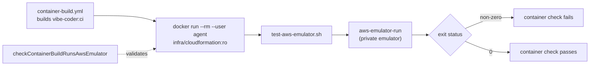

# PR Summary — Issue #5110

## Summary

PR #5276 (merged) moved VibeCoder's CloudFormation CI to the official AWS
Emulator. This PR covers what #5110 still needed:

- **A fresh worker container runs the reference command as `agent`.** The
  required `container` check in `.github/workflows/container-build.yml` now
  starts a fresh container from the image it has just built and runs
  `infra/cloudformation/test-aws-emulator.sh` there as `agent`, using
  `docker run --rm --user agent`, with `infra/cloudformation` mounted read-only
  and the script as the entrypoint. Its exit status fails the check. The step
  runs whenever that job builds the image: on a pull request with an
  image-affecting change, on the weekly schedule, or on a manual run. This PR
  changes `container-build.yml`, so its own CI runs the step.
- **The container step has a validator.**
  `checkContainerBuildRunsAwsEmulator` in
  `worker/deno/lib/aws_emulator_workflow_check.ts` (`[container-agent-run]`)
  requires a step in job `container` that is only `set -euo pipefail` plus one
  `docker run`. It parses that `docker run` positionally and fails closed:
  - the image must be `${IMAGE}`, and only `< /dev/null` may follow it;
  - the last `--user` must be `agent`, and the last `--entrypoint` must end in
    `/test-aws-emulator.sh`;
  - the `infra/cloudformation` mount must end in `:ro`;
  - the job and the step must not set `continue-on-error`; the job must have no
    `if:`, and the step's `if:` must be absent or `env.IMAGE_CHANGED == 'true'`;
  - the effective shell must run the body.
- **Syntax-only shells are refused (PR #5276 review).** `checkAwsEmulatorWorkflow`
  now checks the test step's effective shell: the step's `shell:`, else the
  job's, else the workflow's `defaults.run.shell`. The shell must be unset, or
  `bash`/`sh` with only `--noprofile`, `--norc`, `-e`/`-u`/`-x`/`-o <name>`
  options and an optional `{0}`. Before this change, `bash -n {0}`,
  `bash -o noexec {0}`, `bash -c true {0}` and `true {0}` all passed without
  running the deploy.

Part of #5110.

## Spec

### Intent and Rationale

- No container runtime exists on the worker host. The only place a fresh worker
  container can run the command is the CI job that already builds the image, so
  the run lives there rather than in a new workflow (issue Scope 8: reuse current
  CI mechanisms).
- The validator allowlists shells and `docker run` arguments rather than
  blocklisting them. A new evasion form then fails closed instead of passing.

### Essential Design Decisions

- The agent run is gated on `IMAGE_CHANGED`, the job's existing image gate.
  A PR that changes only the templates or the script is still covered on every
  PR by `aws-emulator.yml`, on the runner.
- The container mount is read-only. The script reads templates from its own
  directory and writes only under `mktemp` and `aws-emulator-run`'s private HOME
  (`infra/cloudformation/test-aws-emulator.sh:39`, `:101`;
  `container/aws-emulator-run.sh:302`).
- `defaultShell` is exported from `worker/deno/lib/aws_emulator_in_ci_check.ts`
  and reused, not copied.

### Undiscoverable Facts

- PR #5276's CI run (job 136009596629) shows the runner path working: 22
  assertions passed, one named gap (`AWS::EC2::Instance` `MetadataOptions`),
  `ParameterNotFound` as the negative case, and cleanup asserted.
- On PR #5276, `container-build / container` passed in 4 s without building,
  because that PR had no image-affecting change. The new step has therefore not
  run anywhere until this PR's CI.
- The fleet reviewer's comment on #5110 reported the `bash -n {0}` gap and
  attributed it to this issue.

## Evidence

Backend and CI only. No UI file is touched.

- `cd worker/deno && deno task test:unit tests/issue_5110_aws_emulator_workflow_test.ts tests/aws_emulator_in_ci_check_test.ts < /dev/null`:
  241 passed, 0 failed.
- A corpus run over every `.github/workflows/*.yml` at the head:
  - `checkContainerBuildRunsAwsEmulator` returns `[]` only for
    `container-build.yml`;
  - `checkAwsEmulatorWorkflow` returns `[]` only for `aws-emulator.yml`;
  - every other workflow gets findings from both;
  - false positives 0, false negatives 0.
- Issue numbers cited: #5110 (CI: migrate VibeCoder's AWS tests to AWS Emulator
  and record real coverage gaps); #5276 (the earlier, merged PR for this issue).

## Acceptance Criteria

<!-- vibe-spec-review inputs="diff+issue-body" -->

- **partial** — A fresh worker container runs the reference command as `agent`,
  and CI runs the same applicable integration checks. — evidence:
  `.github/workflows/container-build.yml` ("Run the AWS Emulator reference
  command as agent in a fresh container"), held by
  `worker/deno/tests/issue_5110_aws_emulator_workflow_test.ts::real container-build.yml runs the reference command as agent`;
  `aws-emulator.yml` ran in PR #5276's CI — reviewer: partial — reason: CI not
  yet verified — remaining: merge-verification-only (the step first runs in this
  PR's `container` check)
- **partial** — Evidence includes the pinned release, actual test commands,
  successful data assertions, a supported negative API result and cleanup. —
  evidence: PR #5276 CI job 136009596629 (runner path) — reviewer: partial —
  reason: CI not yet verified — remaining: merge-verification-only (the
  fresh-container run's output comes from this PR's `container` check)
- **met** — Focused tests prove startup/test failures propagate and missing
  required execution cannot become a green check. — evidence:
  `worker/deno/tests/issue_5110_aws_emulator_workflow_test.ts` (shell refusals
  `bash -n`, `-o noexec`, `-c`, `-s`, `--version`, `true {0}`, `python {0}` at
  step, job and workflow level; container refusals for a second `--entrypoint`
  or `--user`, a different image, a missing `:ro`, `set +e`, a commented-out
  or `echo` line, `! `, `|| true`, an extra argument, `if:` and
  `continue-on-error` at job and step level, and a removed step) — reviewer:
  partial — reason: the reviewer found the `-c`, repeated-flag and image
  evasions at the earlier head 461e1cfa6; each is refused and tested at
  8005e1c03
- **met** — Every existing template is accounted for as exercised or as a
  specific unsupported case with alternative validation; no unsupported/stubbed
  resource is reported as proven. — evidence:
  `infra/cloudformation/test-aws-emulator.sh` (`KNOWN_GAPS`, from PR #5276) —
  reviewer: met
- **met** — Any retained Floci test names the exact gap and removal/recheck
  condition. — evidence: no Floci test is retained (removed in PR #5276) —
  reviewer: met
- **met** — Existing branch/PR coverage, least-privilege permissions and
  required checks remain intact. CI actually runs the new command rather than
  merely installing the emulator. — evidence:
  `.github/workflows/aws-emulator.yml` in PR #5276's CI, which ran the command;
  the new step adds no permission — reviewer: met
- **partial** — Required local/CI checks pass; no automatic mutation or fuzzing
  campaign is added. — evidence: `./quality.sh` (Test Plan); no campaign added
  — reviewer: partial — reason: CI not yet verified — remaining:
  merge-verification-only
- **unrequested** — `defaultShell` is exported from
  `worker/deno/lib/aws_emulator_in_ci_check.ts` — reviewer: unrequested —
  reason: it is reused by the effective-shell check rather than copied

## Standards Review

<!-- vibe-standards-review inputs="diff+CODING-STANDARDS.md" -->

- **violation** — Writing a gate over text: `bash -c true {0}` passed the shell
  check — evidence: `worker/deno/lib/aws_emulator_workflow_check.ts:189` —
  reason: fixed in this diff (allowlist `shellRunsBody`, with tests)
- **violation** — Writing a gate over text: one matching segment was enough, so
  a `set +e` line passed — evidence:
  `worker/deno/lib/aws_emulator_workflow_check.ts:394` — reason: fixed in this
  diff (`stepIsAgentRun` requires only `set -euo pipefail` and the one
  `docker run`)
- **violation** — Workflow behaviour change extends the validator: the image,
  the last `--user` and the `:ro` mount were not checked — evidence:
  `worker/deno/lib/aws_emulator_workflow_check.ts:364` — reason: fixed in this
  diff (positional parse, with tests)
- **violation** — Evasion table both ways: commented-out, `\`-wrapped,
  `--user=agent`, `set +e`, different-image, `bash -c` and `echo` look-alike
  cases had no test — evidence:
  `worker/deno/tests/issue_5110_aws_emulator_workflow_test.ts:529` — reason:
  fixed in this diff
- **clean** — These areas were checked and comply:
  - both checks read parsed YAML, and full-line comments and `\` continuations
    are handled;
  - a step with `|`, `;` or `&` fails closed;
  - `!` and `|| true` are refused;
  - the shell precedence (step, then job, then workflow) matches GitHub;
  - the `continue-on-error` and `if:` tests;
  - `mutate` became `mutateText` and keeps the exactly-once anchor check.

  Review-only rules checked: the evasion table, no source-grep tests, no
  test-only members, and Australian English.

## Test Plan

- Added to `worker/deno/tests/issue_5110_aws_emulator_workflow_test.ts`:
  - the effective-shell refusals and controls for `aws-emulator.yml`;
  - the real `container-build.yml` positive case;
  - the `[container-agent-run]` refusal table and its controls (`-u agent`,
    `--user=agent`, a `\` re-wrap);
  - the job-level refusals;
  - the removed-step case;
  - the malformed-input case.
- No existing assertion was removed or changed. `mutate` now delegates to
  `mutateText(base, ...)` and keeps the exactly-once anchor check.
- A red run against base was not observed. The new container tests import a
  function that base lacks, so the file cannot load there. The fleet reviewer
  showed by direct call that base `checkAwsEmulatorWorkflow` returns `[]` for a
  `bash -n {0}` test step.
- `./quality.sh < /dev/null` on f10167677: `Result: PASSED (with skipped
  checks)`; `config integration` and `checkov` were skipped by the gate itself.
  An earlier run on 8005e1c03 failed one test,
  `worker/deno/tests/pr_summary_ci_workflow_3768_test.ts`, on this host's
  offline npm cache ("Failed caching npm package 'commonmark@0.31.2' ... dns
  error"); it passed after that cache was seeded, with no code change.
- Twinned-rule search: `checkAwsEmulatorWorkflow` and the fleet detector
  `workflowRunsAwsEmulator` both judge shells. The detector keeps its own
  `shellIsNoexec` blocklist and is unchanged.

## Not done or not checked

- The new container step has not run yet. Its first run is this PR's
  `container` check.
- On this host, the push gate's `DENO_DIR=/opt/deno-seed` lacks `commonmark`'s
  npm packages and is read-only, so the worker's pre-push gate blocks with
  "Failed caching npm package 'mdurl@1.0.1'". This is a worker environment
  fault, not a fault in this change.
