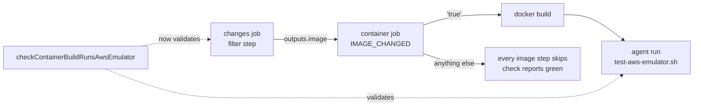

# PR Summary — Issue #5110

## Summary

PRs #5276 and #5288 (both merged) moved VibeCoder's CloudFormation tests to
the official AWS Emulator. They also added a step to the required `container`
check that runs the reference command as `agent` in a fresh worker container.
#5288's own CI has now run that step (see Evidence). The evidence the earlier
summary said was still missing now exists.

This PR closes the last gap the earlier summary named in the step's
validator. `checkContainerBuildRunsAwsEmulator`
(`worker/deno/lib/aws_emulator_workflow_check.ts`) did not look at the
`changes` job that sets `IMAGE_CHANGED`. Removing `needs: changes`, making
`changes` skippable, or making its `image` output constant would skip every
image step, including the agent run, and still report the required check
green. The validator now also requires:

- job `container` to need `changes`;
- job `changes` to exist, with no `if:` or soft `continue-on-error`, and
  `outputs.image` exactly `${{ steps.filter.outputs.image }}`;
- the `filter` step to have no `if:` or soft `continue-on-error`, a shell that
  runs the body, and `BASE_SHA`/`HEAD_SHA` taken from the pull request event;
- the `filter` step's last reachable command (read with the existing
  `reachableSegments` parser) to be exactly
  `.github/scripts/detect-image-changes.sh "$BASE_SHA" "$HEAD_SHA"`;
- the `filter` step to write no `image=` value other than `image=true`.

Part of #5110.

## Spec

### Intent and Rationale

- The issue's third acceptance criterion says missing required execution must
  not become a green check. In GitHub, a skipped step or job counts as passing,
  so any edit that stops `IMAGE_CHANGED` being `true` turns the agent run into
  a silent pass. The `changes` job is where that can happen.
- The `filter` step is read with `reachableSegments` (`lib/shell_command_words.ts`),
  the parser the repo already has. It drops commands behind `true ||`, after an
  unconditional `exit`, and across `\` continuations, so a new hand-written
  reader is not needed.

### Essential Design Decisions

- The check stays a text check. Edits made on the runner (rewriting the
  checked-out script, replacing docker, an indirect `GITHUB_ENV` write)
  are still outside what it can see. `docs/EC2-LINUX-VERIFICATION.md` lists
  them.
- The fresh-container run is still gated on `IMAGE_CHANGED`. A PR that changes
  only `infra/cloudformation/**` runs the same script on the runner through
  `aws-emulator.yml`, which the required `gate` job needs. It does not get a
  fresh-container run, because that would rebuild the 11-minute image on every
  template change.

### Undiscoverable Facts

- PR #5288's CI, job 136121503571 (`container-build / container`, step "Run the
  AWS Emulator reference command as agent in a fresh container"), ran
  `docker run --rm --user agent … test-aws-emulator.sh "${IMAGE}"` and passed:
  - aws-emulator 1.0.385 was installed from the sha256-checked package;
  - `PASS: SSM round trip value = round-trip-ee67b7b250ad`;
  - `PASS: SSM get-parameter after delete: ParameterNotFound (as expected)`;
  - 10 resources had their properties checked;
  - cleanup was asserted (`ValidationError`, `NoSuchEntity`,
    `InvalidVpcID.NotFound`);
  - `all 22 assertions passed`;
  - one named gap was reported as `UNSUPPORTED (not proven)`
    (`AWS::EC2::Instance` `MetadataOptions`), with its alternative validation
    and recheck condition;
  - `[aws-emulator-run] stopped; exit 0`.
- All 23 of PR #5288's checks succeeded (2 skipped).

## Evidence

Backend and CI validator only; no UI file and no workflow file is touched.

- Tests: `worker/deno/tests/issue_5110_aws_emulator_workflow_test.ts`
  (see Test Plan).
- Issue numbers cited: #5110 (CI: migrate VibeCoder's AWS tests to AWS
  Emulator and record real coverage gaps); #5276 and #5288 (the earlier merged
  PRs for this issue, same title).

## Acceptance Criteria

<!-- vibe-spec-review inputs="diff+issue-body" -->

- **met** — A fresh worker container runs the reference command as `agent`,
  and CI runs the same applicable integration checks. — evidence:
  `.github/workflows/container-build.yml` agent-run step (PR #5288), which ran
  and passed in job 136121503571; `.github/workflows/aws-emulator.yml` on every
  PR through `gate` — reviewer: met
- **met** — Evidence includes the pinned release, actual test commands,
  successful data assertions, a supported negative API result and cleanup. —
  evidence: job 136121503571 log (quoted under Undiscoverable Facts);
  `docs/EC2-LINUX-VERIFICATION.md` — reviewer: met
- **met** — Focused tests prove startup/test failures propagate and missing
  required execution cannot become a green check. — evidence:
  `worker/deno/tests/aws_emulator_cloudformation_5110_test.ts` (startup and
  test failures exit non-zero);
  `worker/deno/tests/issue_5110_aws_emulator_workflow_test.ts` (the
  `[container-agent-run]` refusal tables, including the new `changes`-gate
  cases) — reviewer: met
- **met** — Every existing template is accounted for as exercised or as a
  specific unsupported case with alternative validation; no unsupported/stubbed
  resource is reported as proven. — evidence:
  `infra/cloudformation/test-aws-emulator.sh` `KNOWN_GAPS`;
  `worker/deno/tests/aws_emulator_cloudformation_5110_test.ts::aws-emulator-cloudformation 5110: the expected named-gap run exits 0 and reports the gap as UNSUPPORTED, never a pass`
  — reviewer: met
- **met** — Any retained Floci test names the exact gap and removal/recheck
  condition. — evidence: no Floci test of VibeCoder's AWS templates remains
  (removed in PR #5276) — reviewer: met
- **met** — Existing branch/PR coverage, least-privilege permissions and
  required checks remain intact. CI actually runs the new command rather than
  merely installing the emulator. — evidence: `.github/workflows/aws-emulator.yml`
  runs `./infra/cloudformation/test-aws-emulator.sh`; this diff changes no
  workflow — reviewer: met
- **partial** — Required local/CI checks pass; no automatic mutation or fuzzing
  campaign is added. — evidence: `./quality.sh` passed on this branch; no
  campaign added — reviewer: partial — reason: CI not yet verified —
  remaining: merge-verification-only

## Standards Review

<!-- vibe-standards-review inputs="diff+CODING-STANDARDS.md" -->

STANDARDS_REVIEW_TO_FILL

## Test Plan

TEST_PLAN_TO_FILL

## Merge verification

- CI on this head: pending.

## Not done or not checked

- The validator cannot see runner-side edits. These include a step that
  rewrites the checked-out script, replaces docker or its context, or writes
  `GITHUB_ENV` indirectly, and a retag it does not recognise.
  `docs/EC2-LINUX-VERIFICATION.md` lists them.
- A PR that changes only `infra/cloudformation/**` gets the runner path, not a
  fresh-container run (see Essential Design Decisions).
