# PR Summary — Issue #5110

## Summary

VibeCoder's CloudFormation CI now runs on the official AWS Emulator, through
#5109's `aws-emulator-run`, in place of Floci.

- **New reference command:** `infra/cloudformation/test-aws-emulator.sh`. It
  exercises real AWS CLI calls: an SSM write, read and delete round trip, and a
  supported negative case (`ParameterNotFound`). It deploys every template and
  checks the material properties of each created resource. It reports emulator
  gaps as `UNSUPPORTED (not proven)`, separately from the pass count. It then
  deletes the stack and asserts cleanup.
- **CI:** `.github/workflows/aws-emulator.yml` replaces `floci.yml`. It installs
  the pinned 1.0.385 package through the sha256-checked toolchain fragment and
  runs the script.
- **Removed:** the Floci workflow, `test-floci.sh`, the Floci validator and
  tests, and the pre-push Floci check. Each has a replacement or a stated
  reason.
- **Template defect fixed:** the emulator caught a real defect in
  `linux-verification-host.yaml`. Three security-group egress descriptions
  contained an em dash, which EC2 rejects. Floci had stubbed past it.

Some criteria are still partial (see below), so this is Part of #5110.

## Spec

### Intent and Rationale

- **Floci treated stubs as success.** It stubbed unsupported resources and
  counted the deploy as a success. The emulator applies EC2 validation, which
  found the em-dash defect a real deployment would have hit.
- **Real template, no edits.** Deploying it with `--on-failure DO_NOTHING` keeps
  every supported resource alive for property checks even though one resource is
  unsupported, so no derived or trimmed template is needed.
- **The existing workflow was evolved, not paralleled.** `floci.yml` was renamed
  and rewritten as `aws-emulator.yml`, and the Floci validator was replaced by
  `aws_emulator_workflow_check.ts`.

### Essential Design Decisions

- **Named gaps are pinned.** `KNOWN_GAPS` in the script holds the expected
  failure reason for each gap. A gap that stops reproducing, or fails
  differently, fails the run with `gap changed: update KNOWN_GAPS`.
- **No status-only pass.** A template with no property-check function fails the
  run, so a new template cannot pass on stack status alone.
- **The pre-push gate does not run the check.** The gate runs as `vibe`, which
  `aws-emulator-run` always refuses (#5109), so the Floci pre-push check was
  removed with no emulator replacement. CI is the enforcing gate. Locally the
  command runs as `agent` or any other non-root, non-`vibe` account.
- **No push trigger.** The fleet's `workflow-triggers` rule forbids test
  workflows on push to the default branch, so the workflow runs on
  `pull_request` (Develop, main, `milestone/*`) and `workflow_dispatch`.
- **The fleet emulator detector also accepts the official emulator.** With
  `floci.yml` gone, the best-practices `BP-AWS-EMULATOR-MISSING` pre-filer would
  otherwise flag VibeCoder itself. A `run:` step invoking `aws-emulator-run` or
  the pinned install fragment now counts as an emulator in CI. The finding's own
  text and the Floci-to-emulator migration of other repos stay with #5112.

### Undiscoverable Facts

- **`AWS::EC2::Instance` is unsupported on aws-emulator 1.0.385.** Its
  `MetadataOptions` property is rejected with "this emulator does not apply the
  MetadataOptions property of AWS::EC2::Instance". Observed at run time; it is a
  named gap.
- **The public AMI parameter cannot be seeded.** The emulator refuses
  `put-parameter` under `/aws/...` (`ParameterPatternMismatchException`). The
  script instead seeds a user-owned parameter and passes its name, which still
  exercises SSM-typed parameter resolution (`ResolvedValue` is asserted).
- **Floci stays installed in the image,** but no VibeCoder test uses it.

## Evidence

The real run used aws-emulator 1.0.385 and aws-cli 2.40.3 on aarch64. It ran as
`vibe` through a scratch copy of `aws-emulator-run`, with only the `vibe`
refusal lifted. The installed helper refuses `vibe`, and `sudo` to `agent` needs
a password here. Command:
`aws-emulator-run --timeout 450 -- infra/cloudformation/test-aws-emulator.sh`.
It exited 0:

```text
PASS: SSM round trip value = round-trip-46780e87ee0d
PASS: SSM get-parameter after delete: ParameterNotFound (as expected)
PASS: seeded SSM parameter /vibe-coder-test/ubuntu-ami-id-46780e87ee0d for AWS::EC2::Image::Id
UNSUPPORTED (gap reproduced, not proven): VerificationHost CREATE_FAILED (this emulator does not apply the MetadataOptions property of AWS::EC2::Instance)
PASS: stack ... CREATE_FAILED: 10 resources CREATE_COMPLETE, 1 named gap(s)
PASS: VerificationVpc CidrBlock = 10.42.0.0/16
PASS: VerificationVpc enableDnsHostnames = True
PASS: PublicSubnet CidrBlock = 10.42.0.0/24 / VpcId / MapPublicIpOnLaunch = True
PASS: InternetGateway attachment VpcId = vpc-...; VpcGatewayAttachment State = available
PASS: PublicRouteTable 0.0.0.0/0 target = igw-...; subnet association
PASS: HostSecurityGroup inbound rule count = 0; egress = tcp 443, tcp 80, udp 53, tcp 53, udp 123 to 0.0.0.0/0
PASS: HostRole trust principal = ec2.amazonaws.com; managed policy AmazonSSMManagedInstanceCore
PASS: HostInstanceProfile role = <stack role>
PASS: stack removed: ValidationError; role removed: NoSuchEntity; VPC removed: InvalidVpcID.NotFound
PASS: SSM get-parameter after delete (seeded AMI id): ParameterNotFound (as expected)
all 22 assertions passed
exercised: 10 resources (properties checked)
UNSUPPORTED (not proven, named gaps):
  - linux-verification-host.yaml VerificationHost (AWS::EC2::Instance): ... MetadataOptions ...
      alternative validation: checkov scan; worker/deno/tests/linux_verification_host_template_test.ts (HttpTokens required); real-AWS deployment per docs/EC2-LINUX-VERIFICATION.md
      recheck: when the aws-emulator pin in container/tools.json changes, or when the gap stops reproducing
```

- **Negative proof:** a copy with a deliberately wrong gap reason exited 1 with
  `::error::gap changed: update KNOWN_GAPS: VerificationHost ...`.
- **The template defect, before the fix:**
  `HostSecurityGroup CREATE_FAILED ... Value (HTTPS — SSM endpoints, ...) for parameter description is invalid. Valid characters: a-z, A-Z, 0-9, spaces, and ._-:/()#,@[]+=&;{}!$*`.
- **Documentation:** coverage by resource and behaviour, the gap, the
  real-AWS-only items (IAM, KMS and resource policies, runtime, cross-account
  and cross-Region) and the command are in `docs/EC2-LINUX-VERIFICATION.md`. The
  Floci wording is also updated in `docs/CONTAINER.md`, `docs/CONFIGURATION.md`,
  `docs/CONTAINER-IMAGE.md`, `docs/IDLE-TASK-FRAMEWORK.md`,
  `docs/BEST-PRACTICES-SCAN.md`, `DESIGN-PRINCIPLES.md` and
  `CODING-STANDARDS.md`.
- **Issue numbers cited:**
  - #5109: Container: add the official AWS Emulator with an isolated test
    runner.
  - #5111: Standards: require AWS Emulator tests for new and changed AWS
    components.
  - #5112: Best practices: require real AWS Emulator test wiring and migrate
    Floci-only repos.

```mermaid
flowchart LR
    W["aws-emulator.yml<br/>(pull_request)"] --> I["toolchains/aws-emulator.sh<br/>pinned 1.0.385, sha256"]
    I --> S["test-aws-emulator.sh"]
    S --> R["aws-emulator-run<br/>loopback TLS, own CA"]
    R --> M["SSM round trip +<br/>ParameterNotFound"]
    M --> D["deploy template<br/>--on-failure DO_NOTHING"]
    D --> P["property checks"]
    P --> G["UNSUPPORTED gaps<br/>(not counted)"]
    G --> C["delete + cleanup asserts"]
```



## Acceptance Criteria

<!-- vibe-spec-review inputs="diff+issue-body" -->

- **partial** — A fresh worker container runs the reference command as `agent`,
  and CI runs the same applicable integration checks. — evidence:
  `.github/workflows/aws-emulator.yml`,
  `worker/deno/tests/aws_emulator_cloudformation_5110_test.ts` — reviewer:
  partial — reason: not run as `agent` in a fresh container (the real run used a
  scratch helper as `vibe`); CI's `aws` CLI comes from the runner image, not the
  pinned fragment; CI not yet verified
- **met** — Evidence includes the pinned release, actual test commands,
  successful data assertions, a supported negative API result and cleanup. —
  evidence: the real-run output above;
  `infra/cloudformation/test-aws-emulator.sh` — reviewer: partial — reason: the
  reviewer's gap, that the seeded AMI parameter's removal was not asserted, is
  fixed: removal is now asserted and also attempted on early exit
- **partial** — Focused tests prove startup/test failures propagate and missing
  required execution cannot become a green check. — evidence:
  `worker/deno/tests/aws_emulator_cloudformation_5110_test.ts`,
  `worker/deno/tests/issue_5110_aws_emulator_workflow_test.ts` — reviewer:
  partial — reason: a failing data assertion now has a focused test
  (`an aws
  CLI that succeeds with no data fails the run on its first data assertion`,
  exit 1, no PASS), added in the gate retry and not yet re-reviewed; a failed
  cleanup and a template with no property checks still have no focused test;
  "gap changed" was proven only by a manual run
- **met** — Every existing template is accounted for as exercised or as a
  specific unsupported case with alternative validation; no unsupported/stubbed
  resource is reported as proven. — evidence:
  `infra/cloudformation/test-aws-emulator.sh` (KNOWN_GAPS, UNSUPPORTED block),
  `docs/EC2-LINUX-VERIFICATION.md` — reviewer: partial — reason: the reviewer
  found the internet gateway and attachment claimed as property-checked without
  a check, and gaps counted as PASS; both are fixed (attachment VpcId and State
  are asserted; gaps are not counted)
- **met** — Any retained Floci test names the exact gap and removal/recheck
  condition. — evidence: no Floci test is retained
  (`worker/deno/tests/issue_3369_floci_script_test.ts` and
  `worker/deno/tests/issue_3369_floci_workflow_test.ts` are removed) — reviewer:
  met
- **partial** — Existing branch/PR coverage, least-privilege permissions and
  required checks remain intact. CI actually runs the new command rather than
  merely installing the emulator. — evidence:
  `.github/workflows/aws-emulator.yml`,
  `worker/deno/lib/aws_emulator_workflow_check.ts` — reviewer: partial — reason:
  the push trigger on Develop/main was dropped under the fleet
  `workflow-triggers` rule; the check name changed ("Floci" does not appear in
  `infra/rulesets`); CI not yet verified
- **partial** — Required local/CI checks pass; no automatic mutation or fuzzing
  campaign is added. — evidence: `./quality.sh` (see Test Plan) — reviewer:
  missing — reason: the reviewer could not judge it from the diff; no mutation
  or fuzzing is added; CI not yet verified
- **unrequested** — `BP-AWS-EMULATOR-MISSING` detector
  (`worker/deno/lib/aws_emulator_in_ci_check.ts`) also accepts the official AWS
  Emulator — reviewer: unrequested — reason: without it, removing `floci.yml`
  would make the fleet audit flag VibeCoder itself; the finding text and repo
  migration stay with #5112
- **unrequested** — em-dash fix in
  `infra/cloudformation/linux-verification-host.yaml` — reviewer: unrequested —
  reason: a real template defect the emulator caught, and the stack cannot
  deploy without the fix
- **unrequested** — `docs/audits/lib-sweep-coverage/top-up-3369.json` path
  update — reviewer: unrequested — reason: mechanical follow-through of
  replacing `floci_workflow_check.ts`

## Standards Review

<!-- vibe-standards-review inputs="diff+CODING-STANDARDS.md" -->

- **violation** — An edited expectation must still go red without its guard —
  evidence: `worker/deno/tests/pre_push_gate_test.ts:1992` — reason: fixed in
  this diff (the fixture now tracks `test-floci.sh`; observed red against base
  `pre_push_gate.ts`, with a markdownlint positive control)
- **violation** — A workflow behaviour change extends the validator with a
  negative test per invariant — evidence:
  `worker/deno/lib/aws_emulator_workflow_check.ts:48` — reason: fixed in this
  diff (negative tests for `infra/cloudformation/**`, the workflow and the
  fragment paths)
- **violation** — Record unsupported operations as coverage gaps, never passes —
  evidence: `infra/cloudformation/test-aws-emulator.sh:392` — reason: fixed in
  this diff (an uncounted `UNSUPPORTED (gap reproduced, not proven)` line)
- **violation** — Doc claims must match head code (seeded parameter removal
  asserted) — evidence: `infra/cloudformation/test-aws-emulator.sh:26` — reason:
  fixed in this diff
- **violation** — Detector migration is owned by #5112 — evidence:
  `worker/deno/lib/aws_emulator_in_ci_check.ts:569` — reason: required by #5110
  (removing `floci.yml` would otherwise make the detector flag VibeCoder); the
  finding text and repo migration are left to #5112
- **violation** — Doc comments outside the diff go stale — evidence:
  `worker/deno/lib/idle_task_templates/best_practices_template.ts:36` — reason:
  fixed in this diff (also `docs/IDLE-TASK-FRAMEWORK.md`,
  `docs/CONTAINER-IMAGE.md`, `CODING-STANDARDS.md`)
- **clean** — Action SHA pins, `contents: read`, `persist-credentials: false`,
  no fallback to real AWS (loopback-HTTPS and CA refusal), exit statuses
  preserved, failure-reason tests assert the quoted cause, named tests exist,
  Floci references removed outside the archive and audits. The reviewer found no
  review-only rules to check.

## Test Plan

- Added `worker/deno/tests/aws_emulator_cloudformation_5110_test.ts`. It covers:
  - the missing runner (exit 4);
  - a re-exec under `aws-emulator-run`, with its exit status passed through;
  - refusal of a non-loopback endpoint, plus an allowed control that reaches the
    next check;
  - a missing `aws`;
  - a 501 reported as `UNSUPPORTED OPERATION`;
  - an unexpected failure that quotes its cause;
  - a real end-to-end case, ignored for `vibe` and root.

  Result: 6 passed, 1 ignored.
- Added `worker/deno/tests/issue_5110_aws_emulator_workflow_test.ts`: the real
  workflow has no findings, and there is a mutation per invariant. Result: 24
  passed.
- Extended `worker/deno/tests/aws_emulator_in_ci_check_test.ts` with positive
  cases, look-alike negatives and the real workflow. Result: 55 passed.
- `worker/deno/tests/pre_push_gate_test.ts`: removed the five Floci tests and
  added "a changed CloudFormation template plans no cloudformation check". It
  was red against the base `pre_push_gate.ts` and passes at the head.
  - Removed from worker/deno/tests/pre_push_gate_test.ts:
    `assertEquals(flociChecks, [{ label: FLOCI_CHECK, cwd: "/repo", command: FLOCI_COMMAND }])`
    - Removed functionality: the pre-push Floci check (`FLOCI_TEST_SCRIPT` and
      the planning block are deleted from `worker/deno/lib/pre_push_gate.ts`;
      `test-floci.sh` no longer exists)
  - Removed from worker/deno/tests/pre_push_gate_test.ts:
    `assertEquals(blocked.error.command, FLOCI_COMMAND)`
    - Removed functionality: as above; the push-blocking role now belongs to the
      required CI workflow `aws-emulator.yml`
- Removed `worker/deno/tests/issue_3369_floci_script_test.ts` and
  `worker/deno/tests/issue_3369_floci_workflow_test.ts`.
  - Removed functionality: `infra/cloudformation/test-floci.sh`,
    `.github/workflows/floci.yml` and `worker/deno/lib/floci_workflow_check.ts`
    are deleted. Still covered by:
    `worker/deno/tests/issue_5110_aws_emulator_workflow_test.ts::the real workflow passes`
    and `worker/deno/tests/aws_emulator_cloudformation_5110_test.ts`.
- `worker/deno/tests/supply_chain_gate_test.ts`: passes after regenerating
  `docs/audits/dependency-inventory.md`.
- The real emulator run is in Evidence.
- `./quality.sh` ran twice. Every stage passed except `deno tests`
  (`config integration` and `checkov` were skipped).
  - First run: two failures. The stale dependency inventory is fixed.
  - Second run: 35117 passed, 2 failed.
    `worker/deno/tests/best_practices_template_test.ts` ("AWS-emulator pre-check
    skips filing and logs why") expected "floci" in the log line. The log line
    is fixed and the test now passes when run on its own.
  - Both runs: `worker/deno/tests/pr_summary_ci_workflow_3768_test.ts` failed
    with `dns error: failed to lookup address information` fetching
    `registry.npmjs.org`. This is an environmental network fault, not this
    change.
  - The full gate was not re-run after the log fix, for lack of run budget.

<!-- vibe-quality-gate-skipped reason="final full re-run skipped for budget after a one-line log-string fix; the affected test passes when run on its own; the remaining failure is a DNS fault fetching npm" -->

Not done: the script was not run as `agent` in a fresh container. CI has not run
on this branch yet. CI's `aws` CLI is not pinned to the container's 2.40.3.
