# PR Summary — Issue #5110

## Summary

VibeCoder's CloudFormation CI now runs on the official AWS Emulator, through
#5109's `aws-emulator-run`, in place of Floci.

- **Reference command:** `infra/cloudformation/test-aws-emulator.sh`. It makes
  real AWS CLI calls: an SSM write, read and delete round trip, and a supported
  negative case (`ParameterNotFound`). It deploys every template and checks the
  material properties of each created resource. It reports emulator gaps as
  `UNSUPPORTED (not proven)`, apart from the pass count. It then deletes the
  stack and asserts the cleanup.
- **CI:** `.github/workflows/aws-emulator.yml` replaces `floci.yml`. It installs
  the pinned 1.0.385 package through the sha256-checked toolchain fragment and
  runs the script.
- **Removed:** the Floci workflow, `test-floci.sh`, the Floci workflow validator
  and the two `issue_3369_floci_*` test files. The pre-push gate's Floci planner
  stays for repositories that still track `test-floci.sh`. VibeCoder no longer
  does, so it never fires here.
- **Template defect fixed:** the emulator caught a real defect in
  `linux-verification-host.yaml`. Three security-group egress descriptions
  contained an em dash, which EC2 rejects. Floci had stubbed past it.
- **Fleet detector:** `BP-AWS-EMULATOR-MISSING` also accepts a workflow that
  runs `aws-emulator-run`, directly or through a repository script, so VibeCoder
  does not flag itself once `floci.yml` is gone.

Some criteria are still partial (see below), so this is Part of #5110.

## Spec

### Intent and Rationale

- **Floci treated stubs as success.** It stubbed unsupported resources and
  counted the deploy as passed. The emulator applies EC2 validation, which found
  the em-dash defect a real deployment would have hit.
- **The real template, unedited.** Deploying with `--on-failure DO_NOTHING`
  keeps every supported resource alive for property checks even though one
  resource is unsupported, so no trimmed copy of the template is needed.
- **The existing workflow was evolved, not paralleled.** `floci.yml` became
  `aws-emulator.yml`, and the Floci validator became
  `aws_emulator_workflow_check.ts`.

### Essential Design Decisions

- **Named gaps are pinned.** `KNOWN_GAPS` in the script holds each gap's
  expected failure reason. A gap that stops reproducing, or fails another way,
  fails the run with `gap changed: update KNOWN_GAPS`. A template with no
  property-check function fails before any AWS call, so stack status alone
  never passes a template.
- **The pre-push gate does not run the emulator test.** The gate runs as
  `vibe`, which `aws-emulator-run` always refuses (#5109). CI is the enforcing
  gate. Locally the command runs as `agent` or any other non-root account that
  is not `vibe`. The Floci planner is kept because the gate serves the whole
  fleet, and removing it would drop a check from repositories that still track
  `test-floci.sh`.
- **No push trigger.** The fleet's `workflow-triggers` rule forbids test
  workflows on push to the default branch. The workflow runs on `pull_request`
  (Develop, main, `milestone/*`) and `workflow_dispatch`.
- **The detector counts invocation, not installation.** A `run:` command word,
  after shell keywords, `sudo`/`env`/`exec`, `VAR=value` and the
  `time`/`nice`/`timeout`/`command` wrappers, must be `aws-emulator-run`. A
  repository script one level down also counts. An install step, `echo` or
  `command -v` does not. An unreadable referenced script rejects the check
  rather than reading as "no emulator". The finding text and migrating other
  repositories stay with #5112.

### Undiscoverable Facts

- **`AWS::EC2::Instance` is unsupported on aws-emulator 1.0.385.** The emulator
  rejects its `MetadataOptions` property with "this emulator does not apply the
  MetadataOptions property of AWS::EC2::Instance". This was observed at run time
  and is a named gap.
- **The public AMI parameter cannot be seeded.** The emulator refuses
  `put-parameter` under `/aws/...` (`ParameterPatternMismatchException`). The
  script seeds a user-owned parameter and passes its name instead, then deletes
  it and asserts the deletion.
- **Floci stays installed in the image,** but no VibeCoder test uses it.
- **The repo's shell splitters do not fit the detector.**
  `ci_install_pin_scanner.ts` `splitCommands`/`shellTokens` do not split on
  newlines. They drop a word that unquotes to `#`, and they treat `command -v`
  as a wrapper. The detector therefore keeps its own `shellSegments`.

## Evidence

The real run used aws-emulator 1.0.385 and aws-cli 2.40.3 on aarch64, on the
script before this run's review fixes. Those fixes changed only test files,
comments and one marker line, not the script's logic. It ran as `vibe` through a
scratch copy of `aws-emulator-run` with only the `vibe` refusal lifted. The
installed helper refuses `vibe`, and `sudo` to `agent` needs a password here.
The command was
`aws-emulator-run --timeout 450 -- infra/cloudformation/test-aws-emulator.sh`,
and it exited 0:

```text
PASS: SSM round trip value = round-trip-46780e87ee0d
PASS: SSM get-parameter after delete: ParameterNotFound (as expected)
PASS: seeded SSM parameter /vibe-coder-test/ubuntu-ami-id-46780e87ee0d for AWS::EC2::Image::Id
UNSUPPORTED (gap reproduced, not proven): VerificationHost CREATE_FAILED (this emulator does not apply the MetadataOptions property of AWS::EC2::Instance)
PASS: stack ... CREATE_FAILED: 10 resources CREATE_COMPLETE, 1 named gap(s)
PASS: VerificationVpc CidrBlock = 10.42.0.0/16
PASS: VerificationVpc enableDnsHostnames = True
PASS: PublicSubnet CidrBlock = 10.42.0.0/24 / VpcId / MapPublicIpOnLaunch = True
PASS: InternetGateway attachment VpcId = vpc-...; VpcGatewayAttachment State = available
PASS: PublicRouteTable 0.0.0.0/0 target = igw-...; subnet association
PASS: HostSecurityGroup inbound rule count = 0; egress = tcp 443, tcp 80, udp 53, tcp 53, udp 123 to 0.0.0.0/0
PASS: HostRole trust principal = ec2.amazonaws.com; managed policy AmazonSSMManagedInstanceCore
PASS: HostInstanceProfile role = <stack role>
PASS: stack removed: ValidationError; role removed: NoSuchEntity; VPC removed: InvalidVpcID.NotFound
PASS: SSM get-parameter after delete (seeded AMI id): ParameterNotFound (as expected)
all 22 assertions passed
exercised: 10 resources (properties checked)
UNSUPPORTED (not proven, named gaps):
  - linux-verification-host.yaml VerificationHost (AWS::EC2::Instance): ... MetadataOptions ...
      alternative validation: checkov scan; worker/deno/tests/linux_verification_host_template_test.ts (HttpTokens required); real-AWS deployment per docs/EC2-LINUX-VERIFICATION.md
      recheck: when the aws-emulator pin in container/tools.json changes, or when the gap stops reproducing
```

- **The template defect, before the fix:**
  `HostSecurityGroup CREATE_FAILED ... Value (HTTPS — SSM endpoints, ...) for parameter description is invalid. Valid characters: a-z, A-Z, 0-9, spaces, and ._-:/()#,@[]+=&;{}!$*`.
- **Detector corpus run** (`workflowRunsAwsEmulator` with the repository script
  reader over every `.github/workflows/*.yml`):
  - At the head: `aws-emulator.yml` is true and the other 14 workflows are false.
  - On `origin/main`: all 15 are false, `floci.yml` included. That workflow
    counted through the separate Floci rule, not this one.
  - No false positives or false negatives.
- **Documentation:**
  - `docs/EC2-LINUX-VERIFICATION.md` has the coverage by resource and
    behaviour, the gap, the command, and the items left to real AWS: IAM, KMS
    and resource policies, runtime, cross-account and cross-Region.
  - The Floci and detector wording is updated in `docs/CONTAINER.md`,
    `docs/CONFIGURATION.md`, `docs/CONTAINER-IMAGE.md`,
    `docs/IDLE-TASK-FRAMEWORK.md`, `docs/BEST-PRACTICES-SCAN.md`,
    `DESIGN-PRINCIPLES.md` and `CODING-STANDARDS.md`.
- **Issue numbers the diff cites:**
  - #3367: Install a digest-pinned native floci binary in the worker container.
  - #3369: Add a Floci CI job for VibeCoder's own CloudFormation template.
  - #3478: Add a Floci CI job for VibeCoder's own CloudFormation template
    (#3369).
  - #3727: Pre-PR gate: run the Floci CloudFormation deploy test locally for
    infra changes.
  - #5109: Container: add the official AWS Emulator with an isolated test
    runner.
  - #5111: Standards: require AWS Emulator tests for new and changed AWS
    components.
  - #5112: Best practices: require real AWS Emulator test wiring and migrate
    Floci-only repos.

```mermaid
flowchart LR
    W["aws-emulator.yml<br/>(pull_request)"] --> I["toolchains/aws-emulator.sh<br/>pinned 1.0.385, sha256"]
    I --> S["test-aws-emulator.sh"]
    S --> R["aws-emulator-run<br/>loopback TLS, own CA"]
    R --> M["SSM round trip +<br/>ParameterNotFound"]
    M --> D["deploy template<br/>--on-failure DO_NOTHING"]
    D --> P["property checks"]
    P --> G["UNSUPPORTED gaps<br/>(not counted)"]
    G --> C["delete + cleanup asserts"]
```



## Acceptance Criteria

<!-- vibe-spec-review inputs="diff+issue-body" -->

- **partial** — A fresh worker container runs the reference command as `agent`,
  and CI runs the same applicable integration checks. — evidence:
  `.github/workflows/aws-emulator.yml`,
  `infra/cloudformation/test-aws-emulator.sh` — reviewer: partial — reason: not
  run as `agent` in a fresh container (the real run used a scratch helper as
  `vibe`); CI's `aws` CLI comes from the runner image, not the pinned 2.40.3; CI
  not yet verified
- **met** — Evidence includes the pinned release, actual test commands,
  successful data assertions, a supported negative API result and cleanup. —
  evidence: the real-run output above; `infra/cloudformation/test-aws-emulator.sh`
  — reviewer: met
- **partial** — Focused tests prove startup/test failures propagate and missing
  required execution cannot become a green check. — evidence:
  `worker/deno/tests/aws_emulator_cloudformation_5110_test.ts`,
  `worker/deno/tests/issue_5110_aws_emulator_workflow_test.ts` — reviewer:
  partial — reason: the failure paths are tested, but `aws-emulator.yml` is
  path-filtered and is not a need of the required `gate` check, so a red or
  missing run can sit beside a green required check
- **met** — Every existing template is accounted for as exercised or as a
  specific unsupported case with alternative validation; no unsupported/stubbed
  resource is reported as proven. — evidence:
  `infra/cloudformation/test-aws-emulator.sh` (`KNOWN_GAPS`, UNSUPPORTED block,
  no-property-checks refusal), `docs/EC2-LINUX-VERIFICATION.md` — reviewer: met
- **met** — Any retained Floci test names the exact gap and removal/recheck
  condition. — evidence: no VibeCoder Floci test is retained
  (`worker/deno/tests/issue_3369_floci_script_test.ts` and
  `worker/deno/tests/issue_3369_floci_workflow_test.ts` are removed); the
  pre-push Floci planner tests cover a gate feature for other repositories —
  reviewer: met
- **partial** — Existing branch/PR coverage, least-privilege permissions and
  required checks remain intact. CI actually runs the new command rather than
  merely installing the emulator. — evidence:
  `.github/workflows/aws-emulator.yml`,
  `worker/deno/lib/aws_emulator_workflow_check.ts` — reviewer: partial — reason:
  the push trigger on Develop/main was dropped under the fleet
  `workflow-triggers` rule; CI not yet verified
- **partial** — Required local/CI checks pass; no automatic mutation or fuzzing
  campaign is added. — evidence: `./quality.sh` (see Test Plan) — reviewer:
  partial — reason: no mutation or fuzzing is added; CI not yet verified; the
  local gate's one failure is a DNS fault fetching npm
- **unrequested** — `BP-AWS-EMULATOR-MISSING` detector
  (`worker/deno/lib/aws_emulator_in_ci_check.ts`) also accepts the official AWS
  Emulator — reviewer: unrequested — reason: without it, removing `floci.yml`
  would make the fleet audit flag VibeCoder itself; the finding text and repo
  migration stay with #5112
- **unrequested** — em-dash fix in
  `infra/cloudformation/linux-verification-host.yaml` — reviewer: unrequested —
  reason: a real template defect the emulator caught; the stack cannot deploy
  without it
- **unrequested** — `worker/deno/lib/pre_push_gate.ts` comments and the test
  "the AWS Emulator script is never planned" — reviewer: unrequested — reason:
  they record that the gate cannot run the emulator test as `vibe` and keep
  that absence deliberate
- **unrequested** — `docs/audits/lib-sweep-coverage/top-up-3369.json` path
  update — reviewer: unrequested — reason: mechanical follow-through of
  replacing `floci_workflow_check.ts`

## Standards Review

<!-- vibe-standards-review inputs="diff+CODING-STANDARDS.md" -->

- **violation** — PR summary must match the head — evidence:
  `docs/archive/pr-summaries/pr-summary-5110.md:17` — reason: fixed in this diff
  (rewritten against the head: the Floci planner is kept, the `ResolvedValue`
  claim is dropped, and the test names and counts are current)
- **violation** — A Code Change Owes a Docs Change (install counted as
  coverage) — evidence: `DESIGN-PRINCIPLES.md:1875` — reason: fixed in this diff
- **violation** — Integration prerequisites and doc comments must be truthful
  — evidence: `worker/deno/tests/aws_emulator_cloudformation_5110_test.ts:663`
  — reason: fixed in this diff (the comment now says the case runs only where an
  ordinary account has the emulator; CI's real run is `aws-emulator.yml`, which
  fails on a missing runtime)
- **violation** — Writing a gate over text (variants, corpus run, reuse) —
  evidence: `worker/deno/lib/aws_emulator_in_ci_check.ts:393` — reason: fixed in
  this diff (if/then, `timeout`, `time`, `nice`, `command` and quoted variants
  plus look-alikes are tested, and the corpus run is in Evidence; the in-repo
  splitters were checked and do not fit, see Undiscoverable Facts)
- **violation** — Never Fail Silently (bare `catch`) — evidence:
  `worker/deno/lib/aws_emulator_in_ci_check.ts:469` — reason: fixed in this diff
  (only `NotFound` reads as absent; any other error rejects with the path)
- **violation** — `SIMPLE-ON-PURPOSE` marker on one line — evidence:
  `infra/cloudformation/test-aws-emulator.sh:196` — reason: fixed in this diff
- **violation** — Every outcome of a branch needs a test (job-level `if:`) —
  evidence: `worker/deno/lib/aws_emulator_workflow_check.ts:189` — reason: fixed
  in this diff
- **violation** — An issue number cited as provenance is one you looked up —
  evidence: `.github/workflows/aws-emulator.yml:30` — reason: fixed in this diff
  (the unrelated #3360, #1300 and #2123 citations are removed; every remaining
  number is listed in Evidence)
- **clean** — Action SHA pins, `contents: read`, `persist-credentials: false`,
  the dropped push trigger (`workflow-triggers`), the pin from `tools.json`,
  loopback-HTTPS and CA refusals, bounded timeouts, exit-status propagation and
  the cleanup trap, gaps never counted as passes, private temp dirs, no secrets
  staged. Review-only rules checked: Australian English, dummy and "how" tests,
  refusal tests with positive controls, documentation-drift scoping, check where
  you insert, macOS shell portability, path-confinement order.

## Test Plan

- `worker/deno/tests/aws_emulator_cloudformation_5110_test.ts` (new): the
  missing runner (exit 4); the re-exec and its exit status passed through; a
  non-loopback endpoint refused, with a loopback control; a missing `aws`; a 501
  reported as `UNSUPPORTED OPERATION`; an unexpected failure quoting its cause;
  an empty `aws` response failing the first data assertion; a failed
  create-stack still cleaning up; a `ROLLBACK_COMPLETE` stack; a named gap that
  now builds; an unexpected resource status; a failed describe-stack-resources;
  the expected gap run reporting `UNSUPPORTED`; a role left behind failing the
  cleanup assertion; a template with no property checks failing before any AWS
  call, with a positive control. Result: 15 passed, 1 ignored. The ignored case
  is the real end-to-end run, which needs an ordinary account with the emulator.
  The last two tests pin current script behaviour and pass on the head by
  design.
- `worker/deno/tests/issue_5110_aws_emulator_workflow_test.ts` (new): the real
  workflow has no findings, and each invariant has a mutation, including a
  job-level `if:`. Result: 25 passed.
- `worker/deno/tests/aws_emulator_in_ci_check_test.ts` (extended, additions
  only): direct, wrapped, keyword-prefixed and quoted invocations; look-alikes
  (`echo`, `command -v`, `which`, comments, install-only); script indirection
  with `..`, absolute, `$`, symlink-out and oversized refusals; an unreadable
  script rejecting, with a readable control. Result: 80 passed.
- `worker/deno/tests/pre_push_gate_test.ts` (one test added, none removed):
  "the AWS Emulator script is never planned". It passes on the base by design,
  because it pins a deliberate absence. Result: 213 passed when run with the
  session's injected `GIT_CONFIG_*` hook variables unset. With them set, 43
  fixture pushes are refused by this session's own pre-push hook, which is an
  environmental fault.
- `worker/deno/tests/best_practices_template_test.ts`: 69 passed.
  `worker/deno/tests/supply_chain_gate_test.ts`: 43 passed.
- Removed `worker/deno/tests/issue_3369_floci_script_test.ts` and
  `worker/deno/tests/issue_3369_floci_workflow_test.ts`.
  - Removed functionality: `infra/cloudformation/test-floci.sh`,
    `.github/workflows/floci.yml` and `worker/deno/lib/floci_workflow_check.ts`
    are deleted. Still covered by:
    `worker/deno/tests/issue_5110_aws_emulator_workflow_test.ts::real aws-emulator.yml passes every check`
    and `worker/deno/tests/aws_emulator_cloudformation_5110_test.ts`.
- The real emulator run is in Evidence.
- `./quality.sh` (run with the injected `GIT_CONFIG_*` variables unset): every
  stage passed except `deno tests` (`config integration` and `checkov` were
  skipped). The parallel pass ran 35111 tests and passed them, with 2 failures:
  - `worker/deno/tests/aws_emulator_in_ci_check_test.ts` failed to load
    because `Deno.uid()` needs `--allow-sys`, which the gate does not grant. It
    is fixed (`id -u` instead), and the file now passes without `--allow-sys`:
    80 passed.
  - `worker/deno/tests/pr_summary_ci_workflow_3768_test.ts` failed with
    `dns error: failed to lookup address information` fetching
    `registry.npmjs.org`. This is an environmental network fault in this
    container, not this change.
- The gate skipped its serial pass after that failure, so the 40
  `PARALLEL_UNSAFE_TEST_FILES` were run directly: 948 passed, 0 failed, 1
  ignored.

<!-- vibe-quality-gate-skipped reason="the full gate was not re-run after the one-line Deno.uid fix; the affected file passes under the gate's permissions; the only other failure is a DNS fault fetching npm" -->

Not checked: the script was not run as `agent` in a fresh container. CI has not
run on this branch. CI's `aws` CLI is the runner's, not the pinned 2.40.3. The
detector does not skip `sudo` options (`sudo -E aws-emulator-run` is not
counted). The 43 integration suites the gate leaves to CI were not run here.
