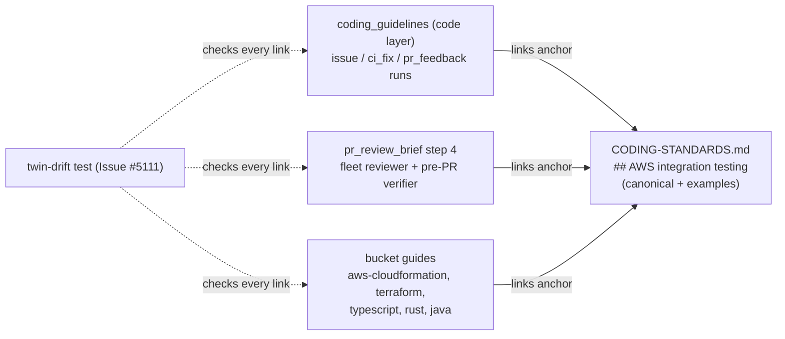

## Summary

Makes AWS Emulator the default integration-test requirement for new or changed
AWS components. The canonical **AWS integration testing** section in
`CODING-STANDARDS.md` (merged in PR #5231) gains rules for scope, isolation,
running the tests and recording gaps, plus a four-row table of worked
examples. The policy now also reaches the instructions coding agents receive
(`prompts/coding_guidelines/prompt.md`, code layer, so issue, CI-fix and
PR-feedback runs get it), the review brief (`prompts/pr_review_brief/prompt.md`,
step 4) and the AWS-relevant best-practices bucket guides. Closes #5111.

## Spec

### Intent and Rationale

- The policy text lives in one place, `CODING-STANDARDS.md`. Every other
  surface gives a short summary and links its anchor, so no template carries
  a long second copy (as the issue's "without copying a long policy into every
  template" asks).
- PR #5231's merged text is reused. Only the requirements it lacked were
  added: the worked examples, "mocks alone or an unrun suite is missing
  coverage", generic smoke tests, the quality command and CI must run the
  tests, unique per-run resources, no live AWS authority, the Rust embedded
  mode exception, no human approval round, and never downgrading a failing
  test without evidence.

### Essential Design Decisions

- The guidelines section sits in the `code` layer, before
  `## Dependency Bumps and Supply Chain`.
  `CODING_GUIDELINES_LAYER_BY_PHASE` (`worker/deno/lib/prompt_builder.ts`)
  gives that layer to `issue`, `ci_fix`, `pr_feedback` and the other
  code-writing phases.
- No detector or enforcement is described as present. Each surface words
  #5112 as "not yet: … will". The existing `BP-AWS-EMULATOR-MISSING`
  pre-filer is described as checking only that CI runs an emulator at all
  (`docs/BEST-PRACTICES-SCAN.md`, `worker/deno/lib/aws_emulator_in_ci_check.ts`).
- AWS rules in the Terraform guide apply only to modules using the AWS
  provider. The pre-filer's existing any-`.tf` trigger is named as #5112's to
  narrow (scope item 4 of #5112).
- That finding's filed text still carries the older Floci wording
  (`buildAwsEmulatorFinding()` in
  `worker/deno/lib/idle_task_templates/best_practices_template.ts`). The
  bucket guides say the canonical policy wins until #5112 rewrites it
  (#5112 scope items 5 and 8). This PR does not change that finding text,
  because #5112 owns it.

### Undiscoverable Facts

- Owner clarifications on #5111 and #5112 (17 November 2026): include AWS CLI
  scripts, keep Blocks local tests separate from SDK/CLI coverage, keep Floci
  only for documented gaps, and start emulators only from an explicitly
  invoked test command.

## Evidence

Docs and prompts only, plus one consistency test. No UI change.

Docs updated: `CODING-STANDARDS.md` (AWS integration testing),
`docs/CONTAINER-IMAGE.md` ("AWS Emulator and `aws-emulator-run`": the sentence
that called #5111 planned now says it is delivered and #5112 planned),
`prompts/best_practices/buckets/aws-cloudformation.md` (its "this guide does
not establish that they have shipped" line now says #5109 and #5110 shipped).
I grepped `README.md`, `docs/` (excluding archive) and the prompts for `5111`,
`5109 through` and `Floci`. No other live doc called this work planned.

Issue numbers the diff cites (each checked with `gh issue view` in this run):

- #5109: Container: add the official AWS Emulator with an isolated test runner
- #5110: CI: migrate VibeCoder's AWS tests to AWS Emulator and record real coverage gaps
- #5111: Standards: require AWS Emulator tests for new and changed AWS components
- #5112: Best practices: require real AWS Emulator test wiring and migrate Floci-only repos (open)

Related existing rules checked so the new rules agree with them: the
guidelines' **Testing Best Practices** discovery-campaign rule, **Human
Escalation** (no new approval gate), **Test Coverage Expectations**
(TDD sequence for a diagnosed bug), and the review brief's step 4 rule against
a discovery tax. The new text restates each one consistently. I also applied
the rule to this PR's own diff. The PR changes no AWS behaviour, so it owes
no emulator test.

## Acceptance Criteria

<!-- vibe-spec-review inputs="diff+issue-body" -->

- **met** — Human standards and effective agent/reviewer prompts agree on when AWS Emulator tests are required and what constitutes evidence. — evidence: `CODING-STANDARDS.md` (AWS integration testing), `prompts/coding_guidelines/prompt.md` (AWS Integration Testing), `prompts/pr_review_brief/prompt.md` step 4, `worker/deno/tests/coding_guidelines_layers_2574_test.ts::code phases - the union of rendered section headings is unchanged (Issue #2574)` — reviewer: met
- **met** — Examples distinguish a changed DynamoDB adapter/handler, pure calculation/UI change, unsupported API and IAM-only change. — evidence: `CODING-STANDARDS.md` worked-examples table — reviewer: met
- **met** — Supported AWS changes with mocks only or an unrun integration suite are identified as missing coverage; a valid scoped gap describes real alternative validation. — evidence: `CODING-STANDARDS.md` "Scope follows the change" and the unsupported-call row; `prompts/pr_review_brief/prompt.md` step 4 — reviewer: met
- **met** — There is no unconditional Floci mandate, broad requirement to deploy every unsupported template successfully, or claim that emulator success proves security. — evidence: `CODING-STANDARDS.md` gap paragraph; `prompts/best_practices/buckets/aws-cloudformation.md`, `terraform.md` — reviewer: met — reason: the reviewer flagged that the existing `BP-AWS-EMULATOR-MISSING` finding text still carries Floci wording; #5112 owns that text, and each bucket guide now says the canonical policy wins until #5112 rewrites it
- **met** — No unrelated test-discovery, new human approval gate or blanket test rewrite is introduced. — evidence: `CODING-STANDARDS.md` ("needs no human approval round", "Do not add unrelated test-discovery campaigns"); bucket guides ("do not file a per-module … finding here") — reviewer: met
- **met** — Relevant prompt rendering/consistency checks and Markdown checks pass; update existing checks proportionately rather than adding phrase-matching tests for every sentence. — evidence: `worker/deno/tests/coding_guidelines_layers_2574_test.ts` heading list updated; `worker/deno/tests/coding_guidelines_twin_drift_test.ts::AWS integration testing - every surface links the one canonical standards section (Issue #5111)`; the `./quality.sh` markdownlint, mermaid and deno tests stages passed — reviewer: met — reason: the reviewer could not run the checks; they were run here (see Test Plan)

## Standards Review

<!-- vibe-standards-review inputs="diff+CODING-STANDARDS.md" -->

- **violation** — Documentation-drift tests, condition 1 (section-scoped): the new link test read the review brief and the bucket guides as whole files — evidence: `worker/deno/tests/coding_guidelines_twin_drift_test.ts:466` — reason: fixed in this diff (every surface is now narrowed with `section()`, and the bucket and guidelines sections now fail on any wrong standards anchor)
- **clean** — Checked and found compliant: the live-value drift pins (the slug comes from the real heading), named tests exist, no stubs, no workflow changes, the edited heading-list expectation still goes red without the section, no assertions removed, no dummy or "how" tests, behaviour another issue delivers is not described as present (#5109 and #5110 backed by `container/aws-emulator-run.sh` and `infra/cloudformation/test-aws-emulator.sh`, and #5112 worded as planned), insertion points, the twinned rule pair, Australian English. Optional notes not chased: the guidelines bullet omits the Rust embedded-mode exception, which the standard and `rust.md` carry.

## Test Plan

- `worker/deno/tests/coding_guidelines_twin_drift_test.ts`: added the test
  "AWS integration testing - every surface links the one canonical standards
  section (Issue #5111)". It derives the anchor slug from the live
  `## AWS integration testing` heading, then checks the guidelines' AWS
  section, the review brief's Review Mode section and the five bucket guides'
  AWS sections. Each must link exactly that anchor. It is red on base: the
  guidelines heading is absent, so `section()` fails, and the review brief and
  `terraform.md` have no such link.
- `worker/deno/tests/coding_guidelines_layers_2574_test.ts`: added
  `"## AWS Integration Testing"` to `CODE_PHASE_HEADINGS_BEFORE_2574`. Nothing
  was removed. The test still asserts exact equality against the headings that
  the issue, CI-fix, PR-feedback and other code phases render. It fails if the
  section leaves the code layer or is renamed.
- `deno test` on both files: 22 passed. Bucket and brief tests
  (`tests/bucket_docs_test.ts`, `tests/best_practices_bucket_guides_consumer_test.ts`,
  `tests/pr_review_brief_shared_3395_test.ts` and three other brief tests):
  passed.
- `./quality.sh < /dev/null`: every stage up to and including `deno tests`
  (846s) and `deno lint` passed, including markdownlint, mermaid, semgrep and
  gitleaks. The run then hit my 900s outer timeout. I ran the remaining Deno
  stages directly: `deno fmt --check` over the whole tree passed (3892 files),
  and `deno check` on the two changed test files passed. These are the only
  TypeScript files this diff changes. I did not run the whole-tree
  `deno check`.
  <!-- vibe-quality-gate-skipped reason="full ./quality.sh exceeded the 900s outer timeout after deno tests and deno lint passed; deno fmt --check (whole tree) and deno check on the changed files were run separately and passed" -->

Not done or not checked: the whole-tree `deno type check` stage of the gate,
and any stage after it in the gate.

🤖 Generated with [Claude Code](https://claude.com/claude-code)
